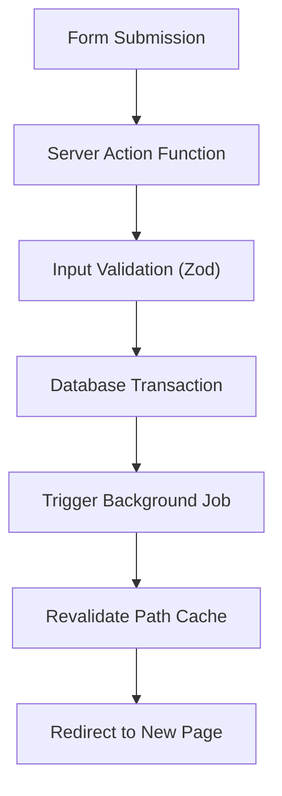
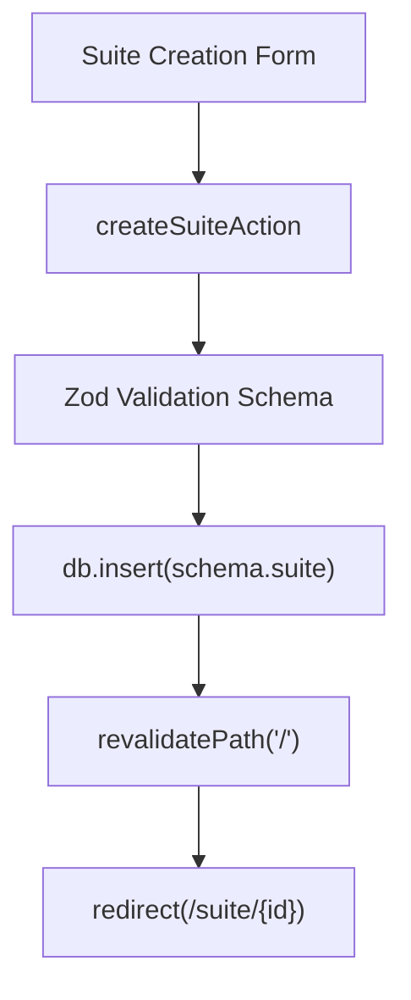
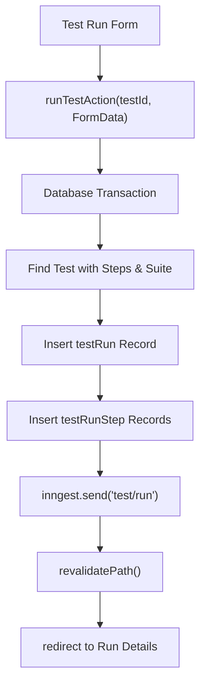
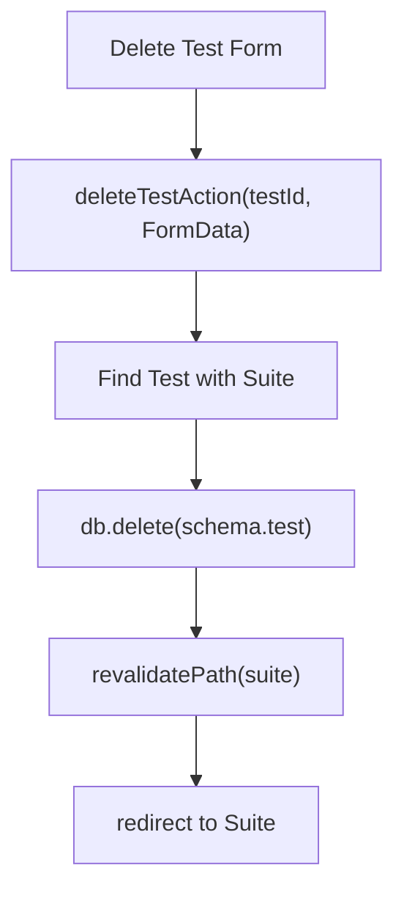
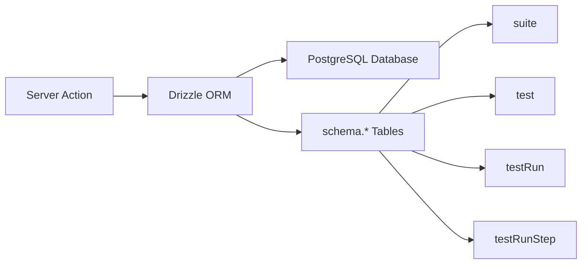
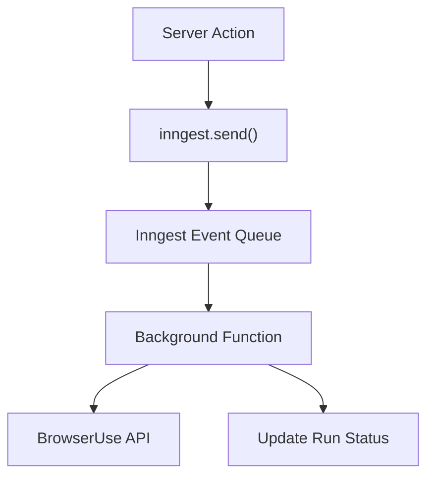
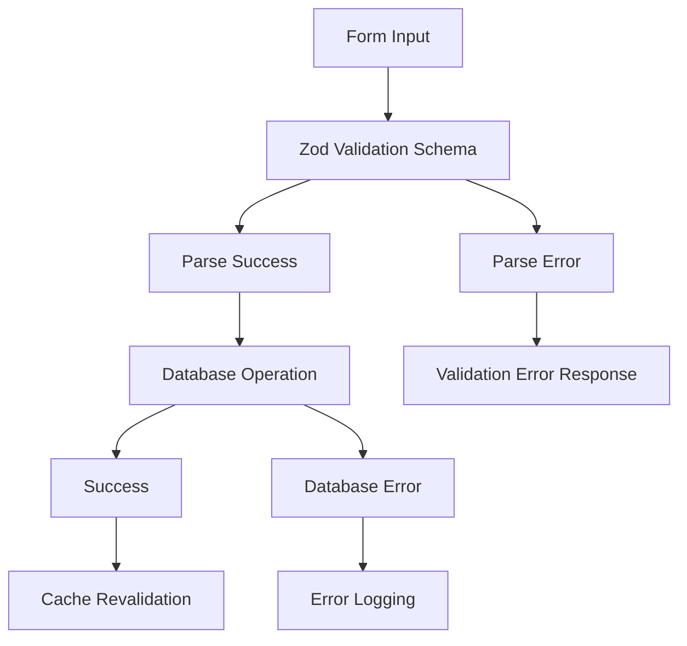

<!-- source: DeepWiki mcp.deepwiki.com · repo browser-use/qa-use · page 8 Server Actions · fetched 2026-10-30 -->

# Server Actions

Relevant source files

The following files were used as context for generating this wiki page:

- [pnpm-lock.yaml](pnpm-lock.yaml)
- [src/app/actions.ts](src/app/actions.ts)
- [src/app/api/inngest/route.ts](src/app/api/inngest/route.ts)
- [src/app/suite/[suiteId]/test/[testId]/actions.ts](src/app/suite/[suiteId]/test/[testId]/actions.ts)
- [src/components/shared/PageHeader.tsx](src/components/shared/PageHeader.tsx)
- [src/components/test/TestDetails.tsx](src/components/test/TestDetails.tsx)

This document covers the Next.js Server Actions implementation in the QA Use platform, which handle form submissions and data mutations on the server side. Server Actions provide a seamless way to perform database operations, trigger background jobs, and manage navigation flow without requiring separate API endpoints.

For information about background job processing, see [Background Processing](#6). For database schema and operations, see [Core Concepts](#3).

## Overview

Server Actions in the QA Use platform follow a consistent pattern of input validation, database operations, cache invalidation, and navigation. The platform implements server actions for suite creation, test execution, and test deletion, integrating tightly with the Drizzle ORM database layer and Inngest background processing system.

**Core Server Action Pattern:**

Sources: [src/app/actions.ts:1-29](), [src/app/suite/[suiteId]/test/[testId]/actions.ts:1-77]()

## Suite Management Actions

The suite creation functionality is handled by the `createSuiteAction` server action, which validates input, creates database records, and manages navigation flow.

### Suite Creation Flow

The `createSuiteAction` function implements the following steps:

1. **Input Validation**: Uses Zod schema `zCreateSuite` to validate the suite name from form data
2. **Database Insert**: Creates new suite record using Drizzle ORM
3. **Cache Invalidation**: Calls `revalidatePath('/')` to refresh the home page cache
4. **Navigation**: Redirects user to the newly created suite detail page

Sources: [src/app/actions.ts:10-29]()

## Test Management Actions

Test-related server actions handle test execution and deletion, integrating with the Inngest background processing system for test execution orchestration.

### Test Execution Action

The `runTestAction` handles triggering individual test runs:

**Key Operations:**
1. **Database Transaction**: Ensures atomicity when creating test run and step records
2. **Test Run Creation**: Inserts new `testRun` record with `pending` status
3. **Step Initialization**: Creates `testRunStep` records for each test step
4. **Background Job Trigger**: Sends Inngest event to start test execution
5. **Cache Management**: Revalidates test detail page cache
6. **Navigation**: Redirects to the test run detail page

### Test Deletion Action

The `deleteTestAction` removes test records and handles cleanup:

Sources: [src/app/suite/[suiteId]/test/[testId]/actions.ts:11-77]()

## Integration Patterns

Server Actions integrate with multiple system components through established patterns:

### Database Integration

**Database Patterns:**
- Use `db.transaction()` for multi-table operations
- Leverage `db.query.*` for complex joins with relations
- Apply `eq()` conditions for precise record selection
- Utilize `.returning()` for immediate access to created records

### Form Integration

Server Actions connect directly to React forms without requiring custom event handlers:

```mermaid
graph TD
    JSXForm["<form action={serverAction}>"] --> FormData["FormData Object"]
    FormData --> ServerAction["Server Action Function"]
    ServerAction --> ValidatedData["Parsed & Validated Data"]
    ValidatedData --> DatabaseOp["Database Operation"]
    DatabaseOp --> Response["Automatic Response Handling"]
```

**Form Binding Examples:**
- `<form action={runTest}>` - Binds to test execution
- `<form action={deleteTest}>` - Binds to test deletion
- `<form action={createSuiteAction}>` - Binds to suite creation

### Background Processing Integration

Server Actions trigger background processing by sending Inngest events with structured payloads containing necessary identifiers for job execution.

Sources: [src/components/test/TestDetails.tsx:49-53](), [src/components/test/TestDetails.tsx:100-105](), [src/app/suite/[suiteId]/test/[testId]/actions.ts:47-52]()

## Error Handling and Validation

Server Actions implement comprehensive error handling and input validation:

### Validation Pipeline

**Error Handling Patterns:**
- Zod schema validation for type safety and input sanitization
- Database transaction rollback on operation failure
- Error logging for debugging and monitoring
- Graceful error responses to the client

### Cache Management

Server Actions coordinate with Next.js caching through `revalidatePath()` calls:

| Action | Revalidated Path | Purpose |
|--------|------------------|---------|
| `createSuiteAction` | `/` | Refresh suite list on homepage |
| `runTestAction` | `/suite/{suiteId}/test/{testId}` | Update test run list |
| `deleteTestAction` | `/suite/{suiteId}` | Remove deleted test from suite view |

Sources: [src/app/actions.ts:27](), [src/app/suite/[suiteId]/test/[testId]/actions.ts:54](), [src/app/suite/[suiteId]/test/[testId]/actions.ts:75]()

---

