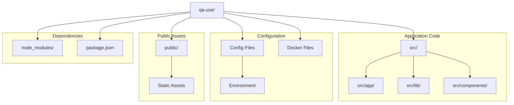
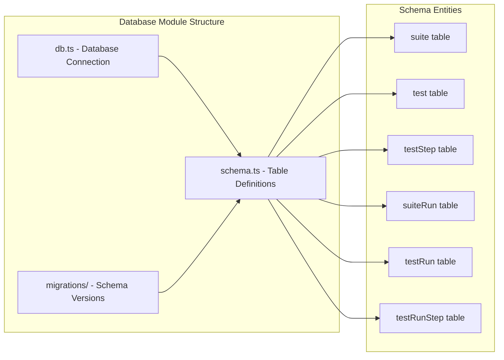
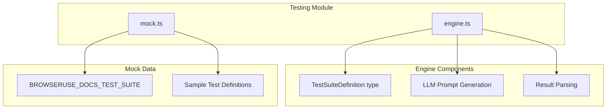
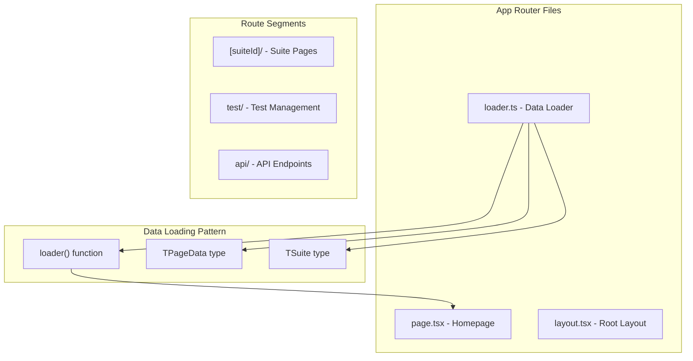
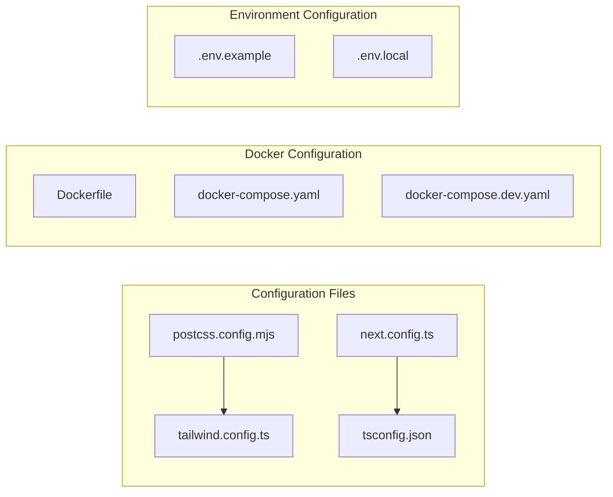
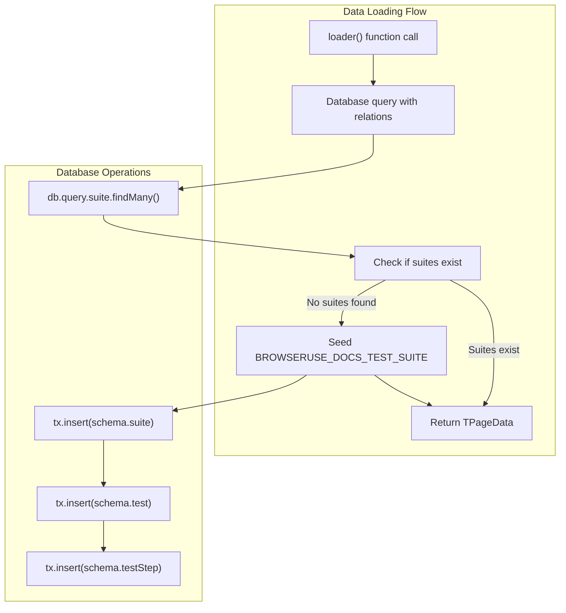
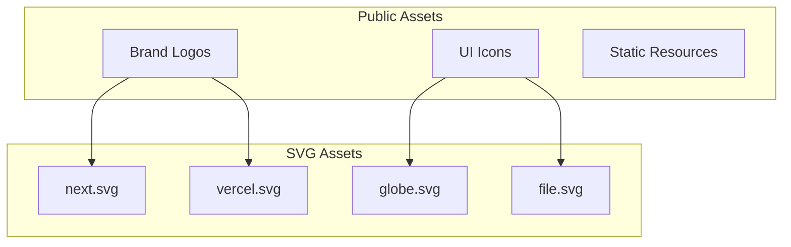

<!-- source: DeepWiki mcp.deepwiki.com · repo browser-use/qa-use · page 9.1 Project Structure · fetched 2026-10-30 -->

# Project Structure

<details>
<summary>Relevant source files</summary>

The following files were used as context for generating this wiki page:

- [postcss.config.mjs](postcss.config.mjs)
- [public/file.svg](public/file.svg)
- [public/globe.svg](public/globe.svg)
- [public/next.svg](public/next.svg)
- [public/vercel.svg](public/vercel.svg)
- [src/app/loader.ts](src/app/loader.ts)

</details>


This document explains the organization of files and directories within the QA Use codebase. It covers the Next.js application structure, key modules, configuration files, and deployment artifacts. For information about the data model and relationships, see [Core Concepts](#3). For details about UI components, see [User Interface](#4).

## Directory Overview

The QA Use platform follows a standard Next.js 14+ application structure with additional directories for database management, testing infrastructure, and background processing.

### High-Level Directory Structure



Sources: Project structure inferred from imports in [src/app/loader.ts:1-64]()

### Core Application Structure

```mermaid
graph TB
    subgraph "src/ - Application Source"
        APP_DIR["app/ - Next.js App Router"]
        LIB_DIR["lib/ - Shared Libraries"]
        COMP_DIR["components/ - React Components"]
    end
    
    subgraph "app/ - Route Definitions"
        PAGES["page.tsx files"]
        LAYOUTS["layout.tsx files"]
        LOADING["loading.tsx files"]
        API_ROUTES["api/ routes"]
        SERVER_ACTIONS["Server Actions"]
        LOADERS["loader.ts files"]
    end
    
    subgraph "lib/ - Core Modules"
        DB_LIB["db/ - Database Layer"]
        TESTING_LIB["testing/ - AI Testing Engine"]
        INNGEST_LIB["inngest/ - Background Jobs"]
        EMAIL_LIB["email/ - Notifications"]
        UTILS_LIB["utils/ - Utilities"]
    end
    
    subgraph "components/ - UI Components"
        UI_COMP["ui/ - Base Components"]
        FEATURE_COMP["Feature Components"]
        SHARED_COMP["Shared Components"]
    end
    
    APP_DIR --> PAGES
    APP_DIR --> LAYOUTS
    APP_DIR --> LOADING
    APP_DIR --> API_ROUTES
    APP_DIR --> SERVER_ACTIONS
    APP_DIR --> LOADERS
    
    LIB_DIR --> DB_LIB
    LIB_DIR --> TESTING_LIB
    LIB_DIR --> INNGEST_LIB
    LIB_DIR --> EMAIL_LIB
    LIB_DIR --> UTILS_LIB
    
    COMP_DIR --> UI_COMP
    COMP_DIR --> FEATURE_COMP
    COMP_DIR --> SHARED_COMP
```



Sources: Structure inferred from imports in [src/app/loader.ts:3-6]()

## Key Directories and Modules

### Database Layer (`src/lib/db/`)

The database layer contains all database-related code using Drizzle ORM:

| File/Directory | Purpose |
|---------------|---------|
| `db.ts` | Database connection instance |
| `schema.ts` | Drizzle schema definitions |
| `migrations/` | Database migration files |



Sources: [src/app/loader.ts:3-4]()

### Testing Engine (`src/lib/testing/`)

The AI-powered testing infrastructure:

| File | Purpose |
|------|---------|
| `engine.ts` | Core testing engine and prompt generation |
| `mock.ts` | Mock test definitions and sample data |



Sources: [src/app/loader.ts:5-6](), [src/app/loader.ts:8]()

### App Router Structure (`src/app/`)

The Next.js App Router implementation with file-based routing:



Sources: [src/app/loader.ts:10-64]()

## Configuration Files

### Framework Configuration

| File | Purpose |
|------|---------|
| `next.config.ts` | Next.js framework configuration |
| `postcss.config.mjs` | PostCSS and Tailwind CSS configuration |
| `tailwind.config.ts` | Tailwind CSS customization |
| `tsconfig.json` | TypeScript compiler configuration |

### Build and Deployment Configuration



Sources: [postcss.config.mjs:1-6]()

### PostCSS Configuration Details

The PostCSS configuration integrates Tailwind CSS for styling:

```javascript
// postcss.config.mjs
const config = {
  plugins: ["@tailwindcss/postcss"],
};
```

Sources: [postcss.config.mjs:1-6]()

## Data Loading Architecture

The application uses a centralized data loading pattern with automatic mock data seeding:



Sources: [src/app/loader.ts:10-59]()

## Public Assets Structure

Static assets served directly by the web server:

| File | Purpose |
|------|---------|
| `next.svg` | Next.js logo |
| `vercel.svg` | Vercel deployment logo |
| `globe.svg` | Global/international icon |
| `file.svg` | File/document icon |



Sources: [public/next.svg:1](), [public/vercel.svg:1](), [public/globe.svg:1](), [public/file.svg:1]()

## Import Path Conventions

The codebase uses TypeScript path mapping with the `@/` alias for clean imports:

| Import Pattern | Maps To | Purpose |
|---------------|---------|---------|
| `@/lib/db/db` | `src/lib/db/db` | Database connection |
| `@/lib/db/schema` | `src/lib/db/schema` | Database schema |
| `@/lib/testing/engine` | `src/lib/testing/engine` | Testing engine types |
| `@/lib/testing/mock` | `src/lib/testing/mock` | Mock test data |

Sources: [src/app/loader.ts:3-6]()