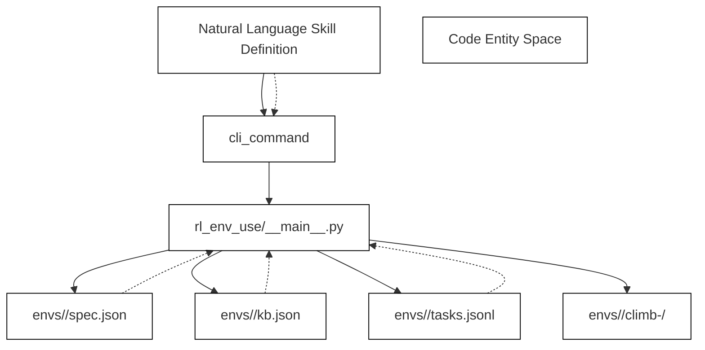
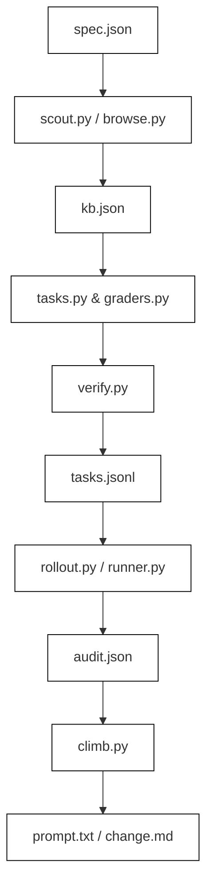

<!-- source: DeepWiki mcp.deepwiki.com · repo browser-use/rl-env-use · page 1 Overview · fetched 2026-10-30 -->

# Overview

Relevant source files

The following files were used as context for generating this wiki page:

- [LICENSE](LICENSE)
- [README.md](README.md)
- [SKILL.md](SKILL.md)

`rl-env-use` is a framework for generating verified reinforcement learning (RL) environments and evaluation benchmarks from real-world data mined by Browser Use agents [README.md:7-12](). It operationalizes Anthropic's automated evaluation design and prompt hillclimbing workflow, replacing static synthetic datasets with dynamic, agent-mined web cases [SKILL.md:8-11](). 

The system takes a high-level natural language skill definition (e.g., predicting clinical trial outcomes from registries or analyzing SEC 10-Q filings) and executes an end-to-end pipeline: mining materials, synthesizing verifiable tasks, grading answers programmatically, auditing against leakage or memorization, evaluating model policy rollouts, and hillclimbing system prompts [README.md:22-28]().

*Sources: [README.md:22-28](), [SKILL.md:13-25]()*, [rl_env_use/__main__.py]()

## Core Architecture and Pipeline

The architecture is organized around self-contained environment directories (`envs/<name>/`) [SKILL.md:15-18](). Each environment encapsulates the raw mined knowledge, synthesized tasks, audit ledgers, evaluation slots, and prompt optimization history. 

*Sources: [SKILL.md:18-28]()*, [rl_env_use/__main__.py]()

## Child Pages

This parent page serves as a high-level entry point. Detailed technical breakdowns, command flags, directory layouts, and execution mechanics are documented in the child pages:

- **[Getting Started & Configuration](#1.1)**: Installation via `uv`, API key setup (`BROWSER_USE_API_KEY`, `OPENROUTER_API_KEY`), environment configuration (`.env`), and running the offline test suite [README.md:63-73]().
- **[CLI Reference](#1.2)**: Complete documentation of commands exposed by `rl_env_use/__main__.py` (`new`, `create`, `build`, `review`, `run`, `report`, `climb`, `compare`, `codify`, `judges`, `split`, `export`), including flags and workflows [SKILL.md:13]().
- **[Environment Directory Layout](#1.3)**: Detailed schema of `envs/<name>/`, covering files such as `spec.json`, `kb.json`, `tasks.jsonl`, `audit.json`, `reviews.jsonl`, and run artifact subdirectories (`models/`, `climb-<model>/`) [SKILL.md:15-30]().

*Sources: [README.md:63-73](), [SKILL.md:13-30]()*, [rl_env_use/__main__.py]()

---

