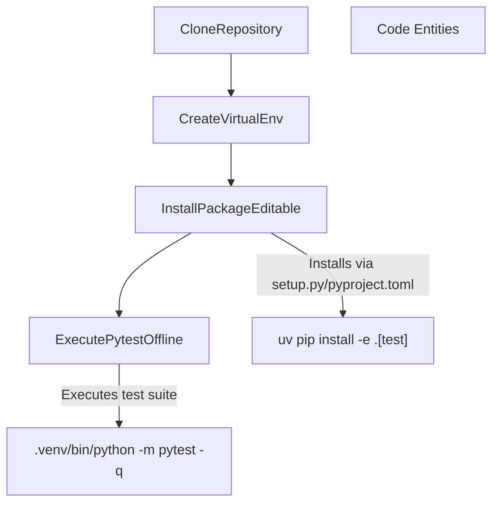
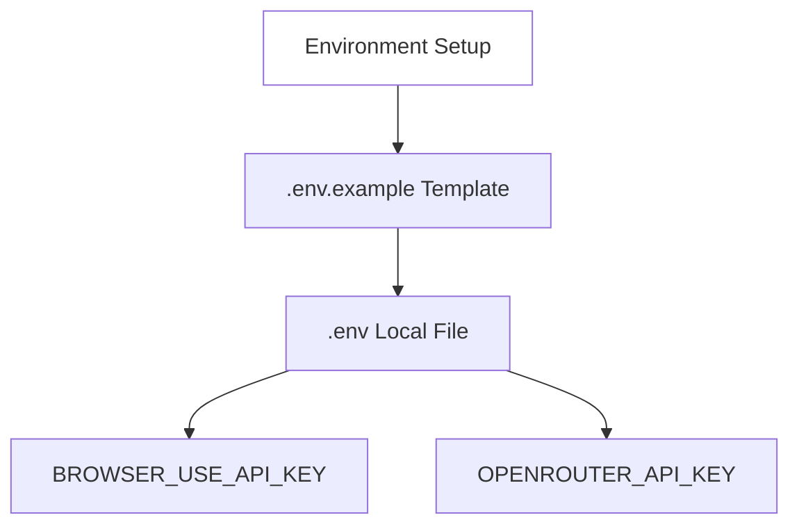
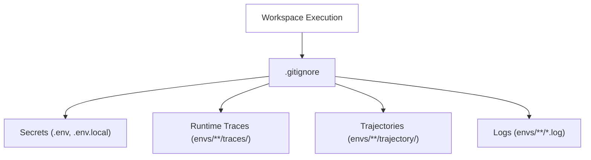

<!-- source: DeepWiki mcp.deepwiki.com · repo browser-use/rl-env-use · page 1.1 Getting Started & Configuration · fetched 2026-10-30 -->

# Getting Started & Configuration

<details>
<summary>Relevant source files</summary>

The following files were used as context for generating this wiki page:

- [.env.example](.env.example)
- [.gitignore](.gitignore)
- [README.md](README.md)

</details>


## Purpose & Scope

This page covers the technical setup and configuration required to deploy and operate `rl-env-use`. It details the installation process using `uv`, environment configuration through `.env` files and API keys (`BROWSER_USE_API_KEY` and `OPENROUTER_API_KEY`), gitignore policies for run artifacts, and the execution of the offline test suite.

Sources: `README.md:1-80`, `.env.example:1-3`, `.gitignore:1-20`

---

## Manual Installation

To set up the development and execution environment, Python 3.11+ is required. Node.js 18+ is optionally required if you intend to build or compile HTML reports [README.md:63-65]. 

The repository relies on `uv` for fast virtual environment management and package installation. The standard installation sequence clones the repository, provisions a virtual environment, and installs the package in editable mode with test dependencies [README.md:67-70]:

```bash
git clone https://github.com/browser-use/rl-env-use ~/Developer/rl-env-use
cd ~/Developer/rl-env-use
uv venv && uv pip install -e '.[test]'
```



Sources: `README.md:63-74`

---

## Environment Configuration & API Keys

The environment relies on two external API keys for its agent mining operations and LLM rollouts. Configuration is managed via a local `.env` file copied from the template [README.md:71].

1. **`BROWSER_USE_API_KEY`**: Authenticates requests against Browser Use Cloud, allowing agents to execute web-browsing missions and mine real-world cases [README.md:20].
2. **`OPENROUTER_API_KEY`**: Routes model generation, task synthesis, and policy evaluation through OpenRouter [README.md:7].

To configure your environment, copy `.env.example` [.env.example:1-3] to `.env` [README.md:71] and populate the keys:

```bash
cp .env.example .env && $EDITOR .env
```



Sources: `.env.example:1-3`, `README.md:70-71`

---

## Gitignored Run Artifacts & Workspace Hygiene

Because agent execution generates large auxiliary traces, trajectory records, and temporary logs, `.gitignore` explicitly excludes volatile runtime directories while preserving key results, climb states, and reports [.gitignore:16-20].

Secrets and environment configurations are excluded at the root level [.gitignore:1-3]:
- `.env` and `.env.local`
- Python compilation artifacts (`__pycache__/`, `*.py[co]`, `.venv/`, `.pytest_cache/`) [.gitignore:5-13]
- Large agent run traces and trajectories under environment directories (`envs/**/traces/`, `envs/**/trajectory/`, and `envs/**/*.log`) [.gitignore:16-19]



Sources: `.gitignore:1-20`

---

## Running the Offline Test Suite

Once dependencies are installed and the environment is configured, you can verify system integrity by running the offline test suite using `pytest` [README.md:72]. 

The offline test suite executes unit tests across modules without requiring live API calls, completing in approximately 10 seconds [README.md:72]:

```bash
.venv/bin/python -m pytest -q
```

Sources: `README.md:72`

---

