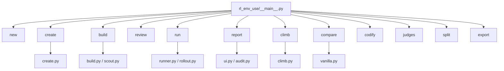
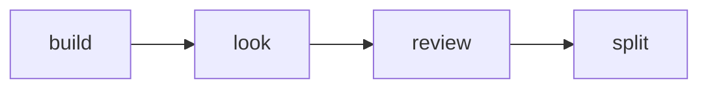
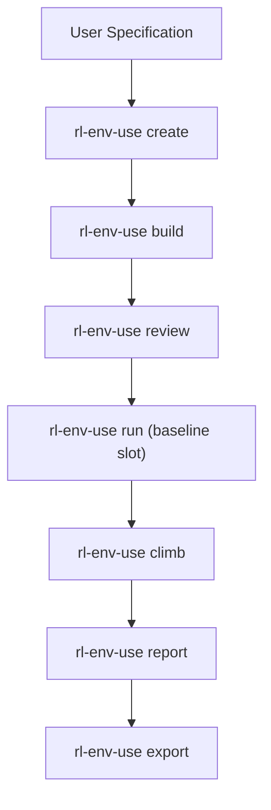

<!-- source: DeepWiki mcp.deepwiki.com · repo browser-use/rl-env-use · page 1.2 CLI Reference · fetched 2026-10-30 -->

# CLI Reference

<details>
<summary>Relevant source files</summary>

The following files were used as context for generating this wiki page:

- [README.md](README.md)
- [SKILL.md](SKILL.md)

</details>


The purpose of this page is to document the complete command-line interface exposed by `rl_env_use/__main__.py`. It covers all available commands (`new`, `create`, `build`, `review`, `run`, `report`, `climb`, `compare`, `codify`, `judges`, `split`, `export`), their supported flags, underlying modules, and typical operational workflows.

---

## Command Architecture & Module Mapping

The CLI serves as the primary entry point for managing environment lifecycles, executing rollouts, auditing tasks, and running prompt hillclimbing loops. 


*Sources: `[SKILL.md:13-89](), [README.md:46-50]()`*

---

## Core Commands Reference

### Initialization & Autonomous Creation (`new`, `create`)

*   **`new`**: Initializes a blank environment directory structure (`envs/<name>/`) with initial configuration metadata (`spec.json`). Designed for step-by-step human guidance [SKILL.md:60-60]().
    *   *Flags:* `--topic`, `--skill`, `--sources`, `--profile`, `--proxy-country` [SKILL.md:60-60]().
*   **`create`**: Autonomous end-to-end environment generator. A planner automatically writes the `spec.json` (skill, sources, conventions, sampling rules) and executes iterative mining rounds until task targets or budgets are reached [SKILL.md:34-44]().
    *   *Flags:* `--tasks <int>`, `--budget <float>`, `--name <str>` [SKILL.md:34-44]().

```bash
rl-env-use create "predict whether a completed trial met its primary endpoint from its registered protocol; ClinicalTrials.gov" --budget 40
```
*Sources: `[README.md:47-47](), [SKILL.md:32-44]()`*

---

### Mining, Building & Review (`build`, `review`, `split`)

*   **`build`**: Executes the mining pipeline (`scout -> look -> synth -> verify -> panel -> harden`) to populate `kb.json` and `tasks.jsonl` [SKILL.md:64-70]().
    *   *Flags:* `--only scout`, `--only look`, `--enrich` [SKILL.md:64-67]().
*   **`review`**: Launches the local review web application to inspect mined cases (`Data` tab), drafted tasks (`Tasks` tab), and execution transcripts (`Traces` tab) [SKILL.md:23-27]().
*   **`split`**: Generates training and testing data splits partitioned by case for validation and hillclimbing workflows [SKILL.md:81-81]().


*Sources: `[SKILL.md:64-81]()`*

---

### Execution & Reporting (`run`, `report`, `compare`)

*   **`run`**: Executes policy evaluations over tasks across specified repetitions, routing queries through OpenRouter and recording ledger costs and trial outcomes into `results.jsonl`, `errors.jsonl`, and `dropped.jsonl` [SKILL.md:27-27, 73-77]().
    *   *Flags:* `--model <str>`, `--flow <str>`, `--limit <int>`, `--dry-run`, `--variant <str>`, `--system <file>` [SKILL.md:73-82]().
*   **`report`**: Regrades existing results, executes audit checks (`audit.json`), and compiles static HTML analysis reports (`report.html`) for model comparisons and slots [SKILL.md:76-77]().
*   **`compare`**: Runs parallel environment evaluations comparing Browser Use agents against vanilla Claude Code browsing instructions to measure task difficulty and agent edge [SKILL.md:86-89]().
    *   *Flags:* `--missions <int>` [SKILL.md:86-89]().

```bash
rl-env-use run envs/trial-forecast --model qwen-35b --limit 5
rl-env-use report envs/trial-forecast
```
*Sources: `[SKILL.md:73-89]()`*

---

### Optimization & Advanced Maintenance (`climb`, `codify`, `judges`, `export`)

*   **`climb`**: Executes the automated prompt hillclimbing optimization loop (`climb-<model>/`), evaluating proposed system prompt edits against train/test splits with noise floors and paired bootstraps [README.md:48-48], [SKILL.md:45-49]().
    *   *Flags:* `--model <str>` [README.md:48-48]().
*   **`codify`**: Codifies trace failures and failure modes identified during rollout reviews [SKILL.md:82-82]().
*   **`judges`**: Calibrates automated failure-mode judges against human review labels (`reviews.jsonl`) [SKILL.md:82-82]().
*   **`export`**: Serializes environment data and verified tasks into clean JSONL formats optimized for external reinforcement learning trainers [SKILL.md:84-84]().

```bash
rl-env-use climb envs/trial-forecast --model qwen-35b
rl-env-use export envs/trial-forecast
```
*Sources: `[README.md:48-49](), [SKILL.md:45-84]()`*

---

## Typical End-to-End CLI Workflows

The following workflow demonstrates the progression from autonomous environment creation to model optimization and evaluation reporting.


*Sources: `[SKILL.md:32-85](), [README.md:46-50]()`*

### Step-by-Step Command Sequence Reference

| Phase | Command | Target Artifacts | Purpose |
| :--- | :--- | :--- | :--- |
| **1. Setup** | `rl-env-use new` | `envs/<name>/spec.json` | Initialize environment specification manually [SKILL.md:60-60](). |
| **2. Autonomous Generation** | `rl-env-use create` | `kb.json`, `tasks.jsonl` | Autonomous multi-round case mining and task drafting [SKILL.md:34-44](). |
| **3. Manual Inspection** | `rl-env-use review` | `reviews.jsonl` | Review mined cases, drafted tasks, and trace transcripts [SKILL.md:23-27](). |
| **4. Baseline Evaluation** | `rl-env-use run` | `models/<slot>/results.jsonl` | Execute baseline policy rollouts over environment tasks [SKILL.md:73-77](). |
| **5. Prompt Hillclimbing** | `rl-env-use climb` | `climb-<model>/` | Optimize system prompts via train/test splits and paired CIs [SKILL.md:45-49](). |
| **6. Reporting & Export** | `rl-env-use report` & `export` | `report.html`, Export Datasets | Generate consolidated audit reports and RL training datasets [SKILL.md:76-84](). |

*Sources: `[SKILL.md:23-84](), [README.md:46-50]()`*

---

