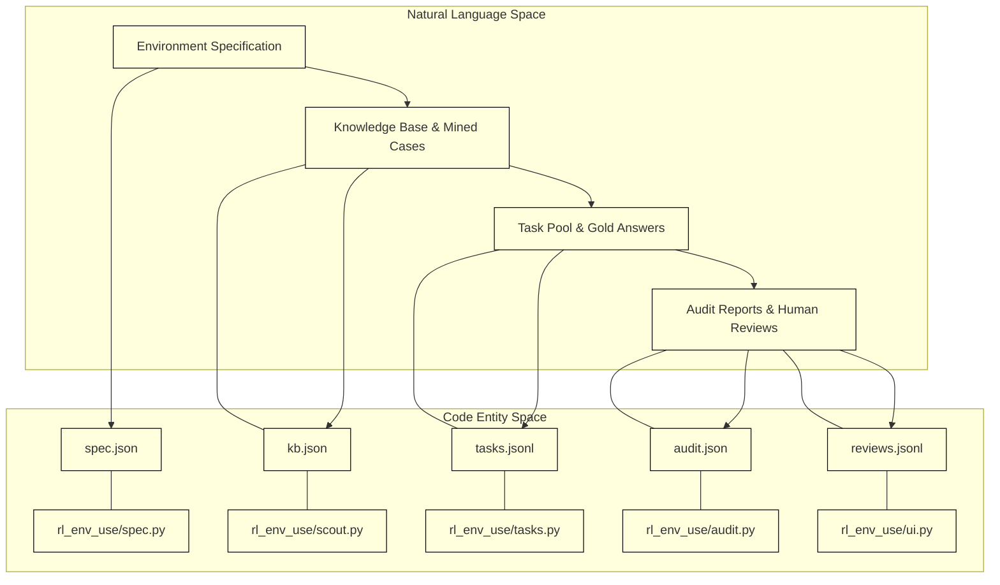
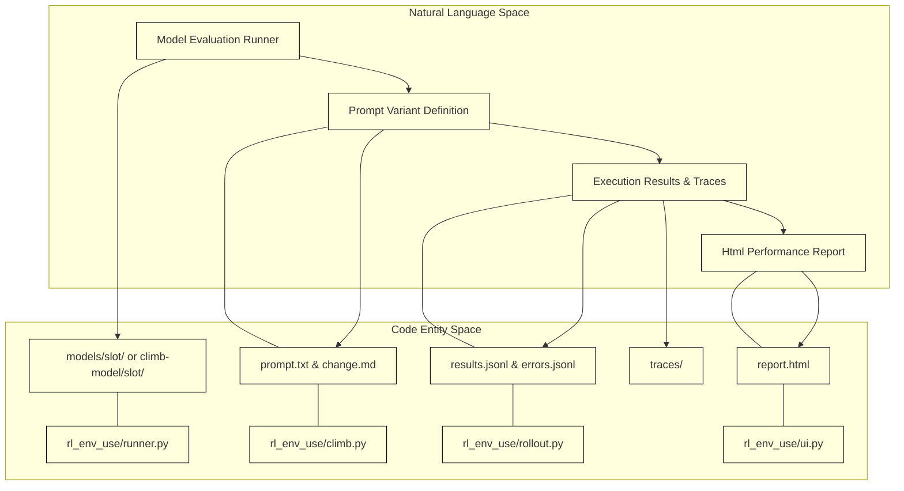

<!-- source: DeepWiki mcp.deepwiki.com · repo browser-use/rl-env-use · page 1.3 Environment Directory Layout · fetched 2026-10-30 -->

# Environment Directory Layout

<details>
<summary>Relevant source files</summary>

The following files were used as context for generating this wiki page:

- [SKILL.md](SKILL.md)
- [envs/sec-credit/climb-haiku/baseline/change.md](envs/sec-credit/climb-haiku/baseline/change.md)
- [envs/sec-credit/climb-haiku/baseline/prompt.txt](envs/sec-credit/climb-haiku/baseline/prompt.txt)
- [envs/sec-credit/climb-haiku/baseline/results.jsonl](envs/sec-credit/climb-haiku/baseline/results.jsonl)
- [envs/sec-credit/climb-haiku/baseline/summary.json](envs/sec-credit/climb-haiku/baseline/summary.json)

</details>


## Purpose and Scope

Every environment in `rl-env-use` is encapsulated within a self-contained directory under `envs/<name>/`. This directory acts as the canonical state container for the environment, storing everything from raw mined knowledge bases and drafted tasks to model comparison slots, evaluation run logs, and iterative prompt hillclimbing artifacts. 

This page details the schema of `envs/<name>/`, explaining the specific role, internal format, and data flow of each file and subdirectory.

Sources: [SKILL.md:13-31]()

---

## Global Environment Schema (`envs/<name>/`)

At the root of each environment directory resides a standard set of metadata files, knowledge base structures, task definitions, and audit reports. 

```
envs/<name>/
  ├── spec.json
  ├── kb.json
  ├── tasks.jsonl
  ├── audit.json
  ├── reviews.jsonl
  ├── models/
  └── climb-<model>/
```

The following diagram bridges the natural language concepts of environment files to the underlying system paths and code entities that read and write them:


Sources: [SKILL.md:18-28](), [SKILL.md:34-84]()

### Core Files

* **`spec.json`**: Defines the environment's high-level configuration including topic, skill definition, source URLs, conventions, financial budgets, and execution spend records [SKILL.md:19]().
* **`kb.json`**: Stores the raw mined material cases, quote-verified outcome facts, and mission configurations extracted by browser agents [SKILL.md:20]().
* **`tasks.jsonl`**: Contains every drafted task paired with its gold answers and grading checks [SKILL.md:21](). The environment only serves tasks that pass verification.
* **`audit.json`**: Holds the latest automated audit report evaluating leakage, saturation, base rates, and structural validity [SKILL.md:22]().
* **`reviews.jsonl`**: Records human reviewer verdicts, annotations, and gold label fixes captured via the local review interface [SKILL.md:23]().

Sources: [SKILL.md:18-28]()

---

## Model Comparison and Hillclimbing Slots

Model evaluation and prompt hillclimbing organize outputs into dedicated subdirectories. Each model or variant is assigned a distinct "slot" containing execution telemetry, transcripts, and evaluation metrics.

```
envs/<name>/
  ├── models/
  │   └── <model-slot>/
  │       ├── change.md
  │       ├── prompt.txt
  │       ├── results.jsonl
  │       └── ...
  └── climb-<model>/
      ├── baseline/
      ├── v1/
      ├── v2/
      └── _state.json
```

The data flow and artifact generation across evaluation slots and hillclimb variants are illustrated below:


Sources: [SKILL.md:24-30](), [SKILL.md:76-84]()

---

## Detailed Artifact Breakdown

Inside any evaluation slot (such as `models/<slot>/` or `climb-<model>/<slot>/`), a standardized set of files tracks the exact state of execution:

| Artifact Name | Description | Key Code Reference |
| :--- | :--- | :--- |
| `change.md` | Documents the natural language change description or diff summary for a prompt variant. The first line is rendered as the column title in generated reports. | [SKILL.md:29]() |
| `prompt.txt` | Stores the complete system prompt text executed for that evaluation slot or hillclimb variant. | [SKILL.md:25]() |
| `results.jsonl` | Line-delimited JSON records of each evaluated prompt instance, including rep number, prompt ID, grading scores, latency, token usage, cost, and metadata. | [envs/sec-credit/climb-haiku/baseline/results.jsonl:1-8]() |
| `summary.json` | High-level summary metadata for the slot, indicating the description, target component, and target model. | [envs/sec-credit/climb-haiku/summary.json:1-1]() |
| `dropped.jsonl` | Records episodes that encountered unrecoverable harness errors or dropped repetitions during execution. | [SKILL.md:27]() |
| `_state.json` | Maintains resumable state for long-running processes such as the hillclimb optimization loop. | [SKILL.md:25]() |
| `report.html` | A standalone self-contained HTML report generated via build scripts, presenting visual performance comparisons, audit results, and failure analyses. | [SKILL.md:25](), [SKILL.md:76-77]() |
| `traces/` | Directory containing full trajectory transcripts and agent logs for individual rollouts (git-ignored). | [SKILL.md:27-30]() |

Sources: [SKILL.md:24-30](), [envs/sec-credit/climb-haiku/baseline/results.jsonl:1-8](), [envs/sec-credit/climb-haiku/summary.json:1-1]()

---

