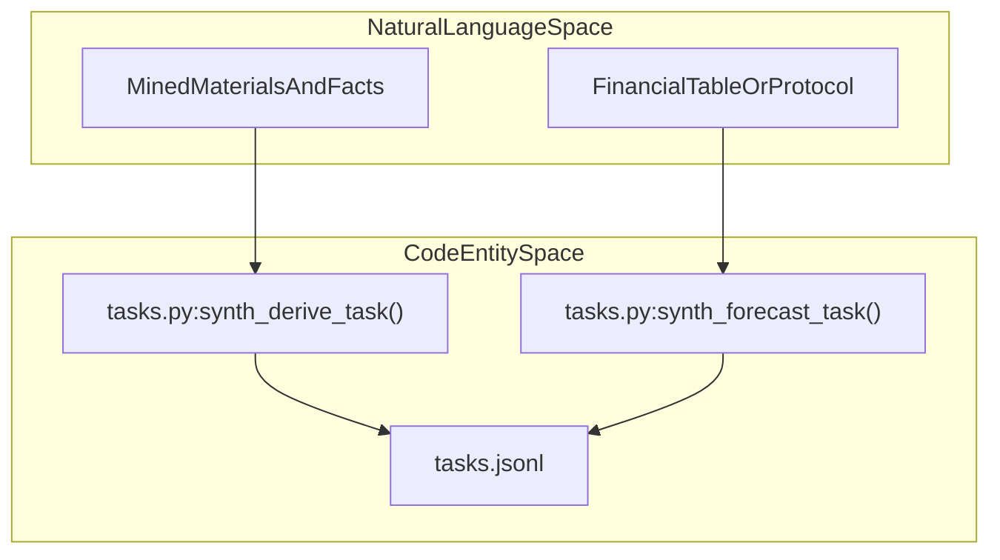
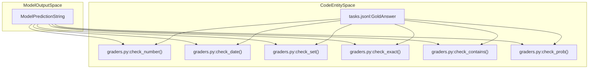

<!-- source: DeepWiki mcp.deepwiki.com · repo browser-use/rl-env-use · page 2.2 Task Synthesis and Grading Checks · fetched 2026-10-30 -->

# Task Synthesis and Grading Checks

Relevant source files

The following files were used as context for generating this wiki page:

- [README.md](README.md)
- [SKILL.md](SKILL.md)

This page details the implementation and mechanics of task synthesis and programmatic grading within `rl-env-use`, focusing on how raw mined materials and facts from `kb.json` are transformed into verifiable, high-difficulty evaluation tasks stored in `tasks.jsonl`, and how `graders.py` evaluates model outputs using precise check types.

---

## 1. Purpose and Scope

The task synthesis subsystem takes verified facts and materials mined by Browser Use agents (`scout.py`/`browse.py`) and structures them into rigorous evaluation items. The system distinguishes between **derive tasks** (where an answer is calculated via code expression over material data) and **forecast tasks** (where an outcome is predicted based on registered protocols or early disclosures). 

Tasks undergo strict filtering, balancing, and closed-book validation before being written to `tasks.jsonl` for use by the runner and environment APIs.

Sources: [SKILL.md:15-28](), [README.md:24-28]()

---

## 2. Derive vs. Forecast Tasks

The synthesis engine classifies tasks into two primary categories depending on the nature of the domain and the availability of data:

- **Derive Tasks**: Computed by code from an expression over numbers present in the source materials (e.g., financial line items in a 10-Q filing or trial participant breakdowns). These test precise data extraction, table parsing, and multi-step arithmetic. When frontier panels saturate derive tasks, the system shifts focus to forecast tasks.
- **Forecast Tasks**: Predict future or withheld outcomes from early indicators (e.g., predicting whether a completed trial met its primary endpoint from its registered protocol on ClinicalTrials.gov). Forecasts must strictly depend on the provided materials and must not be answerable without them. Additionally, at most 60% of served forecasts are permitted to resolve in a single direction to prevent trivial baseline guessing.

Sources: [SKILL.md:37-41]()

---

## 3. Gold Answers and Check Kinds

Grading relies on deterministic check functions defined in `graders.py`. Every drafted task includes a gold answer derived directly from outcome quotes, ensuring zero leakage into prompt instructions or source materials.

Supported check kinds include:
- `number`: Numerical equality within a strict floating-point tolerance.
- `date`: Temporal normalization and comparison.
- `set`: Unordered collection matching for multi-item extractions.
- `exact`: Exact string or token matching.
- `contains`: Substring or keyword presence validation.
- `prob`: Probability or confidence score scoring (e.g., Brier score or thresholded classification accuracy).

Sources: [SKILL.md:68-71]()

---

## 4. Task Balancing, Keep, and Filter Rules

Before a task is committed to `tasks.jsonl`, it passes through a multi-stage filtering and hardening pipeline to ensure validity and appropriate difficulty:

1. **Leakage & Memorization Checks**: Evaluates whether the outcome can be guessed closed-book (without materials) using historical model weights. Tasks that frontier models or baseline weights can solve without reading the text are discarded or rewritten harder.
2. **Ambiguity & Structural Filtering**: Eliminates ambiguous prompts, missing gold references, and structurally unsound questions.
3. **Frontier Panel Calibration**: The frontier panel (comprising models like Opus, GPT-Astra, and Gemini) measures task difficulty. Any task solved effortlessly by all panel members is sent back to the drafter to be made harder on the same case (up to two iteration levels).
4. **Base-Rate Balancing**: Ensures outcome distribution is balanced (e.g., restricting forecast resolution imbalance to a maximum of 60% in one direction).

Sources: [SKILL.md:37-41](), [SKILL.md:68-71]()

---

## 5. Grader Self-Testing and Verification

To ensure robust evaluation without false positives or negatives, grading logic in `graders.py` undergoes automatic self-testing during the build phase. Graders are tested against:
- **Null Inputs**: Ensuring graceful handling of empty or malformed model responses.
- **Foreign Answers**: Validating rejection of valid answers belonging to other cases.
- **Perturbed Golds**: Injecting noise or deliberate offsets into gold answers to verify sensitivity and precision.

Sources: [SKILL.md:68-71]()

---

