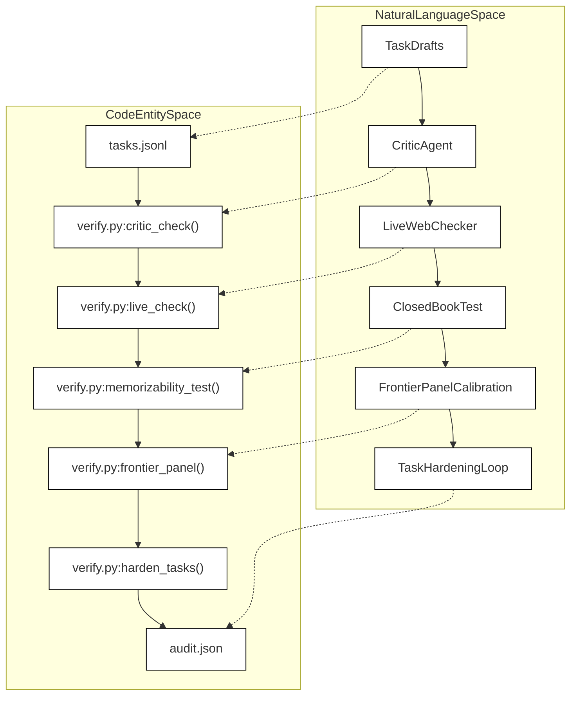
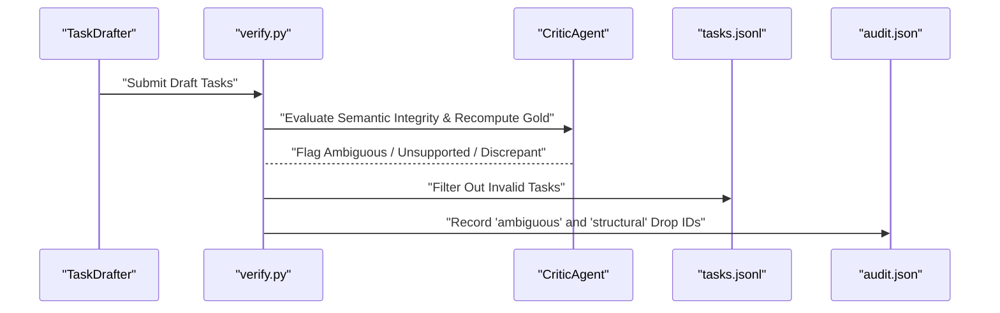
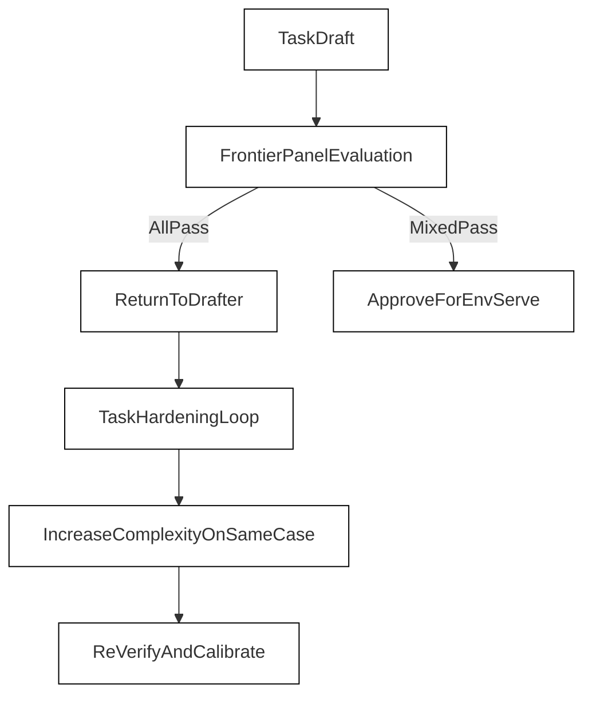

<!-- source: DeepWiki mcp.deepwiki.com · repo browser-use/rl-env-use · page 2.3 Verification, Frontier Panel and Hardening · fetched 2026-10-30 -->

# Verification, Frontier Panel and Hardening

Relevant source files

The following files were used as context for generating this wiki page:

- [SKILL.md](SKILL.md)
- [envs/sec-credit/audit.json](envs/sec-credit/audit.json)

This page covers the technical implementation and operational mechanics of `verify.py` and its associated validation subsystems within `rl-env-use`. The verification pipeline takes drafted tasks from `tasks.jsonl` and subjects them through a rigorous multi-stage filtering, critique, calibration, and hardening loop. This ensures that tasks are unambiguous, require the provided materials or browser access rather than rote memorization, and possess appropriate difficulty headroom against frontier models.

---

## 1. The Verification Architecture and Flow

The verification phase is responsible for filtering out structural defects, prompt leakages, stale references, and memorizable queries. As outlined in `SKILL.md`, tasks undergo automated critique and validation before being admitted into the active environment service pool [SKILL.md:34-42](). 

The following diagram bridges the natural language conceptual space of environment verification with the concrete code entities handling each subsystem:

Sources: `SKILL.md`, `envs/sec-credit/audit.json`

---

## 2. Critic Checks and Ambiguity Filtering

The critic stage inspects drafted tasks for semantic ambiguities, unsupported conclusions, and discrepancies between independent recomputations and the stated gold answer. Tasks failing this inspection are logged with reasons and filtered out.

As reflected in audit logs, ambiguity checks can prune a significant portion of initial drafts if the underlying source materials lack deterministic precision [envs/sec-credit/audit.json:249-251]().

Sources: `SKILL.md`, `envs/sec-credit/audit.json`

---

## 3. Live Checks and Stale Evidence Detection

Tasks must rely on evidence that is verifiable against live web pages or stable material snapshots. The `verify.py` pipeline runs live check routines to verify that source URLs and evidence markers still exist on the live target page.

- **Stale Check**: Tasks citing evidence no longer present on the live page are flagged as `stale` and removed from active rotation [envs/sec-credit/audit.json:238-240]().
- **Browser Edge Check**: Measures whether the evidence requires browser-only interaction (such as dynamic rendering or complex client-side states) versus a plain HTTP fetch [envs/sec-credit/audit.json:72-74]().

Sources: `SKILL.md`, `envs/sec-credit/audit.json`

---

## 4. Closed-Book and Memorizability Tests

To ensure that the environment measures the model's ability to extract and reason over provided materials rather than rely on parametric pre-training memory, tasks undergo closed-book evaluation:

1. **Closed-Book Probe**: The model under test is fed the task *without* the supporting materials or browser access.
2. **Filtering**: If a model correctly answers a task under closed-book conditions (and the task is not a few-choice question where correct guesses occur by chance), the task is classified as `memorizable` and filtered out [SKILL.md:69](), [envs/sec-credit/audit.json:224-225]().

Sources: `SKILL.md`, `envs/sec-credit/audit.json`

---

## 5. Frontier Panel Calibration and All-Pass Capping

Once tasks survive structural, ambiguity, and memorizability checks, they face the **Frontier Panel** (consisting of models such as `opus55`, `gpt-astra`, and `gemini`) to gauge difficulty [SKILL.md:38-42]().

- **Calibration**: The panel measures whether tasks are too easy or appropriately challenging for state-of-the-art models.
- **All-Pass Capping**: When a task is solved by every model on the frontier panel (an "all-pass" task), it is sent back to the drafter to be made harder on the same case (up to two levels of escalation) [SKILL.md:38-40]().
- **Saturation Management**: When the panel saturates deterministic derive tasks (e.g., solving nearly every financial computation in SEC filings), subsequent mining rounds pivot to forecasting tasks (`forecast`) [SKILL.md:41-42]().

Sources: `SKILL.md`, `envs/sec-credit/audit.json`

---

## 6. Task Hardening Loops

When tasks fail calibration due to being excessively straightforward or easily solvable via simple pattern matching, the task hardening loop engages:

Sources: `SKILL.md`, `envs/sec-credit/audit.json`

---

