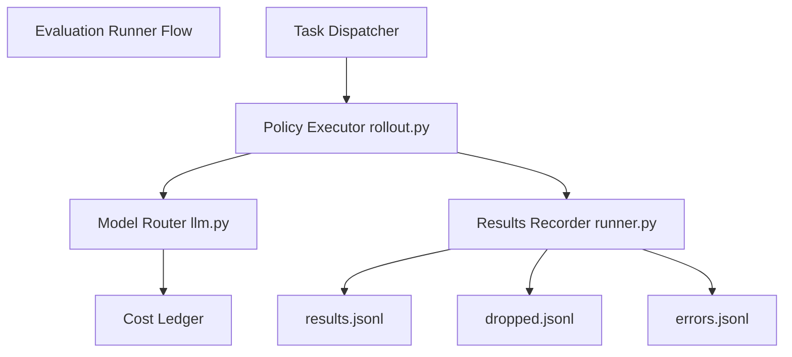
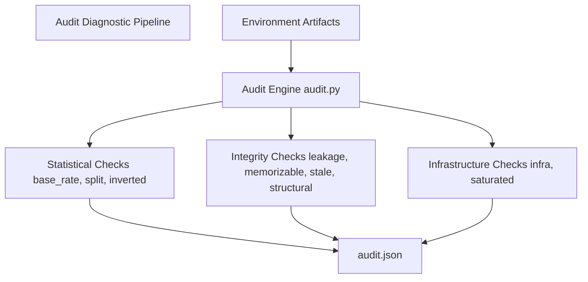
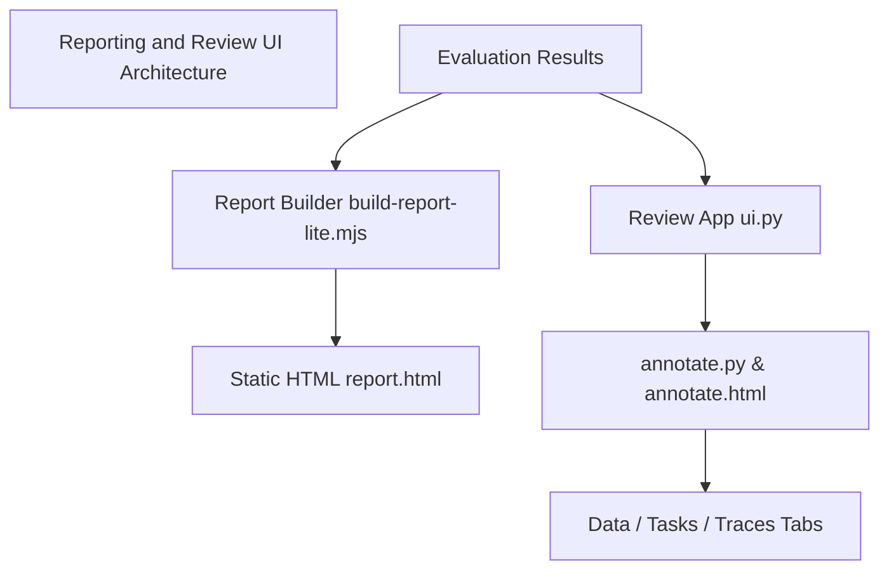

<!-- source: DeepWiki mcp.deepwiki.com · repo browser-use/rl-env-use · page 3 Evaluation and Reporting · fetched 2026-10-30 -->

# Evaluation and Reporting

Relevant source files

The following files were used as context for generating this wiki page:

- [envs/sec-credit/audit.json](envs/sec-credit/audit.json)
- [envs/sec-credit/climb-haiku/report.html](envs/sec-credit/climb-haiku/report.html)

## Purpose and Scope

The Evaluation and Reporting phase of `rl-env-use` bridges trained models, environment specifications, and rigorous performance auditing. Once an environment contains verified tasks, models must be systematically evaluated via policy rollouts, their outputs measured against gold standards, results audited for statistical anomalies or leakage, and reports generated for human review. 

This page provides a high-level overview of running models, auditing execution telemetry, and building review interfaces. For deep technical details, refer to the child pages:
- Rollouts and the Runner: See [Rollouts and the Runner](#3.1).
- Audit Checks: See [Audit Checks](#3.2).
- Reports and Review UI: See [Reports and Review UI](#3.3).

Sources: `envs/sec-credit/audit.json`

---

## 3.1 Rollouts and the Runner

Model evaluation relies on executing policies over tasks and repetitions while logging token costs, API routing parameters, and execution traces. The runner manages task dispatch, handles repetition parallelization, tracks costs via a persistent ledger, and routes requests through OpenRouter. Execution outcomes are written to records such as `results.jsonl`, `dropped.jsonl`, and `errors.jsonl` within model slots.

For complete technical details on policy execution over tasks, repetition handling, cost tracking, and result record schemas, see [Rollouts and the Runner](#3.1).

Sources: `envs/sec-credit/audit.json`

---

## 3.2 Audit Checks

To guarantee benchmark integrity, `audit.py` runs a suite of automated diagnostic checks over environments and model evaluation slots [envs/sec-credit/audit.json:1-701]. These checks detect issues such as saturated score headroom, base rate imbalances, train/test split skew, infrastructure failures (timeouts, crashes), inverted model skill ranks, gold label leakage, structural task flaws, memorizability, stale evidence, and ambiguity [envs/sec-credit/audit.json:1-271]. Findings are categorized by severity (`high`, `medium`, `info`) and serialized into `audit.json` [envs/sec-credit/audit.json:1-3].

For a detailed breakdown of each check, severity levels, and how `audit.json` is compiled, see [Audit Checks](#3.2).

Sources: `envs/sec-credit/audit.json`

---

## 3.3 Reports and Review UI

Model comparisons and audit results are rendered into human-readable dashboards and interactive review applications [envs/sec-credit/climb-haiku/report.html:1-9]. Using tools like `ui.py`, `annotate.py`, and JavaScript build scripts such as `report/build-report-lite.mjs`, the system generates static HTML reports (`report.html`) containing variant metrics, change descriptions, and test splits [envs/sec-credit/climb-haiku/report.html:1-9]. Additionally, local review applications provide specialized tabs for inspecting task data, gold answers, and execution traces.

For comprehensive documentation on report generation, model comparison slots, and the local review app, see [Reports and Review UI](#3.3).

Sources: `envs/sec-credit/climb-haiku/report.html`

---

