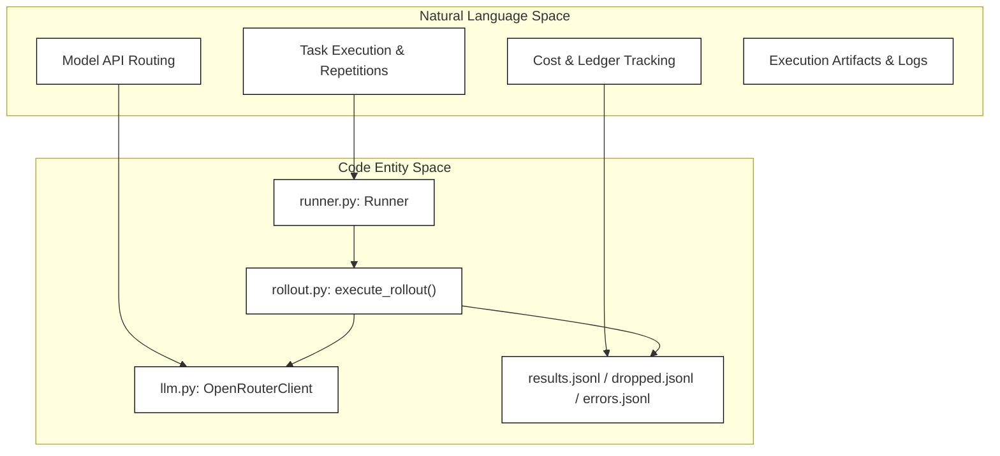
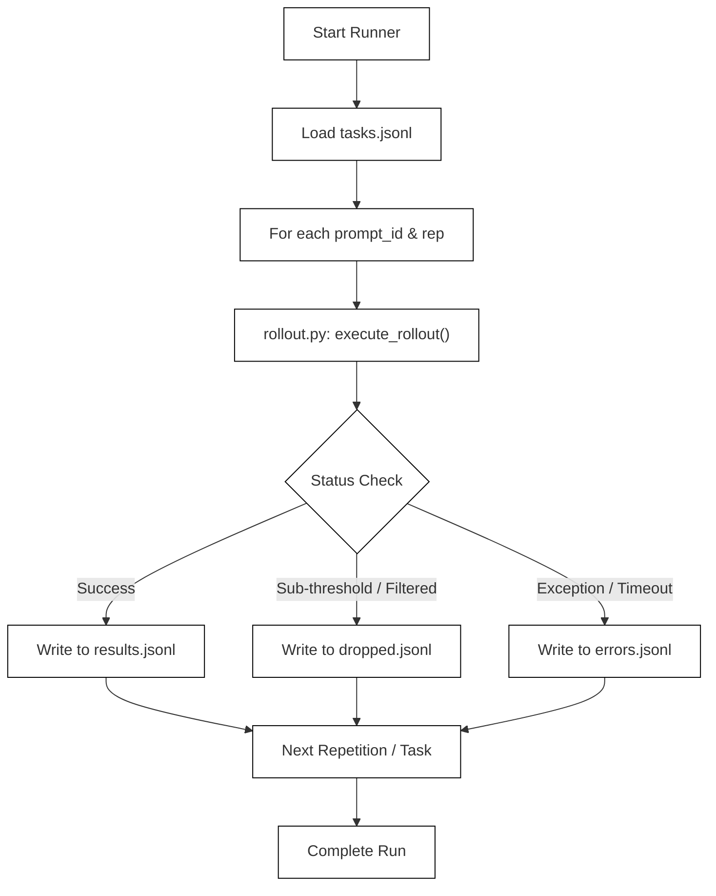

<!-- source: DeepWiki mcp.deepwiki.com · repo browser-use/rl-env-use · page 3.1 Rollouts and the Runner · fetched 2026-10-30 -->

# Rollouts and the Runner

<details>
<summary>Relevant source files</summary>

The following files were used as context for generating this wiki page:

- [envs/sec-credit/climb-haiku/baseline/dropped.jsonl](envs/sec-credit/climb-haiku/baseline/dropped.jsonl)
- [envs/sec-credit/climb-haiku/baseline/results.jsonl](envs/sec-credit/climb-haiku/baseline/results.jsonl)
- [envs/sec-credit/climb-qwen-35b-verified/v1/errors.jsonl](envs/sec-credit/climb-qwen-35b-verified/v1/errors.jsonl)

</details>


## Purpose and Scope
This page covers the execution subsystem responsible for running policy rollouts over task environments. Specifically, it details how `rollout.py`, `runner.py`, and `llm.py` coordinate policy execution across tasks and repetitions (`reps`), handle model routing via OpenRouter, maintain cost ledgers, and persist execution records into `results.jsonl`, `dropped.jsonl`, and `errors.jsonl`.

---

## 1. Core Execution Architecture

The rollout and runner subsystem bridges task definitions with model inference. It manages the lifecycle of evaluating an LLM policy against a task set, capturing latency, token usage, cost, and grading metrics.

### System Architecture and Code Entities
The diagram below maps natural-language operational concepts to their corresponding code entities within the execution subsystem.


*Sources: envs/sec-credit/climb-haiku/baseline/results.jsonl:1-8()*, `envs/sec-credit/climb-haiku/baseline/dropped.jsonl:1-10`(), `envs/sec-credit/climb-qwen-35b-verified/v1/errors.jsonl:1-2`()

---

## 2. Runner and Rollout Mechanics (`runner.py` & `rollout.py`)

- **`runner.py`**: Orchestrates batch runs over environments. It iterates through tasks defined in `tasks.jsonl`, assigns repetition indices (`rep`), manages concurrency, and aggregates metrics into summary ledgers.
- **`rollout.py`**: Executes a single rollout instance for a given task prompt and policy. It handles prompt formatting, system prompt injection, tool-call management (if applicable), and grade calculation via integrated grading functions.

### Execution Flow

*Sources: envs/sec-credit/climb-haiku/baseline/results.jsonl:1-8()*, `envs/sec-credit/climb-haiku/baseline/dropped.jsonl:1-10`(), `envs/sec-credit/climb-qwen-35b-verified/v1/errors.jsonl:1-2`()

---

## 3. Model Routing and Cost Accounting (`llm.py`)

Model interactions are routed through OpenRouter in `llm.py`. The client handles endpoint resolution, API key injection (`OPENROUTER_API_KEY`), and detailed token tracking.

### Cost Ledger & Token Usage
Every rollout record captures token consumption and computed monetary cost. The usage dictionary tracks:
- `input_tokens`: Prompt token count sent to the model.
- `output_tokens`: Completion token count generated by the model.
- `cache_read_input_tokens`: Tokens retrieved from prompt caching layers.
- `reported_cost` / `cost_usd`: Exact dollar cost computed from OpenRouter pricing models.

---

## 4. Output Schemas and Result Files

Execution outputs are serialized into three distinct JSONL streams depending on the rollout outcome.

### Result Records Structure

#### 1. `results.jsonl`
Stores successful rollouts where answers are fully parsed and graded.
```json
{
  "prompt_id": "t_47d77d81",
  "rep": 0,
  "prompt": "Based on the trajectory of Safety Shot, Inc.'s cash balance...",
  "tags": ["liquidity_forecast", "predict", "hard"],
  "grade": {"correct": 0.9775},
  "status": "ok",
  "stop_reason": "done",
  "model": "anthropic/claude-haiku-4.5",
  "latency_s": 5.86,
  "tool_calls": 0,
  "steps": 1,
  "usage": {
    "input_tokens": 3402,
    "output_tokens": 541,
    "cache_read_input_tokens": 0,
    "reported_cost": 0.006107
  },
  "cost_usd": 0.00611,
  "meta": {
    "answer": "0.15",
    "gold": "no",
    "failure_class": null,
    "case": "credit_SHOT_Q3_2024",
    "at": "2026-10-10T14:00:18"
  }
}
```
*Sources: envs/sec-credit/climb-haiku/baseline/results.jsonl:1-4()*

#### 2. `dropped.jsonl`
Records rollouts that completed execution but were dropped or flagged due to filtering rules, confidence thresholds, or auxiliary grading criteria.
```json
{
  "prompt_id": "t_1062dfa0",
  "rep": 0,
  "prompt": "Will Athira Pharma's net loss for Q3 2024...",
  "tags": ["earnings_forecast", "predict", "medium"],
  "grade": {"correct": 0.91},
  "status": "ok",
  "stop_reason": "done",
  "model": "anthropic/claude-haiku-4.5",
  "latency_s": 5.39,
  "tool_calls": 0,
  "steps": 1,
  "usage": {
    "input_tokens": 3464,
    "output_tokens": 542,
    "cache_read_input_tokens": 0,
    "reported_cost": 0.006174
  },
  "cost_usd": 0.00617,
  "meta": {
    "answer": "0.30",
    "gold": "no",
    "failure_class": null,
    "case": "credit_ATHA_Q2_2024",
    "at": "2026-10-10T13:59:57"
  }
}
```
*Sources: envs/sec-credit/climb-haiku/baseline/dropped.jsonl:1-1()*

#### 3. `errors.jsonl`
Captures runtime failures, network timeouts, API rejections, or harness crashes.
```json
{
  "prompt_id": "t_1e784c92",
  "rep": 1,
  "failure_class": "timeout",
  "error": "TimeoutError: ",
  "at": "2026-10-10T17:51:00"
}
```
*Sources: envs/sec-credit/climb-qwen-35b-verified/v1/errors.jsonl:1-1()*

---

