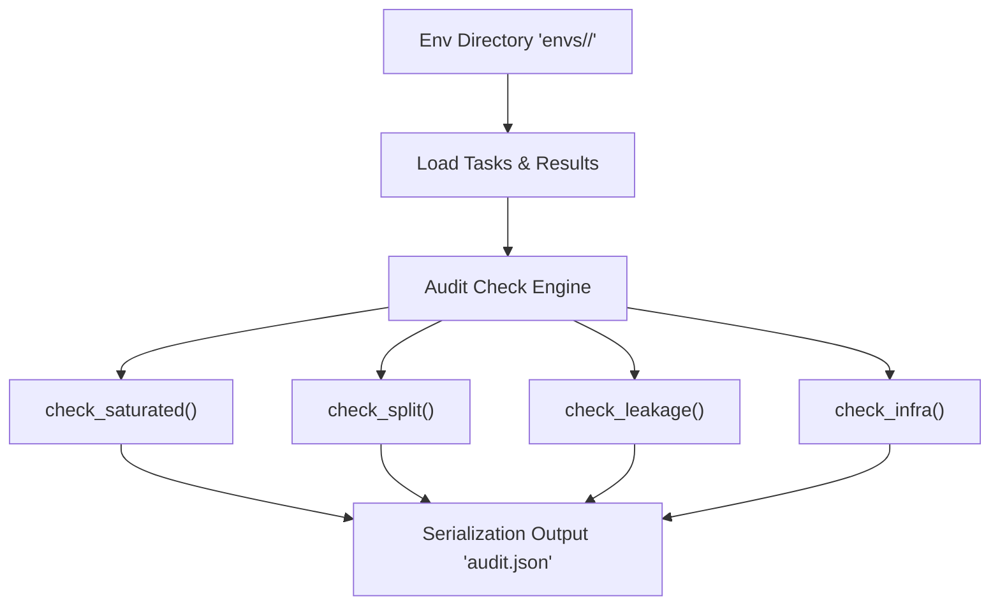
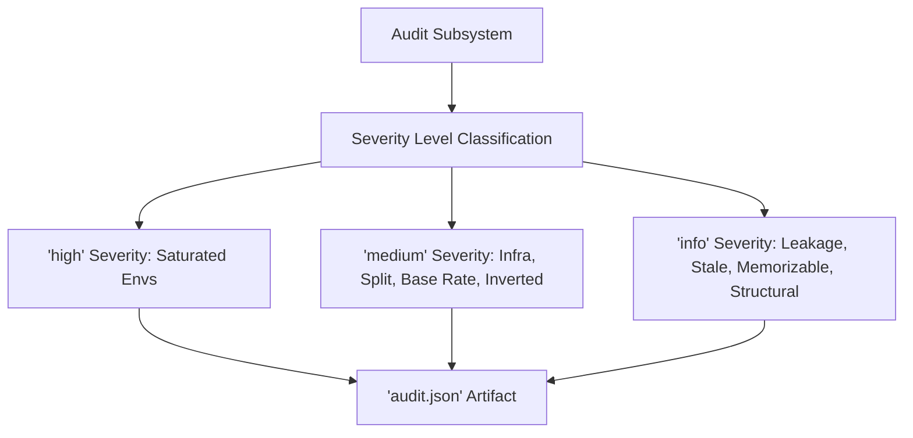

<!-- source: DeepWiki mcp.deepwiki.com · repo browser-use/rl-env-use · page 3.2 Audit Checks · fetched 2026-10-30 -->

# Audit Checks

Relevant source files

The following files were used as context for generating this wiki page:

- [envs/sec-credit/audit.json](envs/sec-credit/audit.json)
- [envs/sec-credit/climb-haiku/baseline/summary.json](envs/sec-credit/climb-haiku/baseline/summary.json)

### Purpose and Scope
The audit system evaluates the health, quality, statistical validity, and security of an environment's task suite and evaluation runs. Implemented via the auditing utility, it scans environment artifacts—such as task definitions, model rollouts, splits, and web evidence—to produce a structured report (`audit.json`) [envs/sec-credit/audit.json:1-701]. This page details the specific audit checks performed, their severity levels, and how findings are aggregated and serialized.

---

## 1. Audit Architecture and Severity Levels

The auditing process inspects generated environments to catch data leakage, structural defects, ceiling effects, and evaluation infrastructure failures before downstream tasks like hillclimbing or reinforcement learning are executed. Findings are categorized into three standard severity levels:

*   `high`: Critical blockers that invalidate the current environment configuration or evaluation setup (e.g., complete score saturation).
*   `medium`: Significant statistical or infrastructure anomalies that require attention or re-drawing (e.g., train/test split drift, base rate imbalance, harness timeouts).
*   `info`: Diagnostic counts, filtered task lists, and minor indicators (e.g., leakage counts, structural exclusions, memorizability flags).

Sources: `[envs/sec-credit/audit.json:1-701]()`

---

## 2. Breakdown of Audit Checks

The audit suite executes a battery of specific checks, each targeting a distinct failure mode in agentic environments:

### Saturated
Detects ceiling effects where a model variant or policy achieves a 100% success rate (`correct: no headroom`), indicating that tasks are too easy or lack sufficient difficulty headroom for effective hillclimbing [envs/sec-credit/audit.json:3-6].

### Base Rate
Evaluates the balance of binary or categorical outcomes in forecast tasks. If a disproportionate number of verified forecasts resolve to a single outcome (e.g., 14 out of 20 resolving "yes"), the check flags majority-outcome imbalances that skew policy optimization [envs/sec-credit/audit.json:9-11].

### Split
Measures distribution drift between training and testing splits (e.g., baseline train scoring 40% versus test scoring 49%), signaling that the split must be re-drawn to ensure statistical comparability [envs/sec-credit/audit.json:13-16].

### Infra
Monitors execution failures within the evaluation harness, tracking classes of errors such as `timeout` or `harness_error` that cause evaluation attempts to crash or fail and become excluded from scoring [envs/sec-credit/audit.json:18-56].

### Inverted
Identifies anomaly cases where a weaker or smaller model variant outperforms a frontier model (e.g., a preview model beating a frontier solver), pointing to potential task or grader bugs [envs/sec-credit/audit.json:59-64].

### Leakage
Scans tasks to ensure that gold answers or ground-truth values do not accidentally leak into the prompt text or context window, automatically filtering out tainted tasks [envs/sec-credit/audit.json:82-88].

### Structural
Validates task schema and execution requirements, filtering out tasks that contain structural malformations or broken dependencies [envs/sec-credit/audit.json:91-220].

### Memorizable
Identifies tasks that can be answered correctly closed-book without accessing live browser evidence, filtering out items that test static LLM parametric memory rather than active web-navigation and reasoning skills [envs/sec-credit/audit.json:224-235].

### Stale
Detects tasks that cite evidence or URLs no longer present on the live web page, requiring periodic re-verification of the environment source material [envs/sec-credit/audit.json:237-246].

### Ambiguous
Flags tasks identified by the critic as ambiguous, unsupported, or cases where independent recomputation disagrees with the gold standard [envs/sec-credit/audit.json:248-251].

### Grader Self-Test
Validates the correctness of underlying grader logic by executing self-tests against known positive and negative outputs to verify grading invariance.

Sources: `[envs/sec-credit/audit.json:1-701]()`

---

## 3. Data Flow and Code Entity Mapping

The audit subsystem reads raw environment specifications, model results, and task configurations, evaluates them against defined heuristics, and serializes the findings into `audit.json`.

Sources: `[envs/sec-credit/audit.json:1-701]()`

The relationship between environment evaluation entities, severity classification, and output storage is mapped below:

Sources: `[envs/sec-credit/audit.json:1-701]()`

---

