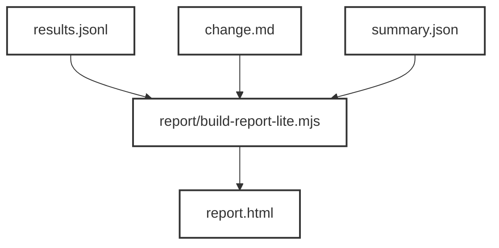
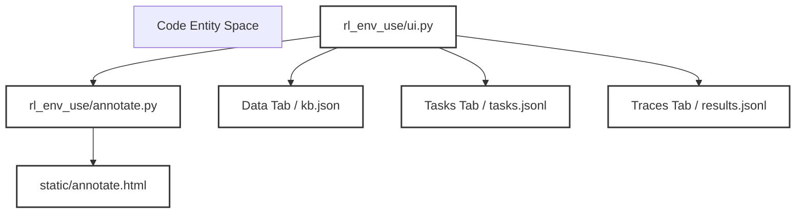

<!-- source: DeepWiki mcp.deepwiki.com · repo browser-use/rl-env-use · page 3.3 Reports and Review UI · fetched 2026-10-30 -->

# Reports and Review UI

Relevant source files

The following files were used as context for generating this wiki page:

- [envs/sec-credit/climb-haiku/report.html](envs/sec-credit/climb-haiku/report.html)
- [envs/sec-credit/climb-haiku/v1/change.md](envs/sec-credit/climb-haiku/v1/change.md)
- [envs/sec-credit/climb-qwen-35b-verified/report.html](envs/sec-credit/climb-qwen-35b-verified/report.html)

## Purpose and Scope

This page covers section 3.3 of the `rl-env-use` codebase, focusing on performance reporting, model comparison slot rendering, HTML report generation (`report/build-report-lite.mjs`, `envs/sec-credit/climb-haiku/report.html`), and the local review application (`ui.py`, `annotate.py`, and `annotate.html`) [envs/sec-credit/climb-haiku/report.html:1-9](). These components provide human evaluators and automated systems with visibility into rollout results, hillclimbing variant progressions, dataset splits, and trace data across Data, Tasks, and Traces tabs.

---

## Report Generation and Lite Reports

Reports summarize variant performance across training and test splits, tracking metrics such as mean correctness, truncation counts, and failed attempts [envs/sec-credit/climb-haiku/report.html:2-9](). The reporting engine builds standalone HTML files (`report.html`) that incorporate dark/light mode CSS variables, interactive sorting headers, and expandable variant change descriptions [envs/sec-credit/climb-haiku/report.html:2-9]().

In climb slots (such as `climb-haiku` and `climb-qwen-35b-verified`), each evaluated variant corresponds to a row in the report table, displaying its prompt modification text (`change.md`), model identifier, aggregated metrics on training cases, and test split validation numbers [envs/sec-credit/climb-haiku/report.html:2-9](), [envs/sec-credit/climb-haiku/v1/change.md:1](), [envs/sec-credit/climb-qwen-35b-verified/report.html:2-11]().

*Figure 1: Report generation pipeline mapping raw results and variant modifications into standalone HTML evaluation reports.*

Sources: `envs/sec-credit/climb-haiku/report.html:1-9`, `envs/sec-credit/climb-haiku/v1/change.md:1-2`, `envs/sec-credit/climb-qwen-35b-verified/report.html:1-11`

---

## Local Review Application Architecture

The local review app (`rl_env_use/ui.py` and `rl_env_use/annotate.py`) serves as the primary interface for inspecting environment assets, raw browser traces, and task grading outputs. It mounts a local web server that reads directly from the environment directory layout (`envs/<name>/`), exposing structured views for raw data materials, generated tasks, and step-by-step agent execution traces.

*Figure 2: Architectural bridge between review application code entities (`ui.py`, `annotate.py`) and user interface presentation tabs.*

Sources: `envs/sec-credit/climb-haiku/report.html:1-9`

---

## Review Tabs: Data, Tasks, and Traces

The review app organizes inspection into three primary operational tabs:

1. **Data Tab**: Displays raw mined materials, scout transcripts, and quote-verified facts stored within `kb.json` and associated material files. Evaluators inspect source extractions to confirm grounding.
2. **Tasks Tab**: Renders synthesized derivation and forecasting tasks (`tasks.jsonl`), showing expected gold answers, check types (e.g., number, date, set, exact, contains, prob), and audit metadata.
3. **Traces Tab**: Visualizes rollout trajectories, step screenshots, action sequences, and model outputs recorded during policy execution against environment instances (`results.jsonl`, `dropped.jsonl`).

Each tab interfaces with the underlying JSONL stores to allow interactive filtering, failure-mode inspection, and human annotation or review sign-off.

Sources: `envs/sec-credit/climb-haiku/report.html:1-9`, `envs/sec-credit/climb-qwen-35b-verified/report.html:2-11`

---

