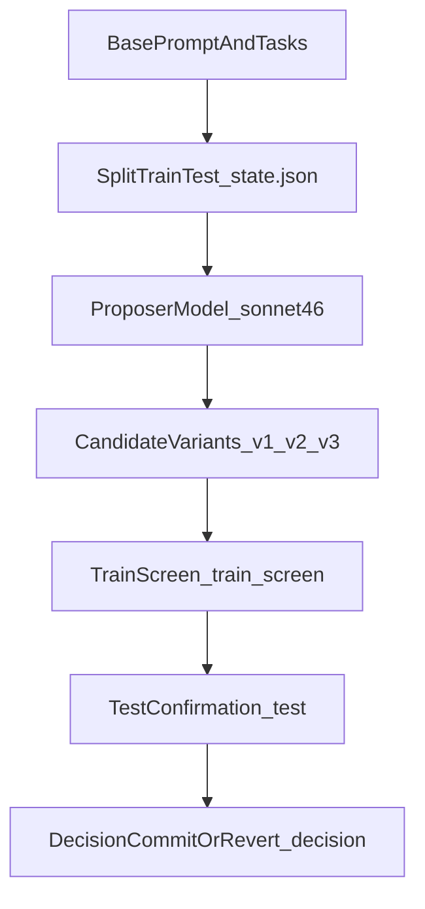
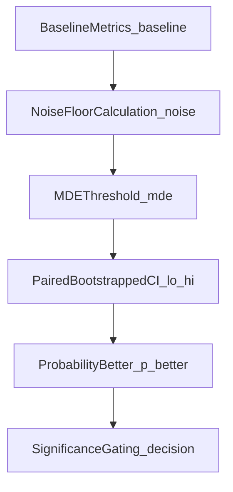

<!-- source: DeepWiki mcp.deepwiki.com · repo browser-use/rl-env-use · page 4 Prompt Hillclimbing · fetched 2026-10-30 -->

# Prompt Hillclimbing

Relevant source files

The following files were used as context for generating this wiki page:

- [README.md](README.md)
- [envs/sec-credit/climb-haiku/_state.json](envs/sec-credit/climb-haiku/_state.json)

## Purpose and Scope
This section provides an overview of the prompt hillclimbing subsystem in `rl-env-use`, which optimizes an agent's system prompt to maximize evaluation scores without overfitting [README.md:27](). Operating on top of task datasets split into train and test partitions, the hillclimbing framework iteratively analyzes failure modes, generates prompt mutations via a proposer model, screens candidates on the training set, and confirms improvements on the held-out test set using rigorous statistical gating [envs/sec-credit/climb-haiku/_state.json:1-166](). 

As a parent page, this document outlines the high-level architecture of the climb loop, statistical foundations, and variant artifacts. Detailed technical mechanisms are documented in the respective child pages.

Sources: `README.md:27-27](), [envs/sec-credit/climb-haiku/_state.json:1-166`()

---

## Climb Loop Architecture

Title: Climb Loop State and Variant Lifecycle

Sources: `envs/sec-credit/climb-haiku/_state.json:1-166](), [README.md:27-27`()

The hillclimbing loop coordinates task splitting, failure bucketization, prompt edits, and checkpoint resumption [envs/sec-credit/climb-haiku/_state.json:1-166](). By partitioning tasks at the case level, the framework ensures that prompt variants are evaluated against unseen execution paths. State is fully preserved across iterations in `_state.json`, allowing long-running optimization jobs to pause, resume, or audit historical decisions [envs/sec-credit/climb-haiku/_state.json:1-67]().

For deep technical details on split mechanics, failure bucketing, screening rounds, and state persistence, see [Climb Loop Mechanics](#4.1).

Sources: `envs/sec-credit/climb-haiku/_state.json:1-167`()

---

## Statistical Evaluation and Gating

Title: Statistical Evaluation and Gating Pipeline

Sources: `envs/sec-credit/climb-haiku/_state.json:60-81](), [README.md:27-27`()

Evaluating prompt variations against stochastic agent rollouts requires robust statistical controls. The climb loop computes baseline performance, empirical noise floors, and Minimum Detectable Effect (MDE) thresholds [envs/sec-credit/climb-haiku/_state.json:60-66](). Using paired case-clustered bootstraps and calculation of `p_better`, candidates must pass strict significance gates before being merged into the incumbent system prompt.

For details on bootstrap algorithms, confidence interval calculations, and noise floor estimation, see [Statistics: Noise Floors, MDE and Paired CIs](#4.2).

Sources: `envs/sec-credit/climb-haiku/_state.json:60-66](), [README.md:27-27`()

---

## Variant Artifacts and Directory Layout

Optimization runs generate a structured trail of artifacts within environment climb slots (e.g., `climb-haiku/`) [envs/sec-credit/climb-haiku/_state.json:1-234](). Each candidate variant records its proposed prompt modification (`change.md`), evolved system prompt (`prompt.txt`), execution rollouts, and summary metrics [README.md:61](). Reviewing these artifacts provides clear interpretability into why specific prompt edits were adopted or reverted.

For a guided walkthrough of slot directories, variant file schemas, and concrete examples from historical runs like `sec-credit climb-haiku`, see [Variant Artifacts Walkthrough](#4.3).

Sources: `envs/sec-credit/climb-haiku/_state.json:1-234](), [README.md:61-61`()

---

