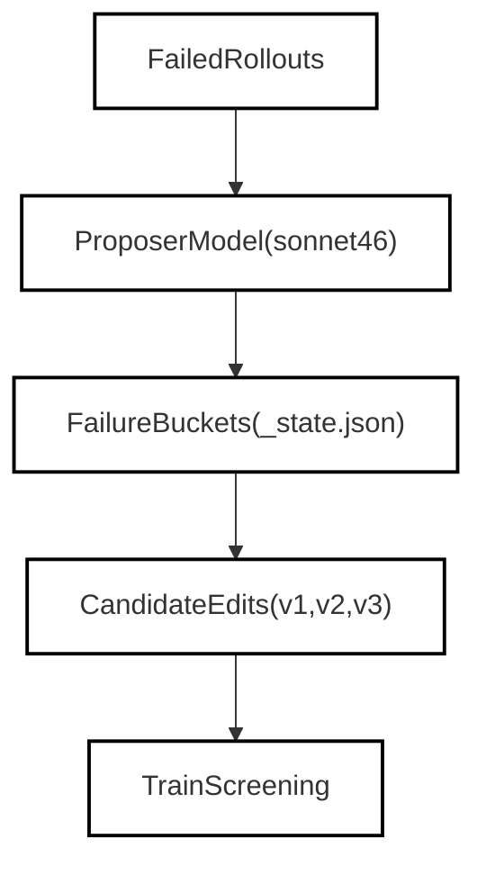
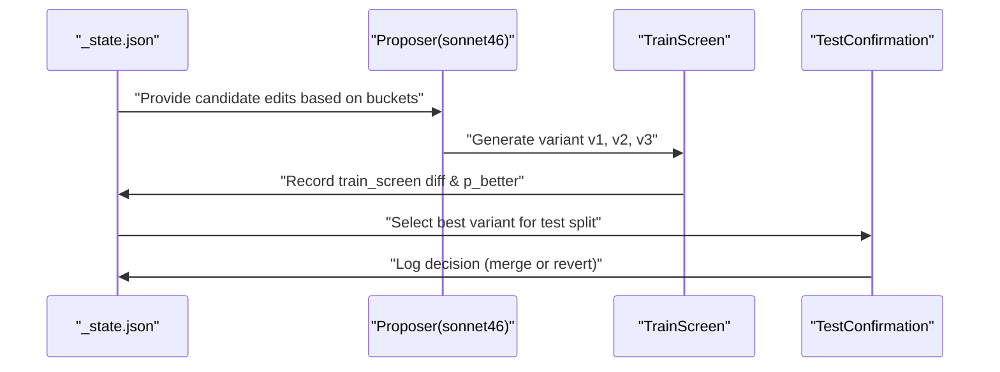

<!-- source: DeepWiki mcp.deepwiki.com · repo browser-use/rl-env-use · page 4.1 Climb Loop Mechanics · fetched 2026-10-30 -->

# Climb Loop Mechanics

<details>
<summary>Relevant source files</summary>

The following files were used as context for generating this wiki page:

- [envs/sec-credit/climb-haiku/_state.json](envs/sec-credit/climb-haiku/_state.json)
- [envs/sec-credit/climb-qwen-35b-verified/_state.json](envs/sec-credit/climb-qwen-35b-verified/_state.json)

</details>


## Purpose and Scope

This page documents the internal mechanics of prompt hillclimbing (`climb.py`) within `rl-env-use`. The system optimizes agent system prompts through an iterative evaluation loop featuring case-clustered train/test splits, multi-repetition noise estimation, LLM-driven failure bucketing, candidate prompt edits, train screening, test confirmation, and automatic reversion rules. State persistence across iterations is managed via resumable `_state.json` artifacts.

Sources: [envs/sec-credit/climb-haiku/_state.json:1-535](), [envs/sec-credit/climb-qwen-35b-verified/_state.json:1-651]()

---

## Case Splitting and Resumable State

The climb loop initializes by partitioning the available task set into disjoint `train_ids` and `test_ids` based on a deterministic split seed (`split_seed`). To prevent data leakage across correlated evaluations, splitting is clustered by case rather than individual atomic tasks.

All persistent optimization metadata, baseline metrics, round history, candidate variants, failure buckets, and decisions are serialized to `_state.json` within the climb slot directory. This ensures the climb loop is fully resumable after interruption.

```json
{
 "train_ids": ["t_098adf82", ...],
 "test_ids": ["t_026f7dbb", ...],
 "policy": "haiku",
 "surface": "system prompt (CASE_SYS + extension)",
 "proposer": "sonnet46",
 "reps": 4,
 "confidence": 0.95,
 "split_seed": 0,
 "baseline": { "train": 0.4522, "test": 0.547, "noise": 0.0433, "mde": 0.0619 }
}
```

Sources: [envs/sec-credit/climb-haiku/_state.json:1-66](), [envs/sec-credit/climb-qwen-35b-verified/_state.json:1-199]()

### Sources
- [envs/sec-credit/climb-haiku/_state.json:1-66]()
- [envs/sec-credit/climb-qwen-35b-verified/_state.json:1-199]()

---

## Rep Halves, Baselines, and Noise Floors

Before candidate generation begins, the baseline policy is evaluated across multiple execution repetitions (`reps`), configured between 3 and 4 per task [envs/sec-credit/climb-haiku/_state.json:54](), [envs/sec-credit/climb-qwen-35b-verified/_state.json:187](). 

The baseline block records:
- Train set performance (`baseline.train`) [envs/sec-credit/climb-haiku/_state.json:61]()
- Test set performance (`baseline.test`) [envs/sec-credit/climb-haiku/_state.json:62]()
- Empirical evaluation noise (`baseline.noise`) [envs/sec-credit/climb-haiku/_state.json:63]()
- Minimum Detectable Effect (`baseline.mde`) [envs/sec-credit/climb-haiku/_state.json:64]()

These metrics establish the statistical threshold required for a candidate prompt edit to be considered a genuine improvement rather than sampling variance.

Sources: [envs/sec-credit/climb-haiku/_state.json:51-66](), [envs/sec-credit/climb-qwen-35b-verified/_state.json:184-199]()

### Sources
- [envs/sec-credit/climb-haiku/_state.json:51-66]()
- [envs/sec-credit/climb-qwen-35b-verified/_state.json:184-199]()

---

## Proposer Buckets and Candidate Edits

During each optimization round, a proposer model (such as `sonnet46`) analyzes failed rollouts and partitions them into semantic failure `buckets` [envs/sec-credit/climb-haiku/_state.json:53](), [envs/sec-credit/climb-haiku/_state.json:108-146](). Each bucket groups task IDs sharing a common failure mode (e.g., rounding errors or probability underestimation) and flags whether the category is remediable via prompt tuning (`fixable: true`) [envs/sec-credit/climb-haiku/_state.json:122]().

Based on these buckets, the proposer generates discrete candidate prompt extensions (`variant: "v1"`, `"v2"`, etc.) targeting specific reasoning or calibration flaws.


*Figure 1: Natural Language Space to Code Entity Space mapping failure analysis to candidate variants in `_state.json`.*

Sources: [envs/sec-credit/climb-haiku/_state.json:53](), [envs/sec-credit/climb-haiku/_state.json:70-146]()

### Sources
- [envs/sec-credit/climb-haiku/_state.json:53]()
- [envs/sec-credit/climb-haiku/_state.json:70-146]()

---

## Train Screening, Test Confirmation, and Revert Rules

Candidate variants undergo a rigorous two-tier evaluation gate:

1. **Train Screening (`train_screen`)**: Each candidate variant is evaluated on the training split to compute performance differences (`diff`), confidence intervals (`lo`, `hi`), and the probability that the variant outperforms the baseline (`p_better`) [envs/sec-credit/climb-haiku/_state.json:74-81]().
2. **Test Confirmation and Decision**: The top candidate is promoted to evaluate against the test split. If test performance is flat or degraded, the loop triggers a reversion (`decision: "revert (test flat or down)"` or `"revert (no train gain)"`) [envs/sec-credit/climb-haiku/_state.json:157-166](), [envs/sec-credit/climb-qwen-35b-verified/_state.json:277]().


*Figure 2: Execution flow of candidate screening and decision logging in `_state.json`.*

Sources: [envs/sec-credit/climb-haiku/_state.json:67-166](), [envs/sec-credit/climb-qwen-35b-verified/_state.json:200-283]()

### Sources
- [envs/sec-credit/climb-haiku/_state.json:67-166]()
- [envs/sec-credit/climb-qwen-35b-verified/_state.json:200-283]()

---

