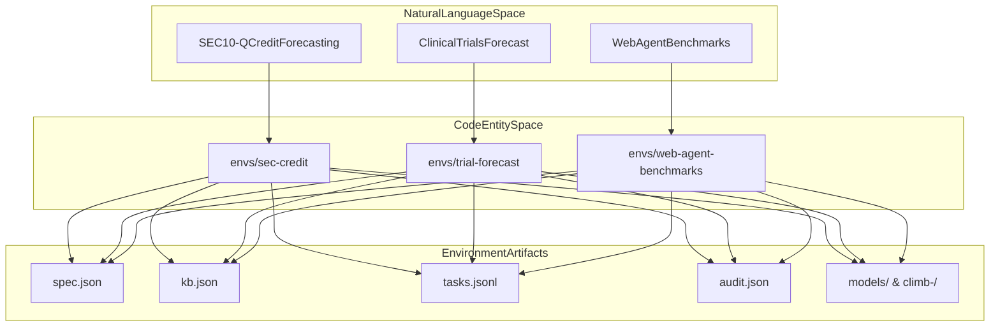

<!-- source: DeepWiki mcp.deepwiki.com · repo browser-use/rl-env-use · page 5 Shipped Environments · fetched 2026-10-30 -->

# Shipped Environments

Relevant source files

The following files were used as context for generating this wiki page:

- [README.md](README.md)
- [envs/sec-credit/audit.json](envs/sec-credit/audit.json)

## Purpose and Scope

This page provides a high-level overview of the `envs/` directory, which houses fully realized and verified reinforcement learning environments shipped with `rl-env-use`. Each environment represents a distinct real-world domain where Browser Use agents mine cases, synthesize tasks, grade outcomes, and evaluate frontier models [README.md:22-29](). 

As a parent page, this section summarizes the available shipped environments and their structural components. For detailed metrics, task categories, filtering statistics, and hillclimbing runs, refer to the child pages:
- For SEC 10-Q/10-K credit forecasting, see [sec-credit](#5.1).
- For ClinicalTrials.gov forecasting and browser-agent benchmarks, see [trial-forecast and web-agent-benchmarks](#5.2).

Sources: [README.md:22-29]()

---

## Environment Ecosystem Architecture

The `envs/` directory contains isolated environment packages. Each package standardizes its datasets, verification logs, and model evaluation slots into a consistent file schema (`spec.json`, `kb.json`, `tasks.jsonl`, `audit.json`, and evaluation directories like `models/` or `climb-<model>/`) [envs/sec-credit/audit.json:1-271]().

*Figure 5.1: Mapping natural language evaluation domains to filesystem code entities within `envs/`.*

Sources: [envs/sec-credit/audit.json:1-271]()

---

## Shipped Domains Overview

The framework currently ships with three primary evaluation suites, balancing financial forecasting, biomedical prediction, and general web-agent navigation tasks [README.md:53-62]().

### SEC Credit Forecasting (`sec-credit`)
The `sec-credit` environment focuses on financial statement analysis, equity dilution forecasts, liquidity analysis, and cash runway projections derived from real SEC filings (10-Q and 10-K) [envs/sec-credit/audit.json:67-69](). It runs rigorous automated filters to eliminate leaked answers, structurally invalid tasks, and memorizable closed-book questions [envs/sec-credit/audit.json:82-246](). 

For detailed task categories, filtering statistics, and specific hillclimbing runs (such as `climb-haiku` and `climb-qwen-35b-verified`), see [sec-credit](#5.1).

### Trial Forecast and Web Agent Benchmarks (`trial-forecast` & `web-agent-benchmarks`)
The `trial-forecast` environment evaluates whether completed clinical trials met their primary endpoints based on registered protocols from ClinicalTrials.gov [README.md:42-54](). It includes post-cutoff trials to prevent data leakage and tests model calibration over binary and multi-choice prediction tasks [README.md:53-62](). The `web-agent-benchmarks` suite complements this with web navigation and multi-step extraction challenges.

For detailed breakdowns of browse tasks versus case tasks, hillclimbing slots, and calibration scores, see [trial-forecast and web-agent-benchmarks](#5.2).

Sources: [README.md:42-62](), [envs/sec-credit/audit.json:67-246]()

---

