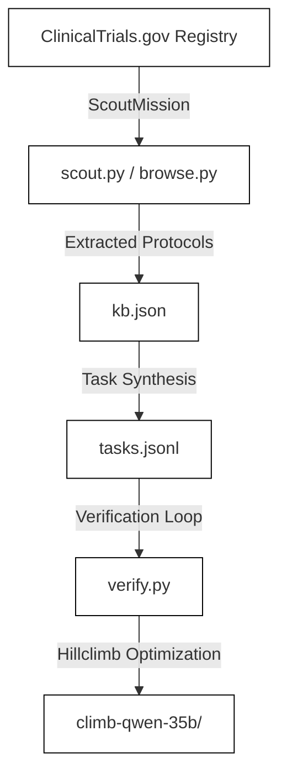
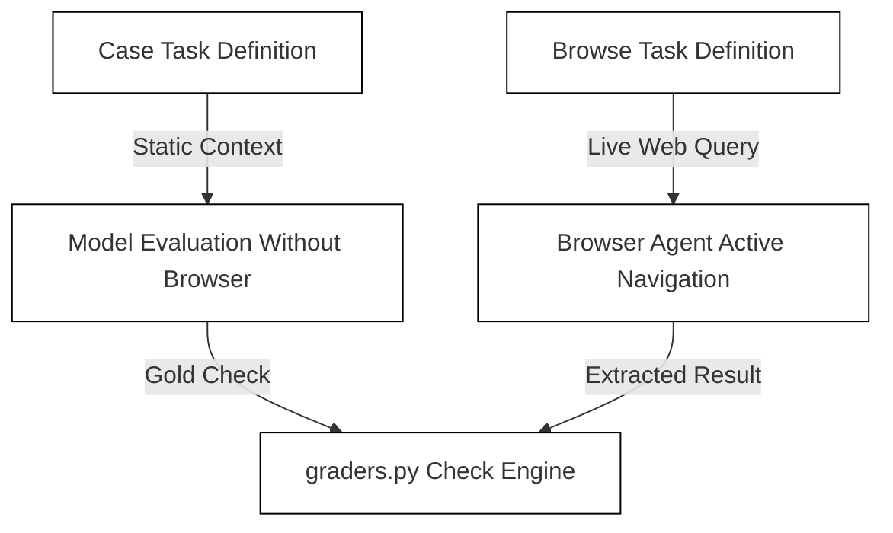

<!-- source: DeepWiki mcp.deepwiki.com · repo browser-use/rl-env-use · page 5.2 trial-forecast and web-agent-benchmarks · fetched 2026-10-30 -->

# trial-forecast and web-agent-benchmarks

Relevant source files

The following files were used as context for generating this wiki page:

- [README.md](README.md)
- [SKILL.md](SKILL.md)

This section details the concrete shipped ClinicalTrials.gov forecasting environment (`envs/trial-forecast`) and the architecture of browser-agent benchmark environments. It covers how clinical trial outcomes are mined, how tasks are structured for temporal out-of-distribution evaluation, and the structural differences between offline case tasks and online browse tasks.

---

## ClinicalTrials.gov Forecast Environment (`envs/trial-forecast`)

The `envs/trial-forecast` environment serves as the primary benchmark for predicting real-world outcomes that occur after a model's training cutoff [README.md:53-54]. Specifically, it tracks completed clinical trials registered on ClinicalTrials.gov whose results were posted after July 2026 [README.md:53-54].

### Core Environment Characteristics
- **Data Volume**: Contains 35 forecasts derived from 29 distinct ClinicalTrials.gov trials [README.md:53-54].
- **Cost Efficiency**: Built with a total budget of $72, where $17 is allocated directly to Browser Use API executions [README.md:54].
- **Task Formulation**: Models are provided with the registered trial protocol and trial metadata, and must predict whether the trial met its primary endpoint [README.md:42-43].
- **Performance & Calibration**: A baseline model (e.g., Qwen 35B) improves significantly via system prompt hillclimbing, moving from an accuracy of 0.53 to 0.78 on held-out tasks, matching frontier models like Opus 5.5 [README.md:58-59]. Because a naive "always answer 50%" strategy scores 0.75, the primary gain stems from calibration—stopping the model from outputting uncalibrated 0 or 1 extremes [README.md:59].

*Diagram 1: ClinicalTrials.gov environment creation and verification flow.*

Sources: `README.md:42-61`, `SKILL.md:18-28`

---

## Case Tasks vs. Browse Tasks

Environments in `rl-env-use` diverge significantly based on whether they evaluate static analytical skills or active web-navigation capabilities. This distinction is controlled during environment initialization [SKILL.md:60-61].

### Case Tasks (Offline Reading)
- **Definition**: The model under test receives a fully compiled set of reference materials (e.g., a trial protocol, financial 10-Q, or sequence data) inside its prompt context.
- **Execution**: The model executes its evaluation **without a browser** [SKILL.md:11]. It reads the static context and answers the derived or forecast question.
- **Data Flow**: Materials are mined once by Browser Use agents during the `build` phase, stored in `kb.json`, and served statically via `Env` [`SKILL.md:19-20`].

### Browse Tasks (Online Navigation)
- **Definition**: Triggered when an environment is initialized without a static `--skill` definition (or explicitly via browse-task configuration) [SKILL.md:60-61].
- **Execution**: The evaluation harness does not provide pre-mined documents. Instead, the model or its accompanying browser agent must actively navigate the live web to locate answers [SKILL.md:60-61].
- **Data Flow**: Tasks require real-time URL fetching, search queries, and multi-step DOM interaction. The benchmark measures the agent's ability to locate, verify, and extract facts dynamically rather than reasoning purely over static text contexts.

*Diagram 2: Comparative data flow between offline case tasks and online browse tasks.*

Sources: `README.md:11-12`, `SKILL.md:60-61`

---

## Browser-Agent Benchmarks and Hillclimb Slots

The benchmark environments leverage Browser Use agents to mine complex real-world data and establish rigorous verification thresholds before exposing tasks to models.

### Mission Mining and Verification
- Browser Use agents execute exploratory missions defined in environment specs to harvest materials and quote-verified facts [README.md:11-12, SKILL.md:19-20].
- Agents handle login flows, anti-bot mechanisms, and pagination to retrieve unstructured multi-page records (such as clinical trial outcome reports).
- Harvested facts undergo rigorous verification where gold answers are computed programmatically [README.md:25]. If a frontier evaluation panel solves a task too easily, the task is sent back to the drafter to be regenerated with higher difficulty [SKILL.md:38-39].

### Hillclimb Slots and Artifact Structure
When evaluating or optimizing models on browser-agent benchmarks, runs are isolated into dedicated directory slots [SKILL.md:24-27]:
- `models/`: Stores comparative evaluation outputs across different frontier and open-weights models [SKILL.md:24].
- `climb-<model>/`: Houses prompt hillclimbing artifacts, tracking the baseline against successive prompt variants (`v1`, `v2`, etc.) [SKILL.md:25, SKILL.md:29].
- Within each climb slot, `change.md` records the semantic rationale for each prompt edit, `prompt.txt` stores the complete system prompt, and `_state.json` maintains resumable optimization state [SKILL.md:25].

Sources: `README.md:11-28`, `SKILL.md:18-30`

---

