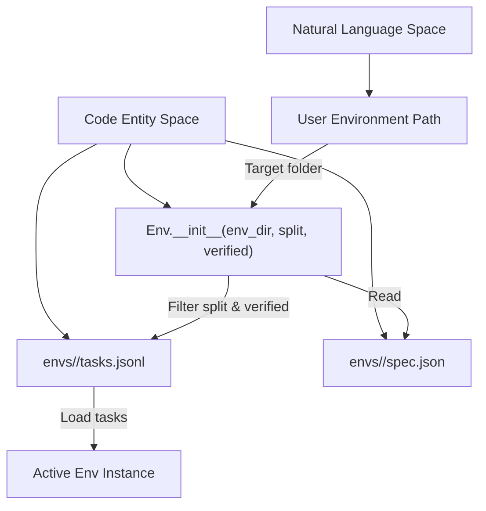
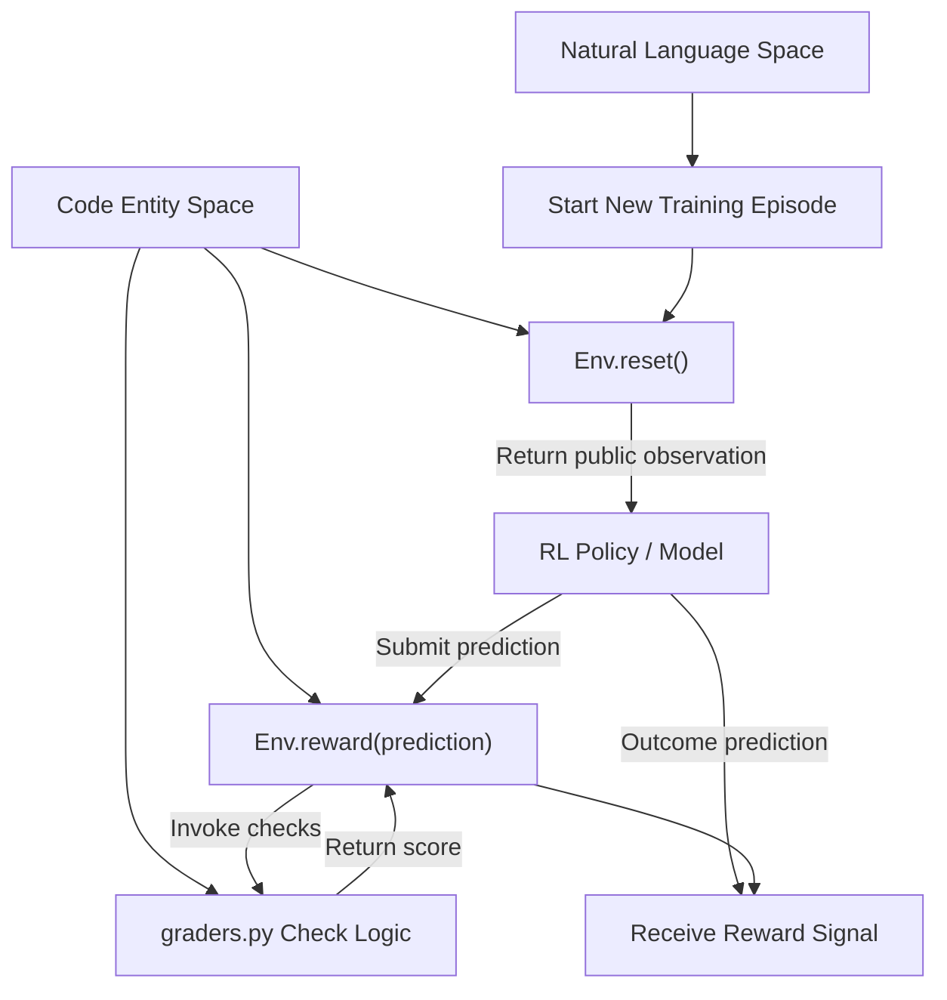
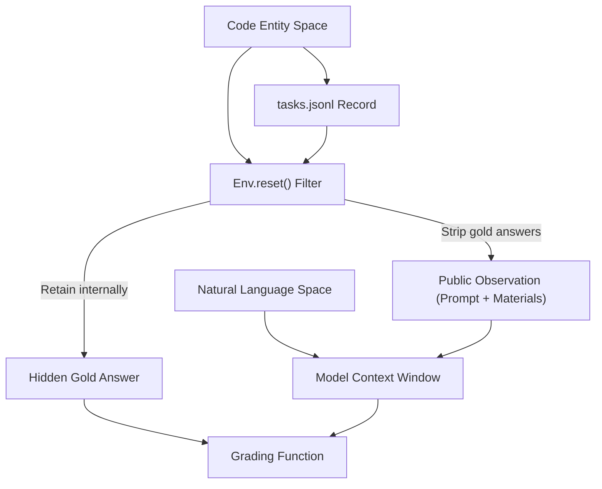
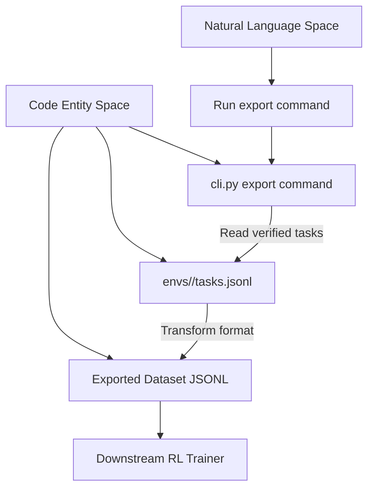

<!-- source: DeepWiki mcp.deepwiki.com · repo browser-use/rl-env-use · page 6.1 The Env API and Dataset Export · fetched 2026-10-30 -->

# The Env API and Dataset Export

Relevant source files

The following files were used as context for generating this wiki page:

- [README.md](README.md)
- [SKILL.md](SKILL.md)

## Purpose and Scope
This section covers the programmatic interface provided by `env.py` via the `Env` class, enabling external reinforcement learning (RL) trainers and evaluation harnesses to interact with verified environments (`envs/<name>/`) [README.md:28](). It details how environments load task splits, manage episode state through `reset()`, evaluate model predictions via `reward()`, hide gold answers from public observations, and export structured datasets to JSONL format for downstream RL training [SKILL.md:84]().

---

## 1. The `Env` Class Initialization and Configuration
The primary programmatic entry point for interacting with a built environment is the `Env` class. Initializing an instance requires specifying the environment directory, the dataset split, and whether to load strictly verified tasks [SKILL.md:84]().

- **`Env(env_dir, split, verified)`**: Loads configuration, materials, and tasks from `envs/<name>/` [SKILL.md:18-21]().
- **`split`**: Filters tasks according to the train/test partitioning established during the build and split phases [SKILL.md:81]().
- **`verified`**: Ensures only tasks passing the frontier panel and hardening loops are served [SKILL.md:38]().

Sources: [README.md:28](), [SKILL.md:18-25]()

---

## 2. Episode Management: `reset`, `reward`, and `rollout`
Once instantiated, the `Env` object exposes standard interface methods used by policy runners and training loops to step through tasks, present public observations, and compute rewards based on programmatic grading rules [SKILL.md:84]().

- **`reset()`**: Selects the next task or episode from the active split, hides sensitive gold attributes, and returns the public observation containing task instructions and associated materials.
- **`reward(prediction)`**: Evaluates the model's prediction against the hidden gold answer using the task's configured grading mechanism (number, date, set, exact, contains, or probability) [SKILL.md:69-70]().
- **`rollout()`**: Executes policy evaluation over tasks, tracking cost ledgers and recording transcripts into `results.jsonl` or `dropped.jsonl` [SKILL.md:26-27]().

Sources: [SKILL.md:69-84]()

---

## 3. Public Observations and Gold Hiding
To prevent data leakage during training and evaluation, the environment enforces strict boundary separation between public model inputs and private evaluation metadata.

- **Public Observations**: Contains only the prompt, instructions, and materials retrieved during scout/look phases [SKILL.md:11]().
- **Gold Hiding**: True outcome facts, numerical answers, and verification metadata remain strictly isolated within the environment state and are never exposed directly to the policy input stream [README.md:25]().

Sources: [README.md:25](), [SKILL.md:21]()

---

## 4. Dataset Export for RL Trainers
Environments can serialize their verified task sets into formats directly consumable by external reinforcement learning trainers or offline fine-tuning pipelines [README.md:28]().

- **`export envs/<name>`**: CLI command that processes `tasks.jsonl` and serializes records into standard JSONL files containing task prompts, public inputs, and grading specifications [SKILL.md:84]().
- **Trainer Integration**: Allows exported files to be ingested by custom training loops, policy gradient frameworks, or rejection sampling pipelines.

Sources: [README.md:28](), [SKILL.md:84]()

---

