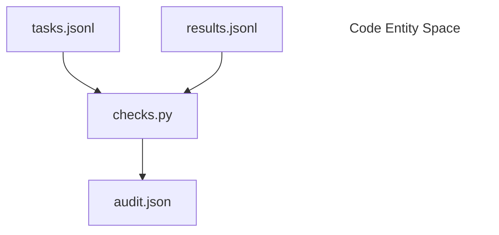

<!-- source: DeepWiki mcp.deepwiki.com · repo browser-use/rl-env-use · page 6.2 Judges, Checks and Vanilla Comparison · fetched 2026-10-30 -->

# Judges, Checks and Vanilla Comparison

<details>
<summary>Relevant source files</summary>

The following files were used as context for generating this wiki page:

- [SKILL.md](SKILL.md)
- [envs/sec-credit/audit.json](envs/sec-credit/audit.json)

</details>


## Purpose and Scope

This page covers the technical implementation and operational mechanics of calibrated failure-mode judges (`judges.py`), structural and validation checks (`checks.py`), and the vanilla browsing comparison harness (`vanilla.py` alongside the `compare` CLI command). These modules ensure data integrity, evaluate agent failure modes against human labels, and provide an A/B benchmark comparing custom Browser Use agent workflows against vanilla Claude Code browsing [SKILL.md:1-89]().

Sources: [SKILL.md:1-89]()

---

## 1. Calibrated Failure-Mode Judges (`judges.py`)

The judges module (`judges.py`) processes model failure transcripts and error traces to categorize failure modes. Once human reviewers label failure transcripts via the local review app interface, the judges module calibrates automated evaluations to match human verdicts.

```mermaid
graph TD
    A["ReviewInterface"] -->| "Human Verdicts" | B["reviews.jsonl"]
    B --> C["CodifyCommand"]
    C --> D["judges.py"]
    D -->| "Calibrated Rules" | E["Automated Judge System"]
    
    sub5["Code Entity Space"]
    style sub5 fill:none,stroke:none
    click D "judges.py"
    click B "reviews.jsonl"
```
*Figure 1: Natural Language Space to Code Entity Space mapping for human label codification and judge calibration.*

Sources: [SKILL.md:1-85]()

---

## 2. Environment and Audit Checks (`checks.py`)

The checks system validates environment integrity, task quality, and split distributions. It produces structured validation records stored in `audit.json`. Audit checks enforce constraints across multiple severity levels (`high`, `medium`, `info`) [envs/sec-credit/audit.json:1-221]().

Key check categories tracked by the audit system include:
* **Saturated**: Flags tasks or splits where models achieve 100% accuracy, indicating a lack of headroom [envs/sec-credit/audit.json:3-6]().
* **Base Rate**: Ensures outcome distributions for forecast tasks do not heavily skew in a single direction (e.g., capped at 60% resolution one way) [envs/sec-credit/audit.json:9-11]().
* **Split**: Detects distribution drift between train and test splits beyond expected statistical noise [envs/sec-credit/audit.json:14-16]().
* **Infra**: Tracks harness errors, timeouts, and execution crashes during rollouts [envs/sec-credit/audit.json:19-56]().
* **Inverted**: Identifies anomalies where smaller or baseline models outperform frontier models on specific task IDs [envs/sec-credit/audit.json:59-64]().
* **Leakage & Memorizable**: Filters tasks where answers leak into prompt contexts or can be resolved via closed-book memory rather than material analysis [envs/sec-credit/audit.json:82-88](), [envs/sec-credit/audit.json:224-235]().


*Figure 2: Data flow from tasks and rollout results through environment verification checks into `audit.json`.*

Sources: [envs/sec-credit/audit.json:1-221]()

---

## 3. Vanilla Claude Code Comparison (`vanilla.py` and `compare`)

To measure the net advantage of specialized browser-use agents versus standard tool-use workflows, `vanilla.py` executes an A/B benchmark. Triggered via the `compare` command, this subsystem runs mining missions using vanilla Claude Code (leveraging standard WebSearch and WebFetch tools with identical model configurations and instructions) and feeds both arms through identical synthesis and verification pipelines [SKILL.md:86-89]().

Sources: [SKILL.md:86-89]()

---

