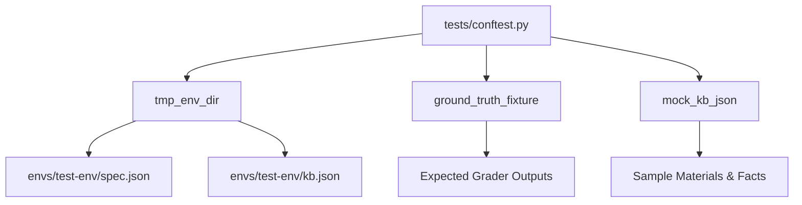
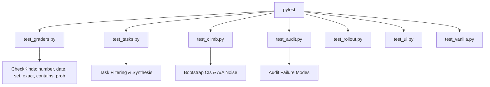

<!-- source: DeepWiki mcp.deepwiki.com · repo browser-use/rl-env-use · page 6.3 Testing · fetched 2026-10-30 -->

# Testing

Relevant source files

The following files were used as context for generating this wiki page:

- [.gitignore](.gitignore)
- [SKILL.md](SKILL.md)

## Purpose and Scope

The testing framework located in the `tests/` directory of `rl-env-use` ensures the correctness, determinism, and robustness of the environment building, grading, rollout, and optimization pipelines. The test suite is structured into fast offline unit tests—exercising individual modules (`graders`, `tasks`, `climb`, `audit`, `rollout`, `ui`, `vanilla`)—and live integration tests that validate end-to-end agent workflows against real or mocked backends. Shared fixtures, mock environments, and `ground_truth` datasets are centralized to support rapid test execution during development.

Sources: [SKILL.md:1-89]()

---

## 1. Test Layout and Fixtures (`conftest.py`)

The test infrastructure relies on `pytest` configuration and shared fixtures defined in `tests/conftest.py`. These fixtures set up temporary environment directories (`envs/<name>/`), seed sample knowledge bases (`kb.json`), draft tasks (`tasks.jsonl`), and provide deterministic `ground_truth` outcome structures for offline testing.

*Figure 1: Fixture data flow in `tests/conftest.py`.*

Sources: [.gitignore:1-19](), [SKILL.md:15-30]()

---

## 2. Offline Unit Tests per Module

Offline unit tests execute without external network calls or API keys, using deterministic mocks and pre-mined fixtures. The test suite is partitioned by core subsystem:

### Graders and Tasks (`test_graders.py`, `test_tasks.py`)
Validate programmatic grading logic across check kinds (`number`, `date`, `set`, `exact`, `contains`, `prob`). Tests pass null, foreign, and perturbed gold answers to ensure strict immunity to false positives. Task synthesis tests verify keep/filter rules and derivative expression evaluations.

### Hillclimb Mechanics (`test_climb.py`)
Tests the hillclimb state machine (`climb-<model>/_state.json`), split-by-case logic, A/A noise estimation from rep halves, proposer bucket edits, and paired case-clustered bootstrap significance testing.

### Audit Checks (`test_audit.py`)
Executes validation rules against mock audit states, testing detection for `saturated`, `base_rate`, `split`, `infra`, `inverted`, `leakage`, `structural`, `memorizable`, `stale`, and `ambiguous` failure modes.

### Rollouts and UI (`test_rollout.py`, `test_ui.py`)
Mocks policy execution over tasks, rep counts, cost ledgers, and OpenRouter request formatting. UI tests check HTML report generation (`report.html`) and review application data handlers.

### Vanilla Comparison (`test_vanilla.py`)
Verifies the comparative harness (`compare`) between RL agents and vanilla Claude Code browsing baselines.

*Relationship between unit test modules and system components.*

Sources: [SKILL.md:32-52]()

---

## 3. Live and Integration Tests

Live tests interact with real APIs (OpenRouter, Browser Use services) and require valid credentials (`OPENROUTER_API_KEY`, `BROWSER_USE_API_KEY`). These tests are marked with pytest markers (e.g., `@pytest.mark.live`) to prevent accidental execution during standard offline development. They execute end-to-end sandbox environment builds (`build`), short rollouts (`run`), and verify that generated run artifacts match expected schema invariants.

Sources: [.gitignore:1-4](), [SKILL.md:32-52]()

---

