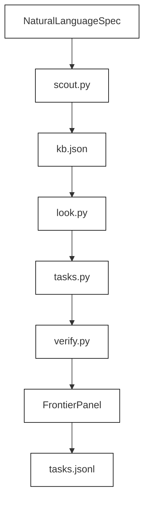
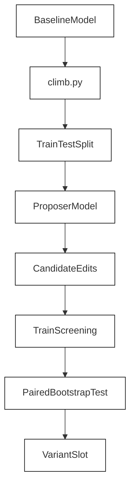

<!-- source: DeepWiki mcp.deepwiki.com · repo browser-use/rl-env-use · page 7 Glossary · fetched 2026-10-30 -->

# Glossary

Relevant source files

The following files were used as context for generating this wiki page:

- [README.md](README.md)
- [SKILL.md](SKILL.md)
- [envs/sec-credit/audit.json](envs/sec-credit/audit.json)
- [envs/sec-credit/climb-haiku/_state.json](envs/sec-credit/climb-haiku/_state.json)

## Purpose and Scope

This page provides formal technical definitions for the core codebase jargon, pipeline phases, data structures, and statistical terms used across `rl-env-use`. Every term is mapped to its functional role within the codebase, referencing relevant files and data flows.

Sources: [`README.md:1-80`]() [`SKILL.md:1-90`]()

---

## Core Concepts and Data Entities

### Case
A **case** represents a discrete real-world instance (such as a corporate SEC filing or a clinical trial) comprising raw input materials and a verified historical outcome [SKILL.md:10-11](). Cases are stored and tracked across mining missions [SKILL.md:20]().
* **Code Reference**: Defined and stored within `kb.json` per environment [SKILL.md:20]() and split across training/testing partitions during hillclimbing [SKILL.md:45]().

### Material
**Materials** are the raw source documents mined by agents (e.g., trial protocols, 10-Q statements, registry web pages) that are supplied as context to the model under test [README.md:24]().
* **Code Reference**: Cataloged in `envs/<name>/kb.json` [SKILL.md:20]() and referenced by task verification pipelines [SKILL.md:26]().

### Fact
A **fact** is an atomic, quote-verified data point extracted from the web that establishes a ground-truth outcome or intermediary property [SKILL.md:20](). Facts are checked against source quotes before being used to synthesize tasks.
* **Code Reference**: Stored in `envs/<name>/kb.json` [SKILL.md:20]().

### Mission
A **mission** is a targeted execution directive given to a Browser Use agent to explore a registry or URL source, mine specific materials, and extract facts [SKILL.md:20]().
* **Code Reference**: Managed during the scout stage [SKILL.md:36]() and logged in `envs/<name>/kb.json` [SKILL.md:20]().

### Gold
**Gold** refers to the verified ground-truth answer for a task, computed automatically by code expressions or verified via extracted outcome quotes [README.md:25]().
* **Code Reference**: Defined in `tasks.jsonl` [SKILL.md:21]() and validated by `graders.py` [SKILL.md:69-70]().

Sources: [`SKILL.md:10-21`]() [`README.md:24-25`]()

---

## Environment Build and Inspection Pipeline

### Scout
**Scout** is the initial data-gathering phase of the environment build pipeline where Browser Use agents navigate target URLs, discover cases, and collect source materials [SKILL.md:36]().
* **Code Reference**: Executed via `build envs/<name>` [SKILL.md:64]() using mining logic in `scout.py` and `browse.py` [SKILL.md:88]().

### Look
The **look** stage measures what a plain HTTP fetch captures versus what is rendered at the browser edge, ensuring that tasks actually require browser-based interaction [SKILL.md:36]().
* **Code Reference**: Displayed via `build envs/<name> --only look` [SKILL.md:64]().

### Derive / Forecast Task
* **Derive Task**: A task where the answer is computed programmatically via an expression over numbers present in the materials [SKILL.md:37]().
* **Forecast Task**: A task requiring the model to predict a future or unreleased outcome based on historical materials [SKILL.md:38]().
* **Code Reference**: Generated in `tasks.jsonl` [SKILL.md:21]() and processed by `tasks.py` [SKILL.md:69]().

### Frontier Panel
The **frontier panel** consists of a group of frontier models (e.g., Opus, GPT-Astra, Gemini) used to benchmark task difficulty [SKILL.md:38](). Tasks solved by all panel models are automatically rejected or made harder [SKILL.md:38]().
* **Code Reference**: Configured during verification [SKILL.md:38]() and evaluated in `verify.py` [SKILL.md:38]().

### Closed-Book
A **closed-book** test evaluates whether a model can answer a task correctly without access to the input materials, thereby testing memory contamination or pre-training leakage [SKILL.md:70]().
* **Code Reference**: Implemented as part of audit and verification checks in `audit.json` [envs/sec-credit/audit.json:224-235]() and `verify.py` [SKILL.md:38]().

### Blind Ablation
**Blind ablation** is an evaluation mode where source materials are intentionally withheld from the policy to confirm that tasks cannot be solved via priors alone [SKILL.md:26]().
* **Code Reference**: Executed under `hillclimb/ablation/` runs [SKILL.md:26]().

Sources: [`SKILL.md:21-70`]() [`envs/sec-credit/audit.json:224-235`]()

*Sources: [`SKILL.md:20-40`]*

---

## Audit and Filtering Terminology

### Saturated
A task set or model slot is **saturated** when performance hits 100% or reaches the ceiling, leaving no headroom to measure further improvements [envs/sec-credit/audit.json:4-6]().
* **Code Reference**: Flagged with `severity: high` in `audit.json` [envs/sec-credit/audit.json:4-6]().

### Leakage
**Leakage** occurs when the gold answer or outcome is inadvertently exposed within the task prompt or input materials [envs/sec-credit/audit.json:82-88]().
* **Code Reference**: Detected during audit checks and logged in `audit.json` [envs/sec-credit/audit.json:82-88]().

### Memorizable
A task is **memorizable** if it can be solved accurately using pre-training knowledge without processing the provided case context [envs/sec-credit/audit.json:224-235]().
* **Code Reference**: Filtered out automatically and reported in `audit.json` [envs/sec-credit/audit.json:224-235]().

### Stale
A task is **stale** when it references source evidence or URLs that are no longer active or present on the live web page [envs/sec-credit/audit.json:238-245]().
* **Code Reference**: Filtered out during verification audits in `audit.json` [envs/sec-credit/audit.json:238-245]().

### Dropped Rep
A **dropped rep** refers to execution repetitions (reps) that failed during rollout and were excluded from final scoring [SKILL.md:27]().
* **Code Reference**: Logged in `dropped.jsonl` within evaluation slots [SKILL.md:27]().

### Harness Error
A **harness error** designates an infrastructure timeout, crash, or execution failure occurring within the evaluation runner rather than a model response failure [envs/sec-credit/audit.json:46]().
* **Code Reference**: Tracked under `audit.json` infra checks [envs/sec-credit/audit.json:43-48]() and `errors.jsonl` [SKILL.md:27]().

Sources: [`envs/sec-credit/audit.json:4-245`]() [`SKILL.md:27`]()

---

## Hillclimbing and Statistical Jargon

### A/A Noise
**A/A noise** measures the variance in evaluation metrics derived from randomized rep halves, establishing the baseline noise floor for comparisons [SKILL.md:45]().
* **Code Reference**: Computed in `climb.py` and stored in state configurations [envs/sec-credit/climb-haiku/_state.json:63]().

### MDE (Minimum Detectable Effect)
**MDE** is the statistical threshold representing the smallest performance delta that can be reliably distinguished from noise given the sample size and variance [envs/sec-credit/climb-haiku/_state.json:64]().
* **Code Reference**: Calculated during hillclimb initialization [envs/sec-credit/climb-haiku/_state.json:64]().

### Noise Floor
The **noise floor** defines the lower bound of score fluctuation attributable to random sampling variance rather than true prompt modifications [envs/sec-credit/climb-haiku/_state.json:63]().
* **Code Reference**: Stored in `_state.json` [envs/sec-credit/climb-haiku/_state.json:63]() and enforced in `climb.py`.

### Incumbent
The **incumbent** is the current best-performing system prompt variant against which new candidate prompts compete during a hillclimbing round.
* **Code Reference**: Maintained across iterations in `climb-<model>/` [SKILL.md:25]().

### Bucket
A **bucket** is a grouping of failing task IDs categorized by specific error modes or failure patterns during error analysis [envs/sec-credit/climb-haiku/_state.json:108-146]().
* **Code Reference**: Defined in `_state.json` during round analysis [envs/sec-credit/climb-haiku/_state.json:108-146]().

### Edit
An **edit** is a proposed textual modification to the system prompt generated by a proposer model to address specific failure buckets [envs/sec-credit/climb-haiku/_state.json:73]().
* **Code Reference**: Stored as candidates in `_state.json` [envs/sec-credit/climb-haiku/_state.json:73]() and written to `change.md` [SKILL.md:25]().

### Slot
A **slot** is a dedicated subdirectory under `models/` or an environment directory representing an isolated model evaluation or hillclimb run [SKILL.md:24-25]().
* **Code Reference**: Structured as `<slot>/change.md`, `results.jsonl`, and `prompt.txt` [SKILL.md:24-29]().

### Variant
A **variant** is a numbered prompt iteration (e.g., `v1`, `v2`, `v3`) evaluated during a hillclimbing loop [SKILL.md:25]().
* **Code Reference**: Recorded in `_state.json` candidates and corresponding variant subdirectories [envs/sec-credit/climb-haiku/_state.json:72-106]().

### Train/Test Split
The **train/test split** partitions environment cases into training subsets (used for screening prompt edits) and test subsets (used for unbiased confirmation) [SKILL.md:45]().
* **Code Reference**: Defined by `train_ids` and `test_ids` in `_state.json` [envs/sec-credit/climb-haiku/_state.json:2-50]().

Sources: [`SKILL.md:24-45`]() [`envs/sec-credit/climb-haiku/_state.json:2-146`]()

*Sources: [`SKILL.md:45-48`]*

---

## Operational and Execution Jargon

### Ledger
The **ledger** tracks API token usage, model routing costs, and total expenditures across mining, verification, and evaluation runs [SKILL.md:27]().
* **Code Reference**: Maintained globally during rollouts and logged in runtime states [SKILL.md:27]().

### Env Flow
**Env flow** refers to the modular directory pipeline and execution paths governing run outputs, traces, and model comparisons within an environment [SKILL.md:27]().
* **Code Reference**: Organized as `<flow>/<slot>/` containing `results.jsonl`, `errors.jsonl`, and `traces/` [SKILL.md:27]().

Sources: [`SKILL.md:27`]