# Page: Overview

# Overview

<details>
<summary>Relevant source files</summary>

The following files were used as context for generating this wiki page:

- [LICENSE](LICENSE)
- [README.md](README.md)
- [SKILL.md](SKILL.md)

</details>


`rl-env-use` is a framework for generating verified reinforcement learning (RL) environments and evaluation benchmarks from real-world data mined by Browser Use agents [README.md:7-12](). It operationalizes Anthropic's automated evaluation design and prompt hillclimbing workflow, replacing static synthetic datasets with dynamic, agent-mined web cases [SKILL.md:8-11](). 

The system takes a high-level natural language skill definition (e.g., predicting clinical trial outcomes from registries or analyzing SEC 10-Q filings) and executes an end-to-end pipeline: mining materials, synthesizing verifiable tasks, grading answers programmatically, auditing against leakage or memorization, evaluating model policy rollouts, and hillclimbing system prompts [README.md:22-28]().

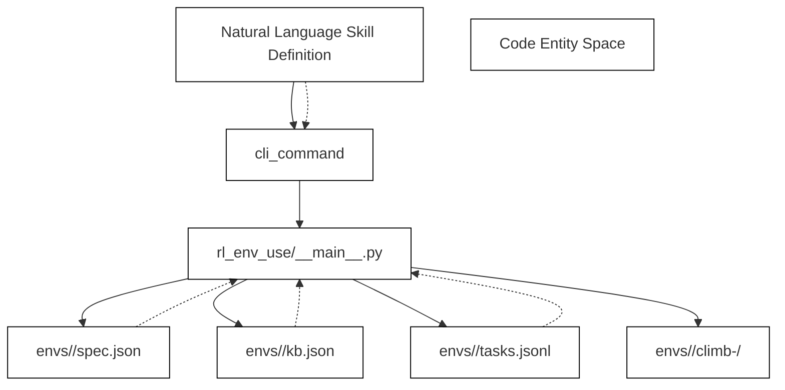
*Sources: [README.md:22-28](), [SKILL.md:13-25]()*, [rl_env_use/__main__.py]()

## Core Architecture and Pipeline

The architecture is organized around self-contained environment directories (`envs/<name>/`) [SKILL.md:15-18](). Each environment encapsulates the raw mined knowledge, synthesized tasks, audit ledgers, evaluation slots, and prompt optimization history. 

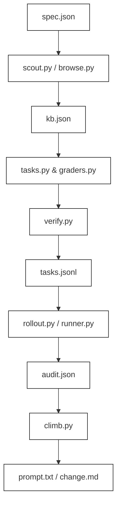
*Sources: [SKILL.md:18-28]()*, [rl_env_use/__main__.py]()

## Child Pages

This parent page serves as a high-level entry point. Detailed technical breakdowns, command flags, directory layouts, and execution mechanics are documented in the child pages:

- **[Getting Started & Configuration](#1.1)**: Installation via `uv`, API key setup (`BROWSER_USE_API_KEY`, `OPENROUTER_API_KEY`), environment configuration (`.env`), and running the offline test suite [README.md:63-73]().
- **[CLI Reference](#1.2)**: Complete documentation of commands exposed by `rl_env_use/__main__.py` (`new`, `create`, `build`, `review`, `run`, `report`, `climb`, `compare`, `codify`, `judges`, `split`, `export`), including flags and workflows [SKILL.md:13]().
- **[Environment Directory Layout](#1.3)**: Detailed schema of `envs/<name>/`, covering files such as `spec.json`, `kb.json`, `tasks.jsonl`, `audit.json`, `reviews.jsonl`, and run artifact subdirectories (`models/`, `climb-<model>/`) [SKILL.md:15-30]().

*Sources: [README.md:63-73](), [SKILL.md:13-30]()*, [rl_env_use/__main__.py]()

---

# Page: Getting Started & Configuration

# Getting Started & Configuration

<details>
<summary>Relevant source files</summary>

The following files were used as context for generating this wiki page:

- [.env.example](.env.example)
- [.gitignore](.gitignore)
- [README.md](README.md)

</details>


## Purpose & Scope

This page covers the technical setup and configuration required to deploy and operate `rl-env-use`. It details the installation process using `uv`, environment configuration through `.env` files and API keys (`BROWSER_USE_API_KEY` and `OPENROUTER_API_KEY`), gitignore policies for run artifacts, and the execution of the offline test suite.

Sources: `README.md:1-80`, `.env.example:1-3`, `.gitignore:1-20`

---

## Manual Installation

To set up the development and execution environment, Python 3.11+ is required. Node.js 18+ is optionally required if you intend to build or compile HTML reports [README.md:63-65]. 

The repository relies on `uv` for fast virtual environment management and package installation. The standard installation sequence clones the repository, provisions a virtual environment, and installs the package in editable mode with test dependencies [README.md:67-70]:

```bash
git clone https://github.com/browser-use/rl-env-use ~/Developer/rl-env-use
cd ~/Developer/rl-env-use
uv venv && uv pip install -e '.[test]'
```

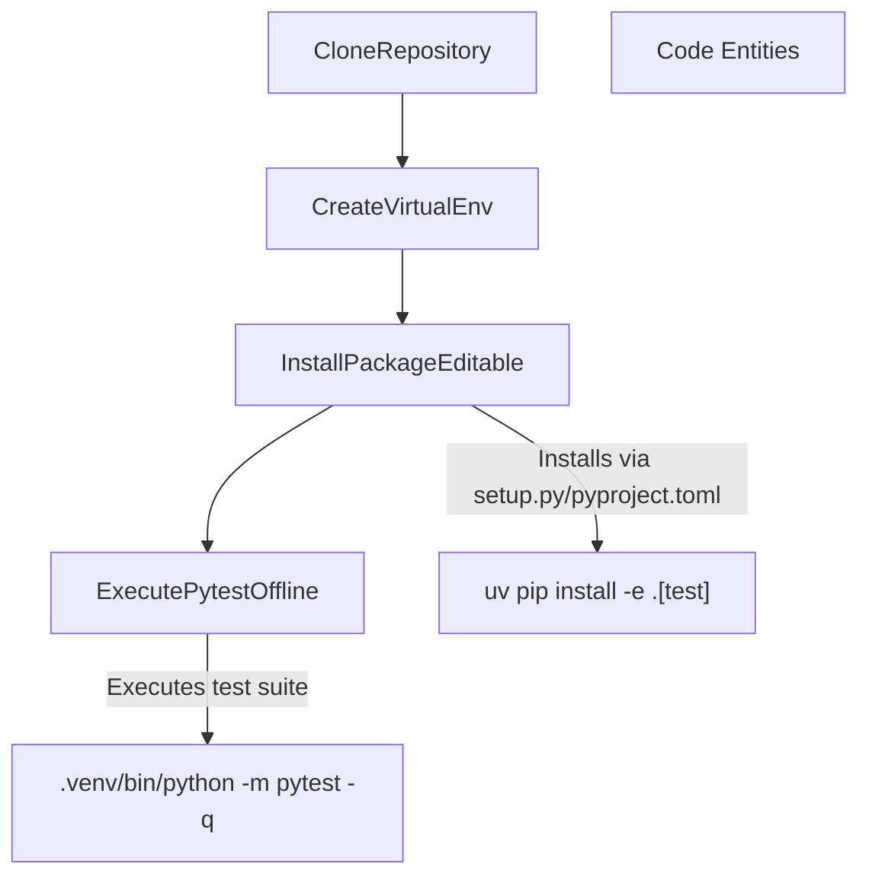

Sources: `README.md:63-74`

---

## Environment Configuration & API Keys

The environment relies on two external API keys for its agent mining operations and LLM rollouts. Configuration is managed via a local `.env` file copied from the template [README.md:71].

1. **`BROWSER_USE_API_KEY`**: Authenticates requests against Browser Use Cloud, allowing agents to execute web-browsing missions and mine real-world cases [README.md:20].
2. **`OPENROUTER_API_KEY`**: Routes model generation, task synthesis, and policy evaluation through OpenRouter [README.md:7].

To configure your environment, copy `.env.example` [.env.example:1-3] to `.env` [README.md:71] and populate the keys:

```bash
cp .env.example .env && $EDITOR .env
```

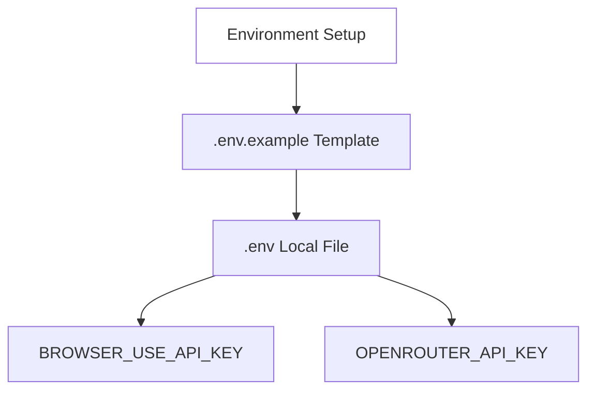

Sources: `.env.example:1-3`, `README.md:70-71`

---

## Gitignored Run Artifacts & Workspace Hygiene

Because agent execution generates large auxiliary traces, trajectory records, and temporary logs, `.gitignore` explicitly excludes volatile runtime directories while preserving key results, climb states, and reports [.gitignore:16-20].

Secrets and environment configurations are excluded at the root level [.gitignore:1-3]:
- `.env` and `.env.local`
- Python compilation artifacts (`__pycache__/`, `*.py[co]`, `.venv/`, `.pytest_cache/`) [.gitignore:5-13]
- Large agent run traces and trajectories under environment directories (`envs/**/traces/`, `envs/**/trajectory/`, and `envs/**/*.log`) [.gitignore:16-19]

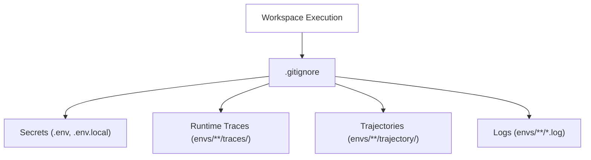

Sources: `.gitignore:1-20`

---

## Running the Offline Test Suite

Once dependencies are installed and the environment is configured, you can verify system integrity by running the offline test suite using `pytest` [README.md:72]. 

The offline test suite executes unit tests across modules without requiring live API calls, completing in approximately 10 seconds [README.md:72]:

```bash
.venv/bin/python -m pytest -q
```

Sources: `README.md:72`

---

# Page: CLI Reference

# CLI Reference

<details>
<summary>Relevant source files</summary>

The following files were used as context for generating this wiki page:

- [README.md](README.md)
- [SKILL.md](SKILL.md)

</details>


The purpose of this page is to document the complete command-line interface exposed by `rl_env_use/__main__.py`. It covers all available commands (`new`, `create`, `build`, `review`, `run`, `report`, `climb`, `compare`, `codify`, `judges`, `split`, `export`), their supported flags, underlying modules, and typical operational workflows.

---

## Command Architecture & Module Mapping

The CLI serves as the primary entry point for managing environment lifecycles, executing rollouts, auditing tasks, and running prompt hillclimbing loops. 

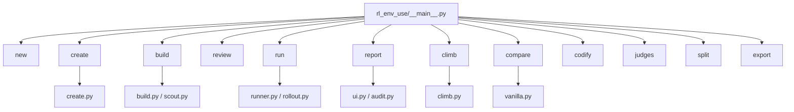
*Sources: `[SKILL.md:13-89](), [README.md:46-50]()`*

---

## Core Commands Reference

### Initialization & Autonomous Creation (`new`, `create`)

*   **`new`**: Initializes a blank environment directory structure (`envs/<name>/`) with initial configuration metadata (`spec.json`). Designed for step-by-step human guidance [SKILL.md:60-60]().
    *   *Flags:* `--topic`, `--skill`, `--sources`, `--profile`, `--proxy-country` [SKILL.md:60-60]().
*   **`create`**: Autonomous end-to-end environment generator. A planner automatically writes the `spec.json` (skill, sources, conventions, sampling rules) and executes iterative mining rounds until task targets or budgets are reached [SKILL.md:34-44]().
    *   *Flags:* `--tasks <int>`, `--budget <float>`, `--name <str>` [SKILL.md:34-44]().

```bash
rl-env-use create "predict whether a completed trial met its primary endpoint from its registered protocol; ClinicalTrials.gov" --budget 40
```
*Sources: `[README.md:47-47](), [SKILL.md:32-44]()`*

---

### Mining, Building & Review (`build`, `review`, `split`)

*   **`build`**: Executes the mining pipeline (`scout -> look -> synth -> verify -> panel -> harden`) to populate `kb.json` and `tasks.jsonl` [SKILL.md:64-70]().
    *   *Flags:* `--only scout`, `--only look`, `--enrich` [SKILL.md:64-67]().
*   **`review`**: Launches the local review web application to inspect mined cases (`Data` tab), drafted tasks (`Tasks` tab), and execution transcripts (`Traces` tab) [SKILL.md:23-27]().
*   **`split`**: Generates training and testing data splits partitioned by case for validation and hillclimbing workflows [SKILL.md:81-81]().

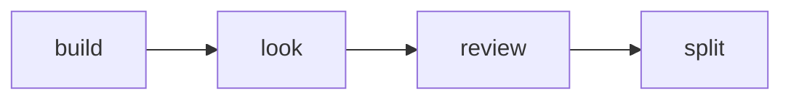
*Sources: `[SKILL.md:64-81]()`*

---

### Execution & Reporting (`run`, `report`, `compare`)

*   **`run`**: Executes policy evaluations over tasks across specified repetitions, routing queries through OpenRouter and recording ledger costs and trial outcomes into `results.jsonl`, `errors.jsonl`, and `dropped.jsonl` [SKILL.md:27-27, 73-77]().
    *   *Flags:* `--model <str>`, `--flow <str>`, `--limit <int>`, `--dry-run`, `--variant <str>`, `--system <file>` [SKILL.md:73-82]().
*   **`report`**: Regrades existing results, executes audit checks (`audit.json`), and compiles static HTML analysis reports (`report.html`) for model comparisons and slots [SKILL.md:76-77]().
*   **`compare`**: Runs parallel environment evaluations comparing Browser Use agents against vanilla Claude Code browsing instructions to measure task difficulty and agent edge [SKILL.md:86-89]().
    *   *Flags:* `--missions <int>` [SKILL.md:86-89]().

```bash
rl-env-use run envs/trial-forecast --model qwen-35b --limit 5
rl-env-use report envs/trial-forecast
```
*Sources: `[SKILL.md:73-89]()`*

---

### Optimization & Advanced Maintenance (`climb`, `codify`, `judges`, `export`)

*   **`climb`**: Executes the automated prompt hillclimbing optimization loop (`climb-<model>/`), evaluating proposed system prompt edits against train/test splits with noise floors and paired bootstraps [README.md:48-48], [SKILL.md:45-49]().
    *   *Flags:* `--model <str>` [README.md:48-48]().
*   **`codify`**: Codifies trace failures and failure modes identified during rollout reviews [SKILL.md:82-82]().
*   **`judges`**: Calibrates automated failure-mode judges against human review labels (`reviews.jsonl`) [SKILL.md:82-82]().
*   **`export`**: Serializes environment data and verified tasks into clean JSONL formats optimized for external reinforcement learning trainers [SKILL.md:84-84]().

```bash
rl-env-use climb envs/trial-forecast --model qwen-35b
rl-env-use export envs/trial-forecast
```
*Sources: `[README.md:48-49](), [SKILL.md:45-84]()`*

---

## Typical End-to-End CLI Workflows

The following workflow demonstrates the progression from autonomous environment creation to model optimization and evaluation reporting.

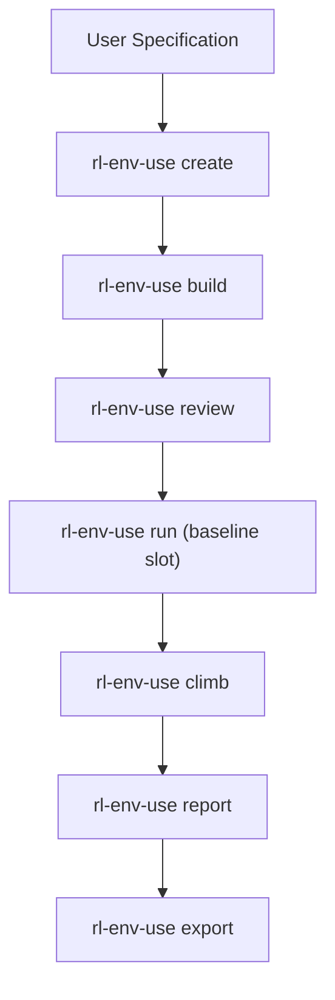
*Sources: `[SKILL.md:32-85](), [README.md:46-50]()`*

### Step-by-Step Command Sequence Reference

| Phase | Command | Target Artifacts | Purpose |
| :--- | :--- | :--- | :--- |
| **1. Setup** | `rl-env-use new` | `envs/<name>/spec.json` | Initialize environment specification manually [SKILL.md:60-60](). |
| **2. Autonomous Generation** | `rl-env-use create` | `kb.json`, `tasks.jsonl` | Autonomous multi-round case mining and task drafting [SKILL.md:34-44](). |
| **3. Manual Inspection** | `rl-env-use review` | `reviews.jsonl` | Review mined cases, drafted tasks, and trace transcripts [SKILL.md:23-27](). |
| **4. Baseline Evaluation** | `rl-env-use run` | `models/<slot>/results.jsonl` | Execute baseline policy rollouts over environment tasks [SKILL.md:73-77](). |
| **5. Prompt Hillclimbing** | `rl-env-use climb` | `climb-<model>/` | Optimize system prompts via train/test splits and paired CIs [SKILL.md:45-49](). |
| **6. Reporting & Export** | `rl-env-use report` & `export` | `report.html`, Export Datasets | Generate consolidated audit reports and RL training datasets [SKILL.md:76-84](). |

*Sources: `[SKILL.md:23-84](), [README.md:46-50]()`*

---

# Page: Environment Directory Layout

# Environment Directory Layout

<details>
<summary>Relevant source files</summary>

The following files were used as context for generating this wiki page:

- [SKILL.md](SKILL.md)
- [envs/sec-credit/climb-haiku/baseline/change.md](envs/sec-credit/climb-haiku/baseline/change.md)
- [envs/sec-credit/climb-haiku/baseline/prompt.txt](envs/sec-credit/climb-haiku/baseline/prompt.txt)
- [envs/sec-credit/climb-haiku/baseline/results.jsonl](envs/sec-credit/climb-haiku/baseline/results.jsonl)
- [envs/sec-credit/climb-haiku/baseline/summary.json](envs/sec-credit/climb-haiku/baseline/summary.json)

</details>


## Purpose and Scope

Every environment in `rl-env-use` is encapsulated within a self-contained directory under `envs/<name>/`. This directory acts as the canonical state container for the environment, storing everything from raw mined knowledge bases and drafted tasks to model comparison slots, evaluation run logs, and iterative prompt hillclimbing artifacts. 

This page details the schema of `envs/<name>/`, explaining the specific role, internal format, and data flow of each file and subdirectory.

Sources: [SKILL.md:13-31]()

---

## Global Environment Schema (`envs/<name>/`)

At the root of each environment directory resides a standard set of metadata files, knowledge base structures, task definitions, and audit reports. 

```
envs/<name>/
  ├── spec.json
  ├── kb.json
  ├── tasks.jsonl
  ├── audit.json
  ├── reviews.jsonl
  ├── models/
  └── climb-<model>/
```

The following diagram bridges the natural language concepts of environment files to the underlying system paths and code entities that read and write them:

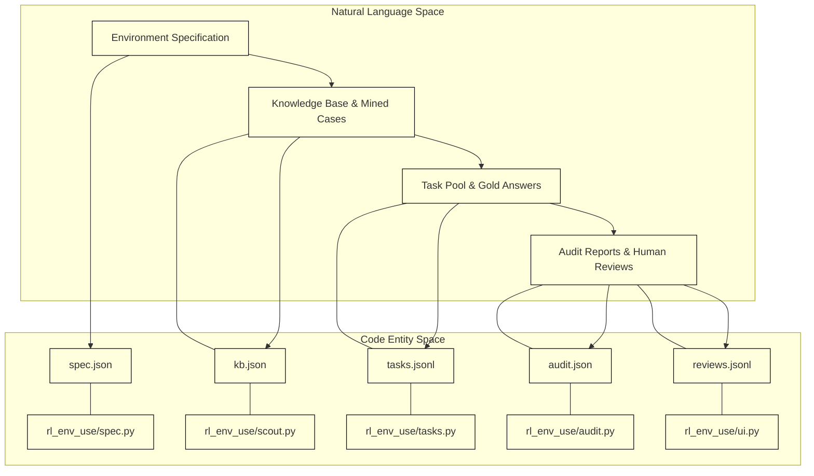
Sources: [SKILL.md:18-28](), [SKILL.md:34-84]()

### Core Files

* **`spec.json`**: Defines the environment's high-level configuration including topic, skill definition, source URLs, conventions, financial budgets, and execution spend records [SKILL.md:19]().
* **`kb.json`**: Stores the raw mined material cases, quote-verified outcome facts, and mission configurations extracted by browser agents [SKILL.md:20]().
* **`tasks.jsonl`**: Contains every drafted task paired with its gold answers and grading checks [SKILL.md:21](). The environment only serves tasks that pass verification.
* **`audit.json`**: Holds the latest automated audit report evaluating leakage, saturation, base rates, and structural validity [SKILL.md:22]().
* **`reviews.jsonl`**: Records human reviewer verdicts, annotations, and gold label fixes captured via the local review interface [SKILL.md:23]().

Sources: [SKILL.md:18-28]()

---

## Model Comparison and Hillclimbing Slots

Model evaluation and prompt hillclimbing organize outputs into dedicated subdirectories. Each model or variant is assigned a distinct "slot" containing execution telemetry, transcripts, and evaluation metrics.

```
envs/<name>/
  ├── models/
  │   └── <model-slot>/
  │       ├── change.md
  │       ├── prompt.txt
  │       ├── results.jsonl
  │       └── ...
  └── climb-<model>/
      ├── baseline/
      ├── v1/
      ├── v2/
      └── _state.json
```

The data flow and artifact generation across evaluation slots and hillclimb variants are illustrated below:

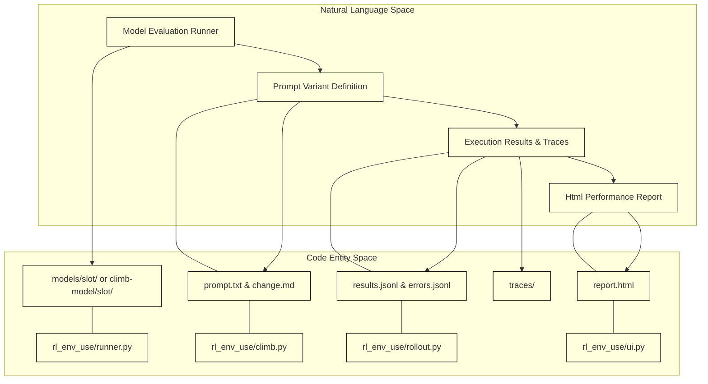
Sources: [SKILL.md:24-30](), [SKILL.md:76-84]()

---

## Detailed Artifact Breakdown

Inside any evaluation slot (such as `models/<slot>/` or `climb-<model>/<slot>/`), a standardized set of files tracks the exact state of execution:

| Artifact Name | Description | Key Code Reference |
| :--- | :--- | :--- |
| `change.md` | Documents the natural language change description or diff summary for a prompt variant. The first line is rendered as the column title in generated reports. | [SKILL.md:29]() |
| `prompt.txt` | Stores the complete system prompt text executed for that evaluation slot or hillclimb variant. | [SKILL.md:25]() |
| `results.jsonl` | Line-delimited JSON records of each evaluated prompt instance, including rep number, prompt ID, grading scores, latency, token usage, cost, and metadata. | [envs/sec-credit/climb-haiku/baseline/results.jsonl:1-8]() |
| `summary.json` | High-level summary metadata for the slot, indicating the description, target component, and target model. | [envs/sec-credit/climb-haiku/summary.json:1-1]() |
| `dropped.jsonl` | Records episodes that encountered unrecoverable harness errors or dropped repetitions during execution. | [SKILL.md:27]() |
| `_state.json` | Maintains resumable state for long-running processes such as the hillclimb optimization loop. | [SKILL.md:25]() |
| `report.html` | A standalone self-contained HTML report generated via build scripts, presenting visual performance comparisons, audit results, and failure analyses. | [SKILL.md:25](), [SKILL.md:76-77]() |
| `traces/` | Directory containing full trajectory transcripts and agent logs for individual rollouts (git-ignored). | [SKILL.md:27-30]() |

Sources: [SKILL.md:24-30](), [envs/sec-credit/climb-haiku/baseline/results.jsonl:1-8](), [envs/sec-credit/climb-haiku/summary.json:1-1]()

---

# Page: Environment Build Pipeline

# Environment Build Pipeline

<details>
<summary>Relevant source files</summary>

The following files were used as context for generating this wiki page:

- [README.md](README.md)
- [SKILL.md](SKILL.md)

</details>


The Environment Build Pipeline automates the translation of a high-level domain specification into a verified, un-saturated set of reinforcement learning tasks [README.md:9-12](). It orchestrates autonomous browser agents to harvest real-world materials [README.md:24](), synthesizes deterministic grading logic, runs multi-model frontier evaluations, and hardens tasks against memorization and leakage [README.md:25-26]().

```mermaid
graph TD
    Spec[""spec.json (Natural Language Spec)""] --> Scout[""scout.py / browse.py (Mining Missions)""]
    Scout --> KB[""kb.json (Cases & Materials)""]
    KB --> Look[""look (HTTP Browser Edge)""]
    Look --> Synth[""tasks.py (Task Synthesis)""]
    Synth --> Graders[""graders.py (Gold & Checks)""]
    Graders --> Verify[""verify.py (Critic & Panel)""]
    Verify --> Harden[""harden (All-Pass Capping)""]
    Harden --> Tasks[""tasks.jsonl (Verified Task Set)""]
```
Sources: `SKILL.md:18-23` [SKILL.md:18-23](), `SKILL.md:32-40` [SKILL.md:40]().

---

## 2.1. Mining with Browser Use Agents

The initial stage of the pipeline uses autonomous browser agents to explore target URLs defined in the domain specification. Missions extract source materials and quote-verified outcome facts, persisting them into `kb.json` [SKILL.md:18-20](). Following extraction, the `look` stage measures what plain HTTP scrapers would have observed, isolating the value added by full browser navigation (the browser edge).

For details, see [Mining with Browser Use Agents](#2.1).

```mermaid
graph LR
    MissionSpec[""spec.json Sources""] --> ScoutModule[""scout.py""]
    ScoutModule --> AgentRun[""Browser Use Agents""]
    AgentRun --> KBFile[""kb.json (Materials & Facts)""]
    KBFile --> LookCheck[""look Stage (HTTP Edge Analysis)""]
```
Sources: `SKILL.md:18-21` [SKILL.md:18-21](), `SKILL.md:36-40` [SKILL.md:36-40]().

---

## 2.2. Task Synthesis and Grading Checks

Once raw cases and materials are stored in `kb.json`, the synthesis engine derives evaluation tasks [SKILL.md:21](). Tasks are structured either as derived computations over tabular data or future forecasts [SKILL.md:37-39](). The `tasks.py` and `graders.py` modules assign gold answers and configure validation checks across multiple check types (`number`, `date`, `set`, `exact`, `contains`, `prob`), filtering out ambiguous or low-quality prompts [README.md:25]().

For details, see [Task Synthesis and Grading Checks](#2.2).

```mermaid
graph LR
    KBData[""kb.json Materials""] --> SynthModule[""tasks.py (Derive / Forecast)""]
    SynthModule --> GraderModule[""graders.py (Gold & Checks)""]
    GraderModule --> FilterRules[""Task Keep / Filter Rules""]
    FilterRules --> DraftTasks[""tasks.jsonl (Draft Tasks)""]
```
Sources: `SKILL.md:21` [SKILL.md:21](), `SKILL.md:37-41` [SKILL.md:41](), `README.md:25-27` [README.md:27]().

---

## 2.3. Verification, Frontier Panel and Hardening

Synthesized tasks undergo rigorous verification via `verify.py` [SKILL.md:38-40](). This stage subjects drafts to critic evaluations, live checks, and closed-book memorizability tests [README.md:25-26](). A frontier panel of advanced models evaluates task difficulty; tasks solved universally by the panel trigger all-pass capping and are returned to the generator to be made harder [SKILL.md:38-40]().

For details, see [Verification, Frontier Panel and Hardening](#2.3).

```mermaid
graph LR
    Drafts[""tasks.jsonl (Drafts)""] --> VerifyModule[""verify.py (Critic & Live Checks)""]
    VerifyModule --> PanelEval[""Frontier Panel (Difficulty Calibration)""]
    PanelEval --> AllPassCheck{""All-Pass Solved?""}
    AllPassCheck -- Yes --> HardenLoop[""Task Hardening Loop""]
    AllPassCheck -- No --> FinalVerify[""Verified Task Set""]
    HardenLoop --> SynthModule[""tasks.py""]
```
Sources: `SKILL.md:38-42` [SKILL.md:42](), `README.md:25-27` [README.md:27]().

---

# Page: Mining with Browser Use Agents

# Mining with Browser Use Agents

<details>
<summary>Relevant source files</summary>

The following files were used as context for generating this wiki page:

- [.env.example](.env.example)
- [SKILL.md](SKILL.md)

</details>


## Purpose and Scope
This page details the implementation of the environment mining phase managed by `scout.py` and `browse.py`. The primary objective is to ingest real-world data sources defined in environment specifications (`spec.json`) and convert them into structured cases, source materials, and quote-verified outcome facts stored within `kb.json`. Additionally, this page covers the `look` stage, which evaluates the "browser edge" by comparing what an interactive browser agent captures versus what plain HTTP scrapers would observe.

Sources: [SKILL.md:1-28]()

---

## Core Concepts: Missions, Cases, Materials, and Facts
The mining subsystem translates high-level environment definitions into concrete dataset entries through several foundational entities:
- **Mission**: A targeted search or crawl objective assigned to a Browser Use agent based on URLs and constraints provided in `spec.json` [SKILL.md:18-20]().
- **Case**: An individual evaluation unit comprising input materials and a future or published true outcome [SKILL.md:10-12]().
- **Materials**: The raw or processed documents (filings, articles, registry records) supplied to the model under test [SKILL.md:10-11]().
- **Quote-Verified Facts**: Extracted factual assertions backed by explicit text quotes from the source materials, preventing hallucination and grounding downstream task synthesis [SKILL.md:20]().

All mined assets are persisted centrally within the environment's knowledge base file, `kb.json` [SKILL.md:20]().

Sources: [SKILL.md:10-28]()

---

## Implementation Architecture: `scout.py` and `browse.py`
The mining pipeline relies on browser-automation loops driven by LLM agents. 

```mermaid
graph TD
    A["UserSpecInput"] -->| "Reads spec.json" | B["scoutModule[scout.py]"]
    B -->| "Spawns Agent" | C["BrowserAgent[browse.py]"]
    C -->| "Executes Mission" | D["LiveWebTarget"]
    D -->| "Extracts HTML/JSON" | E["MaterialExtractor"]
    E -->| "Validates Quotes" | F["KnowledgeBase[kb.json]"]

    style A fill:#fff,stroke:#000,stroke-width:1px
    style B fill:#fff,stroke:#000,stroke-width:1px
    style C fill:#fff,stroke:#000,stroke-width:1px
    style D fill:#fff,stroke:#000,stroke-width:1px
    style E fill:#fff,stroke:#000,stroke-width:1px
    style F fill:#fff,stroke:#000,stroke-width:1px
```
*Figure 1: Data flow bridging specification inputs to structured knowledge base entries via `scout.py` and `browse.py`.*

Sources: [SKILL.md:18-28]()

---

## The Look Stage and the Browser Edge
Before finalizing case ingestion, the pipeline executes the `look` stage (`build envs/<name> --only look`) [SKILL.md:66-68](). This diagnostic procedure measures the disparity between plain HTTP requests and full browser rendering environments.

```mermaid
graph TD
    A["LookStage[look]"] -->| "HTTP Request" | B["PlainHttpClient"]
    A -->| "Browser Session" | C["BrowserUseAgent[browse.py]"]
    B -->| "Returns Raw Payload" | D["HttpEdgeEvaluation"]
    C -->| "Executes JS & Renders" | E["BrowserEdgeEvaluation"]
    D -->| "Compares Content" | F["EdgeGapMetric"]
    E -->| "Compares Content" | F

    style A fill:#fff,stroke:#000,stroke-width:1px
    style B fill:#fff,stroke:#000,stroke-width:1px
    style C fill:#fff,stroke:#000,stroke-width:1px
    style D fill:#fff,stroke:#000,stroke-width:1px
    style E fill:#fff,stroke:#000,stroke-width:1px
    style F fill:#fff,stroke:#000,stroke-width:1px
```
*Figure 2: The `look` stage evaluation flow separating HTTP scrapable content from browser-dependent assets.*

The `look` stage ensures that environments requiring JavaScript execution, authenticated sessions, or complex DOM interactions are correctly flagged, guaranteeing that the mined materials cannot be trivially retrieved via simple static scrapers.

Sources: [SKILL.md:66-68]()

---

# Page: Task Synthesis and Grading Checks

# Task Synthesis and Grading Checks

<details>
<summary>Relevant source files</summary>

The following files were used as context for generating this wiki page:

- [README.md](README.md)
- [SKILL.md](SKILL.md)

</details>


This page details the implementation and mechanics of task synthesis and programmatic grading within `rl-env-use`, focusing on how raw mined materials and facts from `kb.json` are transformed into verifiable, high-difficulty evaluation tasks stored in `tasks.jsonl`, and how `graders.py` evaluates model outputs using precise check types.

---

## 1. Purpose and Scope

The task synthesis subsystem takes verified facts and materials mined by Browser Use agents (`scout.py`/`browse.py`) and structures them into rigorous evaluation items. The system distinguishes between **derive tasks** (where an answer is calculated via code expression over material data) and **forecast tasks** (where an outcome is predicted based on registered protocols or early disclosures). 

Tasks undergo strict filtering, balancing, and closed-book validation before being written to `tasks.jsonl` for use by the runner and environment APIs.

Sources: [SKILL.md:15-28](), [README.md:24-28]()

---

## 2. Derive vs. Forecast Tasks

The synthesis engine classifies tasks into two primary categories depending on the nature of the domain and the availability of data:

- **Derive Tasks**: Computed by code from an expression over numbers present in the source materials (e.g., financial line items in a 10-Q filing or trial participant breakdowns). These test precise data extraction, table parsing, and multi-step arithmetic. When frontier panels saturate derive tasks, the system shifts focus to forecast tasks.
- **Forecast Tasks**: Predict future or withheld outcomes from early indicators (e.g., predicting whether a completed trial met its primary endpoint from its registered protocol on ClinicalTrials.gov). Forecasts must strictly depend on the provided materials and must not be answerable without them. Additionally, at most 60% of served forecasts are permitted to resolve in a single direction to prevent trivial baseline guessing.

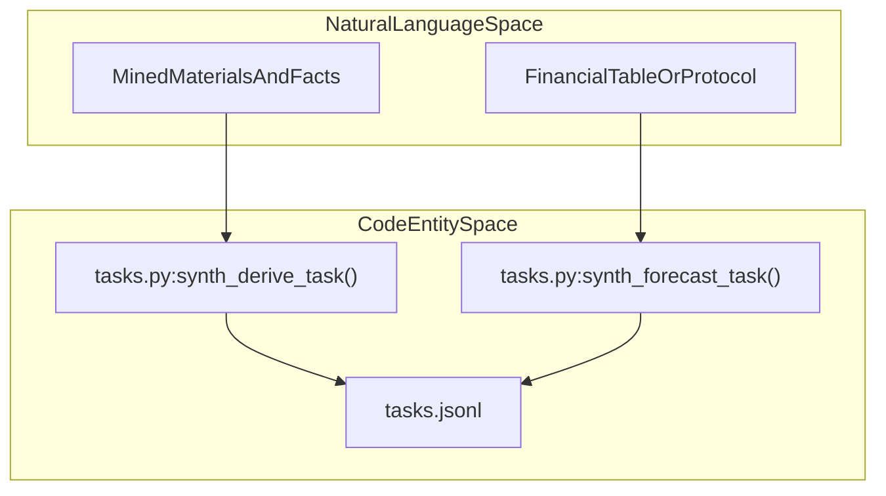

Sources: [SKILL.md:37-41]()

---

## 3. Gold Answers and Check Kinds

Grading relies on deterministic check functions defined in `graders.py`. Every drafted task includes a gold answer derived directly from outcome quotes, ensuring zero leakage into prompt instructions or source materials.

Supported check kinds include:
- `number`: Numerical equality within a strict floating-point tolerance.
- `date`: Temporal normalization and comparison.
- `set`: Unordered collection matching for multi-item extractions.
- `exact`: Exact string or token matching.
- `contains`: Substring or keyword presence validation.
- `prob`: Probability or confidence score scoring (e.g., Brier score or thresholded classification accuracy).

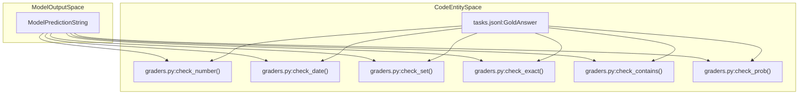

Sources: [SKILL.md:68-71]()

---

## 4. Task Balancing, Keep, and Filter Rules

Before a task is committed to `tasks.jsonl`, it passes through a multi-stage filtering and hardening pipeline to ensure validity and appropriate difficulty:

1. **Leakage & Memorization Checks**: Evaluates whether the outcome can be guessed closed-book (without materials) using historical model weights. Tasks that frontier models or baseline weights can solve without reading the text are discarded or rewritten harder.
2. **Ambiguity & Structural Filtering**: Eliminates ambiguous prompts, missing gold references, and structurally unsound questions.
3. **Frontier Panel Calibration**: The frontier panel (comprising models like Opus, GPT-Astra, and Gemini) measures task difficulty. Any task solved effortlessly by all panel members is sent back to the drafter to be made harder on the same case (up to two iteration levels).
4. **Base-Rate Balancing**: Ensures outcome distribution is balanced (e.g., restricting forecast resolution imbalance to a maximum of 60% in one direction).

Sources: [SKILL.md:37-41](), [SKILL.md:68-71]()

---

## 5. Grader Self-Testing and Verification

To ensure robust evaluation without false positives or negatives, grading logic in `graders.py` undergoes automatic self-testing during the build phase. Graders are tested against:
- **Null Inputs**: Ensuring graceful handling of empty or malformed model responses.
- **Foreign Answers**: Validating rejection of valid answers belonging to other cases.
- **Perturbed Golds**: Injecting noise or deliberate offsets into gold answers to verify sensitivity and precision.

Sources: [SKILL.md:68-71]()

---

# Page: Verification, Frontier Panel and Hardening

# Verification, Frontier Panel and Hardening

<details>
<summary>Relevant source files</summary>

The following files were used as context for generating this wiki page:

- [SKILL.md](SKILL.md)
- [envs/sec-credit/audit.json](envs/sec-credit/audit.json)

</details>


This page covers the technical implementation and operational mechanics of `verify.py` and its associated validation subsystems within `rl-env-use`. The verification pipeline takes drafted tasks from `tasks.jsonl` and subjects them through a rigorous multi-stage filtering, critique, calibration, and hardening loop. This ensures that tasks are unambiguous, require the provided materials or browser access rather than rote memorization, and possess appropriate difficulty headroom against frontier models.

---

## 1. The Verification Architecture and Flow

The verification phase is responsible for filtering out structural defects, prompt leakages, stale references, and memorizable queries. As outlined in `SKILL.md`, tasks undergo automated critique and validation before being admitted into the active environment service pool [SKILL.md:34-42](). 

The following diagram bridges the natural language conceptual space of environment verification with the concrete code entities handling each subsystem:

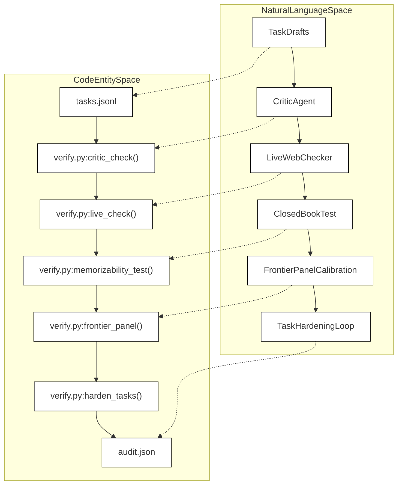

Sources: `SKILL.md`, `envs/sec-credit/audit.json`

---

## 2. Critic Checks and Ambiguity Filtering

The critic stage inspects drafted tasks for semantic ambiguities, unsupported conclusions, and discrepancies between independent recomputations and the stated gold answer. Tasks failing this inspection are logged with reasons and filtered out.

As reflected in audit logs, ambiguity checks can prune a significant portion of initial drafts if the underlying source materials lack deterministic precision [envs/sec-credit/audit.json:249-251]().

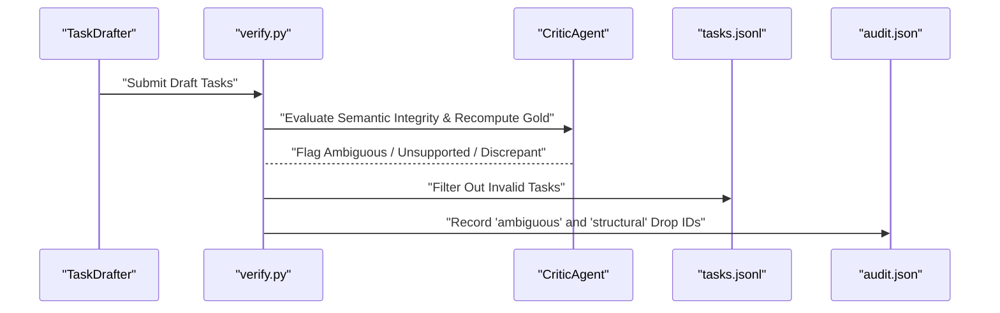

Sources: `SKILL.md`, `envs/sec-credit/audit.json`

---

## 3. Live Checks and Stale Evidence Detection

Tasks must rely on evidence that is verifiable against live web pages or stable material snapshots. The `verify.py` pipeline runs live check routines to verify that source URLs and evidence markers still exist on the live target page.

- **Stale Check**: Tasks citing evidence no longer present on the live page are flagged as `stale` and removed from active rotation [envs/sec-credit/audit.json:238-240]().
- **Browser Edge Check**: Measures whether the evidence requires browser-only interaction (such as dynamic rendering or complex client-side states) versus a plain HTTP fetch [envs/sec-credit/audit.json:72-74]().

Sources: `SKILL.md`, `envs/sec-credit/audit.json`

---

## 4. Closed-Book and Memorizability Tests

To ensure that the environment measures the model's ability to extract and reason over provided materials rather than rely on parametric pre-training memory, tasks undergo closed-book evaluation:

1. **Closed-Book Probe**: The model under test is fed the task *without* the supporting materials or browser access.
2. **Filtering**: If a model correctly answers a task under closed-book conditions (and the task is not a few-choice question where correct guesses occur by chance), the task is classified as `memorizable` and filtered out [SKILL.md:69](), [envs/sec-credit/audit.json:224-225]().

Sources: `SKILL.md`, `envs/sec-credit/audit.json`

---

## 5. Frontier Panel Calibration and All-Pass Capping

Once tasks survive structural, ambiguity, and memorizability checks, they face the **Frontier Panel** (consisting of models such as `opus55`, `gpt-astra`, and `gemini`) to gauge difficulty [SKILL.md:38-42]().

- **Calibration**: The panel measures whether tasks are too easy or appropriately challenging for state-of-the-art models.
- **All-Pass Capping**: When a task is solved by every model on the frontier panel (an "all-pass" task), it is sent back to the drafter to be made harder on the same case (up to two levels of escalation) [SKILL.md:38-40]().
- **Saturation Management**: When the panel saturates deterministic derive tasks (e.g., solving nearly every financial computation in SEC filings), subsequent mining rounds pivot to forecasting tasks (`forecast`) [SKILL.md:41-42]().

Sources: `SKILL.md`, `envs/sec-credit/audit.json`

---

## 6. Task Hardening Loops

When tasks fail calibration due to being excessively straightforward or easily solvable via simple pattern matching, the task hardening loop engages:

```mermaid
graph TD
    A["TaskDraft"] --> B["FrontierPanelEvaluation"]
    B -->|AllPass| C["ReturnToDrafter"]
    C --> D["TaskHardeningLoop"]
    D --> E["IncreaseComplexityOnSameCase"]
    E --> F["ReVerifyAndCalibrate"]
    B -->|MixedPass| G["ApproveForEnvServe"]

    style A fill:#fff,stroke:#000,stroke-width:1px
    style B fill:#fff,stroke:#000,stroke-width:1px
    style C fill:#fff,stroke:#000,stroke-width:1px
    style D fill:#fff,stroke:#000,stroke-width:1px
    style E fill:#fff,stroke:#000,stroke-width:1px
    style F fill:#fff,stroke:#000,stroke-width:1px
    style G fill:#fff,stroke:#000,stroke-width:1px
```

Sources: `SKILL.md`, `envs/sec-credit/audit.json`

---

# Page: Evaluation and Reporting

# Evaluation and Reporting

<details>
<summary>Relevant source files</summary>

The following files were used as context for generating this wiki page:

- [envs/sec-credit/audit.json](envs/sec-credit/audit.json)
- [envs/sec-credit/climb-haiku/report.html](envs/sec-credit/climb-haiku/report.html)

</details>


## Purpose and Scope

The Evaluation and Reporting phase of `rl-env-use` bridges trained models, environment specifications, and rigorous performance auditing. Once an environment contains verified tasks, models must be systematically evaluated via policy rollouts, their outputs measured against gold standards, results audited for statistical anomalies or leakage, and reports generated for human review. 

This page provides a high-level overview of running models, auditing execution telemetry, and building review interfaces. For deep technical details, refer to the child pages:
- Rollouts and the Runner: See [Rollouts and the Runner](#3.1).
- Audit Checks: See [Audit Checks](#3.2).
- Reports and Review UI: See [Reports and Review UI](#3.3).

Sources: `envs/sec-credit/audit.json`

---

## 3.1 Rollouts and the Runner

Model evaluation relies on executing policies over tasks and repetitions while logging token costs, API routing parameters, and execution traces. The runner manages task dispatch, handles repetition parallelization, tracks costs via a persistent ledger, and routes requests through OpenRouter. Execution outcomes are written to records such as `results.jsonl`, `dropped.jsonl`, and `errors.jsonl` within model slots.

```mermaid
graph TD
    sub-title["Evaluation Runner Flow"]
    A["Task Dispatcher"] --> B["Policy Executor rollout.py"]
    B --> C["Model Router llm.py"]
    C --> D["Cost Ledger"]
    B --> E["Results Recorder runner.py"]
    E --> F["results.jsonl"]
    E --> G["dropped.jsonl"]
    E --> H["errors.jsonl"]
```

For complete technical details on policy execution over tasks, repetition handling, cost tracking, and result record schemas, see [Rollouts and the Runner](#3.1).

Sources: `envs/sec-credit/audit.json`

---

## 3.2 Audit Checks

To guarantee benchmark integrity, `audit.py` runs a suite of automated diagnostic checks over environments and model evaluation slots [envs/sec-credit/audit.json:1-701]. These checks detect issues such as saturated score headroom, base rate imbalances, train/test split skew, infrastructure failures (timeouts, crashes), inverted model skill ranks, gold label leakage, structural task flaws, memorizability, stale evidence, and ambiguity [envs/sec-credit/audit.json:1-271]. Findings are categorized by severity (`high`, `medium`, `info`) and serialized into `audit.json` [envs/sec-credit/audit.json:1-3].

```mermaid
graph TD
    sub-title["Audit Diagnostic Pipeline"]
    A["Environment Artifacts"] --> B["Audit Engine audit.py"]
    B --> C["Statistical Checks base_rate, split, inverted"]
    B --> D["Integrity Checks leakage, memorizable, stale, structural"]
    B --> E["Infrastructure Checks infra, saturated"]
    C --> F["audit.json"]
    D --> F
    E --> F
```

For a detailed breakdown of each check, severity levels, and how `audit.json` is compiled, see [Audit Checks](#3.2).

Sources: `envs/sec-credit/audit.json`

---

## 3.3 Reports and Review UI

Model comparisons and audit results are rendered into human-readable dashboards and interactive review applications [envs/sec-credit/climb-haiku/report.html:1-9]. Using tools like `ui.py`, `annotate.py`, and JavaScript build scripts such as `report/build-report-lite.mjs`, the system generates static HTML reports (`report.html`) containing variant metrics, change descriptions, and test splits [envs/sec-credit/climb-haiku/report.html:1-9]. Additionally, local review applications provide specialized tabs for inspecting task data, gold answers, and execution traces.

```mermaid
graph TD
    sub-title["Reporting and Review UI Architecture"]
    A["Evaluation Results"] --> B["Report Builder build-report-lite.mjs"]
    A --> C["Review App ui.py"]
    B --> D["Static HTML report.html"]
    C --> E["annotate.py & annotate.html"]
    E --> F["Data / Tasks / Traces Tabs"]
```

For comprehensive documentation on report generation, model comparison slots, and the local review app, see [Reports and Review UI](#3.3).

Sources: `envs/sec-credit/climb-haiku/report.html`

---

# Page: Rollouts and the Runner

# Rollouts and the Runner

<details>
<summary>Relevant source files</summary>

The following files were used as context for generating this wiki page:

- [envs/sec-credit/climb-haiku/baseline/dropped.jsonl](envs/sec-credit/climb-haiku/baseline/dropped.jsonl)
- [envs/sec-credit/climb-haiku/baseline/results.jsonl](envs/sec-credit/climb-haiku/baseline/results.jsonl)
- [envs/sec-credit/climb-qwen-35b-verified/v1/errors.jsonl](envs/sec-credit/climb-qwen-35b-verified/v1/errors.jsonl)

</details>


## Purpose and Scope
This page covers the execution subsystem responsible for running policy rollouts over task environments. Specifically, it details how `rollout.py`, `runner.py`, and `llm.py` coordinate policy execution across tasks and repetitions (`reps`), handle model routing via OpenRouter, maintain cost ledgers, and persist execution records into `results.jsonl`, `dropped.jsonl`, and `errors.jsonl`.

---

## 1. Core Execution Architecture

The rollout and runner subsystem bridges task definitions with model inference. It manages the lifecycle of evaluating an LLM policy against a task set, capturing latency, token usage, cost, and grading metrics.

### System Architecture and Code Entities
The diagram below maps natural-language operational concepts to their corresponding code entities within the execution subsystem.

```mermaid
graph TD
    subgraph Natural_Language_Space ["Natural Language Space"]
        TaskExecution["Task Execution & Repetitions"]
        ModelRouting["Model API Routing"]
        CostAccounting["Cost & Ledger Tracking"]
        ExecutionArtifacts["Execution Artifacts & Logs"]
    end

    subgraph Code_Entity_Space ["Code Entity Space"]
        Runner["runner.py: Runner"]
        Rollout["rollout.py: execute_rollout()"]
        LLMRouter["llm.py: OpenRouterClient"]
        ResultsWriter["results.jsonl / dropped.jsonl / errors.jsonl"]
    end

    TaskExecution --> Runner
    Runner --> Rollout
    ModelRouting --> LLMRouter
    Rollout --> LLMRouter
    CostAccounting --> ResultsWriter
    Rollout --> ResultsWriter

    classDef default stroke:#000,fill:#fff;
```
*Sources: envs/sec-credit/climb-haiku/baseline/results.jsonl:1-8()*, `envs/sec-credit/climb-haiku/baseline/dropped.jsonl:1-10`(), `envs/sec-credit/climb-qwen-35b-verified/v1/errors.jsonl:1-2`()

---

## 2. Runner and Rollout Mechanics (`runner.py` & `rollout.py`)

- **`runner.py`**: Orchestrates batch runs over environments. It iterates through tasks defined in `tasks.jsonl`, assigns repetition indices (`rep`), manages concurrency, and aggregates metrics into summary ledgers.
- **`rollout.py`**: Executes a single rollout instance for a given task prompt and policy. It handles prompt formatting, system prompt injection, tool-call management (if applicable), and grade calculation via integrated grading functions.

### Execution Flow
```mermaid
graph TD
    Start["Start Runner"] --> LoadTasks["Load tasks.jsonl"]
    LoadTasks --> LoopTasks["For each prompt_id & rep"]
    LoopTasks --> CallRollout["rollout.py: execute_rollout()"]
    CallRollout --> CheckStatus{"Status Check"}
    
    CheckStatus -- "Success" --> WriteResults["Write to results.jsonl"]
    CheckStatus -- "Sub-threshold / Filtered" --> WriteDropped["Write to dropped.jsonl"]
    CheckStatus -- "Exception / Timeout" --> WriteErrors["Write to errors.jsonl"]
    
    WriteResults --> NextRep["Next Repetition / Task"]
    WriteDropped --> NextRep
    WriteErrors --> NextRep
    NextRep --> End["Complete Run"]

    classDef default stroke:#000,fill:#fff;
```
*Sources: envs/sec-credit/climb-haiku/baseline/results.jsonl:1-8()*, `envs/sec-credit/climb-haiku/baseline/dropped.jsonl:1-10`(), `envs/sec-credit/climb-qwen-35b-verified/v1/errors.jsonl:1-2`()

---

## 3. Model Routing and Cost Accounting (`llm.py`)

Model interactions are routed through OpenRouter in `llm.py`. The client handles endpoint resolution, API key injection (`OPENROUTER_API_KEY`), and detailed token tracking.

### Cost Ledger & Token Usage
Every rollout record captures token consumption and computed monetary cost. The usage dictionary tracks:
- `input_tokens`: Prompt token count sent to the model.
- `output_tokens`: Completion token count generated by the model.
- `cache_read_input_tokens`: Tokens retrieved from prompt caching layers.
- `reported_cost` / `cost_usd`: Exact dollar cost computed from OpenRouter pricing models.

---

## 4. Output Schemas and Result Files

Execution outputs are serialized into three distinct JSONL streams depending on the rollout outcome.

### Result Records Structure

#### 1. `results.jsonl`
Stores successful rollouts where answers are fully parsed and graded.
```json
{
  "prompt_id": "t_47d77d81",
  "rep": 0,
  "prompt": "Based on the trajectory of Safety Shot, Inc.'s cash balance...",
  "tags": ["liquidity_forecast", "predict", "hard"],
  "grade": {"correct": 0.9775},
  "status": "ok",
  "stop_reason": "done",
  "model": "anthropic/claude-haiku-4.5",
  "latency_s": 5.86,
  "tool_calls": 0,
  "steps": 1,
  "usage": {
    "input_tokens": 3402,
    "output_tokens": 541,
    "cache_read_input_tokens": 0,
    "reported_cost": 0.006107
  },
  "cost_usd": 0.00611,
  "meta": {
    "answer": "0.15",
    "gold": "no",
    "failure_class": null,
    "case": "credit_SHOT_Q3_2024",
    "at": "2026-10-10T14:00:18"
  }
}
```
*Sources: envs/sec-credit/climb-haiku/baseline/results.jsonl:1-4()*

#### 2. `dropped.jsonl`
Records rollouts that completed execution but were dropped or flagged due to filtering rules, confidence thresholds, or auxiliary grading criteria.
```json
{
  "prompt_id": "t_1062dfa0",
  "rep": 0,
  "prompt": "Will Athira Pharma's net loss for Q3 2024...",
  "tags": ["earnings_forecast", "predict", "medium"],
  "grade": {"correct": 0.91},
  "status": "ok",
  "stop_reason": "done",
  "model": "anthropic/claude-haiku-4.5",
  "latency_s": 5.39,
  "tool_calls": 0,
  "steps": 1,
  "usage": {
    "input_tokens": 3464,
    "output_tokens": 542,
    "cache_read_input_tokens": 0,
    "reported_cost": 0.006174
  },
  "cost_usd": 0.00617,
  "meta": {
    "answer": "0.30",
    "gold": "no",
    "failure_class": null,
    "case": "credit_ATHA_Q2_2024",
    "at": "2026-10-10T13:59:57"
  }
}
```
*Sources: envs/sec-credit/climb-haiku/baseline/dropped.jsonl:1-1()*

#### 3. `errors.jsonl`
Captures runtime failures, network timeouts, API rejections, or harness crashes.
```json
{
  "prompt_id": "t_1e784c92",
  "rep": 1,
  "failure_class": "timeout",
  "error": "TimeoutError: ",
  "at": "2026-10-10T17:51:00"
}
```
*Sources: envs/sec-credit/climb-qwen-35b-verified/v1/errors.jsonl:1-1()*

---

# Page: Audit Checks

# Audit Checks

<details>
<summary>Relevant source files</summary>

The following files were used as context for generating this wiki page:

- [envs/sec-credit/audit.json](envs/sec-credit/audit.json)
- [envs/sec-credit/climb-haiku/baseline/summary.json](envs/sec-credit/climb-haiku/baseline/summary.json)

</details>


### Purpose and Scope
The audit system evaluates the health, quality, statistical validity, and security of an environment's task suite and evaluation runs. Implemented via the auditing utility, it scans environment artifacts—such as task definitions, model rollouts, splits, and web evidence—to produce a structured report (`audit.json`) [envs/sec-credit/audit.json:1-701]. This page details the specific audit checks performed, their severity levels, and how findings are aggregated and serialized.

---

## 1. Audit Architecture and Severity Levels

The auditing process inspects generated environments to catch data leakage, structural defects, ceiling effects, and evaluation infrastructure failures before downstream tasks like hillclimbing or reinforcement learning are executed. Findings are categorized into three standard severity levels:

*   `high`: Critical blockers that invalidate the current environment configuration or evaluation setup (e.g., complete score saturation).
*   `medium`: Significant statistical or infrastructure anomalies that require attention or re-drawing (e.g., train/test split drift, base rate imbalance, harness timeouts).
*   `info`: Diagnostic counts, filtered task lists, and minor indicators (e.g., leakage counts, structural exclusions, memorizability flags).

Sources: `[envs/sec-credit/audit.json:1-701]()`

---

## 2. Breakdown of Audit Checks

The audit suite executes a battery of specific checks, each targeting a distinct failure mode in agentic environments:

### Saturated
Detects ceiling effects where a model variant or policy achieves a 100% success rate (`correct: no headroom`), indicating that tasks are too easy or lack sufficient difficulty headroom for effective hillclimbing [envs/sec-credit/audit.json:3-6].

### Base Rate
Evaluates the balance of binary or categorical outcomes in forecast tasks. If a disproportionate number of verified forecasts resolve to a single outcome (e.g., 14 out of 20 resolving "yes"), the check flags majority-outcome imbalances that skew policy optimization [envs/sec-credit/audit.json:9-11].

### Split
Measures distribution drift between training and testing splits (e.g., baseline train scoring 40% versus test scoring 49%), signaling that the split must be re-drawn to ensure statistical comparability [envs/sec-credit/audit.json:13-16].

### Infra
Monitors execution failures within the evaluation harness, tracking classes of errors such as `timeout` or `harness_error` that cause evaluation attempts to crash or fail and become excluded from scoring [envs/sec-credit/audit.json:18-56].

### Inverted
Identifies anomaly cases where a weaker or smaller model variant outperforms a frontier model (e.g., a preview model beating a frontier solver), pointing to potential task or grader bugs [envs/sec-credit/audit.json:59-64].

### Leakage
Scans tasks to ensure that gold answers or ground-truth values do not accidentally leak into the prompt text or context window, automatically filtering out tainted tasks [envs/sec-credit/audit.json:82-88].

### Structural
Validates task schema and execution requirements, filtering out tasks that contain structural malformations or broken dependencies [envs/sec-credit/audit.json:91-220].

### Memorizable
Identifies tasks that can be answered correctly closed-book without accessing live browser evidence, filtering out items that test static LLM parametric memory rather than active web-navigation and reasoning skills [envs/sec-credit/audit.json:224-235].

### Stale
Detects tasks that cite evidence or URLs no longer present on the live web page, requiring periodic re-verification of the environment source material [envs/sec-credit/audit.json:237-246].

### Ambiguous
Flags tasks identified by the critic as ambiguous, unsupported, or cases where independent recomputation disagrees with the gold standard [envs/sec-credit/audit.json:248-251].

### Grader Self-Test
Validates the correctness of underlying grader logic by executing self-tests against known positive and negative outputs to verify grading invariance.

Sources: `[envs/sec-credit/audit.json:1-701]()`

---

## 3. Data Flow and Code Entity Mapping

The audit subsystem reads raw environment specifications, model results, and task configurations, evaluates them against defined heuristics, and serializes the findings into `audit.json`.

```mermaid
graph TD
    EnvDir["Env Directory 'envs/<name>/'"] --> LoadTasks["Load Tasks & Results"]
    LoadTasks --> CheckEngine["Audit Check Engine"]
    CheckEngine --> CheckSaturated["check_saturated()"]
    CheckEngine --> CheckSplit["check_split()"]
    CheckEngine --> CheckLeakage["check_leakage()"]
    CheckEngine --> CheckInfra["check_infra()"]
    CheckSaturated --> AuditJson["Serialization Output 'audit.json'"]
    CheckSplit --> AuditJson
    CheckLeakage --> AuditJson
    CheckInfra --> AuditJson
```

Sources: `[envs/sec-credit/audit.json:1-701]()`

The relationship between environment evaluation entities, severity classification, and output storage is mapped below:

```mermaid
graph TD
    Subsystem["Audit Subsystem"] --> SeverityClassifier["Severity Level Classification"]
    SeverityClassifier --> HighLevel["'high' Severity: Saturated Envs"]
    SeverityClassifier --> MedLevel["'medium' Severity: Infra, Split, Base Rate, Inverted"]
    SeverityClassifier --> InfoLevel["'info' Severity: Leakage, Stale, Memorizable, Structural"]
    HighLevel --> AuditReport["'audit.json' Artifact"]
    MedLevel --> AuditReport
    InfoLevel --> AuditReport
```

Sources: `[envs/sec-credit/audit.json:1-701]()`

---

# Page: Reports and Review UI

# Reports and Review UI

<details>
<summary>Relevant source files</summary>

The following files were used as context for generating this wiki page:

- [envs/sec-credit/climb-haiku/report.html](envs/sec-credit/climb-haiku/report.html)
- [envs/sec-credit/climb-haiku/v1/change.md](envs/sec-credit/climb-haiku/v1/change.md)
- [envs/sec-credit/climb-qwen-35b-verified/report.html](envs/sec-credit/climb-qwen-35b-verified/report.html)

</details>


## Purpose and Scope

This page covers section 3.3 of the `rl-env-use` codebase, focusing on performance reporting, model comparison slot rendering, HTML report generation (`report/build-report-lite.mjs`, `envs/sec-credit/climb-haiku/report.html`), and the local review application (`ui.py`, `annotate.py`, and `annotate.html`) [envs/sec-credit/climb-haiku/report.html:1-9](). These components provide human evaluators and automated systems with visibility into rollout results, hillclimbing variant progressions, dataset splits, and trace data across Data, Tasks, and Traces tabs.

---

## Report Generation and Lite Reports

Reports summarize variant performance across training and test splits, tracking metrics such as mean correctness, truncation counts, and failed attempts [envs/sec-credit/climb-haiku/report.html:2-9](). The reporting engine builds standalone HTML files (`report.html`) that incorporate dark/light mode CSS variables, interactive sorting headers, and expandable variant change descriptions [envs/sec-credit/climb-haiku/report.html:2-9]().

In climb slots (such as `climb-haiku` and `climb-qwen-35b-verified`), each evaluated variant corresponds to a row in the report table, displaying its prompt modification text (`change.md`), model identifier, aggregated metrics on training cases, and test split validation numbers [envs/sec-credit/climb-haiku/report.html:2-9](), [envs/sec-credit/climb-haiku/v1/change.md:1](), [envs/sec-credit/climb-qwen-35b-verified/report.html:2-11]().

```mermaid
graph TD
  A["results.jsonl"] --> B["report/build-report-lite.mjs"]
  C["change.md"] --> B
  D["summary.json"] --> B
  B --> E["report.html"]

  style A fill:#fff,stroke:#333,stroke-width:2px
  style B fill:#fff,stroke:#333,stroke-width:2px
  style C fill:#fff,stroke:#333,stroke-width:2px
  style D fill:#fff,stroke:#333,stroke-width:2px
  style E fill:#fff,stroke:#333,stroke-width:2px
```
*Figure 1: Report generation pipeline mapping raw results and variant modifications into standalone HTML evaluation reports.*

Sources: `envs/sec-credit/climb-haiku/report.html:1-9`, `envs/sec-credit/climb-haiku/v1/change.md:1-2`, `envs/sec-credit/climb-qwen-35b-verified/report.html:1-11`

---

## Local Review Application Architecture

The local review app (`rl_env_use/ui.py` and `rl_env_use/annotate.py`) serves as the primary interface for inspecting environment assets, raw browser traces, and task grading outputs. It mounts a local web server that reads directly from the environment directory layout (`envs/<name>/`), exposing structured views for raw data materials, generated tasks, and step-by-step agent execution traces.

```mermaid
graph TD
  subcol["Code Entity Space"]
  UI["rl_env_use/ui.py"] --> ANN["rl_env_use/annotate.py"]
  ANN --> HTML["static/annotate.html"]
  UI --> DATA["Data Tab / kb.json"]
  UI --> TASKS["Tasks Tab / tasks.jsonl"]
  UI --> TRACES["Traces Tab / results.jsonl"]

  style UI fill:#fff,stroke:#333,stroke-width:2px
  style ANN fill:#fff,stroke:#333,stroke-width:2px
  style HTML fill:#fff,stroke:#333,stroke-width:2px
  style DATA fill:#fff,stroke:#333,stroke-width:2px
  style TASKS fill:#fff,stroke:#333,stroke-width:2px
  style TRACES fill:#fff,stroke:#333,stroke-width:2px
```
*Figure 2: Architectural bridge between review application code entities (`ui.py`, `annotate.py`) and user interface presentation tabs.*

Sources: `envs/sec-credit/climb-haiku/report.html:1-9`

---

## Review Tabs: Data, Tasks, and Traces

The review app organizes inspection into three primary operational tabs:

1. **Data Tab**: Displays raw mined materials, scout transcripts, and quote-verified facts stored within `kb.json` and associated material files. Evaluators inspect source extractions to confirm grounding.
2. **Tasks Tab**: Renders synthesized derivation and forecasting tasks (`tasks.jsonl`), showing expected gold answers, check types (e.g., number, date, set, exact, contains, prob), and audit metadata.
3. **Traces Tab**: Visualizes rollout trajectories, step screenshots, action sequences, and model outputs recorded during policy execution against environment instances (`results.jsonl`, `dropped.jsonl`).

Each tab interfaces with the underlying JSONL stores to allow interactive filtering, failure-mode inspection, and human annotation or review sign-off.

Sources: `envs/sec-credit/climb-haiku/report.html:1-9`, `envs/sec-credit/climb-qwen-35b-verified/report.html:2-11`

---

# Page: Prompt Hillclimbing

# Prompt Hillclimbing

<details>
<summary>Relevant source files</summary>

The following files were used as context for generating this wiki page:

- [README.md](README.md)
- [envs/sec-credit/climb-haiku/_state.json](envs/sec-credit/climb-haiku/_state.json)

</details>


## Purpose and Scope
This section provides an overview of the prompt hillclimbing subsystem in `rl-env-use`, which optimizes an agent's system prompt to maximize evaluation scores without overfitting [README.md:27](). Operating on top of task datasets split into train and test partitions, the hillclimbing framework iteratively analyzes failure modes, generates prompt mutations via a proposer model, screens candidates on the training set, and confirms improvements on the held-out test set using rigorous statistical gating [envs/sec-credit/climb-haiku/_state.json:1-166](). 

As a parent page, this document outlines the high-level architecture of the climb loop, statistical foundations, and variant artifacts. Detailed technical mechanisms are documented in the respective child pages.

Sources: `README.md:27-27](), [envs/sec-credit/climb-haiku/_state.json:1-166`()

---

## Climb Loop Architecture

Title: Climb Loop State and Variant Lifecycle
```mermaid
graph TD
    A["BasePromptAndTasks"] --> B["SplitTrainTest_state.json"]
    B --> C["ProposerModel_sonnet46"]
    C --> D["CandidateVariants_v1_v2_v3"]
    D --> E["TrainScreen_train_screen"]
    E --> F["TestConfirmation_test"]
    F --> G["DecisionCommitOrRevert_decision"]
```
Sources: `envs/sec-credit/climb-haiku/_state.json:1-166](), [README.md:27-27`()

The hillclimbing loop coordinates task splitting, failure bucketization, prompt edits, and checkpoint resumption [envs/sec-credit/climb-haiku/_state.json:1-166](). By partitioning tasks at the case level, the framework ensures that prompt variants are evaluated against unseen execution paths. State is fully preserved across iterations in `_state.json`, allowing long-running optimization jobs to pause, resume, or audit historical decisions [envs/sec-credit/climb-haiku/_state.json:1-67]().

For deep technical details on split mechanics, failure bucketing, screening rounds, and state persistence, see [Climb Loop Mechanics](#4.1).

Sources: `envs/sec-credit/climb-haiku/_state.json:1-167`()

---

## Statistical Evaluation and Gating

Title: Statistical Evaluation and Gating Pipeline
```mermaid
graph TD
    A["BaselineMetrics_baseline"] --> B["NoiseFloorCalculation_noise"]
    B --> C["MDEThreshold_mde"]
    C --> D["PairedBootstrappedCI_lo_hi"]
    D --> E["ProbabilityBetter_p_better"]
    E --> F["SignificanceGating_decision"]
```
Sources: `envs/sec-credit/climb-haiku/_state.json:60-81](), [README.md:27-27`()

Evaluating prompt variations against stochastic agent rollouts requires robust statistical controls. The climb loop computes baseline performance, empirical noise floors, and Minimum Detectable Effect (MDE) thresholds [envs/sec-credit/climb-haiku/_state.json:60-66](). Using paired case-clustered bootstraps and calculation of `p_better`, candidates must pass strict significance gates before being merged into the incumbent system prompt.

For details on bootstrap algorithms, confidence interval calculations, and noise floor estimation, see [Statistics: Noise Floors, MDE and Paired CIs](#4.2).

Sources: `envs/sec-credit/climb-haiku/_state.json:60-66](), [README.md:27-27`()

---

## Variant Artifacts and Directory Layout

Optimization runs generate a structured trail of artifacts within environment climb slots (e.g., `climb-haiku/`) [envs/sec-credit/climb-haiku/_state.json:1-234](). Each candidate variant records its proposed prompt modification (`change.md`), evolved system prompt (`prompt.txt`), execution rollouts, and summary metrics [README.md:61](). Reviewing these artifacts provides clear interpretability into why specific prompt edits were adopted or reverted.

For a guided walkthrough of slot directories, variant file schemas, and concrete examples from historical runs like `sec-credit climb-haiku`, see [Variant Artifacts Walkthrough](#4.3).

Sources: `envs/sec-credit/climb-haiku/_state.json:1-234](), [README.md:61-61`()

---

# Page: Climb Loop Mechanics

# Climb Loop Mechanics

<details>
<summary>Relevant source files</summary>

The following files were used as context for generating this wiki page:

- [envs/sec-credit/climb-haiku/_state.json](envs/sec-credit/climb-haiku/_state.json)
- [envs/sec-credit/climb-qwen-35b-verified/_state.json](envs/sec-credit/climb-qwen-35b-verified/_state.json)

</details>


## Purpose and Scope

This page documents the internal mechanics of prompt hillclimbing (`climb.py`) within `rl-env-use`. The system optimizes agent system prompts through an iterative evaluation loop featuring case-clustered train/test splits, multi-repetition noise estimation, LLM-driven failure bucketing, candidate prompt edits, train screening, test confirmation, and automatic reversion rules. State persistence across iterations is managed via resumable `_state.json` artifacts.

Sources: [envs/sec-credit/climb-haiku/_state.json:1-535](), [envs/sec-credit/climb-qwen-35b-verified/_state.json:1-651]()

---

## Case Splitting and Resumable State

The climb loop initializes by partitioning the available task set into disjoint `train_ids` and `test_ids` based on a deterministic split seed (`split_seed`). To prevent data leakage across correlated evaluations, splitting is clustered by case rather than individual atomic tasks.

All persistent optimization metadata, baseline metrics, round history, candidate variants, failure buckets, and decisions are serialized to `_state.json` within the climb slot directory. This ensures the climb loop is fully resumable after interruption.

```json
{
 "train_ids": ["t_098adf82", ...],
 "test_ids": ["t_026f7dbb", ...],
 "policy": "haiku",
 "surface": "system prompt (CASE_SYS + extension)",
 "proposer": "sonnet46",
 "reps": 4,
 "confidence": 0.95,
 "split_seed": 0,
 "baseline": { "train": 0.4522, "test": 0.547, "noise": 0.0433, "mde": 0.0619 }
}
```

Sources: [envs/sec-credit/climb-haiku/_state.json:1-66](), [envs/sec-credit/climb-qwen-35b-verified/_state.json:1-199]()

### Sources
- [envs/sec-credit/climb-haiku/_state.json:1-66]()
- [envs/sec-credit/climb-qwen-35b-verified/_state.json:1-199]()

---

## Rep Halves, Baselines, and Noise Floors

Before candidate generation begins, the baseline policy is evaluated across multiple execution repetitions (`reps`), configured between 3 and 4 per task [envs/sec-credit/climb-haiku/_state.json:54](), [envs/sec-credit/climb-qwen-35b-verified/_state.json:187](). 

The baseline block records:
- Train set performance (`baseline.train`) [envs/sec-credit/climb-haiku/_state.json:61]()
- Test set performance (`baseline.test`) [envs/sec-credit/climb-haiku/_state.json:62]()
- Empirical evaluation noise (`baseline.noise`) [envs/sec-credit/climb-haiku/_state.json:63]()
- Minimum Detectable Effect (`baseline.mde`) [envs/sec-credit/climb-haiku/_state.json:64]()

These metrics establish the statistical threshold required for a candidate prompt edit to be considered a genuine improvement rather than sampling variance.

Sources: [envs/sec-credit/climb-haiku/_state.json:51-66](), [envs/sec-credit/climb-qwen-35b-verified/_state.json:184-199]()

### Sources
- [envs/sec-credit/climb-haiku/_state.json:51-66]()
- [envs/sec-credit/climb-qwen-35b-verified/_state.json:184-199]()

---

## Proposer Buckets and Candidate Edits

During each optimization round, a proposer model (such as `sonnet46`) analyzes failed rollouts and partitions them into semantic failure `buckets` [envs/sec-credit/climb-haiku/_state.json:53](), [envs/sec-credit/climb-haiku/_state.json:108-146](). Each bucket groups task IDs sharing a common failure mode (e.g., rounding errors or probability underestimation) and flags whether the category is remediable via prompt tuning (`fixable: true`) [envs/sec-credit/climb-haiku/_state.json:122]().

Based on these buckets, the proposer generates discrete candidate prompt extensions (`variant: "v1"`, `"v2"`, etc.) targeting specific reasoning or calibration flaws.

```mermaid
graph TD
    A["FailedRollouts"] --> B["ProposerModel(sonnet46)"]
    B --> C["FailureBuckets(_state.json)"]
    C --> D["CandidateEdits(v1,v2,v3)"]
    D --> E["TrainScreening"]

    style A fill:#fff,stroke:#000,stroke-width:2px
    style B fill:#fff,stroke:#000,stroke-width:2px
    style C fill:#fff,stroke:#000,stroke-width:2px
    style D fill:#fff,stroke:#000,stroke-width:2px
    style E fill:#fff,stroke:#000,stroke-width:2px
```
*Figure 1: Natural Language Space to Code Entity Space mapping failure analysis to candidate variants in `_state.json`.*

Sources: [envs/sec-credit/climb-haiku/_state.json:53](), [envs/sec-credit/climb-haiku/_state.json:70-146]()

### Sources
- [envs/sec-credit/climb-haiku/_state.json:53]()
- [envs/sec-credit/climb-haiku/_state.json:70-146]()

---

## Train Screening, Test Confirmation, and Revert Rules

Candidate variants undergo a rigorous two-tier evaluation gate:

1. **Train Screening (`train_screen`)**: Each candidate variant is evaluated on the training split to compute performance differences (`diff`), confidence intervals (`lo`, `hi`), and the probability that the variant outperforms the baseline (`p_better`) [envs/sec-credit/climb-haiku/_state.json:74-81]().
2. **Test Confirmation and Decision**: The top candidate is promoted to evaluate against the test split. If test performance is flat or degraded, the loop triggers a reversion (`decision: "revert (test flat or down)"` or `"revert (no train gain)"`) [envs/sec-credit/climb-haiku/_state.json:157-166](), [envs/sec-credit/climb-qwen-35b-verified/_state.json:277]().

```mermaid
sequenceDiagram
    participant State as "_state.json"
    participant Proposer as "Proposer(sonnet46)"
    participant Trainer as "TrainScreen"
    participant Tester as "TestConfirmation"

    State->>Proposer: "Provide candidate edits based on buckets"
    Proposer->>Trainer: "Generate variant v1, v2, v3"
    Trainer->>State: "Record train_screen diff & p_better"
    State->>Tester: "Select best variant for test split"
    Tester->>State: "Log decision (merge or revert)"
```
*Figure 2: Execution flow of candidate screening and decision logging in `_state.json`.*

Sources: [envs/sec-credit/climb-haiku/_state.json:67-166](), [envs/sec-credit/climb-qwen-35b-verified/_state.json:200-283]()

### Sources
- [envs/sec-credit/climb-haiku/_state.json:67-166]()
- [envs/sec-credit/climb-qwen-35b-verified/_state.json:200-283]()

---

# Page: Statistics: Noise Floors, MDE and Paired CIs

# Statistics: Noise Floors, MDE and Paired CIs

<details>
<summary>Relevant source files</summary>

The following files were used as context for generating this wiki page:

- [envs/sec-credit/climb-haiku/_state.json](envs/sec-credit/climb-haiku/_state.json)
- [envs/sec-credit/climb-haiku/v1/summary.json](envs/sec-credit/climb-haiku/v1/summary.json)

</details>


## Purpose and Scope
This page details the statistical framework implemented in the environment hillclimbing and evaluation pipeline (`climb.py`), focusing on how baseline performance, evaluation noise floors, Minimum Detectable Effect (MDE), and paired case-clustered bootstrap confidence intervals are computed. It covers the estimation of $p_{better}$ and the significance gating mechanisms used to accept, screen, or revert system prompt modifications.

---

## Baseline, Noise Floor, and MDE Computation

The evaluation harness establishes a rigorous statistical foundation before any prompt variants are tested. In the state configuration of a climb run, the `baseline` object records the initial performance metrics across train and test splits, alongside the empirically measured evaluation noise floor and MDE [envs/sec-credit/climb-haiku/_state.json:60-66]():

```json
"baseline": {
 "train": 0.4522,
 "test": 0.547,
 "noise": 0.0433,
 "mde": 0.0619,
 "mixed_train": 0.8
}
```[envs/sec-credit/climb-haiku/_state.json:60-66]()

- **Baseline (`train` / `test`)**: The aggregate success rate of the incumbent policy over the respective task split across multiple rollouts (`reps`).
- **Noise (`noise`)**: The standard deviation or empirical variation measured via A/A testing or rep-half variance, establishing the stochastic variability inherent in LLM rollouts for the given task set.
- **Minimum Detectable Effect (`mde`)**: The smallest true performance delta that the evaluation design can reliably detect with target statistical power (typically at $\alpha = 0.05$ and $1-\beta = 0.80$).

Sources: [envs/sec-credit/climb-haiku/_state.json:60-66]()

---

## Paired Case-Clustered Bootstrap and $p_{better}$

Because tasks within an environment are clustered under specific real-world cases (where multiple questions derive from the same source material), standard i.i.d. bootstrapping would underestimate variance. The statistical engine utilizes a **paired case-clustered bootstrap** method.

1. **Clustering**: Resampling is performed at the *case* level rather than the individual task level, preserving intra-case correlation structures.
2. **Pairing**: For each resampled case, performance differences between the incumbent policy and the candidate variant are computed jointly.
3. **Confidence Intervals & $p_{better}$**: The bootstrap distribution yields a mean difference (`diff`), a confidence interval lower bound (`lo`) and upper bound (`hi`), and the probability that the candidate is superior to the incumbent ($p_{better}$).

For example, candidate variant screening metrics stored in `_state.json` capture these exact parameters during train screening [envs/sec-credit/climb-haiku/_state.json:74-81]():

```json
"train_screen": {
 "n": 20,
 "cases": 12,
 "diff": 0.1049,
 "lo": -0.0049,
 "hi": 0.2194,
 "p_better": 0.9663
}
```[envs/sec-credit/climb-haiku/_state.json:74-81]()

Sources: [envs/sec-credit/climb-haiku/_state.json:2-81]()

---

## Significance Gating and Decision Rules

Prompt variants must pass strict statistical gates before modifying the production system prompt. The hillclimbing loop evaluates candidates in two phases: **Train Screening** and **Test Confirmation**.

```
+-----------------------------------------------------------------+
| Natural Language Space: Prompt Candidate Evaluation             |
|                                                                 |
| "Evaluate variant v1 against incumbent on train split"          |
|                      |                                          |
|                      v                                          |
| Code Entity Space: Metric Computation & Gating                  |
| - Rollouts executed via runner.py / rollout.py                  |
| - Paired metrics calculated in climb.py                         |
| - Stored in envs/sec-credit/climb-haiku/_state.json             |
+-----------------------------------------------------------------+
```

Sources: [envs/sec-credit/climb-haiku/_state.json:67-166]()

When a round concludes, candidates are judged against thresholds for $p_{better}$, confidence interval bounds, and overall split performance. If a candidate shows insufficient improvement or negative transfer on the test split, a revert decision is triggered [envs/sec-credit/climb-haiku/_state.json:147-166]():

```json
"variant": "v1",
"train": {
 "n": 20,
 "cases": 12,
 "diff": 0.0654,
 "lo": -0.0724,
 "hi": 0.2284,
 "p_better": 0.8223
},
"test": {
 "n": 25,
 "cases": 11,
 "diff": 0.0169,
 "lo": -0.0355,
 "hi": 0.0596,
 "p_better": 0.7485
},
"decision": "revert (test flat or down)"
```[envs/sec-credit/climb-haiku/_state.json:147-166]()

Sources: [envs/sec-credit/climb-haiku/_state.json:147-166]()

---

## Statistical Pipeline Architecture

```mermaid
graph TD
    sub5 ["Natural Language Space: Candidate Instructions"]
    sub6 ["Code Entity Space: Statistical Engine"]

    sub5 -->|"Prompt Proposal"| sub6
    
    sub6 --> A["_state.json Baseline Configuration"]
    A --> B["Case-Clustered Resampling"]
    B --> C["Paired Difference Calculation diff, lo, hi"]
    C --> D["Probability Estimation p_better"]
    D --> E{Significance Gate}
    E -->|"p_better > Threshold & lo > 0"| F["Promote Variant"]
    E -->|"Flat or Negative Transfer"| G["Revert Decision"]

    sub6 -.->|"Reads metrics from"| H["envs/sec-credit/climb-haiku/_state.json"]
    sub6 -.->|"Executes via"| I["climb.py"]
```

Sources: [envs/sec-credit/climb-haiku/_state.json:60-166]()

---

# Page: Variant Artifacts Walkthrough

# Variant Artifacts Walkthrough

<details>
<summary>Relevant source files</summary>

The following files were used as context for generating this wiki page:

- [envs/sec-credit/climb-haiku/baseline/change.md](envs/sec-credit/climb-haiku/baseline/change.md)
- [envs/sec-credit/climb-haiku/v1/change.md](envs/sec-credit/climb-haiku/v1/change.md)
- [envs/sec-credit/climb-haiku/v1/dropped.jsonl](envs/sec-credit/climb-haiku/v1/dropped.jsonl)
- [envs/sec-credit/climb-haiku/v1/prompt.txt](envs/sec-credit/climb-haiku/v1/prompt.txt)
- [envs/sec-credit/climb-haiku/v1/results.jsonl](envs/sec-credit/climb-haiku/v1/results.jsonl)
- [envs/sec-credit/climb-haiku/v1/summary.json](envs/sec-credit/climb-haiku/v1/summary.json)

</details>


## Purpose and Scope
This page details the technical structure and contents of prompt hillclimbing variant artifacts stored within climb slots. Using the `sec-credit` environment's `climb-haiku` run (specifically variants `baseline` through `v1`) as a worked example, this document breaks down the roles of `change.md`, `prompt.txt`, `summary.json`, `results.jsonl`, and `dropped.jsonl`. 

---

## 1. Climb Slot Anatomy and Directory Layout

A climb slot represents an independent optimization trajectory for a specific model (e.g., `haiku`, `qwen-35b`) inside an environment directory (`envs/<env_dir>/climb-<model>/`). Each iteration of the hillclimbing algorithm stored in `climb.py` creates a discrete variant directory (e.g., `baseline/`, `v1/`, `v2/`, ..., `v8/`) containing exact records of the system prompt, rationale, evaluation outputs, and state transitions.

```mermaid
graph TD
    sub-graph-nl["Natural Language Space"]
        NL_Slot["Climb Iteration Slot"]
        NL_Prompt["Variant System Prompt"]
        NL_Results["Evaluation Execution Logs"]
    end

    sub-graph-code["Code Entity Space"]
        Code_Climb["climb.py"]
        Code_Runner["runner.py"]
        Code_Rollout["rollout.py"]
        Code_Filesystem["envs/<env_dir>/climb-<model>/v<N>/"]
    end

    NL_Slot --> Code_Filesystem
    NL_Prompt --> Code_Filesystem
    NL_Results --> Code_Filesystem
    Code_Climb --> Code_Filesystem
    Code_Runner --> Code_Rollout
    Code_Rollout --> Code_Filesystem

    classDef default stroke:#000,fill:#fff;
```

### Slot Schema
Each variant folder contains a standardized set of files managed by the hillclimbing harness:
* `change.md`: Human-readable description of the prompt modification and diagnostic rationale.
* `prompt.txt`: The literal system prompt string fed to the model rollouts during evaluation.
* `summary.json`: JSON metadata capturing the target attribute, model identifier, and change description.
* `results.jsonl`: Line-delimited JSON records of successful task rollouts, model answers, latency, cost, and computed grades.
* `dropped.jsonl`: Line-delimited JSON records for tasks or replicas that failed execution filters, timed out, or encountered errors.
* `_state.json`: Internal optimization state tracked by the climb loop (resumable state across rounds).

Sources: `envs/sec-credit/climb-haiku/baseline/change.md:1-2` [envs/sec-credit/climb-haiku/baseline/change.md:1](), `envs/sec-credit/climb-haiku/v1/change.md:1-2` [envs/sec-credit/climb-haiku/v1/change.md:1](), `envs/sec-credit/climb-haiku/v1/prompt.txt:1-7` [envs/sec-credit/climb-haiku/v1/prompt.txt:1-7](), `envs/sec-credit/climb-haiku/v1/summary.json:1-1` [envs/sec-credit/climb-haiku/v1/summary.json:1-1](), `envs/sec-credit/climb-haiku/v1/results.jsonl:1-10` [envs/sec-credit/climb-haiku/v1/results.jsonl:1-10](), `envs/sec-credit/climb-haiku/v1/dropped.jsonl:1-10` [envs/sec-credit/climb-haiku/v1/dropped.jsonl:1-10]()

---

## 2. Artifact Breakdown

### `change.md`
The `change.md` file documents the evolutionary history of the prompt. For the initial `baseline` slot, it simply contains the string `baseline` [envs/sec-credit/climb-haiku/baseline/change.md:1](). For subsequent variants like `v1`, it records the precise edit description and the underlying failure mode observed in prior runs (e.g., underestimating the probability of future share issuances or capital raises for cash-constrained small-cap companies) [envs/sec-credit/climb-haiku/v1/change.md:1]().

### `prompt.txt`
`prompt.txt` contains the exact system prompt injected into policy evaluation runs. In variant `v1`, the prompt transitions from a generic domain expert instruction to explicit heuristic guidance regarding small-cap and micro-cap corporate finance behaviors, such as active ATM programs, equity lines of credit (ELOC), and going-concern disclosures [envs/sec-credit/climb-haiku/v1/prompt.txt:1-7]().

### `summary.json`
`summary.json` holds structured metadata for the variant. For `v1`, it stores a JSON object containing the full description of the prompt change, the optimization target (`system_prompt`), and the target model (`haiku`) [envs/sec-credit/climb-haiku/v1/summary.json:1-1]().

### `results.jsonl` and `dropped.jsonl`
These files record the execution telemetry across tasks and replicas (`rep`). Each line is a JSON object containing:
* `prompt_id`: Unique identifier for the evaluated task.
* `rep`: Replication index.
* `prompt`: The specific user prompt or question text.
* `tags`: Categorization tags (e.g., `liquidity_forecast`, `predict`, `medium`) [envs/sec-credit/climb-haiku/v1/results.jsonl:1-10]().
* `grade`: Object containing the computed score (`correct`) [envs/sec-credit/climb-haiku/v1/results.jsonl:1-10]().
* `status`: Execution status (e.g., `ok`) [envs/sec-credit/climb-haiku/v1/results.jsonl:1-10]().
* `model`: Model identifier string (e.g., `anthropic/claude-haiku-4.5`) [envs/sec-credit/climb-haiku/v1/results.jsonl:1-10]().
* `latency_s`: Execution duration in seconds [envs/sec-credit/climb-haiku/v1/results.jsonl:1-10]().
* `usage`: Token consumption details (input, output, cache read tokens, reported cost) [envs/sec-credit/climb-haiku/v1/results.jsonl:1-10]().
* `meta`: Additional context including model answer, gold answer, case name, and ISO timestamp (`at`) [envs/sec-credit/climb-haiku/v1/results.jsonl:1-10]().

Sources: `envs/sec-credit/climb-haiku/baseline/change.md:1-2` [envs/sec-credit/climb-haiku/baseline/change.md:1](), `envs/sec-credit/climb-haiku/v1/change.md:1-2` [envs/sec-credit/climb-haiku/v1/change.md:1](), `envs/sec-credit/climb-haiku/v1/prompt.txt:1-7` [envs/sec-credit/climb-haiku/v1/prompt.txt:1-7](), `envs/sec-credit/climb-haiku/v1/summary.json:1-1` [envs/sec-credit/climb-haiku/v1/summary.json:1-1](), `envs/sec-credit/climb-haiku/v1/results.jsonl:1-10` [envs/sec-credit/climb-haiku/v1/results.jsonl:1-10](), `envs/sec-credit/climb-haiku/v1/dropped.jsonl:1-10` [envs/sec-credit/climb-haiku/v1/dropped.jsonl:1-10]()

---

## 3. Worked Example: `sec-credit` `climb-haiku` (`v1`)

To understand how variant artifacts are generated and inspected during an optimization cycle, we examine the concrete artifacts produced for `climb-haiku/v1` within the `sec-credit` environment.

```mermaid
graph TD
    sub-graph-nl["Natural Language Space"]
        NL_Failure["Model Underestimates Share Issuance"]
        NL_Edit["Propose Heuristic Rule in prompt.txt"]
        NL_Log["Record Rollout Metrics in results.jsonl"]
    end

    sub-graph-code["Code Entity Space"]
        Code_Climb["climb.py"]
        Code_Runner["runner.py"]
        Code_Rollout["rollout.py"]
        Code_Artifact["envs/sec-credit/climb-haiku/v1/"]
    end

    NL_Failure --> Code_Climb
    NL_Edit --> Code_Artifact
    NL_Log --> Code_Runner
    Code_Climb --> Code_Runner
    Code_Runner --> Code_Rollout
    Code_Rollout --> Code_Artifact

    classDef default stroke:#000,fill:#fff;
```

### Concrete Artifact Samples

#### `envs/sec-credit/climb-haiku/baseline/change.md`
```markdown
baseline
```
*(Source: `envs/sec-credit/climb-haiku/baseline/change.md:1-2`)*

#### `envs/sec-credit/climb-haiku/v1/change.md`
```markdown
Add explicit instruction that small-cap biotech/growth companies with going-concern risk, active equity programs, or capital needs almost always issue more shares or raise cash within any 3-6 month window, so the prior probability of exceeding a share/cash threshold should be calibrated upward (0.7-0.9) unless the materials contain strong contrary evidence. [round 1, Underestimating probability of future share issuance / capital raises for cash-constrained small-cap companies]
```
*(Source: `envs/sec-credit/climb-haiku/v1/change.md:1-2`)*

#### `envs/sec-credit/climb-haiku/v1/prompt.txt`
```text
You are a domain expert. Read the materials and answer the question.

When answering probability questions about future financial outcomes (share counts, cash balances, etc.) for small-cap or micro-cap companies:
- Companies with active ATM programs, equity lines (ELOC), warrant overhang, stock-based compensation plans, or going-concern disclosures almost always issue additional shares or raise capital within any 3–6 month forward window. The base-rate probability of additional share issuance in a single quarter for such companies is high (typically 0.70–0.90).
- If the question asks whether shares outstanding will exceed a threshold that requires only modest additional issuance (e.g., <20% above the last reported count), assign a high probability (0.75–0.95) unless the materials contain explicit evidence that no further issuance is planned or possible.
- If the question asks whether a cash-constrained company will maintain or increase its cash balance, consider that such companies routinely raise capital to survive; do not anchor solely on the burn rate from the most recent period.
- Calibrate downward only when materials show: the ATM/ELOC is exhausted, a hard cap has been reached, or management explicitly states no further issuances are planned.
```
*(Source: `envs/sec-credit/climb-haiku/v1/prompt.txt:1-7`)*

#### `envs/sec-credit/climb-haiku/v1/summary.json`
```json
{"description": "Add explicit instruction that small-cap biotech/growth companies with going-concern risk, active equity programs, or capital needs almost always issue more shares or raise cash within any 3-6 month window, so the prior probability of exceeding a share/cash threshold should be calibrated upward (0.7-0.9) unless the materials contain strong contrary evidence. [round 1, Underestimating probability of future share issuance / capital raises for cash-constrained small-cap companies]", "target": "system_prompt", "model": "haiku"}
```
*(Source: `envs/sec-credit/climb-haiku/v1/summary.json:1-1`)*

#### Sample Record from `envs/sec-credit/climb-haiku/v1/results.jsonl`
```json
{"prompt_id": "t_53c0c894", "rep": 0, "prompt": "Will Sonnet BioTherapeutics' cash balance at the end of its next reporting period be below $2,500,000? Answer with the probability (0 to 1) that it did.", "tags": ["liquidity_forecast", "predict", "medium"], "grade": {"correct": 0.8775000000000001}, "status": "ok", "stop_reason": "done", "model": "anthropic/claude-haiku-4.5", "latency_s": 9.38, "tool_calls": 0, "steps": 1, "usage": {"input_tokens": 3793, "output_tokens": 894, "cache_read_input_tokens": 0, "reported_cost": 0.008263}, "cost_usd": 0.00826, "meta": {"answer": "0.65", "gold": "yes", "failure_class": null, "case": "credit_SONN_Q3_2024", "at": "2026-10-10T14:02:12"}}
```
*(Source: `envs/sec-credit/climb-haiku/v1/results.jsonl:1-10`)*

#### Sample Record from `envs/sec-credit/climb-haiku/v1/dropped.jsonl`
```json
{"prompt_id": "t_36dbb60d", "rep": 0, "prompt": "Based on the number of common shares outstanding reported at the time of the FY2024 10-K filing (April 2025), will the Q1 2025 10-Q report exactly the same number of shares outstanding? Answer with the probability (0 to 1) that it did.", "tags": ["shares_outstanding_forecast", "predict", "medium"], "grade": {"correct": 0.2775000000000001}, "status": "ok", "stop_reason": "done", "model": "anthropic/claude-haiku-4.5", "latency_s": 6.87, "tool_calls": 0, "steps": 1, "usage": {"input_tokens": 5086, "output_tokens": 553, "cache_read_input_tokens": 0, "reported_cost": 0.007851}, "cost_usd": 0.00785, "meta": {"answer": "0.15", "gold": "yes", "failure_class": null, "case": "credit_annual_KORE_FY2024", "at": "2026-10-10T14:02:07"}}
```
*(Source: `envs/sec-credit/climb-haiku/v1/dropped.jsonl:1-10`)*

Sources: `envs/sec-credit/climb-haiku/baseline/change.md:1-2` [envs/sec-credit/climb-haiku/baseline/change.md:1](), `envs/sec-credit/climb-haiku/v1/change.md:1-2` [envs/sec-credit/climb-haiku/v1/change.md:1](), `envs/sec-credit/climb-haiku/v1/prompt.txt:1-7` [envs/sec-credit/climb-haiku/v1/prompt.txt:1-7](), `envs/sec-credit/climb-haiku/v1/summary.json:1-1` [envs/sec-credit/climb-haiku/v1/summary.json:1-1](), `envs/sec-credit/climb-haiku/v1/results.jsonl:1-10` [envs/sec-credit/climb-haiku/v1/results.jsonl:1-10](), `envs/sec-credit/climb-haiku/v1/dropped.jsonl:1-10` [envs/sec-credit/climb-haiku/v1/dropped.jsonl:1-10]()

---

# Page: Shipped Environments

# Shipped Environments

<details>
<summary>Relevant source files</summary>

The following files were used as context for generating this wiki page:

- [README.md](README.md)
- [envs/sec-credit/audit.json](envs/sec-credit/audit.json)

</details>


## Purpose and Scope

This page provides a high-level overview of the `envs/` directory, which houses fully realized and verified reinforcement learning environments shipped with `rl-env-use`. Each environment represents a distinct real-world domain where Browser Use agents mine cases, synthesize tasks, grade outcomes, and evaluate frontier models [README.md:22-29](). 

As a parent page, this section summarizes the available shipped environments and their structural components. For detailed metrics, task categories, filtering statistics, and hillclimbing runs, refer to the child pages:
- For SEC 10-Q/10-K credit forecasting, see [sec-credit](#5.1).
- For ClinicalTrials.gov forecasting and browser-agent benchmarks, see [trial-forecast and web-agent-benchmarks](#5.2).

Sources: [README.md:22-29]()

---

## Environment Ecosystem Architecture

The `envs/` directory contains isolated environment packages. Each package standardizes its datasets, verification logs, and model evaluation slots into a consistent file schema (`spec.json`, `kb.json`, `tasks.jsonl`, `audit.json`, and evaluation directories like `models/` or `climb-<model>/`) [envs/sec-credit/audit.json:1-271]().

```mermaid
graph TD
    subgraph "NaturalLanguageSpace"
        A["SEC10-QCreditForecasting"]
        B["ClinicalTrialsForecast"]
        C["WebAgentBenchmarks"]
    end

    subgraph "CodeEntitySpace"
        D["envs/sec-credit"]
        E["envs/trial-forecast"]
        F["envs/web-agent-benchmarks"]
    end

    subgraph "EnvironmentArtifacts"
        G["spec.json"]
        H["kb.json"]
        I["tasks.jsonl"]
        J["audit.json"]
        K["models/ & climb-/"]
    end

    A --> D
    B --> E
    C --> F

    D --> G
    D --> H
    D --> I
    D --> J
    D --> K

    E --> G
    E --> H
    E --> I
    E --> J
    E --> K

    F --> G
    F --> H
    F --> I
    F --> J
    F --> K
```
*Figure 5.1: Mapping natural language evaluation domains to filesystem code entities within `envs/`.*

Sources: [envs/sec-credit/audit.json:1-271]()

---

## Shipped Domains Overview

The framework currently ships with three primary evaluation suites, balancing financial forecasting, biomedical prediction, and general web-agent navigation tasks [README.md:53-62]().

### SEC Credit Forecasting (`sec-credit`)
The `sec-credit` environment focuses on financial statement analysis, equity dilution forecasts, liquidity analysis, and cash runway projections derived from real SEC filings (10-Q and 10-K) [envs/sec-credit/audit.json:67-69](). It runs rigorous automated filters to eliminate leaked answers, structurally invalid tasks, and memorizable closed-book questions [envs/sec-credit/audit.json:82-246](). 

For detailed task categories, filtering statistics, and specific hillclimbing runs (such as `climb-haiku` and `climb-qwen-35b-verified`), see [sec-credit](#5.1).

### Trial Forecast and Web Agent Benchmarks (`trial-forecast` & `web-agent-benchmarks`)
The `trial-forecast` environment evaluates whether completed clinical trials met their primary endpoints based on registered protocols from ClinicalTrials.gov [README.md:42-54](). It includes post-cutoff trials to prevent data leakage and tests model calibration over binary and multi-choice prediction tasks [README.md:53-62](). The `web-agent-benchmarks` suite complements this with web navigation and multi-step extraction challenges.

For detailed breakdowns of browse tasks versus case tasks, hillclimbing slots, and calibration scores, see [trial-forecast and web-agent-benchmarks](#5.2).

Sources: [README.md:42-62](), [envs/sec-credit/audit.json:67-246]()

---

# Page: sec-credit

# sec-credit

<details>
<summary>Relevant source files</summary>

The following files were used as context for generating this wiki page:

- [envs/sec-credit/audit.json](envs/sec-credit/audit.json)
- [envs/sec-credit/climb-haiku/baseline/dropped.jsonl](envs/sec-credit/climb-haiku/baseline/dropped.jsonl)
- [envs/sec-credit/climb-qwen-35b-verified/_state.json](envs/sec-credit/climb-qwen-35b-verified/_state.json)
- [envs/sec-credit/climb-qwen-35b-verified/baseline/change.md](envs/sec-credit/climb-qwen-35b-verified/baseline/change.md)
- [envs/sec-credit/climb-qwen-35b-verified/baseline/prompt.txt](envs/sec-credit/climb-qwen-35b-verified/baseline/prompt.txt)

</details>


## Purpose and Scope
This page documents `envs/sec-credit/`, the SEC 10-Q and 10-K credit forecasting environment within `rl-env-use`. This environment tasks browser-enabled agents with extracting financial figures, analyzing disclosures, and forecasting metrics such as revenue, share counts, equity dilution, and cash runways from real-world corporate filings. We detail the task filtering statistics, the browser-edge requirements, the hillclimbing trajectories of `climb-haiku` and `climb-qwen-35b-verified`, and the structure of evaluation and comparison slots (`models/`).

Sources: `envs/sec-credit/audit.json` [envs/sec-credit/audit.json:1-12], `envs/sec-credit/climb-qwen-35b-verified/_state.json` [envs/sec-credit/climb-qwen-35b-verified/_state.json:184-200]()

---

## 1. Task Categories and Filtering Statistics
The `sec-credit` environment constructs tasks from real-world corporate filing cases. Out of an initial pool of 458 raw tasks, rigorous validation filters remove flawed, leaked, or stale items, leaving a high-quality core set of verified tasks.

According to audit diagnostics (`audit.json`), the filtering pipeline categorizes exclusions into structural defects, ambiguities flagged by critics, memorizable closed-book recalls, stale citations, and prompt data leakage [envs/sec-credit/audit.json:82-251]().

```mermaid
graph TD
    RawTasks["Raw Task Pool (N=458)"] --> LeakageCheck["Leakage & Structural Filter (audit.json)"]
    LeakageCheck -->|"2 leaked, 126 structural"| FilterStep1[Filtered Pool]
    FilterStep1 --> MemorizableCheck["Memorization & Stale Check"]
    MemorizableCheck -->|"7 memorizable, 4 stale"| FilterStep2[Filtered Pool 2]
    FilterStep2 --> CriticAudit["Critic & Ambiguity Evaluation"]
    CriticAudit -->|"82 ambiguous tasks dropped"| FinalTasks["Verified Tasks (N=18)"]

    sub-graph "Code Entities"
    LeakageCheck -.->|"audit.py / checks.py"| CodeAudit[audit.json]
    FinalTasks -.->|"tasks.jsonl"| CodeTasks[envs/sec-credit/tasks.jsonl]
    end

    style RawTasks fill:none,stroke:#000,stroke-width:2px
    style FinalTasks fill:none,stroke:#000,stroke-width:2px
```
*Diagram 1: Task filtering and audit pipeline mapping raw inputs to verified tasks.*

Sources: `envs/sec-credit/audit.json` [envs/sec-credit/audit.json:67-251]()

The 18 surviving tasks span several credit and financial forecasting categories:
* `equity_dilution_forecast` / `share_dilution_forecast` [envs/sec-credit/audit.json:68]()
* `shares_outstanding_forecast` / `share_count_forecast` [envs/sec-credit/audit.json:68]()
* `liquidity_forecast` [envs/sec-credit/audit.json:68]()
* `revenue_forecast` [envs/sec-credit/audit.json:68]()
* `cash_runway_forecast` / `cash_flow_analysis` [envs/sec-credit/audit.json:68]()
* `ratio_analysis` / `leverage_change_analysis` / `forecast` [envs/sec-credit/audit.json:68]()

A critical metric of the environment is its reliance on the **browser edge**: 13 out of the 18 kept tasks rely on evidence visible only via interactive browser rendering, rather than a plain HTTP fetch of the target URL [envs/sec-credit/audit.json:72-74]().

Sources: `envs/sec-credit/audit.json` [envs/sec-credit/audit.json:67-80]()

---

## 2. Hillclimbing Runs: `climb-haiku` and `climb-qwen-35b-verified`
The environment utilizes prompt hillclimbing to optimize policy system prompts against train and test splits. The `climb-qwen-35b-verified` slot maintains detailed state tracks in `_state.json` [envs/sec-credit/climb-qwen-35b-verified/_state.json:1-199]().

```mermaid
graph TD
    StateLoad["Load _state.json"] --> BaselineEval["Baseline Eval (Train=0.912, Test=0.8728)"]
    BaselineEval --> ProposeVariants["Proposer Model (sonnet46) Generates v1, v2"]
    ProposeVariants --> TrainScreen["Train Screen Evaluation (n=88, cases=13)"]
    TrainScreen --> CheckImprovement{"p_better > Threshold?"}
    CheckImprovement -->|Yes| TestConfirm["Confirm on Test Split"]
    CheckImprovement -->|No| Revert["Revert Variant / Record Reason"]
    Revert --> NextRound["Advance Round / Update buckets"]

    sub-graph "Code Entities"
    StateLoad -.->|"climb.py"| CodeState[climb-qwen-35b-verified/_state.json]
    TrainScreen -.->|"rollout.py"| CodeRollout[dropped.jsonl]
    end

    style StateLoad fill:none,stroke:#000,stroke-width:2px
    style FinalTasks fill:none,stroke:#000,stroke-width:2px
```
*Diagram 2: Hillclimbing execution loop tracking prompt variant evaluation and state transitions.*

Sources: `envs/sec-credit/climb-qwen-35b-verified/_state.json` [envs/sec-credit/climb-qwen-35b-verified/_state.json:184-278]()

### State Tracking and Error Buckets
During hillclimbing rounds, failure modes are clustered into explicit error buckets (`buckets`) in `_state.json` [envs/sec-credit/climb-qwen-35b-verified/_state.json:229-275]() to guide the proposer model (`sonnet46`) [envs/sec-credit/climb-qwen-35b-verified/_state.json:186](). Examples of identified error buckets include:
* Over-anchoring on current data while ignoring future equity events [envs/sec-credit/climb-qwen-35b-verified/_state.json:231-232]().
* Over-confidence in directional forecasts based on disclosed intent [envs/sec-credit/climb-qwen-35b-verified/_state.json:247-248]().
* Rounding and arithmetic precision errors in per-share calculations [envs/sec-credit/climb-qwen-35b-verified/_state.json:255-256]().
* Going-concern distress signals incorrectly treated as evidence against revenue generation [envs/sec-credit/climb-qwen-35b-verified/_state.json:269-270]().

Sources: `envs/sec-credit/climb-qwen-35b-verified/_state.json` [envs/sec-credit/climb-qwen-35b-verified/_state.json:200-283]()

---

## 3. Evaluation Artifacts and Model Comparison Slots
Rollout outputs and error logs are stored within variant subdirectories (such as `climb-haiku/baseline/` and `climb-qwen-35b-verified/`). Individual evaluation steps record token usage, reported costs, tool calls, latencies, and metadata including extracted answers versus gold labels [envs/sec-credit/climb-haiku/baseline/dropped.jsonl:1-10]().

Infrastructure failures—such as timeouts and harness errors—are audited and tracked to ensure fairness in scoring. For example, audit records capture timeout classes across model variants and comparison slots [envs/sec-credit/audit.json:19-56]().

Sources: `envs/sec-credit/audit.json` [envs/sec-credit/audit.json:19-56](), `envs/sec-credit/climb-haiku/baseline/dropped.jsonl` [envs/sec-credit/climb-haiku/baseline/dropped.jsonl:1-10]()

---

# Page: trial-forecast and web-agent-benchmarks

# trial-forecast and web-agent-benchmarks

<details>
<summary>Relevant source files</summary>

The following files were used as context for generating this wiki page:

- [README.md](README.md)
- [SKILL.md](SKILL.md)

</details>


This section details the concrete shipped ClinicalTrials.gov forecasting environment (`envs/trial-forecast`) and the architecture of browser-agent benchmark environments. It covers how clinical trial outcomes are mined, how tasks are structured for temporal out-of-distribution evaluation, and the structural differences between offline case tasks and online browse tasks.

---

## ClinicalTrials.gov Forecast Environment (`envs/trial-forecast`)

The `envs/trial-forecast` environment serves as the primary benchmark for predicting real-world outcomes that occur after a model's training cutoff [README.md:53-54]. Specifically, it tracks completed clinical trials registered on ClinicalTrials.gov whose results were posted after July 2026 [README.md:53-54].

### Core Environment Characteristics
- **Data Volume**: Contains 35 forecasts derived from 29 distinct ClinicalTrials.gov trials [README.md:53-54].
- **Cost Efficiency**: Built with a total budget of $72, where $17 is allocated directly to Browser Use API executions [README.md:54].
- **Task Formulation**: Models are provided with the registered trial protocol and trial metadata, and must predict whether the trial met its primary endpoint [README.md:42-43].
- **Performance & Calibration**: A baseline model (e.g., Qwen 35B) improves significantly via system prompt hillclimbing, moving from an accuracy of 0.53 to 0.78 on held-out tasks, matching frontier models like Opus 5.5 [README.md:58-59]. Because a naive "always answer 50%" strategy scores 0.75, the primary gain stems from calibration—stopping the model from outputting uncalibrated 0 or 1 extremes [README.md:59].

```mermaid
graph TD
    sub52_node1["ClinicalTrials.gov Registry"] -->|ScoutMission| sub52_node2["scout.py / browse.py"]
    sub52_node2 -->|Extracted Protocols| sub52_node3["kb.json"]
    sub52_node3 -->|Task Synthesis| sub52_node4["tasks.jsonl"]
    sub52_node4 -->|Verification Loop| sub52_node5["verify.py"]
    sub52_node5 -->|Hillclimb Optimization| sub52_node6["climb-qwen-35b/"]

    classDef default stroke:#000,fill:#fff;
```
*Diagram 1: ClinicalTrials.gov environment creation and verification flow.*

Sources: `README.md:42-61`, `SKILL.md:18-28`

---

## Case Tasks vs. Browse Tasks

Environments in `rl-env-use` diverge significantly based on whether they evaluate static analytical skills or active web-navigation capabilities. This distinction is controlled during environment initialization [SKILL.md:60-61].

### Case Tasks (Offline Reading)
- **Definition**: The model under test receives a fully compiled set of reference materials (e.g., a trial protocol, financial 10-Q, or sequence data) inside its prompt context.
- **Execution**: The model executes its evaluation **without a browser** [SKILL.md:11]. It reads the static context and answers the derived or forecast question.
- **Data Flow**: Materials are mined once by Browser Use agents during the `build` phase, stored in `kb.json`, and served statically via `Env` [`SKILL.md:19-20`].

### Browse Tasks (Online Navigation)
- **Definition**: Triggered when an environment is initialized without a static `--skill` definition (or explicitly via browse-task configuration) [SKILL.md:60-61].
- **Execution**: The evaluation harness does not provide pre-mined documents. Instead, the model or its accompanying browser agent must actively navigate the live web to locate answers [SKILL.md:60-61].
- **Data Flow**: Tasks require real-time URL fetching, search queries, and multi-step DOM interaction. The benchmark measures the agent's ability to locate, verify, and extract facts dynamically rather than reasoning purely over static text contexts.

```mermaid
graph TD
    sub52_case["Case Task Definition"] -->|Static Context| sub52_modelEval["Model Evaluation Without Browser"]
    sub52_browse["Browse Task Definition"] -->|Live Web Query| sub52_agentNav["Browser Agent Active Navigation"]
    sub52_modelEval -->|Gold Check| sub52_graders["graders.py Check Engine"]
    sub52_agentNav -->|Extracted Result| sub52_graders

    classDef default stroke:#000,fill:#fff;
```
*Diagram 2: Comparative data flow between offline case tasks and online browse tasks.*

Sources: `README.md:11-12`, `SKILL.md:60-61`

---

## Browser-Agent Benchmarks and Hillclimb Slots

The benchmark environments leverage Browser Use agents to mine complex real-world data and establish rigorous verification thresholds before exposing tasks to models.

### Mission Mining and Verification
- Browser Use agents execute exploratory missions defined in environment specs to harvest materials and quote-verified facts [README.md:11-12, SKILL.md:19-20].
- Agents handle login flows, anti-bot mechanisms, and pagination to retrieve unstructured multi-page records (such as clinical trial outcome reports).
- Harvested facts undergo rigorous verification where gold answers are computed programmatically [README.md:25]. If a frontier evaluation panel solves a task too easily, the task is sent back to the drafter to be regenerated with higher difficulty [SKILL.md:38-39].

### Hillclimb Slots and Artifact Structure
When evaluating or optimizing models on browser-agent benchmarks, runs are isolated into dedicated directory slots [SKILL.md:24-27]:
- `models/`: Stores comparative evaluation outputs across different frontier and open-weights models [SKILL.md:24].
- `climb-<model>/`: Houses prompt hillclimbing artifacts, tracking the baseline against successive prompt variants (`v1`, `v2`, etc.) [SKILL.md:25, SKILL.md:29].
- Within each climb slot, `change.md` records the semantic rationale for each prompt edit, `prompt.txt` stores the complete system prompt, and `_state.json` maintains resumable optimization state [SKILL.md:25].

Sources: `README.md:11-28`, `SKILL.md:18-30`

---

# Page: RL Env Interface and Integrations

# RL Env Interface and Integrations

<details>
<summary>Relevant source files</summary>

The following files were used as context for generating this wiki page:

- [README.md](README.md)

</details>


This page provides an overview of the programmatic surface, environment interfaces, and external integration components of `rl-env-use`. It covers how downstream RL trainers and evaluators interact with constructed environments, how model failure modes are judged, how baseline comparisons are performed, and how the test suite ensures correctness.

For deep technical details, see the child pages:
- [The Env API and Dataset Export](#6.1)
- [Judges, Checks and Vanilla Comparison](#6.2)
- [Testing](#6.3)

---

## 6.1 The Env API and Dataset Export

The programmatic interface for interacting with generated environments is centered around the `Env` class located in `rl_env_use/env.py` [README.md:28](). It manages environment initialization via directory structures (`env_dir`), dataset splits (`split`), and verified task filters (`verified`). 

The interface supports standard environment operations including `reset()`, reward computation, and full model rollouts while automatically handling public observation isolation and gold answer hiding to prevent data leakage during training. Additionally, environments support direct serialization to JSONL formats optimized for consumption by external reinforcement learning trainers.

For full details on API methods, state management, and export schemas, see [The Env API and Dataset Export](#6.1).

**Sources:**
- `README.md:28-28`

---

## 6.2 Judges, Checks and Vanilla Comparison

To evaluate model outputs reliably and detect reasoning or execution failures, `rl-env-use` provides calibrated failure-mode judges and structural checks. 

- **Judges (`rl_env_use/judges.py`)**: Implement automated evaluation logic to catch qualitative failures, formatting errors, and ungrounded claims.
- **Checks (`rl_env_use/checks.py`)**: Validate task consistency, numerical tolerances, and expected data schemas.
- **Vanilla Comparison (`rl_env_use/vanilla.py`)**: Provides A/B evaluation against unassisted or vanilla agent setups (such as standard Claude Code browsing sessions) via the `compare` command workflow.

For implementation specifics on prompt rubrics, check rules, and baseline comparison harnesses, see [Judges, Checks and Vanilla Comparison](#6.2).

**Sources:**
- `README.md:10-12`

---

## 6.3 Testing

The testing infrastructure under the `tests/` directory ensures robustness across all core modules, including task graders, scout parsers, hillclimbing loops, audit validators, and UI report generators. 

The test suite uses `conftest.py` and dedicated ground-truth fixtures to run offline unit tests (executing in seconds) alongside selective live integration tests for external API interactions.

For detailed test layouts, fixture definitions, and execution commands, see [Testing](#6.3).

**Sources:**
- `README.md:72-73`

---

## Architecture Diagrams

### Diagram 1: Environment Interface and Dataset Export Flow
Bridging natural language requests and environment configurations to programmatic Python classes and RL trainer datasets.

```mermaid
graph TD
    NL["NaturalLanguageEnvironmentSpec"] -->|scout/synth| CodeFiles["EnvironmentDirectoryFiles"]
    CodeFiles -->|loads spec and tasks| EnvClass["EnvClassInEnvPy"]
    EnvClass -->|exposes methods| ResetMethod["resetMethod"]
    EnvClass -->|exposes methods| RolloutMethod["rolloutMethod"]
    EnvClass -->|hides answers| PublicObs["PublicObservations"]
    EnvClass -->|serializes| JSONLExport["JSONLDatasetExport"]

    sub-graph Code Entity Space
        EnvClass
        ResetMethod
        RolloutMethod
        PublicObs
        JSONLExport
    end
```
Sources: `README.md:28-28`

### Diagram 2: Evaluation, Judges, and Vanilla Comparison Pipeline
Mapping evaluation workflows from model generation to calibrated judges and baseline comparisons.

```mermaid
graph TD
    TaskInput["NaturalLanguageTaskPrompt"] -->|executes policy| RolloutRunner["rolloutPyAndRunnerPy"]
    RolloutRunner -->|produces results| ResultsJSONL["resultsJsonlRecord"]
    ResultsJSONL -->|evaluated by| JudgeModule["judgesPyCalibratedJudges"]
    ResultsJSONL -->|validated by| CheckModule["checksPyStructuralChecks"]
    ResultsJSONL -->|compared via| VanillaCompare["vanillaPyCompareCommand"]

    sub-graph Code Entity Space
        RolloutRunner
        ResultsJSONL
        JudgeModule
        CheckModule
        VanillaCompare
    end
```
Sources: `README.md:10-12`, `README.md:28-28`

---

# Page: The Env API and Dataset Export

# The Env API and Dataset Export

<details>
<summary>Relevant source files</summary>

The following files were used as context for generating this wiki page:

- [README.md](README.md)
- [SKILL.md](SKILL.md)

</details>


## Purpose and Scope
This section covers the programmatic interface provided by `env.py` via the `Env` class, enabling external reinforcement learning (RL) trainers and evaluation harnesses to interact with verified environments (`envs/<name>/`) [README.md:28](). It details how environments load task splits, manage episode state through `reset()`, evaluate model predictions via `reward()`, hide gold answers from public observations, and export structured datasets to JSONL format for downstream RL training [SKILL.md:84]().

---

## 1. The `Env` Class Initialization and Configuration
The primary programmatic entry point for interacting with a built environment is the `Env` class. Initializing an instance requires specifying the environment directory, the dataset split, and whether to load strictly verified tasks [SKILL.md:84]().

- **`Env(env_dir, split, verified)`**: Loads configuration, materials, and tasks from `envs/<name>/` [SKILL.md:18-21]().
- **`split`**: Filters tasks according to the train/test partitioning established during the build and split phases [SKILL.md:81]().
- **`verified`**: Ensures only tasks passing the frontier panel and hardening loops are served [SKILL.md:38]().

```mermaid
graph TD
    sub5["Code Entity Space"]
    sub5 --> EnvInit["Env.__init__(env_dir, split, verified)"]
    sub5 --> TasksFile["envs/<name>/tasks.jsonl"]
    sub5 --> SpecFile["envs/<name>/spec.json"]
    
    EnvInit -->|Read| SpecFile
    EnvInit -->|Filter split & verified| TasksFile
    TasksFile -->|Load tasks| ActiveEnv["Active Env Instance"]

    sub4["Natural Language Space"]
    sub4 --> UserSpec["User Environment Path"]
    UserSpec -->|Target folder| EnvInit
```

Sources: [README.md:28](), [SKILL.md:18-25]()

---

## 2. Episode Management: `reset`, `reward`, and `rollout`
Once instantiated, the `Env` object exposes standard interface methods used by policy runners and training loops to step through tasks, present public observations, and compute rewards based on programmatic grading rules [SKILL.md:84]().

- **`reset()`**: Selects the next task or episode from the active split, hides sensitive gold attributes, and returns the public observation containing task instructions and associated materials.
- **`reward(prediction)`**: Evaluates the model's prediction against the hidden gold answer using the task's configured grading mechanism (number, date, set, exact, contains, or probability) [SKILL.md:69-70]().
- **`rollout()`**: Executes policy evaluation over tasks, tracking cost ledgers and recording transcripts into `results.jsonl` or `dropped.jsonl` [SKILL.md:26-27]().

```mermaid
graph TD
    sub3["Code Entity Space"]
    sub3 --> CallReset["Env.reset()"]
    sub3 --> CallReward["Env.reward(prediction)"]
    sub3 --> GraderModule["graders.py Check Logic"]
    
    CallReset -->|Return public observation| Policy["RL Policy / Model"]
    Policy -->|Submit prediction| CallReward
    CallReward -->|Invoke checks| GraderModule
    GraderModule -->|Return score| CallReward

    sub2["Natural Language Space"]
    sub2 --> EpisodeStart["Start New Training Episode"]
    EpisodeStart --> CallReset
    Policy -->|Outcome prediction| EpisodeEnd["Receive Reward Signal"]
    CallReward --> EpisodeEnd
```

Sources: [SKILL.md:69-84]()

---

## 3. Public Observations and Gold Hiding
To prevent data leakage during training and evaluation, the environment enforces strict boundary separation between public model inputs and private evaluation metadata.

- **Public Observations**: Contains only the prompt, instructions, and materials retrieved during scout/look phases [SKILL.md:11]().
- **Gold Hiding**: True outcome facts, numerical answers, and verification metadata remain strictly isolated within the environment state and are never exposed directly to the policy input stream [README.md:25]().

```mermaid
graph TD
    sub7["Code Entity Space"]
    sub7 --> TaskLoad["tasks.jsonl Record"]
    sub7 --> Splitter["Env.reset() Filter"]
    
    TaskLoad --> Splitter
    Splitter -->|Strip gold answers| PublicObs["Public Observation (Prompt + Materials)"]
    Splitter -->|Retain internally| PrivateGold["Hidden Gold Answer"]

    sub6["Natural Language Space"]
    sub6 --> ModelInput["Model Context Window"]
    PublicObs --> ModelInput
    PrivateGold --> GraderCheck["Grading Function"]
    ModelInput --> GraderCheck
```

Sources: [README.md:25](), [SKILL.md:21]()

---

## 4. Dataset Export for RL Trainers
Environments can serialize their verified task sets into formats directly consumable by external reinforcement learning trainers or offline fine-tuning pipelines [README.md:28]().

- **`export envs/<name>`**: CLI command that processes `tasks.jsonl` and serializes records into standard JSONL files containing task prompts, public inputs, and grading specifications [SKILL.md:84]().
- **Trainer Integration**: Allows exported files to be ingested by custom training loops, policy gradient frameworks, or rejection sampling pipelines.

```mermaid
graph TD
    sub9["Code Entity Space"]
    sub9 --> ExportCmd["cli.py export command"]
    sub9 --> TasksInput["envs/<name>/tasks.jsonl"]
    sub9 --> JsonlOutput["Exported Dataset JSONL"]

    ExportCmd -->|Read verified tasks| TasksInput
    TasksInput -->|Transform format| JsonlOutput

    sub8["Natural Language Space"]
    sub8 --> UserExport["Run export command"]
    UserExport --> ExportCmd
    JsonlOutput --> Trainer["Downstream RL Trainer"]
```

Sources: [README.md:28](), [SKILL.md:84]()

---

# Page: Judges, Checks and Vanilla Comparison

# Judges, Checks and Vanilla Comparison

<details>
<summary>Relevant source files</summary>

The following files were used as context for generating this wiki page:

- [SKILL.md](SKILL.md)
- [envs/sec-credit/audit.json](envs/sec-credit/audit.json)

</details>


## Purpose and Scope

This page covers the technical implementation and operational mechanics of calibrated failure-mode judges (`judges.py`), structural and validation checks (`checks.py`), and the vanilla browsing comparison harness (`vanilla.py` alongside the `compare` CLI command). These modules ensure data integrity, evaluate agent failure modes against human labels, and provide an A/B benchmark comparing custom Browser Use agent workflows against vanilla Claude Code browsing [SKILL.md:1-89]().

Sources: [SKILL.md:1-89]()

---

## 1. Calibrated Failure-Mode Judges (`judges.py`)

The judges module (`judges.py`) processes model failure transcripts and error traces to categorize failure modes. Once human reviewers label failure transcripts via the local review app interface, the judges module calibrates automated evaluations to match human verdicts.

```mermaid
graph TD
    A["ReviewInterface"] -->| "Human Verdicts" | B["reviews.jsonl"]
    B --> C["CodifyCommand"]
    C --> D["judges.py"]
    D -->| "Calibrated Rules" | E["Automated Judge System"]
    
    sub5["Code Entity Space"]
    style sub5 fill:none,stroke:none
    click D "judges.py"
    click B "reviews.jsonl"
```
*Figure 1: Natural Language Space to Code Entity Space mapping for human label codification and judge calibration.*

Sources: [SKILL.md:1-85]()

---

## 2. Environment and Audit Checks (`checks.py`)

The checks system validates environment integrity, task quality, and split distributions. It produces structured validation records stored in `audit.json`. Audit checks enforce constraints across multiple severity levels (`high`, `medium`, `info`) [envs/sec-credit/audit.json:1-221]().

Key check categories tracked by the audit system include:
* **Saturated**: Flags tasks or splits where models achieve 100% accuracy, indicating a lack of headroom [envs/sec-credit/audit.json:3-6]().
* **Base Rate**: Ensures outcome distributions for forecast tasks do not heavily skew in a single direction (e.g., capped at 60% resolution one way) [envs/sec-credit/audit.json:9-11]().
* **Split**: Detects distribution drift between train and test splits beyond expected statistical noise [envs/sec-credit/audit.json:14-16]().
* **Infra**: Tracks harness errors, timeouts, and execution crashes during rollouts [envs/sec-credit/audit.json:19-56]().
* **Inverted**: Identifies anomalies where smaller or baseline models outperform frontier models on specific task IDs [envs/sec-credit/audit.json:59-64]().
* **Leakage & Memorizable**: Filters tasks where answers leak into prompt contexts or can be resolved via closed-book memory rather than material analysis [envs/sec-credit/audit.json:82-88](), [envs/sec-credit/audit.json:224-235]().

```mermaid
graph TD
    T["tasks.jsonl"] --> C["checks.py"]
    R["results.jsonl"] --> C
    C --> A["audit.json"]
    
    sub6["Code Entity Space"]
    style sub6 fill:none,stroke:none
    click C "checks.py"
    click A "audit.json"
```
*Figure 2: Data flow from tasks and rollout results through environment verification checks into `audit.json`.*

Sources: [envs/sec-credit/audit.json:1-221]()

---

## 3. Vanilla Claude Code Comparison (`vanilla.py` and `compare`)

To measure the net advantage of specialized browser-use agents versus standard tool-use workflows, `vanilla.py` executes an A/B benchmark. Triggered via the `compare` command, this subsystem runs mining missions using vanilla Claude Code (leveraging standard WebSearch and WebFetch tools with identical model configurations and instructions) and feeds both arms through identical synthesis and verification pipelines [SKILL.md:86-89]().

Sources: [SKILL.md:86-89]()

---

# Page: Testing

# Testing

<details>
<summary>Relevant source files</summary>

The following files were used as context for generating this wiki page:

- [.gitignore](.gitignore)
- [SKILL.md](SKILL.md)

</details>


## Purpose and Scope

The testing framework located in the `tests/` directory of `rl-env-use` ensures the correctness, determinism, and robustness of the environment building, grading, rollout, and optimization pipelines. The test suite is structured into fast offline unit tests—exercising individual modules (`graders`, `tasks`, `climb`, `audit`, `rollout`, `ui`, `vanilla`)—and live integration tests that validate end-to-end agent workflows against real or mocked backends. Shared fixtures, mock environments, and `ground_truth` datasets are centralized to support rapid test execution during development.

Sources: [SKILL.md:1-89]()

---

## 1. Test Layout and Fixtures (`conftest.py`)

The test infrastructure relies on `pytest` configuration and shared fixtures defined in `tests/conftest.py`. These fixtures set up temporary environment directories (`envs/<name>/`), seed sample knowledge bases (`kb.json`), draft tasks (`tasks.jsonl`), and provide deterministic `ground_truth` outcome structures for offline testing.

```mermaid
graph TD
    A["tests/conftest.py"] --> B["tmp_env_dir"]
    A --> C["ground_truth_fixture"]
    A --> D["mock_kb_json"]
    B --> E["envs/test-env/spec.json"]
    B --> F["envs/test-env/kb.json"]
    C --> G["Expected Grader Outputs"]
    D --> H["Sample Materials & Facts"]
```
*Figure 1: Fixture data flow in `tests/conftest.py`.*

Sources: [.gitignore:1-19](), [SKILL.md:15-30]()

---

## 2. Offline Unit Tests per Module

Offline unit tests execute without external network calls or API keys, using deterministic mocks and pre-mined fixtures. The test suite is partitioned by core subsystem:

### Graders and Tasks (`test_graders.py`, `test_tasks.py`)
Validate programmatic grading logic across check kinds (`number`, `date`, `set`, `exact`, `contains`, `prob`). Tests pass null, foreign, and perturbed gold answers to ensure strict immunity to false positives. Task synthesis tests verify keep/filter rules and derivative expression evaluations.

### Hillclimb Mechanics (`test_climb.py`)
Tests the hillclimb state machine (`climb-<model>/_state.json`), split-by-case logic, A/A noise estimation from rep halves, proposer bucket edits, and paired case-clustered bootstrap significance testing.

### Audit Checks (`test_audit.py`)
Executes validation rules against mock audit states, testing detection for `saturated`, `base_rate`, `split`, `infra`, `inverted`, `leakage`, `structural`, `memorizable`, `stale`, and `ambiguous` failure modes.

### Rollouts and UI (`test_rollout.py`, `test_ui.py`)
Mocks policy execution over tasks, rep counts, cost ledgers, and OpenRouter request formatting. UI tests check HTML report generation (`report.html`) and review application data handlers.

### Vanilla Comparison (`test_vanilla.py`)
Verifies the comparative harness (`compare`) between RL agents and vanilla Claude Code browsing baselines.

```mermaid
graph TD
    A["pytest"] --> B["test_graders.py"]
    A --> C["test_tasks.py"]
    A --> D["test_climb.py"]
    A --> E["test_audit.py"]
    A --> F["test_rollout.py"]
    A --> G["test_ui.py"]
    A --> H["test_vanilla.py"]
    B --> I["CheckKinds: number, date, set, exact, contains, prob"]
    C --> J["Task Filtering & Synthesis"]
    D --> K["Bootstrap CIs & A/A Noise"]
    E --> L["Audit Failure Modes"]
```
*Relationship between unit test modules and system components.*

Sources: [SKILL.md:32-52]()

---

## 3. Live and Integration Tests

Live tests interact with real APIs (OpenRouter, Browser Use services) and require valid credentials (`OPENROUTER_API_KEY`, `BROWSER_USE_API_KEY`). These tests are marked with pytest markers (e.g., `@pytest.mark.live`) to prevent accidental execution during standard offline development. They execute end-to-end sandbox environment builds (`build`), short rollouts (`run`), and verify that generated run artifacts match expected schema invariants.

Sources: [.gitignore:1-4](), [SKILL.md:32-52]()

---

# Page: Glossary

# Glossary

<details>
<summary>Relevant source files</summary>

The following files were used as context for generating this wiki page:

- [README.md](README.md)
- [SKILL.md](SKILL.md)
- [envs/sec-credit/audit.json](envs/sec-credit/audit.json)
- [envs/sec-credit/climb-haiku/_state.json](envs/sec-credit/climb-haiku/_state.json)

</details>


## Purpose and Scope

This page provides formal technical definitions for the core codebase jargon, pipeline phases, data structures, and statistical terms used across `rl-env-use`. Every term is mapped to its functional role within the codebase, referencing relevant files and data flows.

Sources: [`README.md:1-80`]() [`SKILL.md:1-90`]()

---

## Core Concepts and Data Entities

### Case
A **case** represents a discrete real-world instance (such as a corporate SEC filing or a clinical trial) comprising raw input materials and a verified historical outcome [SKILL.md:10-11](). Cases are stored and tracked across mining missions [SKILL.md:20]().
* **Code Reference**: Defined and stored within `kb.json` per environment [SKILL.md:20]() and split across training/testing partitions during hillclimbing [SKILL.md:45]().

### Material
**Materials** are the raw source documents mined by agents (e.g., trial protocols, 10-Q statements, registry web pages) that are supplied as context to the model under test [README.md:24]().
* **Code Reference**: Cataloged in `envs/<name>/kb.json` [SKILL.md:20]() and referenced by task verification pipelines [SKILL.md:26]().

### Fact
A **fact** is an atomic, quote-verified data point extracted from the web that establishes a ground-truth outcome or intermediary property [SKILL.md:20](). Facts are checked against source quotes before being used to synthesize tasks.
* **Code Reference**: Stored in `envs/<name>/kb.json` [SKILL.md:20]().

### Mission
A **mission** is a targeted execution directive given to a Browser Use agent to explore a registry or URL source, mine specific materials, and extract facts [SKILL.md:20]().
* **Code Reference**: Managed during the scout stage [SKILL.md:36]() and logged in `envs/<name>/kb.json` [SKILL.md:20]().

### Gold
**Gold** refers to the verified ground-truth answer for a task, computed automatically by code expressions or verified via extracted outcome quotes [README.md:25]().
* **Code Reference**: Defined in `tasks.jsonl` [SKILL.md:21]() and validated by `graders.py` [SKILL.md:69-70]().

Sources: [`SKILL.md:10-21`]() [`README.md:24-25`]()

---

## Environment Build and Inspection Pipeline

### Scout
**Scout** is the initial data-gathering phase of the environment build pipeline where Browser Use agents navigate target URLs, discover cases, and collect source materials [SKILL.md:36]().
* **Code Reference**: Executed via `build envs/<name>` [SKILL.md:64]() using mining logic in `scout.py` and `browse.py` [SKILL.md:88]().

### Look
The **look** stage measures what a plain HTTP fetch captures versus what is rendered at the browser edge, ensuring that tasks actually require browser-based interaction [SKILL.md:36]().
* **Code Reference**: Displayed via `build envs/<name> --only look` [SKILL.md:64]().

### Derive / Forecast Task
* **Derive Task**: A task where the answer is computed programmatically via an expression over numbers present in the materials [SKILL.md:37]().
* **Forecast Task**: A task requiring the model to predict a future or unreleased outcome based on historical materials [SKILL.md:38]().
* **Code Reference**: Generated in `tasks.jsonl` [SKILL.md:21]() and processed by `tasks.py` [SKILL.md:69]().

### Frontier Panel
The **frontier panel** consists of a group of frontier models (e.g., Opus, GPT-Astra, Gemini) used to benchmark task difficulty [SKILL.md:38](). Tasks solved by all panel models are automatically rejected or made harder [SKILL.md:38]().
* **Code Reference**: Configured during verification [SKILL.md:38]() and evaluated in `verify.py` [SKILL.md:38]().

### Closed-Book
A **closed-book** test evaluates whether a model can answer a task correctly without access to the input materials, thereby testing memory contamination or pre-training leakage [SKILL.md:70]().
* **Code Reference**: Implemented as part of audit and verification checks in `audit.json` [envs/sec-credit/audit.json:224-235]() and `verify.py` [SKILL.md:38]().

### Blind Ablation
**Blind ablation** is an evaluation mode where source materials are intentionally withheld from the policy to confirm that tasks cannot be solved via priors alone [SKILL.md:26]().
* **Code Reference**: Executed under `hillclimb/ablation/` runs [SKILL.md:26]().

Sources: [`SKILL.md:21-70`]() [`envs/sec-credit/audit.json:224-235`]()

```mermaid
graph TD
    A["NaturalLanguageSpec"] --> B["scout.py"]
    B --> C["kb.json"]
    C --> D["look.py"]
    D --> E["tasks.py"]
    E --> F["verify.py"]
    F --> G["FrontierPanel"]
    G --> H["tasks.jsonl"]

    classDef default fill:none,stroke:#000,stroke-width:1px;
```
*Sources: [`SKILL.md:20-40`]*

---

## Audit and Filtering Terminology

### Saturated
A task set or model slot is **saturated** when performance hits 100% or reaches the ceiling, leaving no headroom to measure further improvements [envs/sec-credit/audit.json:4-6]().
* **Code Reference**: Flagged with `severity: high` in `audit.json` [envs/sec-credit/audit.json:4-6]().

### Leakage
**Leakage** occurs when the gold answer or outcome is inadvertently exposed within the task prompt or input materials [envs/sec-credit/audit.json:82-88]().
* **Code Reference**: Detected during audit checks and logged in `audit.json` [envs/sec-credit/audit.json:82-88]().

### Memorizable
A task is **memorizable** if it can be solved accurately using pre-training knowledge without processing the provided case context [envs/sec-credit/audit.json:224-235]().
* **Code Reference**: Filtered out automatically and reported in `audit.json` [envs/sec-credit/audit.json:224-235]().

### Stale
A task is **stale** when it references source evidence or URLs that are no longer active or present on the live web page [envs/sec-credit/audit.json:238-245]().
* **Code Reference**: Filtered out during verification audits in `audit.json` [envs/sec-credit/audit.json:238-245]().

### Dropped Rep
A **dropped rep** refers to execution repetitions (reps) that failed during rollout and were excluded from final scoring [SKILL.md:27]().
* **Code Reference**: Logged in `dropped.jsonl` within evaluation slots [SKILL.md:27]().

### Harness Error
A **harness error** designates an infrastructure timeout, crash, or execution failure occurring within the evaluation runner rather than a model response failure [envs/sec-credit/audit.json:46]().
* **Code Reference**: Tracked under `audit.json` infra checks [envs/sec-credit/audit.json:43-48]() and `errors.jsonl` [SKILL.md:27]().

Sources: [`envs/sec-credit/audit.json:4-245`]() [`SKILL.md:27`]()

---

## Hillclimbing and Statistical Jargon

### A/A Noise
**A/A noise** measures the variance in evaluation metrics derived from randomized rep halves, establishing the baseline noise floor for comparisons [SKILL.md:45]().
* **Code Reference**: Computed in `climb.py` and stored in state configurations [envs/sec-credit/climb-haiku/_state.json:63]().

### MDE (Minimum Detectable Effect)
**MDE** is the statistical threshold representing the smallest performance delta that can be reliably distinguished from noise given the sample size and variance [envs/sec-credit/climb-haiku/_state.json:64]().
* **Code Reference**: Calculated during hillclimb initialization [envs/sec-credit/climb-haiku/_state.json:64]().

### Noise Floor
The **noise floor** defines the lower bound of score fluctuation attributable to random sampling variance rather than true prompt modifications [envs/sec-credit/climb-haiku/_state.json:63]().
* **Code Reference**: Stored in `_state.json` [envs/sec-credit/climb-haiku/_state.json:63]() and enforced in `climb.py`.

### Incumbent
The **incumbent** is the current best-performing system prompt variant against which new candidate prompts compete during a hillclimbing round.
* **Code Reference**: Maintained across iterations in `climb-<model>/` [SKILL.md:25]().

### Bucket
A **bucket** is a grouping of failing task IDs categorized by specific error modes or failure patterns during error analysis [envs/sec-credit/climb-haiku/_state.json:108-146]().
* **Code Reference**: Defined in `_state.json` during round analysis [envs/sec-credit/climb-haiku/_state.json:108-146]().

### Edit
An **edit** is a proposed textual modification to the system prompt generated by a proposer model to address specific failure buckets [envs/sec-credit/climb-haiku/_state.json:73]().
* **Code Reference**: Stored as candidates in `_state.json` [envs/sec-credit/climb-haiku/_state.json:73]() and written to `change.md` [SKILL.md:25]().

### Slot
A **slot** is a dedicated subdirectory under `models/` or an environment directory representing an isolated model evaluation or hillclimb run [SKILL.md:24-25]().
* **Code Reference**: Structured as `<slot>/change.md`, `results.jsonl`, and `prompt.txt` [SKILL.md:24-29]().

### Variant
A **variant** is a numbered prompt iteration (e.g., `v1`, `v2`, `v3`) evaluated during a hillclimbing loop [SKILL.md:25]().
* **Code Reference**: Recorded in `_state.json` candidates and corresponding variant subdirectories [envs/sec-credit/climb-haiku/_state.json:72-106]().

### Train/Test Split
The **train/test split** partitions environment cases into training subsets (used for screening prompt edits) and test subsets (used for unbiased confirmation) [SKILL.md:45]().
* **Code Reference**: Defined by `train_ids` and `test_ids` in `_state.json` [envs/sec-credit/climb-haiku/_state.json:2-50]().

Sources: [`SKILL.md:24-45`]() [`envs/sec-credit/climb-haiku/_state.json:2-146`]()

```mermaid
graph TD
    A["BaselineModel"] --> B["climb.py"]
    B --> C["TrainTestSplit"]
    C --> D["ProposerModel"]
    D --> E["CandidateEdits"]
    E --> F["TrainScreening"]
    F --> G["PairedBootstrapTest"]
    G --> H["VariantSlot"]

    classDef default fill:none,stroke:#000,stroke-width:1px;
```
*Sources: [`SKILL.md:45-48`]*

---

## Operational and Execution Jargon

### Ledger
The **ledger** tracks API token usage, model routing costs, and total expenditures across mining, verification, and evaluation runs [SKILL.md:27]().
* **Code Reference**: Maintained globally during rollouts and logged in runtime states [SKILL.md:27]().

### Env Flow
**Env flow** refers to the modular directory pipeline and execution paths governing run outputs, traces, and model comparisons within an environment [SKILL.md:27]().
* **Code Reference**: Organized as `<flow>/<slot>/` containing `results.jsonl`, `errors.jsonl`, and `traces/` [SKILL.md:27]().

Sources: [`SKILL.md:27`]