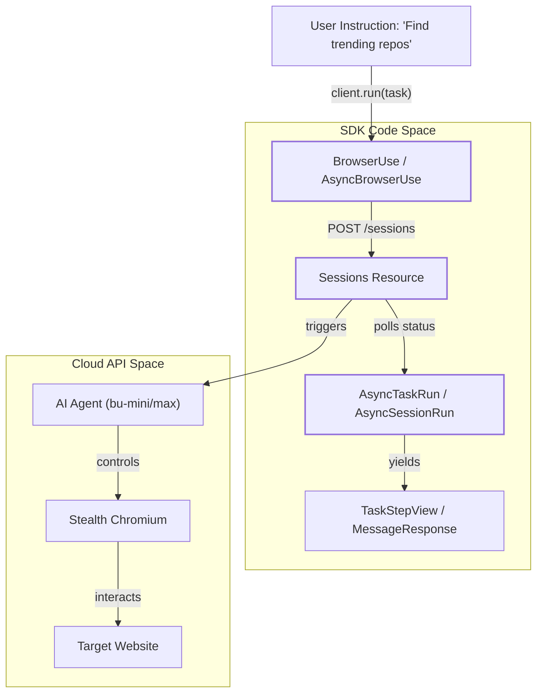
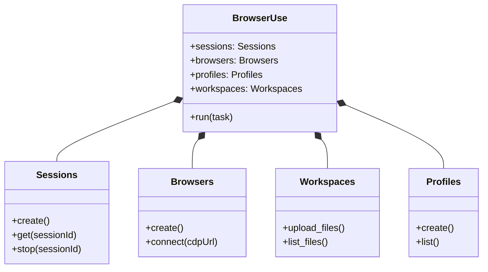

<!-- source: DeepWiki mcp.deepwiki.com · repo browser-use/sdk · page 1 Overview · fetched 2026-10-30 -->

# Overview

Relevant source files

The following files were used as context for generating this wiki page:

- [README.md](README.md)
- [browser-use-node/README.md](browser-use-node/README.md)
- [browser-use-node/src/v2/helpers.ts](browser-use-node/src/v2/helpers.ts)
- [browser-use-python/README.md](browser-use-python/README.md)
- [browser-use-python/src/browser_use_sdk/v2/client.py](browser-use-python/src/browser_use_sdk/v2/client.py)
- [docs/cloud/agent/quickstart.mdx](docs/cloud/agent/quickstart.mdx)
- [docs/cloud/api-reference.mdx](docs/cloud/api-reference.mdx)
- [docs/cloud/quickstart.mdx](docs/cloud/quickstart.mdx)
- [docs/docs.json](docs/docs.json)
- [docs/open-source/introduction.mdx](docs/open-source/introduction.mdx)

The Browser Use SDK repository provides the official client libraries for interacting with **Browser Use Cloud**, a state-of-the-art AI browser automation platform. The SDKs allow developers to control headless browsers, execute complex web tasks using natural language, and manage persistent browser identities (Profiles) and environments (Workspaces).

## What is Browser Use?

Browser Use enables AI agents to interact with the web like humans. It handles the heavy lifting of infrastructure, including:
*   **Stealth Browsers:** Chromium instances designed to bypass bot detection [docs/cloud/quickstart.mdx:3-4]().
*   **Managed Infrastructure:** CAPTCHA solving, residential proxies, and high-performance execution [docs/cloud/quickstart.mdx:3-4]().
*   **Agent Intelligence:** Support for leading LLMs (GPT, Claude, Gemini) optimized for browser navigation [docs/cloud/agent/quickstart.mdx:44-46]().

The repository contains two primary SDKs:
1.  **Python SDK** (`browser-use-sdk` on PyPI) [browser-use-python/README.md:1-12]().
2.  **TypeScript SDK** (`browser-use-sdk` on npm) [browser-use-node/README.md:1-9]().

## System Architecture

The SDKs are thin wrappers around the Browser Use REST API (v2 and v3) [docs/cloud/agent/quickstart.mdx:7-8](). They provide a 1:1 mapping of API endpoints to class methods, ensuring that every cloud feature is accessible programmatically.

### Conceptual Mapping: Natural Language to Code

The following diagram illustrates how a natural language request from a user is transformed into code entities within the SDK and eventually executed on the Cloud API.

**Diagram: Request Flow and Code Entity Association**

Sources: [browser-use-python/src/browser_use_sdk/v2/client.py:27-56](), [docs/cloud/agent/quickstart.mdx:7-10](), [browser-use-node/src/v2/helpers.ts:27-48]()

## SDK Versions: v2 vs v3

The repository maintains two versions of the API simultaneously. While both are supported, **v3** is the current recommendation for new projects due to its session-centric model.

| Feature | v2 (Legacy) | v3 (Current) |
| :--- | :--- | :--- |
| **Primary Unit** | `Tasks` | `Sessions` |
| **Model** | Task-centric (Task ID) | Session-centric (Session ID) |
| **Output** | `TaskResult` | `SessionResponse` |
| **Imports** | `browser_use_sdk.v2` | `browser_use_sdk.v3` |

Sources: [docs/cloud/quickstart.mdx:27-45](), [browser-use-python/src/browser_use_sdk/v2/client.py:22-25](), [docs/cloud/api-reference.mdx:21-22]()

### Entity Relationship Diagram

This diagram shows how the core code entities (Classes and Types) relate to the system resources.

**Diagram: SDK Resource Model**

Sources: [browser-use-python/src/browser_use_sdk/v2/client.py:49-56](), [docs/cloud/agent/quickstart.mdx:7-8]()

## Navigation Guide

The wiki is structured to take you from a basic implementation to deep architectural understanding.

### [Getting Started](#1.1)
Step-by-step guide for new developers. Covers installation via `pip` or `npm`, obtaining API keys from the Cloud console, and running your first `client.run()` command.
*   **Key Files:** `docs/cloud/quickstart.mdx`, `README.md`.

### [Repository Layout and Design Principles](#1.2)
Explains the monorepo structure and the "1:1 with OpenAPI" philosophy. Learn how the code-generation pipeline ensures both Python and TypeScript SDKs stay in sync with the backend.
*   **Key Files:** `CLAUDE.md`, `RUNBOOK.md`, `docs/docs.json`.

### [SDK Architecture](#2)
Deep dive into the internal mechanics:
*   **Client Classes:** `BrowserUse` and `AsyncBrowserUse` implementations.
*   **HTTP Layer:** Handling retries, authentication, and error mapping.
*   **Session Helpers:** How `TaskRun` and `SessionStream` handle polling and async iteration.

### [API Resources Reference](#3)
Detailed documentation for every resource manager:
*   **Sessions & Browsers:** The core of execution.
*   **Workspaces:** File management and I/O.
*   **Profiles:** Managing cookies and browser state.

### [Open Source SDK (browser_use Python Library)](#5)
Overview of the `browser-use` Python library (distinct from the Cloud SDK), which allows for local execution and custom tool registration.
*   **Key Files:** `docs/open-source/introduction.mdx`.

---
**Sources:**
* [docs/docs.json:40-171]()
* [docs/cloud/quickstart.mdx:1-65]()
* [docs/cloud/agent/quickstart.mdx:1-47]()
* [browser-use-python/src/browser_use_sdk/v2/client.py:27-56]()
* [browser-use-node/src/v2/helpers.ts:9-20]()

---

