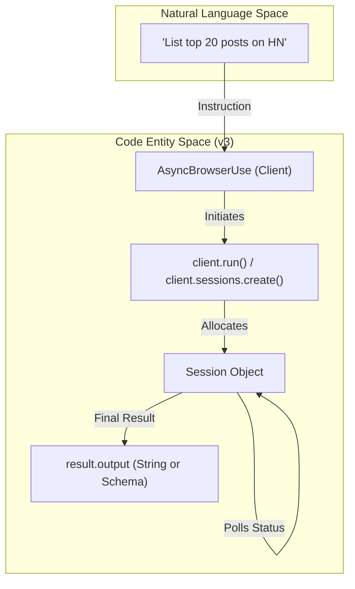
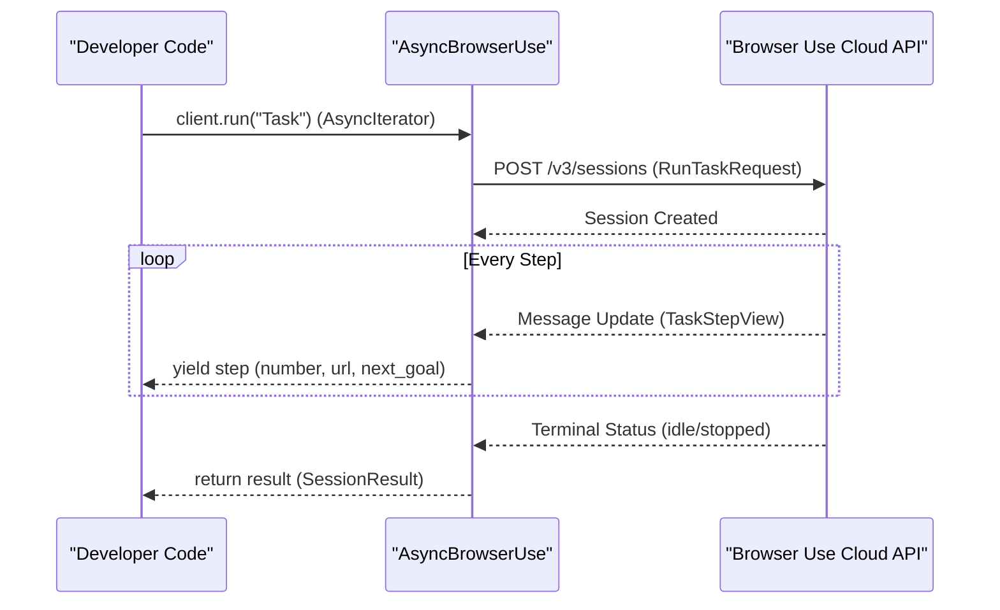

<!-- source: DeepWiki mcp.deepwiki.com · repo browser-use/sdk · page 1.1 Getting Started · fetched 2026-10-30 -->

# Getting Started

<details>
<summary>Relevant source files</summary>

The following files were used as context for generating this wiki page:

- [browser-use-node/examples/basic.ts](browser-use-node/examples/basic.ts)
- [browser-use-node/examples/streaming.ts](browser-use-node/examples/streaming.ts)
- [browser-use-node/examples/structured-output.ts](browser-use-node/examples/structured-output.ts)
- [browser-use-node/package.json](browser-use-node/package.json)
- [browser-use-python/examples/basic.py](browser-use-python/examples/basic.py)
- [browser-use-python/examples/streaming.py](browser-use-python/examples/streaming.py)
- [browser-use-python/examples/structured_output.py](browser-use-python/examples/structured_output.py)
- [browser-use-python/pyproject.toml](browser-use-python/pyproject.toml)
- [browser-use-python/tests/test_prod.py](browser-use-python/tests/test_prod.py)
- [browser-use-python/uv.lock](browser-use-python/uv.lock)
- [docs/cloud/agent/quickstart.mdx](docs/cloud/agent/quickstart.mdx)
- [docs/cloud/quickstart.mdx](docs/cloud/quickstart.mdx)
- [docs/cloud/vibecoding.mdx](docs/cloud/vibecoding.mdx)
- [docs/open-source/vibecoding.mdx](docs/open-source/vibecoding.mdx)

</details>


This page provides a technical guide for developers to integrate the Browser Use SDK into their projects. It covers installation, authentication, and the execution of the first automated browser task using the Cloud API.

## 1. Installation

The Browser Use SDK is available for both Python and TypeScript. It is designed as a thin wrapper around the Browser Use Cloud API, providing type-safe access to managed browser infrastructure [docs/cloud/agent/quickstart.mdx:7-8]().

### Python
The Python SDK requires Python 3.9 or higher [browser-use-python/pyproject.toml:11-11]().
```bash
pip install browser-use-sdk
```
**Dependencies:** `httpx` (HTTP client) and `pydantic` (data validation) [browser-use-python/pyproject.toml:12-12]().

### TypeScript / Node.js
The TypeScript SDK is distributed as an ESM module with CJS compatibility [browser-use-node/package.json:7-9]().
```bash
npm install browser-use-sdk
# or
pnpm add browser-use-sdk
```
**Dependencies:** `dotenv` and `zod` (for structured output schema validation) [browser-use-node/package.json:63-64]().

**Sources:** [browser-use-python/pyproject.toml:1-37](), [browser-use-node/package.json:1-67](), [docs/cloud/quickstart.mdx:7-16]()

---

## 2. Authentication

The SDK authenticates requests using an API Key. You can obtain a key from the [Browser Use Cloud Settings](https://cloud.browser-use.com/settings?tab=api-keys&new=1) [docs/cloud/quickstart.mdx:18-18]().

### Configuration Methods
1.  **Environment Variable:** The SDK automatically looks for `BROWSER_USE_API_KEY` [docs/cloud/quickstart.mdx:20-22]().
2.  **Constructor Argument:** Pass the `api_key` directly to the client constructor [browser-use-python/tests/test_prod.py:47-47]().

```bash
export BROWSER_USE_API_KEY=bu_your_key_here
```

**Sources:** [docs/cloud/quickstart.mdx:18-22](), [browser-use-python/tests/test_prod.py:32-47]()

---

## 3. Running Your First Task

The simplest way to interact with the API is the `.run()` method. This method encapsulates the entire lifecycle: creating a session, polling for status updates, and returning the final result [docs/cloud/agent/quickstart.mdx:9-9]().

### Basic Execution (Async)
The SDKs are designed for asynchronous execution to handle the long-running nature of browser automation tasks.

**Python Implementation:**
```python
import asyncio
from browser_use_sdk.v3 import AsyncBrowserUse

async def main():
    # Uses BROWSER_USE_API_KEY from env
    client = AsyncBrowserUse()
    result = await client.run("Find the price of Bitcoin on CoinMarketCap")
    print(result.output)

asyncio.run(main())
```
[docs/cloud/quickstart.mdx:27-37]()

**TypeScript Implementation:**
```typescript
import { BrowserUse } from "browser-use-sdk/v3";

const client = new BrowserUse();
const result = await client.run("Find the price of Bitcoin on CoinMarketCap");
console.log(result.output);
```
[docs/cloud/quickstart.mdx:38-44]()

### Data Flow: Run vs. Session
The following diagram illustrates the transition from a natural language instruction to the code entities that manage the browser lifecycle.

**Task Execution Logic**


**Sources:** [docs/cloud/agent/quickstart.mdx:7-10](), [browser-use-python/examples/basic.py:12-21](), [browser-use-node/examples/basic.ts:1-20]()

---

## 4. Understanding Import Paths (v2 vs v3)

The SDK supports two versions of the API. **v3 is the current standard**, focusing on a "Session-centric" model, while v2 is the legacy "Task-centric" model.

| Feature | v2 (Legacy) | v3 (Current) |
| :--- | :--- | :--- |
| **Primary Resource** | `tasks` | `sessions` |
| **Import Path (Py)** | `from browser_use_sdk.v2 import ...` | `from browser_use_sdk.v3 import ...` |
| **Import Path (TS)** | `import { ... } from "browser-use-sdk/v2"` | `import { ... } from "browser-use-sdk/v3"` |
| **Status Model** | `finished` / `isSuccess` | `idle` / `stopped` / `error` |

### Import Defaults
In both SDKs, the root import (e.g., `from browser_use_sdk import BrowserUse`) currently points to the version determined by the package's internal exports, but explicitly importing from `/v3` is recommended for forward compatibility [browser-use-node/package.json:22-31]().

**Sources:** [browser-use-node/package.json:11-32](), [docs/cloud/agent/quickstart.mdx:7-10](), [browser-use-python/tests/test_prod.py:44-44]()

---

## 5. Advanced Usage Patterns

### Structured Output
You can force the agent to return data matching a specific schema (Pydantic in Python, Zod in TypeScript) [browser-use-python/tests/test_prod.py:114-128]().

```python
from pydantic import BaseModel
class PriceResult(BaseModel):
    price: float
    currency: str

result = await client.run("What is the price of gold?", schema=PriceResult)
print(result.output.price) # Typed as float
```
[browser-use-python/tests/test_prod.py:108-128]()

### Real-time Streaming
To monitor the agent's progress step-by-step, use the streaming pattern [browser-use-python/examples/streaming.py:15-22]().

**Streaming Logic Flow**


**Sources:** [browser-use-python/examples/streaming.py:12-22](), [browser-use-node/examples/streaming.ts:7-21](), [browser-use-python/tests/test_prod.py:133-152]()

---

