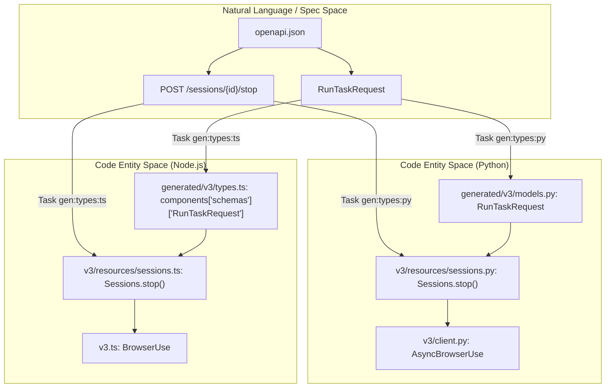
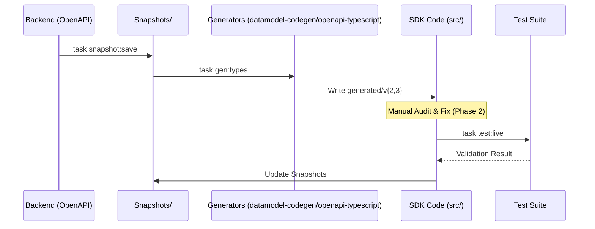

<!-- source: DeepWiki mcp.deepwiki.com · repo browser-use/sdk · page 1.2 Repository Layout and Design Principles · fetched 2026-10-30 -->

# Repository Layout and Design Principles

<details>
<summary>Relevant source files</summary>

The following files were used as context for generating this wiki page:

- [.claude/commands/generate.md](.claude/commands/generate.md)
- [.env.example](.env.example)
- [.gitignore](.gitignore)
- [CLAUDE.md](CLAUDE.md)
- [RUNBOOK.md](RUNBOOK.md)
- [Taskfile.yml](Taskfile.yml)
- [browser-use-node/.gitignore](browser-use-node/.gitignore)
- [browser-use-node/package.json](browser-use-node/package.json)
- [browser-use-node/pnpm-lock.yaml](browser-use-node/pnpm-lock.yaml)
- [browser-use-python/examples/profiles.py](browser-use-python/examples/profiles.py)
- [browser-use-python/examples/sessions.py](browser-use-python/examples/sessions.py)
- [browser-use-python/pyproject.toml](browser-use-python/pyproject.toml)
- [browser-use-python/src/browser_use_sdk/v2/resources/billing.py](browser-use-python/src/browser_use_sdk/v2/resources/billing.py)
- [browser-use-python/src/browser_use_sdk/v2/resources/files.py](browser-use-python/src/browser_use_sdk/v2/resources/files.py)
- [browser-use-python/src/browser_use_sdk/v2/resources/marketplace.py](browser-use-python/src/browser_use_sdk/v2/resources/marketplace.py)
- [browser-use-python/tests/test_live.py](browser-use-python/tests/test_live.py)
- [browser-use-python/uv.lock](browser-use-python/uv.lock)
- [static/sdks-banner.png](static/sdks-banner.png)

</details>


This page details the structural organization of the Browser Use SDK monorepo, the core philosophies guiding its development, and the automated pipelines used to maintain parity between the Python and TypeScript implementations.

## Monorepo Structure

The repository is organized as a monorepo containing both the Node.js and Python SDKs, along with shared documentation and API snapshots. This structure ensures that changes to the underlying Browser Use Cloud API are reflected simultaneously across both languages.

```text
/
├── browser-use-node/           # TypeScript SDK source and configuration
│   ├── src/
│   │   ├── core/               # Shared HTTP logic, retry mechanisms, and errors
│   │   ├── generated/          # Auto-generated types from OpenAPI (v2 and v3)
│   │   ├── v2/                 # V2 client, resource managers, and run/stream helpers
│   │   └── v3/                 # V3 client, session managers, and run/stream helpers
│   └── package.json            # Node.js dependencies and build scripts
├── browser-use-python/         # Python SDK source and configuration
│   ├── src/browser_use_sdk/
│   │   ├── _core/              # Shared HTTP logic and error handling
│   │   ├── generated/          # Auto-generated Pydantic models (v2 and v3)
│   │   ├── v2/                 # V2 client and resource implementations
│   │   └── v3/                 # V3 client and session implementations
│   └── pyproject.toml          # Python dependencies and build metadata
├── snapshots/                  # JSON snapshots of OpenAPI specs used for the last generation
│   ├── v2.json
│   └── v3.json
├── Taskfile.yml                # Unified command runner for generation, testing, and publishing
├── RUNBOOK.md                  # Detailed instructions for the SDK update pipeline
└── CLAUDE.md                   # Project rules, layout summary, and design principles
```
Sources: `[CLAUDE.md:5-27]()`, `[browser-use-node/package.json:1-35]()`, `[browser-use-python/pyproject.toml:1-19]()`

## Design Principles

The SDK development is governed by five core principles to ensure reliability and maintainability:

1.  **1:1 with OpenAPI**: Every endpoint defined in the Cloud API specification must map directly to a corresponding method in the SDK resource managers `[CLAUDE.md:53-53]()`.
2.  **Generated Types**: To prevent drift, all data models and type definitions are generated from the OpenAPI spec using `openapi-typescript` for Node.js and `datamodel-codegen` for Python `[CLAUDE.md:54-54]()`.
3.  **Minimal Helpers**: High-level abstractions like `.run()` and `.stream()` are kept thin (typically ~20 lines) to remain easy to audit and debug `[CLAUDE.md:55-55]()`.
4.  **Strict Type Safety**: The Python SDK returns Pydantic model instances rather than raw dictionaries, ensuring IDE completion and runtime validation `[CLAUDE.md:56-56]()`.
5.  **Synchronization**: Both SDKs must implement identical retry logic (HTTP 429 only), polling intervals (2s), and terminal status detection `[CLAUDE.md:62-63]()`.

## Code Generation Pipeline

The repository uses a deterministic pipeline to transform OpenAPI specifications into functional code. This process is managed via the `Taskfile.yml`.

### Type Generation Workflow

The `gen:types` task coordinates the generation for both languages:
*   **TypeScript**: Uses `openapi-typescript` to produce `types.ts`. These are then aliased within resource files to provide a clean developer experience `[Taskfile.yml:34-40]()`.
*   **Python**: Uses `datamodel-codegen` with specific flags (`--snake-case-field`, `--use-union-operator`) to generate Pydantic v2 models in `models.py` `[Taskfile.yml:42-65]()`.

### Data Flow: Spec to SDK

The following diagram illustrates how a backend change propagates through the repository entities:

**OpenAPI to Code Entity Mapping**

Sources: `[Taskfile.yml:28-65]()`, `[CLAUDE.md:51-57]()`, `[RUNBOOK.md:46-55]()`

## SDK Update Runbook

The `RUNBOOK.md` defines a four-phase process for updating the SDKs when the backend API changes. This process is designed to be executed by developers or AI agents (like Claude) to maintain perfect parity.

### Phase 0: Discovery
Compare fresh OpenAPI specs against the local `snapshots/` directory. Changes are classified as **MAJOR** (removed endpoints/required fields), **MINOR** (new endpoints), or **PATCH** (new optional fields) `[RUNBOOK.md:5-17]()`.

### Phase 1: Regenerate & Audit
Run `task gen:types`. Because code generators often have quirks, manual or automated audits are performed:
*   **Python Patching**: `datamodel-codegen` often outputs string literals for enum defaults; these must be manually patched to enum members `[RUNBOOK.md:23-23]()`.
*   **Regex Engine**: If models contain complex regex, `ConfigDict(regex_engine="python-re")` is added to the Pydantic models `[RUNBOOK.md:24-24]()`.

### Phase 2: Implementation
Update the resource managers (e.g., `marketplace.py`) to include new methods or parameters. A key rule is that every method with a request body **MUST** accept `**extra` (Python) or a spread object (TS) to ensure forward compatibility with new API fields `[CLAUDE.md:61-61]()`.

### Phase 3: Verification
The testing strategy involves three tiers:
1.  **Vibe Tests**: Spec-driven tests that do not require a backend `[Taskfile.yml:119-123]()`.
2.  **Live Tests**: Integration tests against a local backend (`localhost:8000`) `[Taskfile.yml:137-141]()`.
3.  **Prod Tests**: Smoke tests against the production API `[Taskfile.yml:155-159]()`.

**SDK Update Pipeline**

Sources: `[RUNBOOK.md:1-43]()`, `[Taskfile.yml:206-213]()`

## Resource Implementation Pattern

Every resource in the SDK (e.g., `Marketplace`, `Sessions`, `Billing`) follows a standard pattern for both synchronous and asynchronous clients.

| Feature | Python Implementation | Node.js Implementation |
| :--- | :--- | :--- |
| **HTTP Client** | `SyncHttpClient` / `AsyncHttpClient` | `HttpClient` |
| **Validation** | `Model.model_validate()` | Type casting / Zod (optional) |
| **Naming** | `snake_case` | `camelCase` |
| **Extra Params** | `**extra: Any` | `...extra: any` |

Example from `Marketplace.execute`:
[browser-use-python/src/browser_use_sdk/v2/resources/marketplace.py:56-75]()
```python
def execute(
    self,
    skill_id: str,
    *,
    parameters: dict[str, Any] | None = None,
    session_id: str | None = None,
    **extra: Any,
) -> ExecuteSkillResponse:
    body: dict[str, Any] = {}
    # ... logic to build body ...
    body.update(extra) # Forward compatibility
    return ExecuteSkillResponse.model_validate(
        self._http.request("POST", f"/marketplace/skills/{skill_id}/execute", json=body)
    )
```
Sources: `[browser-use-python/src/browser_use_sdk/v2/resources/marketplace.py:56-75]()`, `[CLAUDE.md:61-61]()`

---

