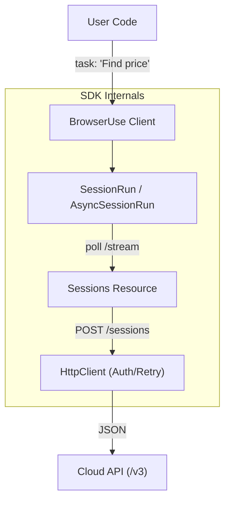
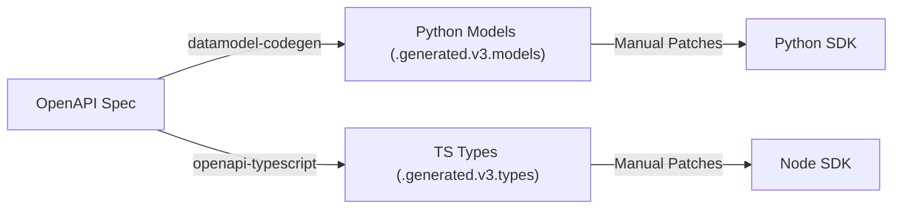

<!-- source: DeepWiki mcp.deepwiki.com · repo browser-use/sdk · page 2 SDK Architecture · fetched 2026-10-30 -->

# SDK Architecture

Relevant source files

The following files were used as context for generating this wiki page:

- [README.md](README.md)
- [browser-use-node/README.md](browser-use-node/README.md)
- [browser-use-node/src/index.ts](browser-use-node/src/index.ts)
- [browser-use-node/src/v2/helpers.ts](browser-use-node/src/v2/helpers.ts)
- [browser-use-node/src/v3/client.ts](browser-use-node/src/v3/client.ts)
- [browser-use-node/src/v3/resources/browsers.ts](browser-use-node/src/v3/resources/browsers.ts)
- [browser-use-python/README.md](browser-use-python/README.md)
- [browser-use-python/src/browser_use_sdk/__init__.py](browser-use-python/src/browser_use_sdk/__init__.py)
- [browser-use-python/src/browser_use_sdk/v2/client.py](browser-use-python/src/browser_use_sdk/v2/client.py)
- [browser-use-python/src/browser_use_sdk/v2/helpers.py](browser-use-python/src/browser_use_sdk/v2/helpers.py)
- [browser-use-python/src/browser_use_sdk/v3/client.py](browser-use-python/src/browser_use_sdk/v3/client.py)
- [browser-use-python/src/browser_use_sdk/v3/resources/browsers.py](browser-use-python/src/browser_use_sdk/v3/resources/browsers.py)
- [browser-use-python/src/browser_use_sdk/v3/resources/sessions.py](browser-use-python/src/browser_use_sdk/v3/resources/sessions.py)

This page provides a high-level overview of the internal structure of the Browser Use Python and TypeScript SDKs. Both SDKs are designed to be thin, type-safe wrappers around the Browser Use Cloud API, maintaining a 1:1 relationship with the OpenAPI specification while providing ergonomic helpers for common patterns like polling and streaming.

## Core Design Philosophy

The SDKs follow a "Resource-Based" architecture. The top-level `BrowserUse` client acts as a container for specialized resource managers (e.g., `sessions`, `browsers`, `workspaces`), each corresponding to a specific set of API endpoints.

### High-Level Component Diagram

This diagram shows how natural language requests from the user flow through the SDK components into the Cloud API.

**Sources:**
- [browser-use-python/src/browser_use_sdk/v3/client.py:25-50]()
- [browser-use-node/src/v3/client.ts:26-55]()

---

## Client Classes (v2 and v3)

The SDK supports two major API versions. While v2 is maintained for legacy support, v3 is the current standard, shifting from a "Task-centric" model to a "Session-centric" model.

- **v3 Client**: Found in `browser_use_sdk.v3` (Python) and `browser-use-sdk/v3` (Node). It focuses on `sessions` that can run multiple tasks and maintain state. [browser-use-python/src/browser_use_sdk/v3/client.py:25-26](), [browser-use-node/src/v3/client.ts:26-26]()
- **v2 Client**: The default import in both SDKs. It uses a `tasks` resource as the primary unit of work. [browser-use-python/src/browser_use_sdk/__init__.py:8-9](), [browser-use-node/src/index.ts:1-1]()

Both clients provide a high-level `.run()` method that abstracts away session creation, polling for completion, and output parsing.

For details on API differences and constructor options, see [Client Classes (v2 and v3)](#2.1).

---

## HTTP Layer and Error Handling

The foundation of both SDKs is a custom HTTP client (`SyncHttpClient`/`AsyncHttpClient` in Python, `HttpClient` in Node) that manages the low-level communication with the Cloud API.

Key responsibilities include:
- **Authentication**: Injecting the `Authorization: Bearer <API_KEY>` header into every request. [browser-use-python/src/browser_use_sdk/v3/client.py:35-44]()
- **Serialization**: Handling JSON cleaning and Pydantic/Zod schema conversions.
- **Resiliency**: Implementing exponential backoff and retries, specifically for `429 Too Many Requests` errors.
- **Timeouts**: Managing request-level and global task-level timeouts.

For details on the networking stack, see [HTTP Layer and Error Handling](#2.2).

---

## Session Helpers and Streaming

Executing a browser task is an asynchronous, long-running operation. The SDKs provide "Helper" classes to manage this lifecycle:

| Feature | Python Class | Node.js Class |
|:---|:---|:---|
| **v3 Execution** | `AsyncSessionRun` | `SessionRun` |
| **v2 Execution** | `AsyncTaskRun` | `TaskRun` |

These helpers implement a "Dual-Pattern":
1. **Awaitable**: You can `await` the helper directly to block until the task is finished and get the final result. [browser-use-python/src/browser_use_sdk/v2/helpers.py:186-187](), [browser-use-node/src/v2/helpers.ts:61-66]()
2. **Async Iterator**: You can use `async for` (Python) or `for await` (Node) to stream individual browser steps or messages as they occur. [browser-use-python/src/browser_use_sdk/v2/helpers.py:201-218](), [browser-use-node/src/v2/helpers.ts:69-93]()

For details on pagination and terminal status detection, see [Session Helpers and Streaming](#2.3).

---

## Generated Types and OpenAPI Sync

To ensure 1:1 parity with the Cloud API, the majority of the data models (Requests and Responses) are auto-generated from the backend's OpenAPI specification.

- **Python**: Uses `pydantic` models for runtime validation. [browser-use-python/src/browser_use_sdk/v3/resources/sessions.py:9-13]()
- **Node.js**: Uses TypeScript interfaces for compile-time safety, with `zod` for optional runtime schema validation of agent outputs. [browser-use-node/src/v3/client.ts:1-12]()

For details on the generation pipeline and snapshots, see [Generated Types and OpenAPI Sync](#2.4).

**Sources:**
- [browser-use-python/src/browser_use_sdk/v2/helpers.py:13-13]()
- [browser-use-node/src/v2/helpers.ts:9-9]()
- [browser-use-python/src/browser_use_sdk/v3/resources/sessions.py:67-69]()
- [browser-use-node/src/v3/client.ts:85-86]()

---

