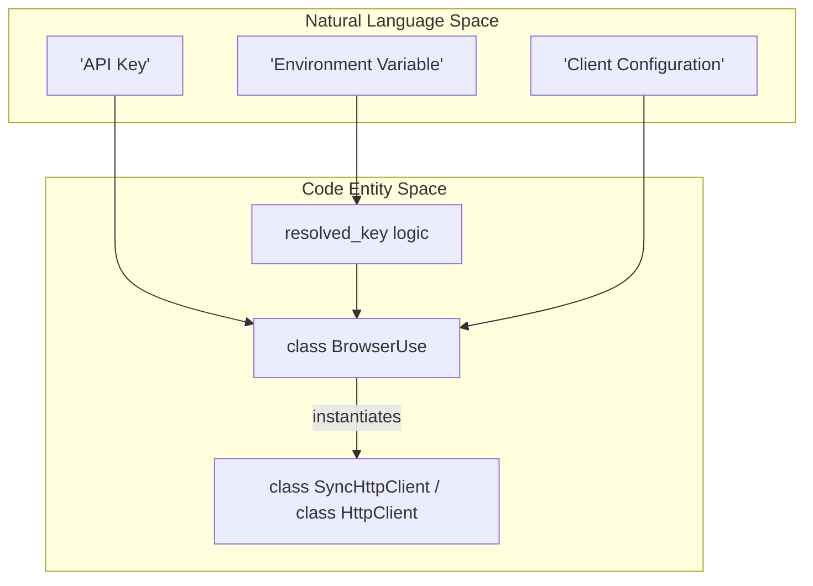
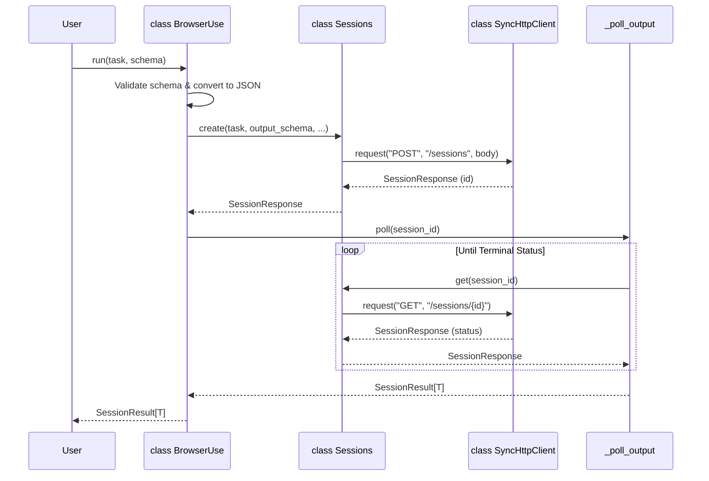

<!-- source: DeepWiki mcp.deepwiki.com · repo browser-use/sdk · page 2.1 Client Classes (v2 and v3) · fetched 2026-10-30 -->

# Client Classes (v2 and v3)

Relevant source files

The following files were used as context for generating this wiki page:

- [README.md](README.md)
- [browser-use-node/README.md](browser-use-node/README.md)
- [browser-use-node/src/index.ts](browser-use-node/src/index.ts)
- [browser-use-node/src/v2/helpers.ts](browser-use-node/src/v2/helpers.ts)
- [browser-use-node/src/v3.ts](browser-use-node/src/v3.ts)
- [browser-use-node/src/v3/client.ts](browser-use-node/src/v3/client.ts)
- [browser-use-node/src/v3/resources/browsers.ts](browser-use-node/src/v3/resources/browsers.ts)
- [browser-use-node/src/v3/resources/sessions.ts](browser-use-node/src/v3/resources/sessions.ts)
- [browser-use-python/README.md](browser-use-python/README.md)
- [browser-use-python/src/browser_use_sdk/__init__.py](browser-use-python/src/browser_use_sdk/__init__.py)
- [browser-use-python/src/browser_use_sdk/v2/__init__.py](browser-use-python/src/browser_use_sdk/v2/__init__.py)
- [browser-use-python/src/browser_use_sdk/v2/client.py](browser-use-python/src/browser_use_sdk/v2/client.py)
- [browser-use-python/src/browser_use_sdk/v2/helpers.py](browser-use-python/src/browser_use_sdk/v2/helpers.py)
- [browser-use-python/src/browser_use_sdk/v3/__init__.py](browser-use-python/src/browser_use_sdk/v3/__init__.py)
- [browser-use-python/src/browser_use_sdk/v3/client.py](browser-use-python/src/browser_use_sdk/v3/client.py)
- [browser-use-python/src/browser_use_sdk/v3/resources/browsers.py](browser-use-python/src/browser_use_sdk/v3/resources/browsers.py)
- [browser-use-python/src/browser_use_sdk/v3/resources/sessions.py](browser-use-python/src/browser_use_sdk/v3/resources/sessions.py)

The Browser Use SDK provides two primary entry points for interacting with the Browser Use Cloud API: the `BrowserUse` (synchronous) and `AsyncBrowserUse` (asynchronous) client classes. These classes encapsulate the HTTP communication layer, manage resource-specific managers (e.g., sessions, browsers, workspaces), and provide high-level methods for task execution and streaming.

## Client Overview

The SDK supports two distinct API versions: **v2** (task-centric) and **v3** (session-centric). While both versions share similar patterns, they differ in their import paths and internal resource management.

### v3 Client Architecture (Recommended)
The v3 client is designed around a unified `sessions` resource where tasks are dispatched to browser sessions.

| Feature | Python Class | Node.js Class |
| :--- | :--- | :--- |
| **Sync Client** | `browser_use_sdk.v3.BrowserUse` | N/A (Node is async-first) |
| **Async Client** | `browser_use_sdk.v3.AsyncBrowserUse` | `browser_use_sdk.v3.BrowserUse` |
| **Base URL** | `https://api.browser-use.com/api/v3` | `https://api.browser-use.com/api/v3` |

### v2 Client Architecture (Legacy)
The v2 client uses a model where `tasks` are the primary entity, which in turn manage underlying `sessions`.

| Feature | Python Class | Node.js Class |
| :--- | :--- | :--- |
| **Sync Client** | `browser_use_sdk.BrowserUse` | N/A |
| **Async Client** | `browser_use_sdk.AsyncBrowserUse` | `browser_use_sdk.BrowserUse` |
| **Base URL** | `https://api.browser-use.com/api/v2` | `https://api.browser-use.com/api/v2` |

**Sources:**
- [browser-use-python/src/browser_use_sdk/v3/client.py:20-50]()
- [browser-use-node/src/v3/client.ts:14-55]()
- [browser-use-python/src/browser_use_sdk/__init__.py:1-10]()

---

## Constructor and Initialization

Both v2 and v3 clients require an API key, which can be provided explicitly or via the `BROWSER_USE_API_KEY` environment variable.

### Configuration Options
The `BrowserUse` constructor accepts several optional parameters to tune the client behavior:
- `api_key`: The project API key from the Browser Use Cloud dashboard.
- `base_url`: Override the default API endpoint (useful for testing or proxying).
- `timeout`: Global request timeout in seconds (Python) or milliseconds (Node).
- `max_retries`: (Node only) Number of automatic retries for failed requests.

**Python (v3) Initialization Example:**
[browser-use-python/src/browser_use_sdk/v3/client.py:28-44]()

**Node.js (v3) Initialization Example:**
[browser-use-node/src/v3/client.ts:35-55]()

### Natural Language to Code Entity Mapping: Client Initialization
This diagram maps the high-level initialization concepts to the internal SDK entities.

**Sources:**
- [browser-use-python/src/browser_use_sdk/v3/client.py:35-44]()
- [browser-use-node/src/v3/client.ts:36-48]()

---

## High-Level Methods: `run()` and `stream()`

The clients provide two main methods to execute browser tasks. These methods are abstractions over the `sessions.create` (v3) or `tasks.create` (v2) endpoints.

### 1. `run()`
A blocking (or `await`-able) method that dispatches a task and waits for the agent to reach a terminal state (e.g., `success`, `error`).

- **Return Value**: A `SessionResult` (v3) or `TaskResult` (v2) containing the final `output` and metadata.
- **Polling**: Internally calls `_poll_output` to check the session status until completion.
- **Schema Support**: Supports Pydantic (Python) or Zod (Node) for structured output.

**Sources:**
- [browser-use-python/src/browser_use_sdk/v3/client.py:104-164]()
- [browser-use-node/src/v3/client.ts:70-114]()

### 2. `stream()`
A method that returns an iterator/stream of messages as they are generated by the agent.

- **Return Value**: A `SessionStream` (v3) or `TaskStream` (v2).
- **Functionality**: Allows real-time observation of the agent's progress (e.g., "Navigating to Google", "Extracting price").
- **Final Result**: The stream object contains a `.result` property that becomes populated once the stream is exhausted.

**Sources:**
- [browser-use-python/src/browser_use_sdk/v3/client.py:165-224]()

---

## Structured Output Support

The v3 client provides first-class support for structured data extraction using schema libraries. This is implemented by converting the schema to a JSON Schema and passing it to the `output_schema` parameter of the API.

### Python (Pydantic)
In Python, you pass a Pydantic `BaseModel`. The SDK calls `.model_json_schema()` to generate the definition for the LLM.
[browser-use-python/src/browser_use_sdk/v3/client.py:135-143]()

### Node.js (Zod)
In Node.js, you pass a Zod schema. The SDK uses `z.toJSONSchema(schema)` to serialize the requirements.
[browser-use-node/src/v3/client.ts:78-86]()

---

## Resource Management

The client acts as a hub for various resource managers. Each manager handles a specific set of API endpoints.

| Manager | Purpose | v2 Access | v3 Access |
| :--- | :--- | :--- | :--- |
| `sessions` | Manage browser session lifecycle | `client.sessions` | `client.sessions` |
| `browsers` | Standalone browser control | `client.browsers` | `client.browsers` |
| `workspaces` | File and script management | N/A | `client.workspaces` |
| `profiles` | Persistent browser identities | `client.profiles` | `client.profiles` |
| `billing` | Credit and usage tracking | `client.billing` | `client.billing` |
| `tasks` | Legacy task management | `client.tasks` | N/A |

**Sources:**
- [browser-use-python/src/browser_use_sdk/v3/client.py:45-49]()
- [browser-use-node/src/v3/client.ts:27-31]()

### Code Entity Interaction: Session Execution Flow
This diagram illustrates how the `BrowserUse` client coordinates between different code entities during a `run()` call.

**Sources:**
- [browser-use-python/src/browser_use_sdk/v3/client.py:104-163]()
- [browser-use-python/src/browser_use_sdk/v3/resources/sessions.py:23-69]()

---

## v2 vs v3 API Surface Differences

The primary architectural shift from v2 to v3 is the move from a "Task" object to a "Session" object.

### Task Dispatching
- **v2**: You create a `Task`, which returns a `task_id`. The task then starts a session.
- **v3**: You create a `Session` with an optional `task`. If a `session_id` is provided to `run()`, the SDK automatically sets `keep_alive=True` to allow multi-turn interactions.

**Sources:**
- [browser-use-python/src/browser_use_sdk/v3/client.py:146-148]()
- [browser-use-node/src/v3/client.ts:88-90]()

### Script Caching (v3 Only)
The v3 `run()` and `stream()` methods support `cache_script`.
- If `True`, the SDK requires a `workspace_id`.
- The agent will attempt to generate and save a deterministic script to the workspace, which can be re-run at lower cost.

**Sources:**
- [browser-use-python/src/browser_use_sdk/v3/client.py:123-133]()

---

