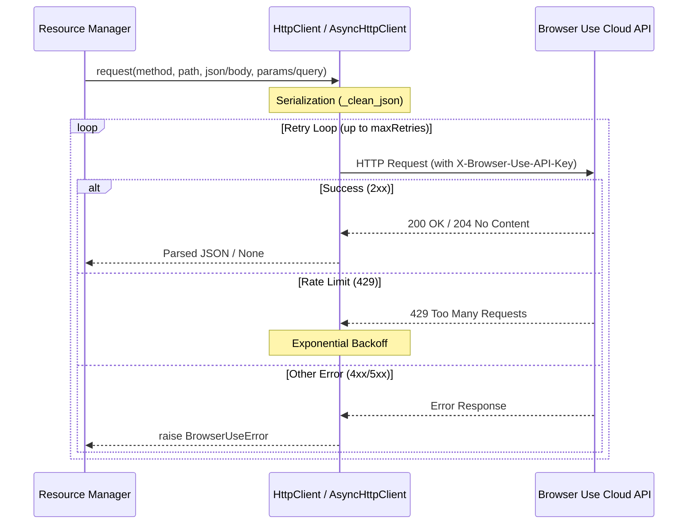
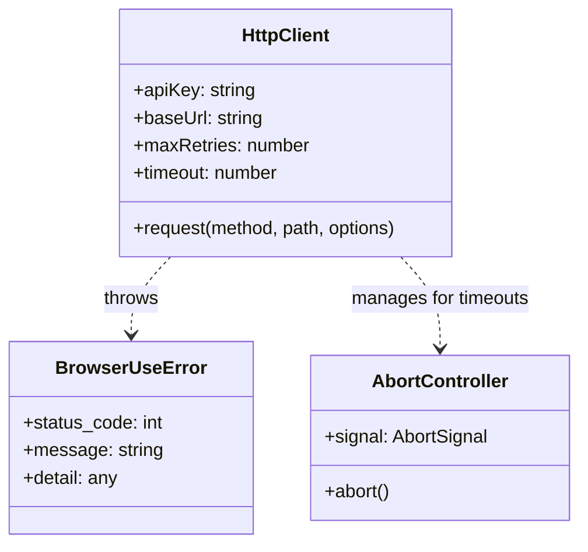

<!-- source: DeepWiki mcp.deepwiki.com · repo browser-use/sdk · page 2.2 HTTP Layer and Error Handling · fetched 2026-10-30 -->

# HTTP Layer and Error Handling

Relevant source files

The following files were used as context for generating this wiki page:

- [browser-use-node/src/core/http.ts](browser-use-node/src/core/http.ts)
- [browser-use-node/src/v3/helpers.ts](browser-use-node/src/v3/helpers.ts)
- [browser-use-python/src/browser_use_sdk/_core/__init__.py](browser-use-python/src/browser_use_sdk/_core/__init__.py)
- [browser-use-python/src/browser_use_sdk/_core/errors.py](browser-use-python/src/browser_use_sdk/_core/errors.py)
- [browser-use-python/src/browser_use_sdk/_core/http.py](browser-use-python/src/browser_use_sdk/_core/http.py)
- [browser-use-python/src/browser_use_sdk/v3/helpers.py](browser-use-python/src/browser_use_sdk/v3/helpers.py)

This page documents the internal HTTP communication layer used by both the Python and Node.js SDKs. It covers the implementation of the low-level clients, authentication mechanisms, automated retry logic, and standardized error reporting.

## Overview of HTTP Clients

The SDKs use dedicated HTTP client classes to wrap underlying network libraries (`httpx` in Python and `fetch` in Node.js). These classes handle the boilerplate of API communication, ensuring consistent behavior across all resource managers.

| Feature | Python Implementation | Node.js Implementation |
| :--- | :--- | :--- |
| **Sync Client** | `SyncHttpClient` [browser-use-python/src/browser_use_sdk/_core/http.py:63-107]() | N/A (Async only) |
| **Async Client** | `AsyncHttpClient` [browser-use-python/src/browser_use_sdk/_core/http.py:109-153]() | `HttpClient` [browser-use-node/src/core/http.ts:10-132]() |
| **Underlying Lib** | `httpx` [browser-use-python/src/browser_use_sdk/_core/http.py:10]() | `fetch` (Native/Undici) [browser-use-node/src/core/http.ts:63]() |

### Data Flow: Request Lifecycle

The following diagram illustrates how a request moves from a Resource Manager through the HTTP layer to the Browser Use Cloud API.

**Request and Error Handling Flow**

Sources: [browser-use-python/src/browser_use_sdk/_core/http.py:80-103](), [browser-use-node/src/core/http.ts:48-112]()

---

## Authentication and Headers

Every request sent by the SDK includes the `X-Browser-Use-API-Key` header. This is configured during the initialization of the client.

- **Python**: The header is set in the `httpx.Client` or `httpx.AsyncClient` constructor [browser-use-python/src/browser_use_sdk/_core/http.py:76]().
- **Node.js**: The header is injected into the `headers` object during each `request` call [browser-use-node/src/core/http.ts:41-43]().

---

## Serialization and Parameter Cleaning

Before data is sent to the API, it undergoes a cleaning process to ensure it is compatible with the backend's expectations.

### Python: `_clean_json`
The Python SDK uses a recursive `_clean_json` function to prepare complex types for the `httpx` request:
- **Pydantic Models**: Converted using `.model_dump(by_alias=True, exclude_none=True)` [browser-use-python/src/browser_use_sdk/_core/http.py:26-27]().
- **Enums**: Converted to their underlying `.value` [browser-use-python/src/browser_use_sdk/_core/http.py:28-29]().
- **UUIDs/Datetimes**: Stringified to standard formats [browser-use-python/src/browser_use_sdk/_core/http.py:30-33]().

### Node.js: Query Param Cleaning
The Node.js client iterates through the `query` object, filtering out `undefined` or `null` values and converting remaining values to strings using `String(value)` [browser-use-node/src/core/http.ts:33-39]().

Sources: [browser-use-python/src/browser_use_sdk/_core/http.py:20-34](), [browser-use-node/src/core/http.ts:32-39]()

---

## Retry Logic and Exponential Backoff

Both SDKs implement an automatic retry mechanism specifically for `429 Too Many Requests` status codes.

1.  **Retry Target**: Only HTTP 429 is retried [browser-use-python/src/browser_use_sdk/_core/http.py:15](), [browser-use-node/src/core/http.ts:80]().
2.  **Default Retries**: 3 attempts [browser-use-python/src/browser_use_sdk/_core/http.py:16](), [browser-use-node/src/core/http.ts:19]().
3.  **Backoff Strategy**:
    - **Python**: Uses `min(_BACKOFF_BASE * (2 ** attempt), 10)` where base is 0.5s [browser-use-python/src/browser_use_sdk/_core/http.py:17-92]().
    - **Node.js**: Uses `Math.min(1000 * 2 ** (attempt - 1), 10_000)` [browser-use-node/src/core/http.ts:50]().

Sources: [browser-use-python/src/browser_use_sdk/_core/http.py:90-98](), [browser-use-node/src/core/http.ts:48-85]()

---

## Error Handling: `BrowserUseError`

When the API returns a non-success status code (and retries are exhausted or inapplicable), the SDK raises a `BrowserUseError`. This class provides structured access to the failure details.

**Class Definition (Python)**: [browser-use-python/src/browser_use_sdk/_core/errors.py:6-18]()
**Class Definition (Node.js)**: [browser-use-node/src/core/errors.ts]() (referenced in [browser-use-node/src/core/http.ts:107]())

### Error Parsing Logic
The SDKs attempt to extract a human-readable message from the response body:
1.  Check for a `message` field in the JSON response.
2.  Check for a `detail` field (common in FastAPI/Python backends).
3.  Fallback to the HTTP reason phrase or status code.

| Field | Description |
| :--- | :--- |
| `status_code` | The raw HTTP status code (e.g., 401, 404, 500). |
| `message` | The extracted error string for the user. |
| `detail` | The full raw JSON body returned by the API for debugging. |

Sources: [browser-use-python/src/browser_use_sdk/_core/http.py:41-60](), [browser-use-node/src/core/http.ts:87-107]()

---

## Timeout Handling and Abort Signals (Node.js)

In the Node.js SDK, `HttpClient` utilizes the `AbortController` API to manage request timeouts and allow user-initiated cancellations.

1.  **Default Timeout**: 30 seconds [browser-use-node/src/core/http.ts:20]().
2.  **Internal Timeout**: An `AbortController` is created per request. If the request exceeds the `timeout` duration, `controller.abort()` is called [browser-use-node/src/core/http.ts:54-57]().
3.  **User Signal**: If a user provides their own `AbortSignal` via `options.signal`, it takes precedence, allowing external cancellation of the request [browser-use-node/src/core/http.ts:55-60]().

**Entity Mapping: HTTP Entities**

Sources: [browser-use-node/src/core/http.ts:10-132](), [browser-use-python/src/browser_use_sdk/_core/errors.py:6-18]()

---

## Implementation Details: Python Helpers

The Python SDK includes a sentinel object `_UNSET` to distinguish between a parameter being omitted versus a user explicitly passing `None`.

- **`_UNSET`**: Used as a default value in resource manager methods. If a value is `_UNSET`, it is not sent in the JSON payload. If it is `None`, it is sent as a JSON `null` [browser-use-python/src/browser_use_sdk/_core/__init__.py:4-7]().
- **`_clean_params`**: Specifically handles query string serialization, converting booleans to `"true"`/`"false"` and stripping `None` values [browser-use-python/src/browser_use_sdk/_core/http.py:155-167]().

Sources: [browser-use-python/src/browser_use_sdk/_core/__init__.py:4-9](), [browser-use-python/src/browser_use_sdk/_core/http.py:155-167]()

---

