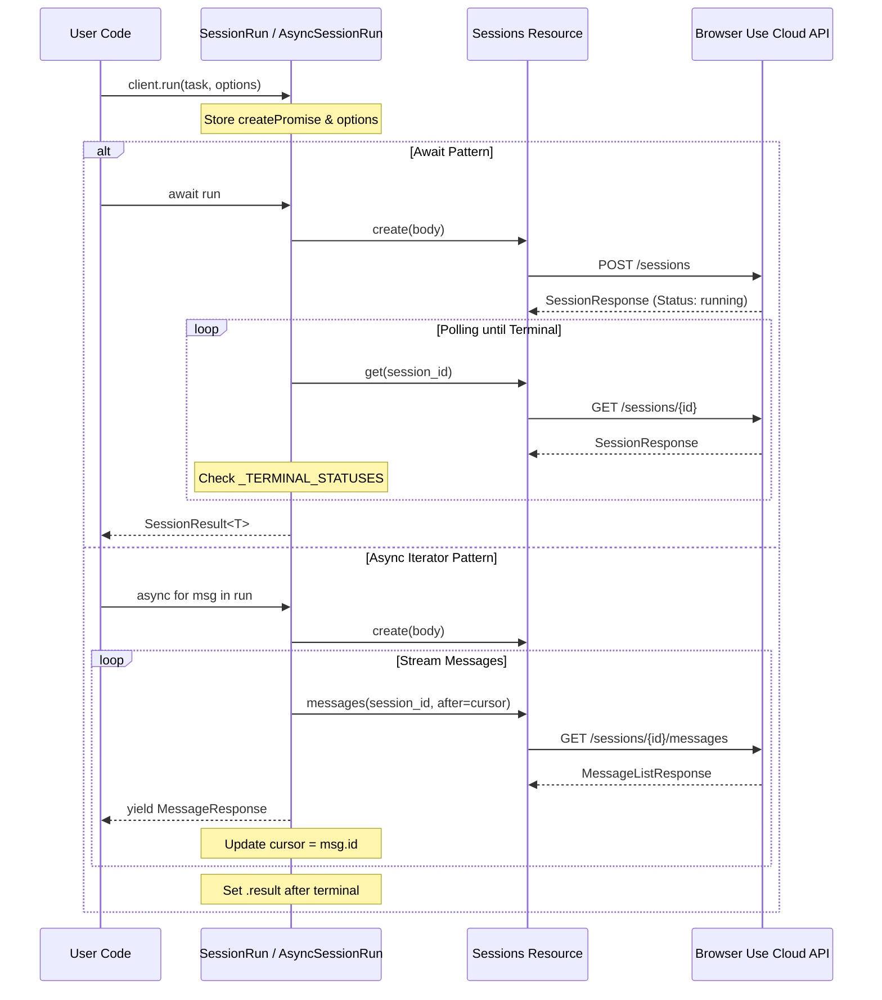
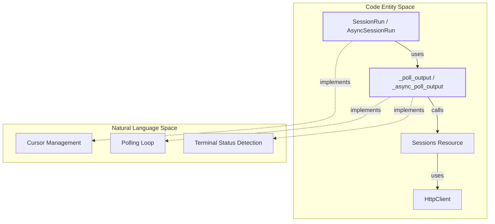

<!-- source: DeepWiki mcp.deepwiki.com · repo browser-use/sdk · page 2.3 Session Helpers and Streaming · fetched 2026-10-30 -->

# Session Helpers and Streaming

Relevant source files

The following files were used as context for generating this wiki page:

- [browser-use-node/src/core/http.ts](browser-use-node/src/core/http.ts)
- [browser-use-node/src/v3/client.ts](browser-use-node/src/v3/client.ts)
- [browser-use-node/src/v3/helpers.ts](browser-use-node/src/v3/helpers.ts)
- [browser-use-node/src/v3/resources/browsers.ts](browser-use-node/src/v3/resources/browsers.ts)
- [browser-use-python/src/browser_use_sdk/_core/http.py](browser-use-python/src/browser_use_sdk/_core/http.py)
- [browser-use-python/src/browser_use_sdk/v3/client.py](browser-use-python/src/browser_use_sdk/v3/client.py)
- [browser-use-python/src/browser_use_sdk/v3/helpers.py](browser-use-python/src/browser_use_sdk/v3/helpers.py)
- [browser-use-python/src/browser_use_sdk/v3/resources/browsers.py](browser-use-python/src/browser_use_sdk/v3/resources/browsers.py)
- [browser-use-python/src/browser_use_sdk/v3/resources/sessions.py](browser-use-python/src/browser_use_sdk/v3/resources/sessions.py)
- [docs/cloud/agent/streaming.mdx](docs/cloud/agent/streaming.mdx)
- [docs/cloud/tutorials/integrations/n8n.mdx](docs/cloud/tutorials/integrations/n8n.mdx)
- [docs/cloud/tutorials/integrations/openclaw.mdx](docs/cloud/tutorials/integrations/openclaw.mdx)
- [docs/cloud/tutorials/integrations/playwright.mdx](docs/cloud/tutorials/integrations/playwright.mdx)

The Browser Use SDK provides high-level abstractions for managing the lifecycle of an agent session. Instead of requiring manual polling of the REST API, the SDKs use helper classes to implement a "dual-purpose" pattern: you can either `await` a run to get the final result or iterate over it using an async-for loop to stream live messages.

## Dual-Purpose Run Pattern

Both the Python and Node.js SDKs implement a pattern where the `run()` method returns a handle that is both a Promise (or Awaitable) and an Async Iterator. This allows developers to choose between blocking for a result or building real-time UIs.

### Core Entities

| Entity | Language | Role |
| :--- | :--- | :--- |
| `SessionRun` | Node.js | Dual-purpose class implementing `PromiseLike` and `Symbol.asyncIterator` [browser-use-node/src/v3/helpers.ts:26-148](). |
| `AsyncSessionRun` | Python | Dual-purpose class implementing `__await__` and `__aiter__` [browser-use-python/src/browser_use_sdk/v3/helpers.py:82-165](). |
| `SessionResult` | Both | Wrapper containing the final `SessionResponse` and the parsed/typed `output` [browser-use-python/src/browser_use_sdk/v3/helpers.py:18-32](), [browser-use-node/src/v3/helpers.ts:20-20](). |

### Data Flow: Run and Stream

The following diagram illustrates how a call to `client.run()` transitions from session creation to terminal status detection.

**Session Execution Flow**

Sources: [browser-use-python/src/browser_use_sdk/v3/helpers.py:82-165](), [browser-use-node/src/v3/helpers.ts:26-148](), [docs/cloud/agent/streaming.mdx:14-37]()

## Cursor-Based Message Pagination

Streaming is implemented via cursor-based pagination on the `/sessions/{id}/messages` endpoint. The SDK maintains a `cursor` (the ID of the last received message) and requests only new messages in subsequent polls [browser-use-python/src/browser_use_sdk/v3/helpers.py:140-147](), [browser-use-node/src/v3/helpers.ts:108-116]().

### Start Cursor for Follow-up Tasks
When running a follow-up task on an existing `session_id`, the SDK snapshots the current latest message ID as the `_startCursor`. This ensures the iterator only yields messages produced by the *new* task, ignoring the history of previous tasks in that same session [browser-use-node/src/v3/client.ts:93-110]().

### Terminal Status Detection
The SDK considers a session finished when its `status` enters one of the `_TERMINAL_STATUSES`:
* `idle`: Task completed successfully and session is ready for next task.
* `stopped`: Task or session was manually cancelled.
* `timed_out`: Session exceeded its maximum duration.
* `error`: An unrecoverable error occurred.

Sources: [browser-use-python/src/browser_use_sdk/v3/helpers.py:13-13](), [browser-use-node/src/v3/helpers.ts:8-8](), [browser-use-python/src/browser_use_sdk/v3/resources/sessions.py:111-130]()

## Polling and Timeouts

The SDKs use a polling mechanism to monitor session progress.

* **Default Interval**: 2 seconds [browser-use-python/src/browser_use_sdk/v3/helpers.py:52-52](), [browser-use-node/src/v3/helpers.ts:46-46]().
* **Default Timeout**: 14,400 seconds (4 hours) [browser-use-python/src/browser_use_sdk/v3/helpers.py:51-51](), [browser-use-node/src/v3/helpers.ts:45-45]().
* **Drain Logic**: When a session reaches a terminal status, the SDK performs one final "drain" poll for messages to ensure no late-arriving logs are missed before returning the result [browser-use-python/src/browser_use_sdk/v3/helpers.py:152-159](), [browser-use-node/src/v3/helpers.ts:121-128]().

**Entity Mapping: Polling Logic**

Sources: [browser-use-python/src/browser_use_sdk/v3/helpers.py:46-80](), [browser-use-node/src/v3/helpers.ts:78-100](), [browser-use-python/src/browser_use_sdk/_core/http.py:63-106]()

## Implementation Details

### Node.js: `SessionRun`
In TypeScript, `SessionRun` implements `PromiseLike<SessionResult<T>>`. This allows it to be used with `await` without being an actual `Promise` instance, enabling the custom iterator logic [browser-use-node/src/v3/helpers.ts:26-68]().

### Python: `AsyncSessionRun` and `SessionStream`
Python provides two distinct helpers:
1. `AsyncSessionRun`: For `AsyncBrowserUse`, supporting `await` and `async for` [browser-use-python/src/browser_use_sdk/v3/helpers.py:82-165]().
2. `SessionStream`: For the synchronous `BrowserUse` client, providing a standard `Iterator` for use in `for msg in stream:` blocks [browser-use-python/src/browser_use_sdk/v3/helpers.py:167-202]().

### Structured Output Parsing
The helpers automatically handle the conversion of the raw session `output` (often a JSON string from the LLM) into typed objects using Pydantic (Python) or Zod (Node.js) if a schema was provided during the `run()` call [browser-use-python/src/browser_use_sdk/v3/helpers.py:35-43](), [browser-use-node/src/v3/helpers.ts:142-147]().

Sources: [browser-use-python/src/browser_use_sdk/v3/client.py:135-143](), [browser-use-node/src/v3/client.ts:78-86]()

---

