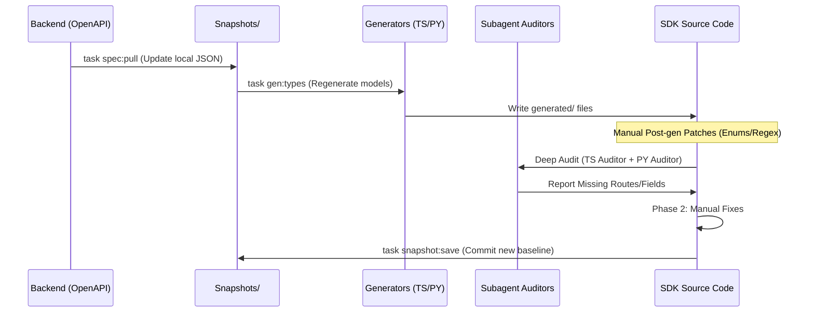

<!-- source: DeepWiki mcp.deepwiki.com · repo browser-use/sdk · page 2.4 Generated Types and OpenAPI Sync · fetched 2026-10-30 -->

# Generated Types and OpenAPI Sync

<details>
<summary>Relevant source files</summary>

The following files were used as context for generating this wiki page:

- [.claude/commands/generate.md](.claude/commands/generate.md)
- [.env.example](.env.example)
- [.gitignore](.gitignore)
- [RUNBOOK.md](RUNBOOK.md)
- [Taskfile.yml](Taskfile.yml)
- [browser-use-node/.gitignore](browser-use-node/.gitignore)
- [browser-use-node/pnpm-lock.yaml](browser-use-node/pnpm-lock.yaml)
- [browser-use-node/src/generated/v2/types.ts](browser-use-node/src/generated/v2/types.ts)
- [browser-use-node/src/generated/v3/types.ts](browser-use-node/src/generated/v3/types.ts)
- [browser-use-python/examples/profiles.py](browser-use-python/examples/profiles.py)
- [browser-use-python/examples/sessions.py](browser-use-python/examples/sessions.py)
- [browser-use-python/src/browser_use_sdk/generated/v2/models.py](browser-use-python/src/browser_use_sdk/generated/v2/models.py)
- [browser-use-python/src/browser_use_sdk/generated/v3/models.py](browser-use-python/src/browser_use_sdk/generated/v3/models.py)
- [browser-use-python/tests/test_live.py](browser-use-python/tests/test_live.py)
- [docs/cloud/openapi/v2.json](docs/cloud/openapi/v2.json)
- [docs/cloud/openapi/v3.json](docs/cloud/openapi/v3.json)
- [docs/openapi/v2.json](docs/openapi/v2.json)
- [docs/openapi/v3.json](docs/openapi/v3.json)
- [snapshots/v2.json](snapshots/v2.json)
- [snapshots/v3.json](snapshots/v3.json)
- [static/sdks-banner.png](static/sdks-banner.png)

</details>


The Browser Use SDK follows a "1:1-with-OpenAPI" design philosophy, ensuring that both the Python and TypeScript SDKs remain perfectly in sync with the Cloud API. This is achieved through a deterministic code-generation pipeline that transforms OpenAPI specifications into native type definitions and Pydantic models.

## Code Generation Pipeline

The synchronization process is managed via `Taskfile.yml` and follows a structured flow from the backend specification to the SDK source code.

### Implementation Flow

1.  **Spec Retrieval**: Fresh OpenAPI specs are pulled from the running local backend or the production environment [Taskfile.yml:13-18]().
2.  **Snapshotting**: The repository maintains a `snapshots/` directory containing `v2.json` and `v3.json`. These serve as the "known good" baseline for the current SDK version [snapshots/v3.json:1-10]().
3.  **Type Generation**:
    *   **Node.js**: Uses `openapi-typescript` to generate interfaces from the spec [Taskfile.yml:38-39]().
    *   **Python**: Uses `datamodel-codegen` to generate Pydantic v2 models [Taskfile.yml:46-64]().

### Pipeline Architecture

Title: OpenAPI Synchronization and Generation Flow
```mermaid
graph TD
    subgraph "Backend Space"
        B_V2["OpenAPI V2 Spec"]
        B_V3["OpenAPI V3 Spec"]
    end

    subgraph "Snapshots (Git Tracked)"
        S_V2["snapshots/v2.json"]
        S_V3["snapshots/v3.json"]
    end

    subgraph "Node.js SDK Generation"
        TS_GEN["openapi-typescript"]
        TS_V2["browser-use-node/src/generated/v2/types.ts"]
        TS_V3["browser-use-node/src/generated/v3/types.ts"]
    end

    subgraph "Python SDK Generation"
        PY_GEN["datamodel-codegen"]
        PY_V2["browser-use-python/.../generated/v2/models.py"]
        PY_V3["browser-use-python/.../generated/v3/models.py"]
    end

    B_V2 -->| "task spec:pull" | S_V2
    B_V3 -->| "task spec:pull" | S_V3
    
    S_V2 --> TS_GEN
    S_V3 --> TS_GEN
    TS_GEN --> TS_V2
    TS_GEN --> TS_V3

    S_V2 --> PY_GEN
    S_V3 --> PY_GEN
    PY_GEN --> PY_V2
    PY_GEN --> PY_V3
```
Sources: [Taskfile.yml:13-65](), [RUNBOOK.md:7-24]()

## Tooling and Configuration

### Node.js (TypeScript)
The TypeScript SDK utilizes `openapi-typescript` to generate a comprehensive `paths` interface. Instead of direct exports for every schema, the SDK resources use local type aliases that point into the generated `components["schemas"]` [RUNBOOK.md:67-68]().

*   **Generated File**: `browser-use-node/src/generated/v3/types.ts` [browser-use-node/src/generated/v3/types.ts:1-10]()
*   **Command**: `npx openapi-typescript {{.OPENAPI_V3}} -o src/generated/v3/types.ts` [Taskfile.yml:39]()

### Python (Pydantic)
The Python SDK uses `datamodel-codegen` (pinned to version 0.45.0) to generate Pydantic models. It is configured to use snake_case fields, field constraints, and the union operator (`|`) for type hints [Taskfile.yml:46-54](), [RUNBOOK.md:64]().

*   **Generated File**: `browser-use-python/src/browser_use_sdk/generated/v3/models.py` [browser-use-python/src/browser_use_sdk/generated/v3/models.py:1-10]()
*   **Command**: `datamodel-codegen --input-file-type openapi --output-model-type pydantic_v2.BaseModel --snake-case-field` [Taskfile.yml:46-51]()

## Post-Generation Patches

Due to limitations in automated generators, the SDK pipeline includes mandatory post-generation fixes documented in the `RUNBOOK.md`.

| Issue | Target | Resolution |
| :--- | :--- | :--- |
| **Enum Defaults** | Python | `datamodel-codegen` outputs string literals for defaults. These must be manually patched to enum members (e.g., `Status.active` instead of `'active'`) to satisfy type checkers [RUNBOOK.md:23, 63](). |
| **Regex Engine** | Python | Pydantic models with complex regex patterns (lookaheads) require `ConfigDict(regex_engine="python-re")` [browser-use-python/src/browser_use_sdk/generated/v3/models.py:27-29](), [RUNBOOK.md:62](). |
| **Snake Case** | Python | Python params are converted from `snake_case` in code to `camelCase` in the request body via Pydantic aliases [browser-use-python/src/browser_use_sdk/generated/v3/models.py:38, 50](), [RUNBOOK.md:51](). |

Sources: [RUNBOOK.md:22-24](), [browser-use-python/src/browser_use_sdk/generated/v3/models.py:26-30]()

## Synchronization Workflow

The synchronization process is a three-phase workflow designed to prevent breaking changes from reaching production.

Title: SDK Update Runbook Phases

Sources: [RUNBOOK.md:5-43](), [Taskfile.yml:206-212]()

### Phase 0: Discovery and Classification
Before generating code, developers must diff the fresh specs against `snapshots/`. Changes are classified by impact [RUNBOOK.md:7-14]():
*   **MAJOR**: Removed endpoints, required parameters, or response fields.
*   **MINOR**: New endpoints.
*   **PATCH**: New optional parameters or enum values.

### Phase 1: Audit
After running `task gen:types`, two parallel subagents (one for TS, one for Python) audit the SDK resources against the new spec [RUNBOOK.md:25-29](). They verify:
*   **Method Coverage**: Every route in `openapi.json` has a corresponding method in the SDK (e.g., `POST /sessions` -> `.create()`) [RUNBOOK.md:48]().
*   **Type Safety**: Methods return Pydantic model instances in Python (via `model_validate()`) or the correct TypeScript aliases [RUNBOOK.md:68]().

### Phase 2: Validation
The final step involves running the "vibe" tests (spec-driven, no backend) and, if possible, live integration tests to ensure the generated types correctly serialize/deserialize data from the API [Taskfile.yml:114-141]().

Sources: [RUNBOOK.md:31-41](), [Taskfile.yml:28-42]()

---

