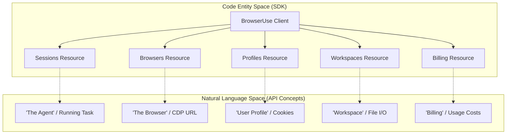
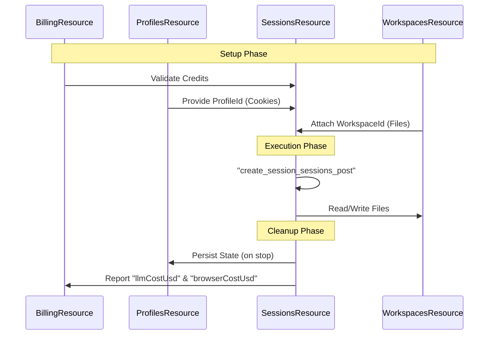

<!-- source: DeepWiki mcp.deepwiki.com · repo browser-use/sdk · page 3 API Resources Reference · fetched 2026-10-30 -->

# API Resources Reference

Relevant source files

The following files were used as context for generating this wiki page:

- [browser-use-node/src/v3/client.ts](browser-use-node/src/v3/client.ts)
- [browser-use-node/src/v3/resources/browsers.ts](browser-use-node/src/v3/resources/browsers.ts)
- [browser-use-python/src/browser_use_sdk/v3/client.py](browser-use-python/src/browser_use_sdk/v3/client.py)
- [browser-use-python/src/browser_use_sdk/v3/resources/browsers.py](browser-use-python/src/browser_use_sdk/v3/resources/browsers.py)
- [browser-use-python/src/browser_use_sdk/v3/resources/sessions.py](browser-use-python/src/browser_use_sdk/v3/resources/sessions.py)
- [docs/openapi/v2.json](docs/openapi/v2.json)
- [docs/openapi/v3.json](docs/openapi/v3.json)
- [snapshots/v2.json](snapshots/v2.json)
- [snapshots/v3.json](snapshots/v3.json)

This page provides a high-level overview of the resource managers exposed by the Browser Use SDK clients. These resources act as the primary interface for interacting with the Cloud API's entities, such as agent sessions, browser instances, persistent profiles, and workspaces.

The SDK follows a resource-based architecture where the main `BrowserUse` client delegates specific functionality to dedicated resource classes [browser-use-python/src/browser_use_sdk/v3/client.py:45-49]().

### Resource Mapping Overview

The following diagram illustrates how the high-level SDK resource managers map to the underlying Cloud API entities and their corresponding code implementations.

**Resource Entity Mapping**

Sources: [browser-use-python/src/browser_use_sdk/v3/client.py:45-49](), [browser-use-node/src/v3/client.ts:27-31]()

---

### Sessions Resource (v3)
The `Sessions` resource is the primary entry point for the v3 "session-centric" model. It manages the lifecycle of an agent session, which can transition between `idle` and `running` states. It supports dispatching tasks to existing sessions, cursor-based message pagination, and granular stop strategies [browser-use-python/src/browser_use_sdk/v3/resources/sessions.py:19-154]().

For details, see [Sessions Resource (v3)](#3.1).

### Browsers Resource
The `Browsers` resource allows for the creation of standalone browser instances without an active agent. This is typically used for direct automation via CDP, Playwright, or Puppeteer. It provides the `liveUrl` for real-time viewing and `cdpUrl` for remote debugging [browser-use-python/src/browser_use_sdk/v3/resources/browsers.py:17-86]().

For details, see [Browsers Resource](#3.2).

### Workspaces Resource (v3)
`Workspaces` provide a persistent, isolated file system for sessions. This resource manages the upload of input files (via presigned S3 URLs) and the listing or downloading of output files generated by the agent during task execution [browser-use-python/src/browser_use_sdk/v3/client.py:49]().

For details, see [Workspaces Resource (v3)](#3.3).

### Profiles Resource
`Profiles` are containers for browser state, including cookies, `localStorage`, and session data. They enable the "login once, reuse many" pattern. Note that state persistence is only guaranteed if a session is explicitly stopped using the SDK [browser-use-python/src/browser_use_sdk/v3/client.py:47]().

For details, see [Profiles Resource](#3.4).

### Tasks, Skills, and Marketplace (v2)
These resources are specific to the v2 "task-centric" model. While v3 is recommended for new integrations, v2 remains supported for legacy workflows involving the `Skills` library (reusable agent capabilities) and the `Marketplace` (pre-configured community agents) [snapshots/v2.json:62-212]().

For details, see [Tasks, Skills, and Marketplace Resources (v2)](#3.5).

### Billing Resource
The `Billing` resource provides transparency into account balances and usage costs. It allows developers to query the `AccountView`, which includes current credit balances and the specific cost vectors (LLM, Browser, and Proxy) incurred by sessions [snapshots/v2.json:15-60]().

For details, see [Billing Resource](#3.6).

---

### Resource Relationship Diagram

The diagram below shows how resources interact during a typical automated workflow: a `Profile` is attached to a `Session`, which uses a `Workspace` for file I/O, all while consuming credits tracked by the `Billing` resource.

**Resource Interaction Lifecycle**

Sources: [snapshots/v3.json:21-22](), [browser-use-python/src/browser_use_sdk/v3/resources/sessions.py:23-39](), [snapshots/v2.json:15-22]()

---

