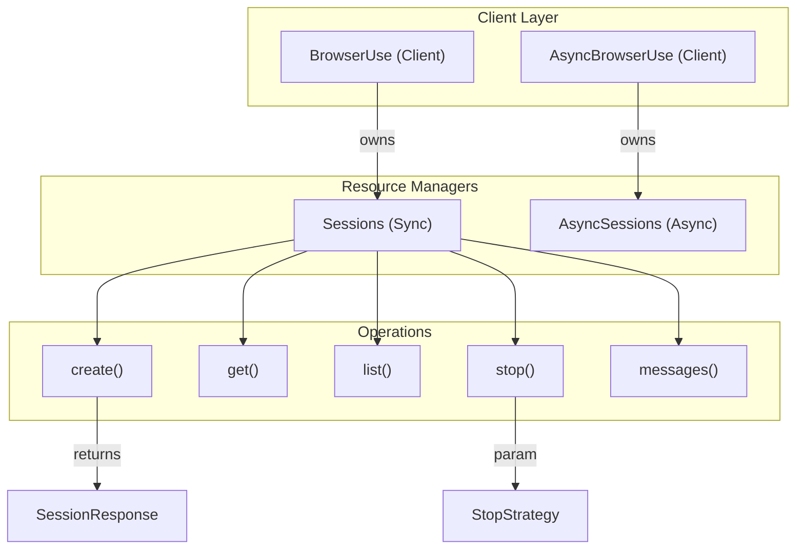
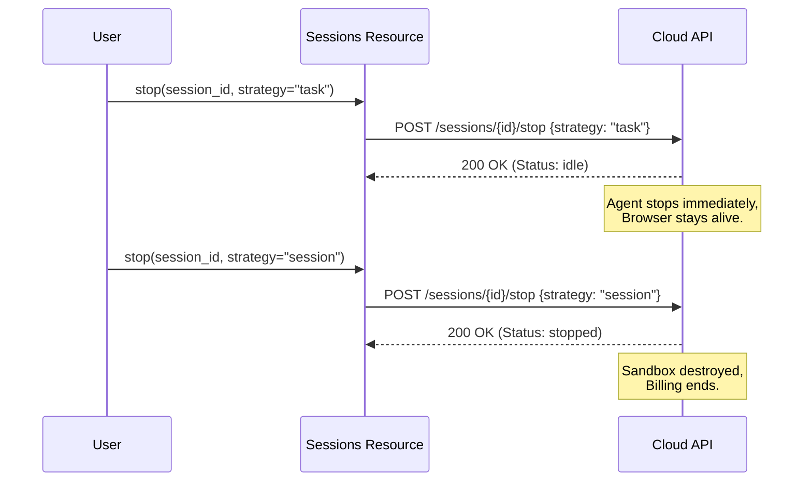

<!-- source: DeepWiki mcp.deepwiki.com · repo browser-use/sdk · page 3.1 Sessions Resource (v3) · fetched 2026-10-30 -->

# Sessions Resource (v3)

<details>
<summary>Relevant source files</summary>

The following files were used as context for generating this wiki page:

- [browser-use-node/src/generated/v3/types.ts](browser-use-node/src/generated/v3/types.ts)
- [browser-use-node/src/v3.ts](browser-use-node/src/v3.ts)
- [browser-use-node/src/v3/client.ts](browser-use-node/src/v3/client.ts)
- [browser-use-node/src/v3/resources/browsers.ts](browser-use-node/src/v3/resources/browsers.ts)
- [browser-use-node/src/v3/resources/sessions.ts](browser-use-node/src/v3/resources/sessions.ts)
- [browser-use-python/src/browser_use_sdk/generated/v3/models.py](browser-use-python/src/browser_use_sdk/generated/v3/models.py)
- [browser-use-python/src/browser_use_sdk/v3/__init__.py](browser-use-python/src/browser_use_sdk/v3/__init__.py)
- [browser-use-python/src/browser_use_sdk/v3/client.py](browser-use-python/src/browser_use_sdk/v3/client.py)
- [browser-use-python/src/browser_use_sdk/v3/resources/browsers.py](browser-use-python/src/browser_use_sdk/v3/resources/browsers.py)
- [browser-use-python/src/browser_use_sdk/v3/resources/sessions.py](browser-use-python/src/browser_use_sdk/v3/resources/sessions.py)
- [docs/openapi/v2.json](docs/openapi/v2.json)
- [docs/openapi/v3.json](docs/openapi/v3.json)
- [snapshots/v2.json](snapshots/v2.json)
- [snapshots/v3.json](snapshots/v3.json)

</details>


The **Sessions** resource is the primary interface for interacting with the Browser Use v3 API. Unlike v2, which was task-centric, v3 is session-centric: an agent exists within a session, and multiple tasks can be dispatched to the same session while maintaining browser state, authentication, and workspace context.

## Overview of Session Lifecycle

A session transitions through several states defined by the `BuAgentSessionStatus` enum. The lifecycle typically begins with a `POST /sessions` request, which can either create an idle session or immediately dispatch a task.

### Session States
| State | Description |
| :--- | :--- |
| `created` | Initial state after the session record is created in the database. |
| `running` | An agent is currently executing a task within the session. |
| `idle` | The session is active but no task is running. Ready for follow-up tasks. |
| `stopped` | The session has been explicitly terminated. The browser sandbox is destroyed. |
| `timed_out` | The session exceeded its maximum duration and was automatically stopped. |
| `error` | A terminal error occurred during task execution or session setup. |

**Sources:** [browser-use-python/src/browser_use_sdk/generated/v3/models.py:101-107](), [snapshots/v3.json:21-30]()

## Code Entity Mapping

The following diagram maps the natural language concepts of session management to the specific classes and methods in the SDK.

### Session Management Flow

**Sources:** [browser-use-python/src/browser_use_sdk/v3/client.py:48-49](), [browser-use-python/src/browser_use_sdk/v3/resources/sessions.py:19-155](), [browser-use-node/src/v3/client.ts:53]()

## Creating and Dispatching Tasks

The `create` method (and the high-level `run`/`stream` methods) uses the `RunTaskRequest` schema. This is a polymorphic endpoint that handles three main scenarios:

1.  **New Session + Task:** Provide `task`, leave `sessionId` null.
2.  **Existing Session + Task:** Provide both `task` and `sessionId`.
3.  **Idle Session (No Task):** Leave `task` null. Useful for pre-uploading files to a workspace before starting an agent.

### RunTaskRequest Parameters
| Parameter | Type | Description |
| :--- | :--- | :--- |
| `task` | `str` | The natural language instruction for the agent. |
| `model` | `BuModel` | The LLM tier to use (e.g., `bu-mini`, `bu-ultra`). |
| `keep_alive` | `bool` | If `true`, the session enters `idle` after the task. If `false`, it enters `stopped`. |
| `output_schema` | `dict` | JSON Schema for structured data extraction. |
| `proxy_country_code` | `str` | Two-letter code (e.g., "us", "de") for residential proxy rotation. |
| `cache_script` | `bool` | Enables deterministic rerun caching for the task. |

**Sources:** [browser-use-python/src/browser_use_sdk/v3/resources/sessions.py:23-38](), [snapshots/v3.json:332-414]()

## Stop Strategies

The `stop` method allows for granular control over how a session is terminated via the `StopStrategy` enum.



*   **`session` (Default):** Completely destroys the browser sandbox and moves the session to the `stopped` state.
*   **`task`:** Only interrupts the currently running agent task. The browser remains active, and the session returns to `idle`.

**Sources:** [browser-use-python/src/browser_use_sdk/v3/resources/sessions.py:95-105](), [snapshots/v3.json:221-222]()

## Message Pagination

Messages within a session are retrieved using cursor-based pagination. This is critical for the `stream()` implementation to ensure no messages are missed or duplicated during long-running tasks.

### Cursor Implementation
The `messages()` method accepts `after` and `before` parameters, which correspond to message UUIDs.
*   **Python:** `sessions.messages(session_id, after=last_msg_id)` [browser-use-python/src/browser_use_sdk/v3/resources/sessions.py:111-130]()
*   **Node.js:** `sessions.messages(sessionId, { after: lastMsgId })` [browser-use-node/src/generated/v3/types.ts:97]()

## Session Persistence (Keep-Alive)

The `keep_alive` parameter controls the post-task behavior of the browser.

*   **Auto-Detection:** In the SDK `run()` and `stream()` methods, if a `session_id` is provided, `keep_alive` defaults to `true` to facilitate multi-turn conversations. [browser-use-python/src/browser_use_sdk/v3/client.py:146-147]()
*   **Manual Persistence:** If `keep_alive` is `true`, the session will remain in `idle` until the `timeout_at` timestamp is reached or `stop(strategy="session")` is called.

**Sources:** [browser-use-python/src/browser_use_sdk/v3/client.py:146-147](), [snapshots/v3.json:21]()

## Recording Handling

If `enable_recording` is set to `true` during session creation, the platform generates an MP4 recording of the browser viewport.

### `wait_for_recording`
Since video processing happens asynchronously after a session stops, the SDK provides a helper to poll for the final URLs.

```python
# Python implementation of polling for recording URLs
def wait_for_recording(self, session_id, timeout=15, interval=2):
    deadline = time.monotonic() + timeout
    while time.monotonic() < deadline:
        session = self.get(session_id)
        if session.recording_urls:
            return list(session.recording_urls)
        time.sleep(interval)
    return []
```
**Sources:** [browser-use-python/src/browser_use_sdk/v3/resources/sessions.py:132-153](), [browser-use-python/src/browser_use_sdk/generated/v3/models.py:93-98]()

## Summary Table of Session Endpoints

| Method | HTTP | Path | Description |
| :--- | :--- | :--- | :--- |
| `create` | `POST` | `/sessions` | Create session or dispatch task. |
| `list` | `GET` | `/sessions` | Paginated list of all project sessions. |
| `get` | `GET` | `/sessions/{id}` | Detailed session status and cost metadata. |
| `stop` | `POST` | `/sessions/{id}/stop` | Stop task or destroy session. |
| `delete` | `DELETE` | `/sessions/{id}` | Soft-delete session record. |
| `messages` | `GET` | `/sessions/{id}/messages` | Cursor-paginated agent message history. |

**Sources:** [snapshots/v3.json:15-325](), [browser-use-python/src/browser_use_sdk/v3/resources/sessions.py:19-155]()

---

