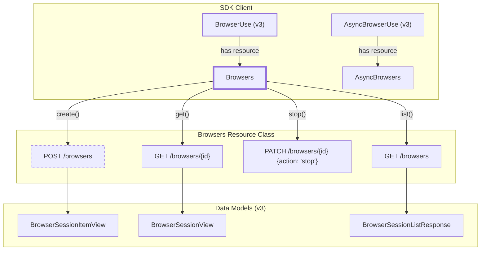
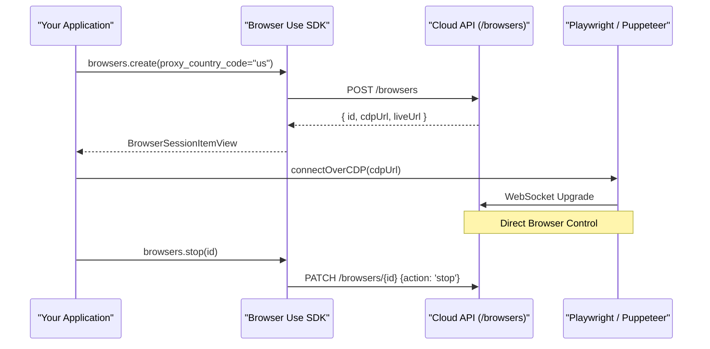

<!-- source: DeepWiki mcp.deepwiki.com · repo browser-use/sdk · page 3.2 Browsers Resource · fetched 2026-10-30 -->

# Browsers Resource

<details>
<summary>Relevant source files</summary>

The following files were used as context for generating this wiki page:

- [browser-use-node/src/v2/resources/browsers.ts](browser-use-node/src/v2/resources/browsers.ts)
- [browser-use-node/src/v2/resources/sessions.ts](browser-use-node/src/v2/resources/sessions.ts)
- [browser-use-node/src/v3/client.ts](browser-use-node/src/v3/client.ts)
- [browser-use-node/src/v3/resources/browsers.ts](browser-use-node/src/v3/resources/browsers.ts)
- [browser-use-python/src/browser_use_sdk/v2/resources/browsers.py](browser-use-python/src/browser_use_sdk/v2/resources/browsers.py)
- [browser-use-python/src/browser_use_sdk/v2/resources/sessions.py](browser-use-python/src/browser_use_sdk/v2/resources/sessions.py)
- [browser-use-python/src/browser_use_sdk/v3/client.py](browser-use-python/src/browser_use_sdk/v3/client.py)
- [browser-use-python/src/browser_use_sdk/v3/resources/browsers.py](browser-use-python/src/browser_use_sdk/v3/resources/browsers.py)
- [browser-use-python/src/browser_use_sdk/v3/resources/sessions.py](browser-use-python/src/browser_use_sdk/v3/resources/sessions.py)
- [docs/cloud/agent/follow-up-tasks.mdx](docs/cloud/agent/follow-up-tasks.mdx)
- [docs/cloud/agent/structured-output.mdx](docs/cloud/agent/structured-output.mdx)
- [docs/cloud/browser/playwright-puppeteer-selenium.mdx](docs/cloud/browser/playwright-puppeteer-selenium.mdx)
- [docs/cloud/browser/stealth.mdx](docs/cloud/browser/stealth.mdx)
- [docs/cloud/guides/webhooks.mdx](docs/cloud/guides/webhooks.mdx)
- [docs/cloud/legacy/skills.mdx](docs/cloud/legacy/skills.mdx)
- [docs/cloud/new-features/api-v3.mdx](docs/cloud/new-features/api-v3.mdx)

</details>


The Browsers resource provides direct access to the Browser Use managed browser infrastructure. While the [Sessions Resource (v3)](/api-resources-reference/sessions-resource-v3) is typically used for agent-led tasks, the Browsers resource allows developers to create standalone browser sessions for manual control, live viewing, or integration with existing automation frameworks like Playwright and Puppeteer.

Every browser session runs in a hardened Chromium fork featuring built-in stealth, anti-fingerprinting, and automatic proxy rotation [docs/cloud/browser/playwright-puppeteer-selenium.mdx:7-8]().

## Resource Architecture

The Browsers resource is available in both v2 and v3 SDKs. It interacts with the `/browsers` endpoint of the Cloud API.

### Code Entity Mapping

The following diagram bridges the high-level resource concepts to the specific classes and methods in the SDK.

**Browsers Resource Entity Map**

Sources: [browser-use-python/src/browser_use_sdk/v3/client.py:46](), [browser-use-python/src/browser_use_sdk/v3/resources/browsers.py:17-86](), [browser-use-node/src/v3/resources/browsers.ts:15-42]()

## Creating Standalone Sessions

Standalone sessions are useful when you want to bypass the Agent LLM and control the browser directly or provide a "Human-in-the-Loop" interface via the `liveUrl`.

### Configuration Options
When calling `create()`, you can configure the browser environment:

| Parameter | Type | Description |
| :--- | :--- | :--- |
| `profile_id` | `str` | Attach a [Profile](/api-resources-reference/profiles-resource) to reuse cookies/storage. |
| `proxy_country_code` | `str` | Specify a country (e.g., "us", "de") for residential proxy exit. |
| `browser_screen_width` | `int` | Set the viewport width. |
| `browser_screen_height` | `int` | Set the viewport height. |
| `timeout` | `int` | Session duration in minutes (Default: 15, Max: 240). |
| `enable_recording` | `bool` | Enable video recording of the session. |

Sources: [browser-use-python/src/browser_use_sdk/v3/resources/browsers.py:21-52](), [docs/cloud/browser/playwright-puppeteer-selenium.mdx:79-88]()

## Integration: CDP, Playwright, and Puppeteer

The Browsers resource provides two critical URLs in the `BrowserSessionView` response:
1.  **`cdp_url` / `cdpUrl`**: A WebSocket endpoint for direct Chrome DevTools Protocol (CDP) connections [docs/cloud/browser/playwright-puppeteer-selenium.mdx:102]().
2.  **`live_url` / `liveUrl`**: A URL for a hosted interactive web view of the browser session [docs/cloud/browser/playwright-puppeteer-selenium.mdx:103]().

### Connection Flow


Sources: [docs/cloud/browser/playwright-puppeteer-selenium.mdx:96-130](), [browser-use-python/src/browser_use_sdk/v3/resources/browsers.py:75-85]()

### Implementation Example (Python)
```python
from browser_use_sdk.v3 import AsyncBrowserUse
from playwright.async_api import async_playwright

client = AsyncBrowserUse()
# 1. Create the managed browser
browser_session = await client.browsers.create(proxy_country_code="us")

async with async_playwright() as p:
    # 2. Connect Playwright to the remote browser via CDP
    pw_browser = await p.chromium.connect_over_cdp(browser_session.cdp_url)
    page = pw_browser.contexts[0].pages[0]
    
    await page.goto("https://example.com")
    print(await page.title())
    
    await pw_browser.close()

# 3. Explicitly stop to avoid unnecessary billing
await client.browsers.stop(browser_session.id)
```
Sources: [docs/cloud/browser/playwright-puppeteer-selenium.mdx:96-113](), [browser-use-python/src/browser_use_sdk/v3/resources/browsers.py:83-85]()

## Stopping and Refunds

Sessions created via the Browsers resource continue to run (and consume credits) until they either:
1.  Reach the configured `timeout`.
2.  Are explicitly stopped via the SDK.

The `stop()` method is a convenience wrapper that calls `update()` with the `action="stop"` payload [browser-use-python/src/browser_use_sdk/v3/resources/browsers.py:83-85](). 

### Proportional Refunds
Browser Use Cloud typically calculates costs based on active duration. If a session is configured for a 60-minute timeout but is stopped via `browsers.stop()` after 5 minutes, the project is only billed for the used duration.

> [!WARNING]
> Always call `stop()` in a `finally` block or use a context manager to ensure sessions are terminated, as closing the local Playwright/Puppeteer client does not always immediately terminate the remote cloud session [docs/cloud/browser/playwright-puppeteer-selenium.mdx:155-157]().

## v2 vs v3 Differences

While the core functionality remains similar, there are structural differences in the resource implementation:

| Feature | v2 (Legacy) | v3 (Current) |
| :--- | :--- | :--- |
| **Namespace** | `client.browsers` | `client.browsers` |
| **Action Enum** | `BrowserSessionUpdateAction.stop` [browser-use-python/src/browser_use_sdk/v2/resources/browsers.py:112]() | String literal `"stop"` [browser-use-python/src/browser_use_sdk/v3/resources/browsers.py:85]() |
| **Resizing** | Supported (`allow_resizing`) [browser-use-python/src/browser_use_sdk/v2/resources/browsers.py:38]() | Supported (`allow_resizing`) [browser-use-python/src/browser_use_sdk/v3/resources/browsers.py:45]() |
| **ID Type** | `str` | `str` or `UUID` [browser-use-python/src/browser_use_sdk/v3/resources/browsers.py:69]() |

Sources: [browser-use-python/src/browser_use_sdk/v2/resources/browsers.py:1-113](), [browser-use-python/src/browser_use_sdk/v3/resources/browsers.py:1-86]()

---

