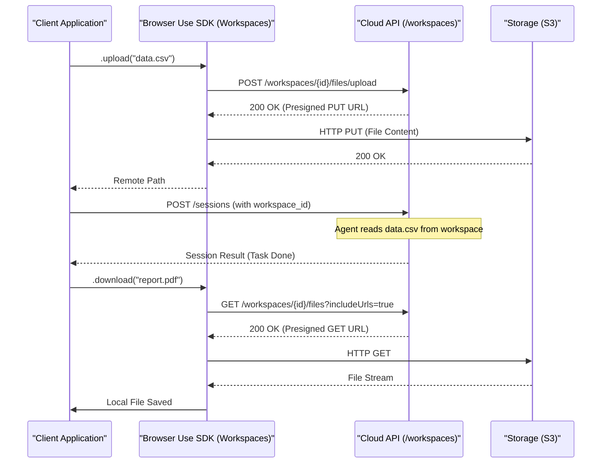
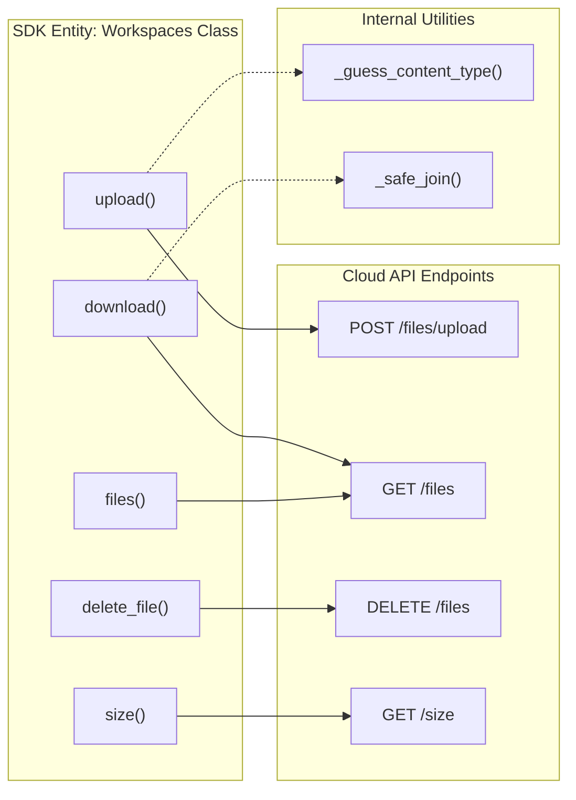

<!-- source: DeepWiki mcp.deepwiki.com · repo browser-use/sdk · page 3.3 Workspaces Resource (v3) · fetched 2026-10-30 -->

# Workspaces Resource (v3)

<details>
<summary>Relevant source files</summary>

The following files were used as context for generating this wiki page:

- [browser-use-node/src/v3/resources/workspaces.ts](browser-use-node/src/v3/resources/workspaces.ts)
- [browser-use-python/src/browser_use_sdk/v3/resources/workspaces.py](browser-use-python/src/browser_use_sdk/v3/resources/workspaces.py)
- [docs/cloud/agent/human-in-the-loop.mdx](docs/cloud/agent/human-in-the-loop.mdx)
- [docs/cloud/agent/workspaces.mdx](docs/cloud/agent/workspaces.mdx)
- [docs/cloud/browser/live-preview.mdx](docs/cloud/browser/live-preview.mdx)
- [docs/cloud/guides/authentication.mdx](docs/cloud/guides/authentication.mdx)
- [docs/cloud/tutorials/chat-ui.mdx](docs/cloud/tutorials/chat-ui.mdx)
- [docs/openapi/v2.json](docs/openapi/v2.json)
- [docs/openapi/v3.json](docs/openapi/v3.json)
- [snapshots/v2.json](snapshots/v2.json)
- [snapshots/v3.json](snapshots/v3.json)

</details>


The **Workspaces** resource provides persistent file storage for browser agents. It enables a common I/O pattern where developers upload configuration or data files for the agent to consume, and later download files (like reports, CSVs, or screenshots) that the agent generated during its session.

## Overview and Purpose

Workspaces act as a virtual file system for the agent. When a session is created with a `workspace_id`, the agent's sandbox is initialized with access to that workspace's files [docs/cloud/agent/workspaces.mdx:7-10]().

Key capabilities include:
*   **Persistent Storage**: Files survive between different tasks and sessions if they share the same workspace.
*   **Large File Support**: Uses a presigned URL pattern for direct S3 uploads/downloads, bypassing API gateway payload limits.
*   **Organization**: Supports file prefixes (folders) and shallow vs. recursive listing.
*   **Security**: Includes path traversal protection in SDK helpers to prevent unauthorized access to local files during upload/download.

## Data Flow: File I/O Pattern

The Workspaces resource implements an **Upload → Execute → Download** pattern. Because the API does not accept raw binary data in the JSON request body, the SDK coordinates a two-step process using presigned URLs.

### 1. Upload Flow
1.  **Metadata Exchange**: The SDK calls `upload_files` with file names and sizes [browser-use-python/src/browser_use_sdk/v3/resources/workspaces.py:128-135]().
2.  **Presigned URL Generation**: The backend returns a `FileUploadResponse` containing S3 PUT URLs for each file.
3.  **Direct Upload**: The SDK performs an HTTP `PUT` request for each local file directly to the provided S3 URL [browser-use-python/src/browser_use_sdk/v3/resources/workspaces.py:186-190]().

### 2. Download Flow
1.  **File Discovery**: The SDK calls `files` with `include_urls=True` to find the specific file and its temporary download URL [browser-use-python/src/browser_use_sdk/v3/resources/workspaces.py:103-112]().
2.  **Direct Download**: The SDK performs an HTTP `GET` on the presigned URL and writes the stream to the local disk [browser-use-python/src/browser_use_sdk/v3/resources/workspaces.py:221-224]().

### File I/O Sequence Diagram
Title: Workspace File Upload and Agent Execution

**Sources**: [browser-use-python/src/browser_use_sdk/v3/resources/workspaces.py:162-191](), [browser-use-python/src/browser_use_sdk/v3/resources/workspaces.py:193-224](), [docs/cloud/agent/workspaces.mdx:12-47]()

## Implementation Details

### Resource Manager Classes
The Workspaces resource is managed by the `Workspaces` class in both SDKs. It is attached to the main client under the `.workspaces` property.

*   **Python**: `Workspaces` in `browser_use_sdk.v3.resources.workspaces` [browser-use-python/src/browser_use_sdk/v3/resources/workspaces.py:40-40]().
*   **TypeScript**: `Workspaces` in `src/v3/resources/workspaces` [browser-use-node/src/v3/resources/workspaces.ts:69-69]().

### Key Methods and Parameters

| Method | Description | Key Parameters |
| :--- | :--- | :--- |
| `list` | Lists all workspaces in the project. | `page_size`, `page_number` |
| `create` | Creates a new workspace container. | `name` |
| `get` | Retrieves metadata for a specific workspace. | `workspace_id` |
| `update` | Renames an existing workspace. | `workspace_id`, `name` |
| `delete` | Permanently deletes a workspace and all files. | `workspace_id` |
| `files` | Lists files with pagination and filtering. | `prefix`, `shallow`, `include_urls`, `cursor` |
| `upload` | **High-level helper**: Handles URL acquisition and PUT. | `*paths`, `prefix` |
| `download` | **High-level helper**: Handles discovery and GET. | `path`, `to` |
| `size` | Returns total storage used in bytes. | `workspace_id` |

**Sources**: [browser-use-python/src/browser_use_sdk/v3/resources/workspaces.py:44-160](), [browser-use-node/src/v3/resources/workspaces.ts:73-122]()

### Code Entity Mapping: Workspaces Logic
Title: Mapping Workspace Methods to API Endpoints

**Sources**: [browser-use-python/src/browser_use_sdk/v3/resources/workspaces.py:26-37](), [browser-use-python/src/browser_use_sdk/v3/resources/workspaces.py:103-160]()

## Advanced Filtering and Organization

### Prefix and Shallow Filtering
Workspaces use a flat object store that simulates a directory structure using the `prefix` parameter.
*   **Prefix**: Passing `prefix="reports/"` to `files()` will return all files starting with that string [browser-use-python/src/browser_use_sdk/v3/resources/workspaces.py:107-112]().
*   **Shallow**: If `shallow=True`, the API only returns files at the immediate level of the prefix, effectively treating it like a single-directory `ls` command [browser-use-python/src/browser_use_sdk/v3/resources/workspaces.py:111-111]().

### Path Traversal Protection
The SDKs implement a `_safe_join` (Python) or `safeJoin` (Node) utility to prevent malicious or accidental path traversal when downloading files to the local machine [browser-use-python/src/browser_use_sdk/v3/resources/workspaces.py:31-37](), [browser-use-node/src/v3/resources/workspaces.ts:5-12]().

```python
# Python implementation of path traversal check
def _safe_join(base: Path, untrusted: str) -> Path:
    base_resolved = base.resolve()
    resolved = (base / untrusted).resolve()
    if base_resolved != resolved and base_resolved not in resolved.parents:
        raise ValueError(f"Path traversal detected: {untrusted}")
    return resolved
```
**Sources**: [browser-use-python/src/browser_use_sdk/v3/resources/workspaces.py:31-37]()

## Resource Models
The Workspaces resource uses the following generated models for data validation:
*   `WorkspaceView`: The core representation of a workspace (id, name, created_at) [browser-use-python/src/browser_use_sdk/v3/resources/workspaces.py:19-19]().
*   `FileListResponse`: A paginated list of file metadata including `path`, `size`, and optionally `url` [browser-use-python/src/browser_use_sdk/v3/resources/workspaces.py:12-12]().
*   `FileUploadItem`: Used to request upload URLs, containing `name`, `contentType`, and `size` [browser-use-python/src/browser_use_sdk/v3/resources/workspaces.py:13-13]().

**Sources**: [browser-use-python/src/browser_use_sdk/v3/resources/workspaces.py:11-20](), [snapshots/v3.json:115999]() (refers to schemas in full OpenAPI spec).

---

