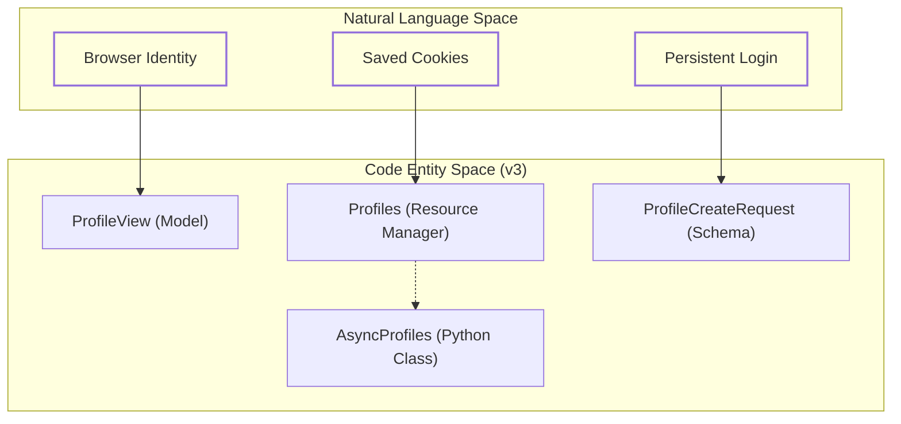
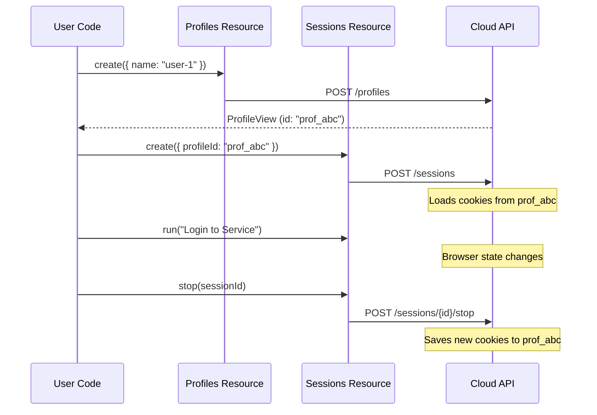

<!-- source: DeepWiki mcp.deepwiki.com · repo browser-use/sdk · page 3.4 Profiles Resource · fetched 2026-10-30 -->

# Profiles Resource

<details>
<summary>Relevant source files</summary>

The following files were used as context for generating this wiki page:

- [browser-use-node/examples/authentication.ts](browser-use-node/examples/authentication.ts)
- [browser-use-node/examples/profiles.ts](browser-use-node/examples/profiles.ts)
- [browser-use-node/examples/sessions.ts](browser-use-node/examples/sessions.ts)
- [browser-use-node/examples/stealth.ts](browser-use-node/examples/stealth.ts)
- [browser-use-node/src/v3/resources/profiles.ts](browser-use-node/src/v3/resources/profiles.ts)
- [browser-use-node/tests/vibe.test.ts](browser-use-node/tests/vibe.test.ts)
- [browser-use-python/examples/authentication.py](browser-use-python/examples/authentication.py)
- [browser-use-python/src/browser_use_sdk/v3/resources/profiles.py](browser-use-python/src/browser_use_sdk/v3/resources/profiles.py)
- [browser-use-python/tests/test_vibe.py](browser-use-python/tests/test_vibe.py)
- [docs/cloud/agent/human-in-the-loop.mdx](docs/cloud/agent/human-in-the-loop.mdx)
- [docs/cloud/agent/workspaces.mdx](docs/cloud/agent/workspaces.mdx)
- [docs/cloud/browser/live-preview.mdx](docs/cloud/browser/live-preview.mdx)
- [docs/cloud/guides/authentication.mdx](docs/cloud/guides/authentication.mdx)
- [docs/cloud/tutorials/chat-ui.mdx](docs/cloud/tutorials/chat-ui.mdx)

</details>


The **Profiles** resource provides persistent browser identity containers. Unlike standard sessions which start with a clean slate, a Profile stores cookies, `localStorage`, and session data, enabling the "Login once, reuse many" pattern. This is essential for bypassing repeated 2FA prompts or maintaining authenticated states across disparate agent runs.

## Implementation Overview

Profiles are managed through the `Profiles` (Node.js) or `AsyncProfiles`/`Profiles` (Python) classes. These classes wrap the `/profiles` REST API endpoints.

### Data Flow: Persistence and State
The most critical technical requirement for Profiles is the persistence trigger. Browser state is **only** synchronized and saved to the cloud storage when a session is explicitly stopped.

1.  **Creation**: A profile is created as a named container.
2.  **Attachment**: A `profileId` is passed during `sessions.create()`.
3.  **Execution**: The agent performs actions (e.g., logging into LinkedIn).
4.  **Persistence**: The user calls `sessions.stop()`. This triggers the backend to bundle the current browser context state and update the Profile's persistent storage.

### Code Entity Mapping

The following diagram maps the high-level profile concepts to the specific code entities in the SDK.

**Profile Entity Mapping**

**Sources:** [browser-use-python/src/browser_use_sdk/v3/resources/profiles.py:15-103](), [browser-use-node/src/v3/resources/profiles.ts:15-42]()

---

## Key Functions and Classes

### Python (v3)
In Python, the `AsyncProfiles` class handles asynchronous interactions with the profile service.

| Method | Role | Path |
| :--- | :--- | :--- |
| `create()` | Initializes a new profile container. | `/profiles` (POST) |
| `list()` | Retrieves profiles with optional `query` filtering. | `/profiles` (GET) |
| `get()` | Fetches details for a specific `profile_id`. | `/profiles/{id}` (GET) |
| `update()` | Renames or modifies profile metadata. | `/profiles/{id}` (PATCH) |
| `delete()` | Permanently removes the profile and its stored state. | `/profiles/{id}` (DELETE) |

**Sources:** [browser-use-python/src/browser_use_sdk/v3/resources/profiles.py:83-149]()

### Node.js (v3)
The Node.js implementation follows the same REST mapping using the `HttpClient`.

**Profile Lifecycle Interaction**

**Sources:** [browser-use-node/src/v3/resources/profiles.ts:15-42](), [docs/cloud/guides/authentication.mdx:7-37]()

---

## Usage Patterns

### The "Login Once" Pattern
This pattern involves creating a session with a profile, performing a manual or automated login, and then stopping the session to save the credentials.

```python
# Example of persisting state
profile = await client.profiles.create(name="production-user")
session = await client.sessions.create(profile_id=profile.id)

# Perform login task
await client.run("Log into Amazon with provided credentials", session_id=session.id)

# CRITICAL: Must stop to save cookies/localStorage
await client.sessions.stop(session.id)
```
**Sources:** [docs/cloud/guides/authentication.mdx:7-21](), [browser-use-node/examples/profiles.ts:12-21]()

### Profile Management and Searching
Profiles can be queried by name using the `query` parameter in the `list` method. This is useful for mapping internal system User IDs to Browser Use Profiles.

```typescript
// Searching for an existing profile by name
const results = await client.profiles.list({ query: "internal-user-42" });
const profile = results.items[0]; 

if (!profile) {
  const newProfile = await client.profiles.create({ name: "internal-user-42" });
}
```
**Sources:** [docs/cloud/guides/authentication.mdx:77-80](), [browser-use-node/src/v3/resources/profiles.ts:24-26]()

---

## Technical Requirements & Constraints

### Persistence Guarantee
State is **not** streamed in real-time to the profile storage. It is bundled at the end of a session. If a session crashes, times out (15-minute inactivity limit), or is deleted without being stopped, the profile state may revert to its previous version.
*   **Maximum Duration**: Sessions have a hard limit of 4 hours.
*   **Inactivity**: Sessions time out after 15 minutes of idle time.

**Sources:** [docs/cloud/guides/authentication.mdx:96-98](), [docs/cloud/agent/human-in-the-loop.mdx:12-14]()

### Resource Mapping (v2 vs v3)
Both SDK versions map to the same underlying profile infrastructure, though the resource manager locations differ slightly in the codebase.

| Version | SDK Path | Spec Mapping |
| :--- | :--- | :--- |
| **v2** | `client.profiles` | `_V2_MAP` in `test_vibe.py` |
| **v3** | `client.profiles` | `_V3_MAP` in `test_vibe.py` |

**Sources:** [browser-use-python/tests/test_vibe.py:71-75](), [browser-use-python/tests/test_vibe.py:114-119]()

---

