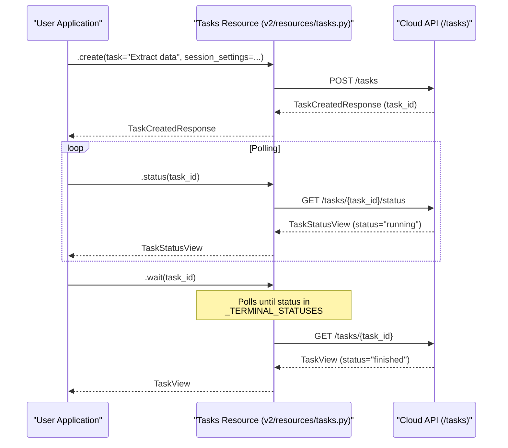
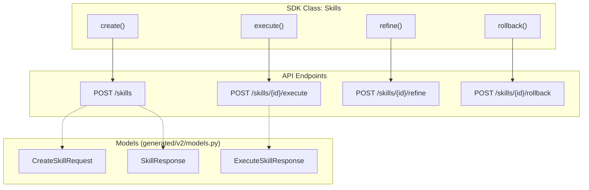

<!-- source: DeepWiki mcp.deepwiki.com · repo browser-use/sdk · page 3.5 Tasks, Skills, and Marketplace Resources (v2) · fetched 2026-10-30 -->

# Tasks, Skills, and Marketplace Resources (v2)

Relevant source files

The following files were used as context for generating this wiki page:

- [CLAUDE.md](CLAUDE.md)
- [browser-use-node/src/generated/v2/types.ts](browser-use-node/src/generated/v2/types.ts)
- [browser-use-node/src/v2/resources/browsers.ts](browser-use-node/src/v2/resources/browsers.ts)
- [browser-use-node/src/v2/resources/sessions.ts](browser-use-node/src/v2/resources/sessions.ts)
- [browser-use-node/src/v2/resources/tasks.ts](browser-use-node/src/v2/resources/tasks.ts)
- [browser-use-python/src/browser_use_sdk/generated/v2/models.py](browser-use-python/src/browser_use_sdk/generated/v2/models.py)
- [browser-use-python/src/browser_use_sdk/v2/resources/billing.py](browser-use-python/src/browser_use_sdk/v2/resources/billing.py)
- [browser-use-python/src/browser_use_sdk/v2/resources/browsers.py](browser-use-python/src/browser_use_sdk/v2/resources/browsers.py)
- [browser-use-python/src/browser_use_sdk/v2/resources/files.py](browser-use-python/src/browser_use_sdk/v2/resources/files.py)
- [browser-use-python/src/browser_use_sdk/v2/resources/marketplace.py](browser-use-python/src/browser_use_sdk/v2/resources/marketplace.py)
- [browser-use-python/src/browser_use_sdk/v2/resources/profiles.py](browser-use-python/src/browser_use_sdk/v2/resources/profiles.py)
- [browser-use-python/src/browser_use_sdk/v2/resources/sessions.py](browser-use-python/src/browser_use_sdk/v2/resources/sessions.py)
- [browser-use-python/src/browser_use_sdk/v2/resources/skills.py](browser-use-python/src/browser_use_sdk/v2/resources/skills.py)
- [browser-use-python/src/browser_use_sdk/v2/resources/tasks.py](browser-use-python/src/browser_use_sdk/v2/resources/tasks.py)

This page provides a technical reference for the v2-only resources in the Browser Use SDK. While v3 moves toward a session-centric model (where tasks are messages within a session), v2 uses a **task-centric model** where tasks are top-level entities that can either auto-create or attach to browser sessions.

## v2 Task-Centric vs v3 Session-Centric

In the v2 API, the `Task` is the primary unit of execution. A task can exist independently of a pre-created session; if no `sessionId` is provided during creation, the system automatically provisions a temporary session.

| Feature | v2 (Task-Centric) | v3 (Session-Centric) |
| :--- | :--- | :--- |
| **Primary Entity** | `Task` [browser-use-python/src/browser_use_sdk/v2/resources/tasks.py:88]() | `Session` |
| **Execution** | `tasks.create()` returns a `taskId` | `sessions.run()` starts an agent in a session |
| **Lifecycle** | Tasks reach `finished` or `stopped` | Sessions reach `idle` or `stopped` |
| **History** | Steps are properties of the Task | History is a list of Messages in the Session |

**Sources:** [CLAUDE.md:31-32](), [browser-use-python/src/browser_use_sdk/v2/resources/tasks.py:18-117](), [browser-use-node/src/generated/v2/types.ts:44-54]()

---

## Tasks Resource

The `Tasks` resource manages the lifecycle of AI agent executions. It supports creating, listing, stopping, and polling for completion.

### Task Execution Flow
The following diagram illustrates the lifecycle of a v2 Task from creation to completion.

**Task Lifecycle and SDK Entities**

**Sources:** [browser-use-python/src/browser_use_sdk/v2/resources/tasks.py:18-202](), [browser-use-node/src/v2/resources/tasks.ts:28-84]()

### Key Methods
- **`create()`**: Starts a new task. If `sessionId` is omitted, it uses `sessionSettings` to configure a new temporary browser [browser-use-python/src/browser_use_sdk/v2/resources/tasks.py:92-143]().
- **`status()`**: A lightweight endpoint returning only status, output, and cost. Optimized for high-frequency polling [browser-use-python/src/browser_use_sdk/v2/resources/tasks.py:192-196]().
- **`wait()`**: A client-side helper that polls `.status()` every 2 seconds (default) until the task reaches a terminal state (`finished` or `stopped`), then fetches the full `TaskView` [browser-use-python/src/browser_use_sdk/v2/resources/tasks.py:204-221]().
- **`logs()`**: Returns a secure download URL for the execution logs [browser-use-python/src/browser_use_sdk/v2/resources/tasks.py:198-202]().

---

## Skills Resource

Skills are reusable agent capabilities that can be generated, refined, and executed. They represent "recorded" or "learned" behaviors that the agent can perform deterministically or semi-deterministically.

### Skill Management and Code Mapping
The `Skills` resource maps directly to the `/skills` API surface.

**Skills Code-to-API Mapping**

**Sources:** [browser-use-python/src/browser_use_sdk/v2/resources/skills.py:17-187](), [browser-use-python/src/browser_use_sdk/generated/v2/models.py:159-189]()

### Skill Lifecycle Functions
- **`create()`**: Initiates skill generation based on a `goal` and `agent_prompt` [browser-use-python/src/browser_use_sdk/v2/resources/skills.py:21-39]().
- **`refine()`**: Updates a skill based on natural language `feedback` and optional `test_output` [browser-use-python/src/browser_use_sdk/v2/resources/skills.py:134-152]().
- **`execute()`**: Runs a specific skill ID within an optional `sessionId`, passing `parameters` as a dictionary [browser-use-python/src/browser_use_sdk/v2/resources/skills.py:115-132]().
- **`executions()`**: Retrieves a paginated list of previous executions for a specific skill [browser-use-python/src/browser_use_sdk/v2/resources/skills.py:160-177]().

---

## Marketplace Resource

The Marketplace allows users to discover, clone, and execute skills shared by the community.

### Marketplace Implementation
The `Marketplace` class handles interactions with the `/marketplace` sub-path.

| Method | Endpoint | Description |
| :--- | :--- | :--- |
| `list()` | `GET /marketplace/skills` | Browse public skills with filters like `category` or `query` [browser-use-python/src/browser_use_sdk/v2/resources/marketplace.py:18-42](). |
| `get()` | `GET /marketplace/skills/{slug}` | Get details for a specific marketplace skill using its slug [browser-use-python/src/browser_use_sdk/v2/resources/marketplace.py:44-48](). |
| `clone()` | `POST /marketplace/skills/{id}/clone` | Copy a marketplace skill into the user's private skill library [browser-use-python/src/browser_use_sdk/v2/resources/marketplace.py:50-54](). |
| `execute()` | `POST /marketplace/skills/{id}/execute` | Run a marketplace skill directly without cloning it first [browser-use-python/src/browser_use_sdk/v2/resources/marketplace.py:56-75](). |

**Sources:** [browser-use-python/src/browser_use_sdk/v2/resources/marketplace.py:14-75]()

---

## Technical Implementation Details

### Data Flow and Validation
Both SDKs follow a strict pattern for resource methods:
1. **Body Construction**: Python uses internal helpers like `_build_create_body` to handle `_UNSET` values and optional parameters [browser-use-python/src/browser_use_sdk/v2/resources/tasks.py:21-85]().
2. **HTTP Request**: The `HttpClient` (Node) or `SyncHttpClient/AsyncHttpClient` (Python) performs the request [browser-use-node/src/v2/resources/tasks.ts:29]().
3. **Model Validation**:
   - **Python**: Uses `model_validate()` on generated Pydantic classes (e.g., `TaskView.model_validate(...)`) [browser-use-python/src/browser_use_sdk/v2/resources/tasks.py:173-175]().
   - **Node.js**: Relies on TypeScript interfaces generated from the OpenAPI spec for compile-time safety [browser-use-node/src/v2/resources/tasks.ts:2-13]().

### Forward Compatibility
Every method accepting a request body includes `**extra` (Python) or accepts a partial component schema (Node). This allows the SDK to support new backend features before the SDK types are officially regenerated [CLAUDE.md:61](), [browser-use-python/src/browser_use_sdk/v2/resources/tasks.py:43-44]().

**Sources:** [CLAUDE.md:51-58](), [browser-use-python/src/browser_use_sdk/v2/resources/tasks.py:141-143](), [browser-use-node/src/v2/resources/tasks.ts:5-13]()

---

