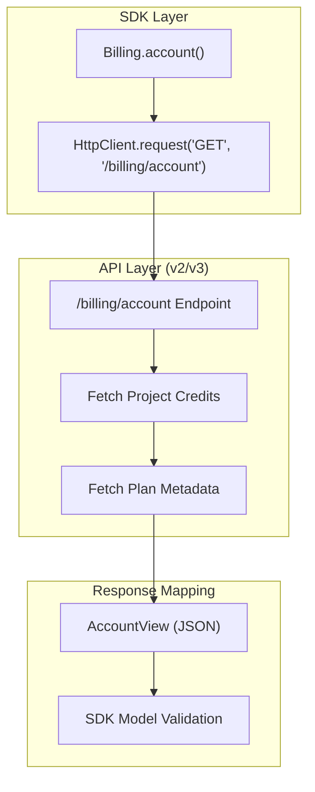
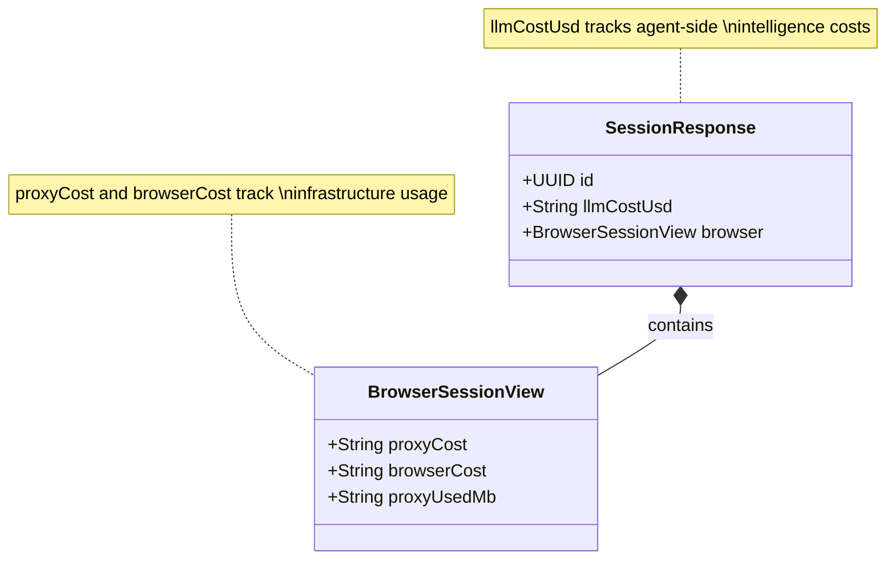
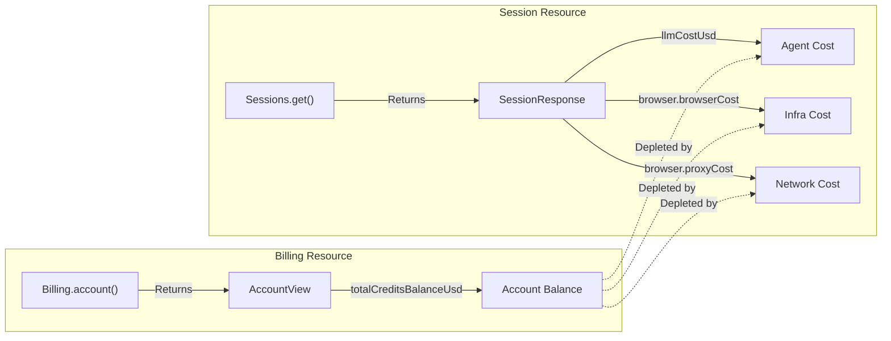

<!-- source: DeepWiki mcp.deepwiki.com · repo browser-use/sdk · page 3.6 Billing Resource · fetched 2026-10-30 -->

# Billing Resource

Relevant source files

The following files were used as context for generating this wiki page:

- [browser-use-node/src/generated/v3/types.ts](browser-use-node/src/generated/v3/types.ts)
- [browser-use-node/src/v3/resources/billing.ts](browser-use-node/src/v3/resources/billing.ts)
- [browser-use-python/src/browser_use_sdk/generated/v3/models.py](browser-use-python/src/browser_use_sdk/generated/v3/models.py)
- [browser-use-python/src/browser_use_sdk/v3/resources/billing.py](browser-use-python/src/browser_use_sdk/v3/resources/billing.py)
- [docs/openapi/v2.json](docs/openapi/v2.json)
- [docs/openapi/v3.json](docs/openapi/v3.json)
- [snapshots/v2.json](snapshots/v2.json)
- [snapshots/v3.json](snapshots/v3.json)

The Billing resource provides programmatic access to account-level financial data, credit balances, and usage-based cost tracking for browser sessions and AI agent tasks. It allows developers to monitor remaining credits and understand the cost breakdown of their automation workflows across both v2 and v3 of the Browser Use API.

## Account Billing Information

The primary entry point for the Billing resource is the `account()` method. This method retrieves the `AccountView` object, which contains the current state of the project's credits and plan details.

### The `account()` Method
The `account()` method performs a `GET` request to the `/billing/account` endpoint [browser-use-python/src/browser_use_sdk/v3/resources/billing.py:11-15](). It is available in both synchronous and asynchronous flavors in the Python SDK and as a standard Promise-based method in the Node.js SDK [browser-use-node/src/v3/resources/billing.ts:10-12]().

### AccountView Fields
The `AccountView` model provides the following key fields:
*   `totalCreditsBalanceUsd`: The remaining credit balance for the account in USD.
*   `rateLimit`: The current rate limits applied to the account.
*   `plan_info`: Details regarding the subscription tier (e.g., Pay As You Go, Business, or Scaleup).

**Billing Data Flow**

Title: Billing Account Retrieval Flow

Sources: [browser-use-python/src/browser_use_sdk/v3/resources/billing.py:11-26](), [snapshots/v3.json:15-61]()

## Session Cost Tracking

While the `Billing` resource provides account-wide totals, individual session costs are tracked within the `SessionResponse` (v3) and `BrowserSessionView` (v3/v2) objects. Browser Use tracks costs across three primary vectors to provide a granular breakdown of expenditure per session.

### The Three Cost Vectors
Every session tracks usage through these specific fields:

1.  **`llmCostUsd`**: The cost incurred by the Large Language Model (LLM) during agent execution. This is determined by the model tier used (e.g., `bu-mini`, `bu-ultra`) and the number of tokens processed [snapshots/v3.json:44-46]().
2.  **`browserCostUsd`**: The cost for hosting the managed browser infrastructure. Browser sessions are typically charged per hour. In v3, stopping a session triggers a proportional refund for unused time, rounded to the nearest minute [browser-use-node/src/generated/v3/types.ts:123-132]().
3.  **`proxyCostUsd`**: The cost associated with proxy usage. This includes both the base cost for the proxy connection and costs derived from data throughput, represented by `proxyUsedMb` [browser-use-python/src/browser_use_sdk/generated/v3/models.py:73-79]().

### Cost Entity Mapping
The following diagram associates the logical cost vectors with the specific code entities in the generated models.

Title: Session Cost Entity Mapping

Sources: [browser-use-python/src/browser_use_sdk/generated/v3/models.py:26-98](), [snapshots/v3.json:44-46]()

## Implementation Details

### Python SDK
In Python, the billing resource is split into `Billing` (Sync) and `AsyncBilling` (Async) classes. Both wrap the `AccountView.model_validate` call to ensure type safety using Pydantic [browser-use-python/src/browser_use_sdk/v3/resources/billing.py:7-26]().

### Node.js SDK
In Node.js, the `Billing` class uses the `HttpClient` to fetch the `AccountView` type, which is defined in the generated TypeScript components [browser-use-node/src/v3/resources/billing.ts:6-13]().

### Pricing and Refunds (v3)
In the v3 API, browser sessions include specific logic for tiered pricing:
*   **Pay As You Go**: Standard hourly rate (e.g., $0.06/hour).
*   **Subscribers**: Discounted hourly rate (e.g., $0.03/hour).
*   **Proportional Refunds**: When a browser session is stopped via `update_browser_session` or `stop_session`, the system calculates the unused time and issues a refund to the account's credit balance [browser-use-node/src/generated/v3/types.ts:161-168]().

**Resource Association**

Title: Billing and Session Resource Relationship

Sources: [browser-use-python/src/browser_use_sdk/v3/resources/billing.py:11-15](), [browser-use-python/src/browser_use_sdk/generated/v3/models.py:73-86](), [snapshots/v3.json:132-161]()

---

