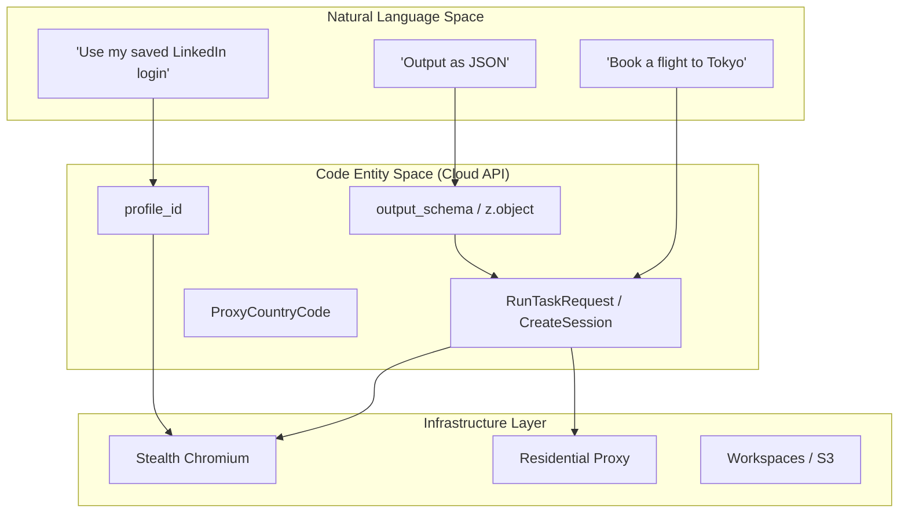
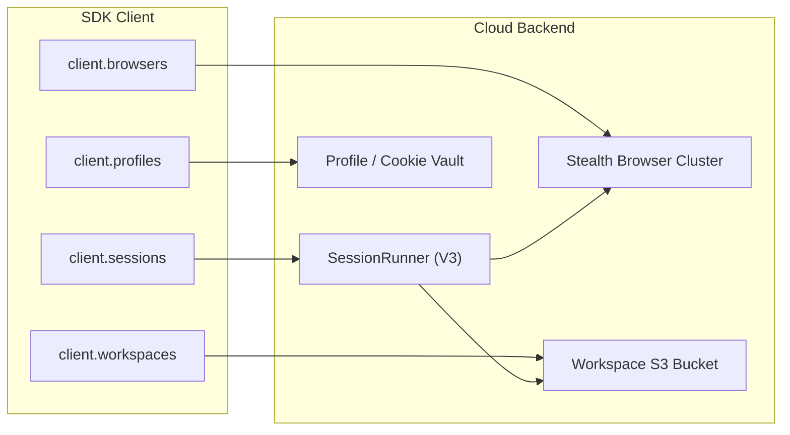

<!-- source: DeepWiki mcp.deepwiki.com · repo browser-use/sdk · page 4 Cloud Platform Features · fetched 2026-10-30 -->

# Cloud Platform Features

Relevant source files

The following files were used as context for generating this wiki page:

- [docs/cloud/api-reference.mdx](docs/cloud/api-reference.mdx)
- [docs/cloud/llms-full.txt](docs/cloud/llms-full.txt)
- [docs/cloud/llms.txt](docs/cloud/llms.txt)
- [docs/docs.json](docs/docs.json)
- [docs/llms-full.txt](docs/llms-full.txt)
- [docs/llms.txt](docs/llms.txt)

The Browser Use Cloud platform provides a managed infrastructure layer that extends the core SDK capabilities with production-grade features. While the open-source library handles local automation, the Cloud platform manages stealth browser clusters, residential proxy rotation, persistent authentication states, and cost-optimized execution via script caching.

The platform is accessible via the [API v3 Reference](https://docs.browser-use.com/cloud/api-reference) and is exposed through the `BrowserUse` (TypeScript) and `AsyncBrowserUse` (Python) client classes [docs/cloud/agent/quickstart:83-85]().

### Platform Architecture Overview

The following diagram illustrates how high-level natural language tasks are translated into managed cloud entities and infrastructure components.

**Natural Language to Cloud Entity Mapping**

Sources: [docs/cloud/llms-full.txt:48-61](), [docs/cloud/llms.txt:28-42]()

---

### Agent Intelligence and Models
The Cloud platform supports multiple model tiers optimized for browser navigation. Users can select between `bu-mini`, `bu-max`, and `bu-ultra` tiers, which map to specific provider models like `claude-sonnet-4.6` or `gpt-5.4-mini` [docs/cloud/llms-full.txt:129-133](). Beyond basic execution, the agent supports structured data extraction via `output_schema`, multi-turn "follow-up" tasks within the same session, and real-time message streaming.

For details, see [Agent Execution and Models](#4.1).

### Script Caching and Deterministic Rerun
To reduce LLM costs and increase reliability, the platform includes a **Deterministic Rerun** sub-system. When a task is executed with `cache_script=true`, the platform generates a reusable script in the workspace. Subsequent runs with the same parameters can bypass the LLM entirely, executing the cached actions at near-zero cost.

For details, see [Script Caching and Deterministic Rerun](#4.2).

### Managed Browser Infrastructure
Browser Use Cloud operates a fleet of "Stealth" Chromium instances designed to bypass bot detection. This infrastructure includes:
*   **Residential Proxies:** Automatic rotation across 195+ countries [docs/llms.txt:40]().
*   **Live Preview:** Real-time visual monitoring of the agent via `liveUrl` [docs/cloud/llms-full.txt:51]().
*   **Session Recording:** Automatic MP4 generation of the entire automation flow [docs/cloud/llms-full.txt:57]().

For details, see [Browser Infrastructure: Stealth, Proxies, and Live Preview](#4.3).

### Authentication and Secrets
The platform provides multiple patterns for handling sensitive data. **Profiles** allow for "login once, reuse many" workflows by persisting cookies and localStorage [docs/llms.txt:45](). For dynamic credentials, the system supports `sensitive_data` injection, 1Password integration, and built-in TOTP 2FA handling using the `bu_2fa_code` suffix.

For details, see [Authentication, Secrets, and 2FA](#4.4).

### Webhooks and Integrations
For asynchronous workflows, the platform provides a webhook system that sends `agent.task.status_update` events upon session completion or failure. This enables integration with external CI/CD pipelines, n8n workflows, and the Browser Use MCP (Model Context Protocol) server for IDE tools like Cursor and Windsurf [docs/llms.txt:53-56]().

For details, see [Webhooks and Async Notifications](#4.5).

---

### Infrastructure Component Relationship
This diagram maps the SDK resource managers to the underlying cloud infrastructure components.

**SDK Resource to Infrastructure Mapping**

Sources: [docs/cloud/llms-full.txt:83-85](), [docs/docs.json:61-97]()

---

