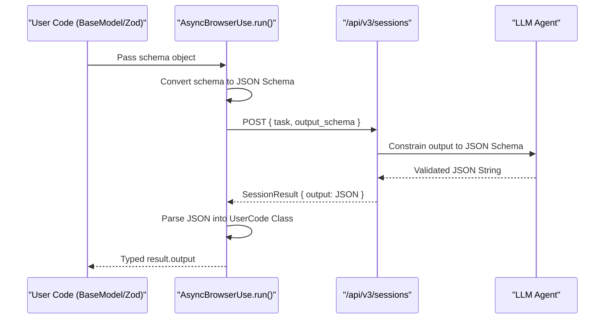

<!-- source: DeepWiki mcp.deepwiki.com · repo browser-use/sdk · page 4.1 Agent Execution and Models · fetched 2026-10-30 -->

# Agent Execution and Models

<details>
<summary>Relevant source files</summary>

The following files were used as context for generating this wiki page:

- [docs/cloud/agent/cache-script.mdx](docs/cloud/agent/cache-script.mdx)
- [docs/cloud/agent/follow-up-tasks.mdx](docs/cloud/agent/follow-up-tasks.mdx)
- [docs/cloud/agent/models.mdx](docs/cloud/agent/models.mdx)
- [docs/cloud/agent/streaming.mdx](docs/cloud/agent/streaming.mdx)
- [docs/cloud/agent/structured-output.mdx](docs/cloud/agent/structured-output.mdx)
- [docs/cloud/browser/playwright-puppeteer-selenium.mdx](docs/cloud/browser/playwright-puppeteer-selenium.mdx)
- [docs/cloud/browser/stealth.mdx](docs/cloud/browser/stealth.mdx)
- [docs/cloud/faq.mdx](docs/cloud/faq.mdx)
- [docs/cloud/guides/mcp-server.mdx](docs/cloud/guides/mcp-server.mdx)
- [docs/cloud/guides/webhooks.mdx](docs/cloud/guides/webhooks.mdx)
- [docs/cloud/llms-full.txt](docs/cloud/llms-full.txt)
- [docs/cloud/llms.txt](docs/cloud/llms.txt)
- [docs/cloud/tutorials/grow-therapy-compare.mdx](docs/cloud/tutorials/grow-therapy-compare.mdx)
- [docs/cloud/tutorials/integrations/n8n.mdx](docs/cloud/tutorials/integrations/n8n.mdx)
- [docs/cloud/tutorials/integrations/openclaw.mdx](docs/cloud/tutorials/integrations/openclaw.mdx)
- [docs/cloud/tutorials/integrations/playwright.mdx](docs/cloud/tutorials/integrations/playwright.mdx)
- [docs/llms-full.txt](docs/llms-full.txt)
- [docs/llms.txt](docs/llms.txt)

</details>


This page covers the core execution logic of the Browser Use agent, the supported model tiers, and the lifecycle of an automation session. It details how natural language tasks are transformed into browser actions through specific LLM mappings and structured output validation.

## Supported Model Tiers

The Browser Use Cloud SDK supports several model tiers optimized for different levels of complexity and cost. Users can specify a model via the `model` parameter in `client.run()` or `sessions.create()`.

| Tier | API String | Mapping / Provider | Use Case |
| :--- | :--- | :--- | :--- |
| **bu-ultra** | `claude-opus-4.6` | Anthropic Claude 3.5 Opus | Most capable; for maximum accuracy and complex reasoning. |
| **bu-max** | `claude-sonnet-4.6` | Anthropic Claude 3.5 Sonnet | **Recommended.** Best balance of capability and cost. |
| **bu-mini** | `gpt-5.4-mini` | OpenAI GPT-4o mini | Fast and efficient; for simple, well-defined tasks. |

**Sources:**
- [docs/cloud/llms-full.txt:123-135]()
- [docs/cloud/faq.mdx:7-11]()
- [docs/cloud/agent/models.mdx:7-17]()

## Session Lifecycle and States

Every agent execution happens within a session. The session transitions through a defined set of states represented by the `BuAgentSessionStatus` (v3) or legacy status fields (v2).

### Lifecycle Diagram: Session State Transitions
This diagram maps the high-level session lifecycle to the state identifiers used in the `sessions.get()` response.

```mermaid
graph TD
    "CREATED"["created"] --> "IDLE"["idle"]
    "IDLE"["idle"] -- "client.run() / sessions.send_task()" --> "RUNNING"["running"]
    "RUNNING"["running"] -- "Task Completion" --> "IDLE"["idle"]
    "RUNNING"["running"] -- "client.sessions.stop(strategy='task')" --> "IDLE"["idle"]
    "RUNNING"["running"] -- "client.sessions.stop(strategy='session')" --> "STOPPED"["stopped"]
    "RUNNING"["running"] -- "Error / Exception" --> "ERROR"["error"]
    "RUNNING"["running"] -- "Timeout (max 4h)" --> "TIMED_OUT"["timed_out"]
    "IDLE"["idle"] -- "Inactivity" --> "STOPPED"["stopped"]
```

**Sources:**
- [docs/cloud/llms-full.txt:85-85]()
- [docs/cloud/agent/streaming.mdx:96-98]()
- [docs/cloud/tutorials/integrations/n8n.mdx:49-49]()

## Structured Output with `output_schema`

The SDK allows users to define a strict schema for the agent's final response. When an `output_schema` is provided, the agent is forced to return data that matches the schema, which the SDK then validates and parses into a typed object.

- **Python:** Uses `pydantic.BaseModel`.
- **TypeScript:** Uses `zod` (requires Zod v4).

### Implementation Flow: Schema to Typed Object
This diagram shows how a code-defined schema (e.g., Pydantic) influences the backend agent and returns to the SDK as a typed entity.



**Sources:**
- [docs/cloud/llms-full.txt:165-192]()
- [docs/cloud/agent/structured-output.mdx:1-20]()

## Streaming Messages

The SDK supports real-time streaming of the agent's execution steps. This includes reasoning, browser actions (e.g., "Clicking button"), and tool outputs.

### Key Data Structures
- **`AsyncSessionRun` (Python) / `SessionStream` (Node):** An iterable object returned by `client.run()` that yields message chunks.
- **`MessageResponse`:** Contains fields like `role` (user/assistant/tool), `type`, `summary`, and `screenshot_url`.

```python
# Example of streaming in Python
run = client.run("Find the top story on Hacker News")
async for msg in run:
    print(f"[{msg.role}] {msg.summary}")
```

**Sources:**
- [docs/cloud/agent/streaming.mdx:11-37]()
- [docs/cloud/guides/mcp-server.mdx:77-77]()

## Follow-up Tasks and `keep_alive`

By default, a session stops after the first task is completed. By setting `keep_alive=True`, the session remains in the `idle` state, allowing for follow-up tasks in the same browser context (preserving cookies, tabs, and page state).

1.  **`client.run(..., keep_alive=True)`**: Executes the task and leaves the browser running.
2.  **`client.sessions.send_task(session_id, task=...)`**: Sends a new instruction to the existing session.
3.  **`client.sessions.stop(session_id, strategy="session")`**: Explicitly terminates the infrastructure.

**Sources:**
- [docs/cloud/llms-full.txt:59-59]()
- [docs/cloud/agent/streaming.mdx:48-70]()
- [docs/cloud/guides/mcp-server.mdx:73-75]()

## Deterministic Reruns (Caching)

The "Deterministic Rerun" feature bypasses the LLM for repeated tasks by using cached scripts. This is triggered by the `@{{param}}` syntax in the task string and requires a `workspace_id`.

- **Template Hashing:** The SDK/API identifies the template (e.g., `"Get price for @{{}}"`).
- **Script Generation:** On the first run, the agent generates a Python script in the workspace's `scripts/` directory.
- **Execution:** Subsequent calls with the same template execute the script directly in a sandbox, resulting in $0 LLM cost.

**Sources:**
- [docs/cloud/agent/cache-script.mdx:7-77]()
- [docs/cloud/llms.txt:35-35]()

---

