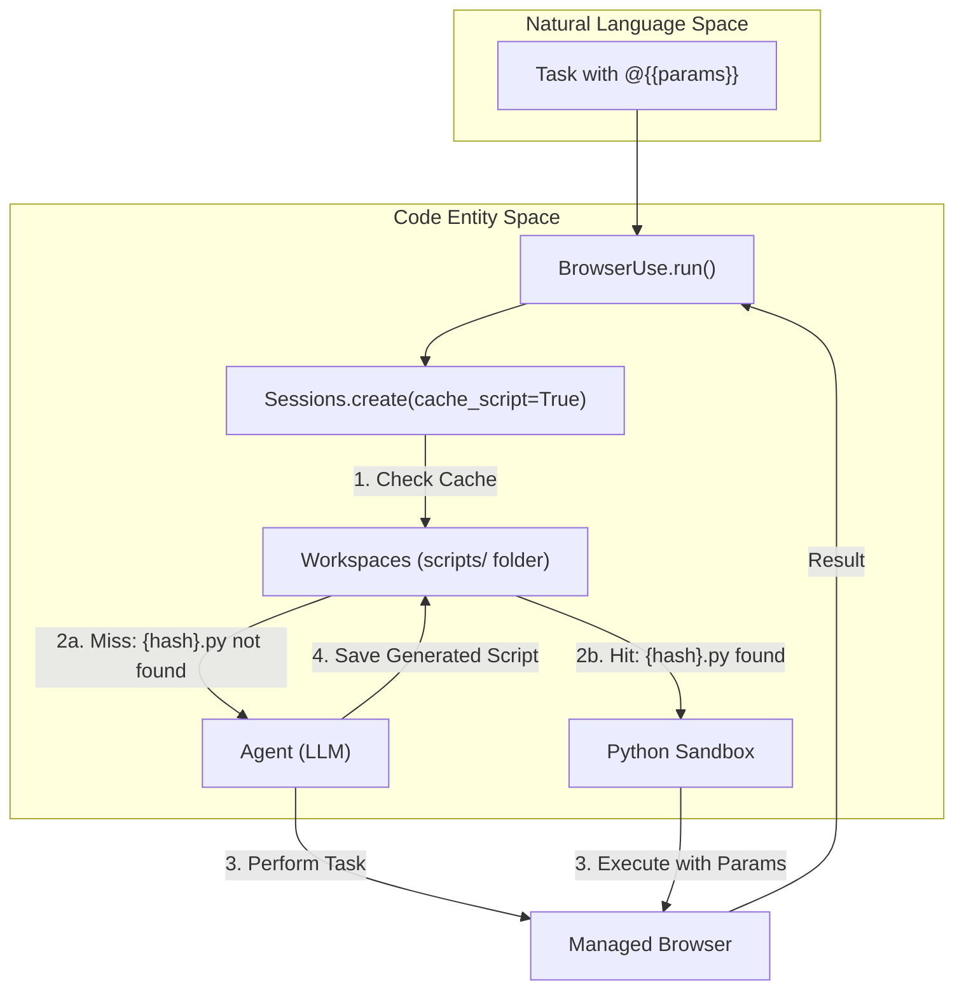
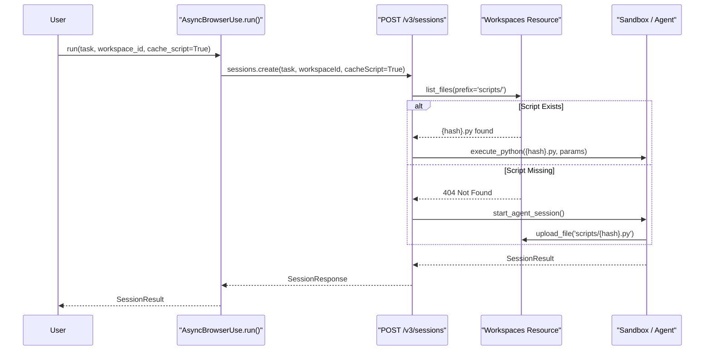

<!-- source: DeepWiki mcp.deepwiki.com · repo browser-use/sdk · page 4.2 Script Caching and Deterministic Rerun · fetched 2026-10-30 -->

# Script Caching and Deterministic Rerun

<details>
<summary>Relevant source files</summary>

The following files were used as context for generating this wiki page:

- [browser-use-node/src/v3/client.ts](browser-use-node/src/v3/client.ts)
- [browser-use-node/src/v3/resources/browsers.ts](browser-use-node/src/v3/resources/browsers.ts)
- [browser-use-python/src/browser_use_sdk/v3/client.py](browser-use-python/src/browser_use_sdk/v3/client.py)
- [browser-use-python/src/browser_use_sdk/v3/resources/browsers.py](browser-use-python/src/browser_use_sdk/v3/resources/browsers.py)
- [browser-use-python/src/browser_use_sdk/v3/resources/sessions.py](browser-use-python/src/browser_use_sdk/v3/resources/sessions.py)
- [docs/cloud/agent/cache-script.mdx](docs/cloud/agent/cache-script.mdx)
- [docs/cloud/agent/models.mdx](docs/cloud/agent/models.mdx)
- [docs/cloud/faq.mdx](docs/cloud/faq.mdx)
- [docs/cloud/guides/mcp-server.mdx](docs/cloud/guides/mcp-server.mdx)
- [docs/cloud/llms-full.txt](docs/cloud/llms-full.txt)
- [docs/cloud/llms.txt](docs/cloud/llms.txt)
- [docs/cloud/tutorials/grow-therapy-compare.mdx](docs/cloud/tutorials/grow-therapy-compare.mdx)
- [docs/llms-full.txt](docs/llms-full.txt)
- [docs/llms.txt](docs/llms.txt)

</details>


The Deterministic Rerun sub-system allows the Browser Use SDK to execute complex browser tasks at near-zero LLM cost after an initial "discovery" run. By transforming natural language instructions into parameterized Python scripts stored within a workspace, the system bypasses the LLM for subsequent executions, providing up to 99% cost reduction and significantly lower latency.

## Overview and Syntax

Deterministic rerun is triggered by the presence of template parameters in the task string or by explicit configuration via the `cache_script` parameter [[browser-use-python/src/browser_use_sdk/v3/client.py:123-131]]().

### Template Syntax: `@{{param}}`
The system uses a specific bracket syntax to identify variables within a task:
*   **Parameterized:** `"Get the top @{{5}} stories from HN"` identifies `5` as a variable [[docs/cloud/agent/cache-script.mdx:22-22]]().
*   **Static Cache:** Append `@{{}}` to a task to cache the exact string without parameters [[docs/cloud/agent/cache-script.mdx:135-140]]().
*   **Multiple Params:** Tasks can contain multiple bracketed sections, e.g., `"Search @{{google.com}} for @{{browser-use}}"` [[docs/cloud/agent/cache-script.mdx:59-63]]().

### Parameter: `cache_script`
The `cache_script` parameter in `client.run()` or `client.sessions.create()` controls this behavior [[browser-use-python/src/browser_use_sdk/v3/client.py:104-118]]():

| Value | Description |
| :--- | :--- |
| `None` (Default) | Auto-detect. Enabled if `@{{}}` is present and a `workspace_id` is provided [[browser-use-python/src/browser_use_sdk/v3/client.py:124-126]](). |
| `True` | Force-enable. Requires a `workspace_id` [[browser-use-python/src/browser_use_sdk/v3/client.py:132-133]](). |
| `False` | Force-disable caching even if brackets are present [[browser-use-python/src/browser_use_sdk/v3/client.py:127-127]](). |

**Sources:** `[browser-use-python/src/browser_use_sdk/v3/client.py:104-133]()`, `[docs/cloud/agent/cache-script.mdx:54-92]()`

---

## Implementation and Data Flow

The sub-system bridges the gap between the "Natural Language Space" (LLM reasoning) and the "Code Entity Space" (deterministic script execution).

### Logic Flow: Natural Language to Script
1.  **Template Extraction:** The system strips values from `@{{}}` to create a generic template.
2.  **Hashing:** The template string is hashed to create a unique identifier (e.g., `a7f3b2c1`) [[docs/cloud/agent/cache-script.mdx:67-68]]().
3.  **Lookup:** The system checks the attached `Workspace` for a file at `scripts/{hash}.py` [[docs/cloud/agent/cache-script.mdx:69-69]]().
4.  **Execution/Generation:**
    *   **Cache Miss:** A full agent session is initiated. Upon successful completion, the agent generates a standalone Python script and saves it to the workspace [[docs/cloud/agent/cache-script.mdx:71-72]]().
    *   **Cache Hit:** The system bypasses the LLM and executes the existing script in a secure sandbox, injecting the new parameter values [[docs/cloud/agent/cache-script.mdx:74-76]]().

### System Architecture Diagram
The following diagram illustrates how `BrowserUse.run()` interacts with `Sessions` and the `Workspaces` file system to manage scripts.

"Deterministic Rerun Architecture"

**Sources:** `[browser-use-python/src/browser_use_sdk/v3/client.py:149-163]()`, `[docs/cloud/agent/cache-script.mdx:54-77]()`

---

## Workspace Integration and Script Storage

Cached scripts are stored as standard files within a `Workspace`. This allows users to inspect, download, or manually delete scripts via the `Workspaces` resource [[docs/cloud/agent/cache-script.mdx:227-230]]().

### Hash-based Lookup
The script filename is derived from the hash of the normalized task template. 
*   **Template:** `"Get @{{}} news from @{{}}"`
*   **Storage Path:** `workspaces/{workspace_id}/scripts/{template_hash}.py`

### Auto-Healing with LLM Judge
If a cached script fails (e.g., due to a website UI change), the system can trigger "Auto-healing." An LLM judge evaluates the failure and decides whether to:
1.  Re-run the full agent to "repair" the script.
2.  Update the existing script in the workspace.
3.  Fallback to a standard agent run for that specific execution.

**Sources:** `[docs/cloud/agent/cache-script.mdx:67-76]()`, `[browser-use-python/src/browser_use_sdk/v3/resources/workspaces.py]()` (implied by workspace file structure).

---

## Cost and Performance Comparison

The primary advantage of the Deterministic Rerun sub-system is the elimination of LLM token costs for repeated tasks.

| Metric | Agent Run (Cache Miss) | Cached Rerun (Cache Hit) |
| :--- | :--- | :--- |
| **LLM Cost** | Full (Input + Output tokens) | **$0.00** [[docs/cloud/agent/cache-script.mdx:7]]() |
| **Latency** | High (Reasoning + Step-by-step) | **Low** (Direct script execution) [[docs/cloud/agent/cache-script.mdx:26-30]]() |
| **Reliability** | Probabilistic | Deterministic |
| **Typical Speed** | ~60s [[docs/cloud/agent/cache-script.mdx:20]]() | ~5s [[docs/cloud/agent/cache-script.mdx:26]]() |

### Execution Logic Diagram
This diagram maps the SDK function calls to the backend behavior during a rerun.

"SDK to Backend Execution Mapping"

**Sources:** `[browser-use-python/src/browser_use_sdk/v3/client.py:149-163]()`, `[browser-use-python/src/browser_use_sdk/v3/resources/sessions.py:23-69]()`, `[docs/cloud/agent/cache-script.mdx:54-77]()`

---

## Practical Examples

### Parameterized Scraper
A common use case is looping through a list of items to scrape from the same site structure [[docs/cloud/agent/cache-script.mdx:100-114]]().

```python
# First call: Agent discovers the path
result = await client.run(
    "Search for @{{laptop}} on amazon.com and return prices",
    workspace_id=my_workspace_id
)

# Subsequent calls: 0 LLM cost
for item in ["keyboard", "monitor", "mouse"]:
    result = await client.run(
        f"Search for @{{{{{item}}}}} on amazon.com and return prices",
        workspace_id=my_workspace_id
    )
```

### Static Task Caching
For tasks that never change but need to be run periodically [[docs/cloud/agent/cache-script.mdx:138-149]]().

```python
# The @{{}} suffix forces the system to cache this exact string
result = await client.run(
    "Check if the login button is visible on example.com @{{}}",
    workspace_id=my_workspace_id
)
```

**Sources:** `[docs/cloud/agent/cache-script.mdx:93-224]()`

---

