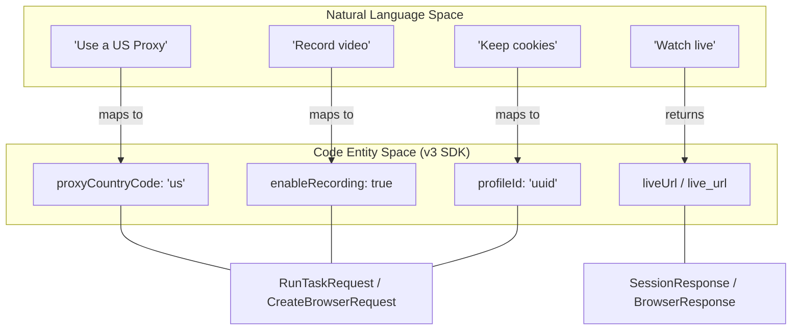
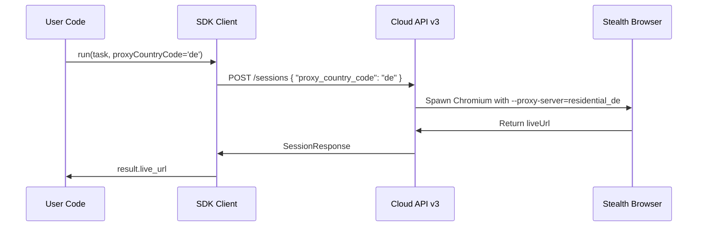
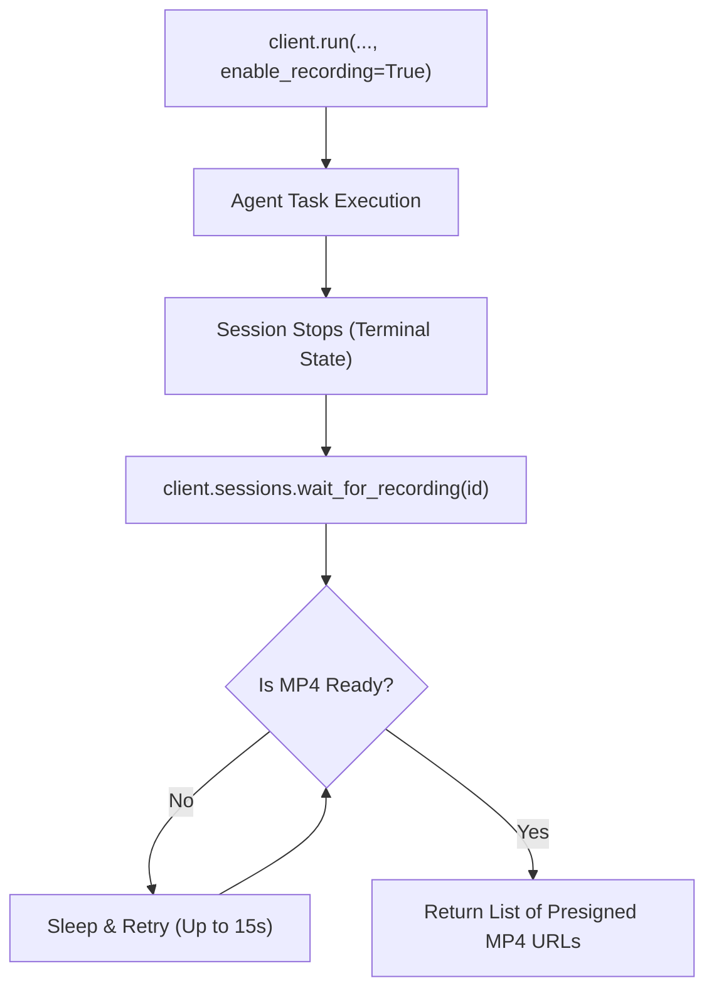

<!-- source: DeepWiki mcp.deepwiki.com · repo browser-use/sdk · page 4.3 Browser Infrastructure: Stealth, Proxies, and Live Preview · fetched 2026-10-30 -->

# Browser Infrastructure: Stealth, Proxies, and Live Preview

Relevant source files

The following files were used as context for generating this wiki page:

- [docs/cloud/agent/follow-up-tasks.mdx](docs/cloud/agent/follow-up-tasks.mdx)
- [docs/cloud/agent/human-in-the-loop.mdx](docs/cloud/agent/human-in-the-loop.mdx)
- [docs/cloud/agent/structured-output.mdx](docs/cloud/agent/structured-output.mdx)
- [docs/cloud/agent/workspaces.mdx](docs/cloud/agent/workspaces.mdx)
- [docs/cloud/browser/live-preview.mdx](docs/cloud/browser/live-preview.mdx)
- [docs/cloud/browser/playwright-puppeteer-selenium.mdx](docs/cloud/browser/playwright-puppeteer-selenium.mdx)
- [docs/cloud/browser/stealth.mdx](docs/cloud/browser/stealth.mdx)
- [docs/cloud/guides/authentication.mdx](docs/cloud/guides/authentication.mdx)
- [docs/cloud/guides/webhooks.mdx](docs/cloud/guides/webhooks.mdx)
- [docs/cloud/llms-full.txt](docs/cloud/llms-full.txt)
- [docs/cloud/llms.txt](docs/cloud/llms.txt)
- [docs/cloud/tutorials/chat-ui.mdx](docs/cloud/tutorials/chat-ui.mdx)
- [docs/llms-full.txt](docs/llms-full.txt)
- [docs/llms.txt](docs/llms.txt)

This page documents the managed browser infrastructure provided by the Browser Use Cloud. It covers the hardened Chromium environment designed for AI agents, the integrated residential proxy network, real-time session visualization, and recording capabilities.

## Managed Stealth Browser

Every session in Browser Use Cloud runs in a hardened, managed Chromium fork specifically designed to bypass bot detection and anti-scraping measures [docs/cloud/browser/playwright-puppeteer-selenium.mdx:7-7](). This infrastructure is the default for both AI agent tasks (`sessions.create`) and raw CDP sessions (`browsers.create`) [docs/cloud/llms-full.txt:48-61]().

### Key Stealth Features
*   **Fingerprint Randomization:** Automatic randomization of browser fingerprints to prevent tracking across sessions.
*   **Hardened Chromium:** A custom fork that removes typical automation markers used by anti-bot services [docs/cloud/browser/stealth.mdx:1-10]().
*   **Cookie Banner Blocking:** Built-in logic to handle or bypass common consent overlays that often obstruct AI agents.

### Entity Mapping: Browser Configuration
The following diagram bridges the natural language configuration to the specific code entities in the v3 SDK.

**Browser Infrastructure Entity Map**

Sources: [docs/cloud/llms-full.txt:48-61](), [docs/cloud/browser/playwright-puppeteer-selenium.mdx:79-88](), [docs/cloud/browser/live-preview.mdx:11-29]()

---

## Residential Proxies

Browser Use Cloud includes a built-in residential proxy network covering 195+ countries [docs/cloud/browser/playwright-puppeteer-selenium.mdx:7-7](). Proxies are rotated automatically and are enabled by default for all sessions.

### Proxy Selection
Users can specify a target country using the `proxy_country_code` (Python) or `proxyCountryCode` (TypeScript) parameter [docs/cloud/browser/playwright-puppeteer-selenium.mdx:83-83]().

| Parameter | Type | Description |
| :--- | :--- | :--- |
| `proxy_country_code` | `string` | ISO 3166-1 alpha-2 code (e.g., `us`, `de`, `jp`). |
| `custom_proxy` | `string` | Enterprise feature to provide a custom proxy URL (SOCKS5/HTTP). |

### Implementation Flow
When a session is initiated, the backend orchestrator selects an exit node based on the provided parameters before launching the Chromium instance.

**Proxy Data Flow**

Sources: [docs/cloud/llms-full.txt:102-106](), [docs/cloud/browser/playwright-puppeteer-selenium.mdx:19-28]()

---

## Live Preview

The `liveUrl` (or `live_url` in Python) is a unique URL returned immediately upon the creation of any session or standalone browser [docs/cloud/browser/live-preview.mdx:11-12](). It allows developers and end-users to watch the agent's actions in real-time.

### Embedding the Browser
The `liveUrl` is hosted on `live.browser-use.com` and can be embedded in any web application using an `iframe` [docs/cloud/browser/live-preview.mdx:49-57]().

**CSP Requirements:**
If your application implements a Content Security Policy (CSP), you must allow the live domain:
`Content-Security-Policy: frame-src 'self' https://live.browser-use.com;` [docs/cloud/browser/live-preview.mdx:59-63]()

### Customization Parameters
The live view can be customized via query strings appended to the `liveUrl` [docs/cloud/browser/live-preview.mdx:77-87]():
*   `theme`: Set to `light` or `dark` (default).
*   `ui`: Set to `false` to hide the browser chrome (URL bar and tabs).

### Human-in-the-Loop (HITL)
The live preview is not just for viewing; it supports direct interaction. This allows for patterns where an agent performs the bulk of a task, but pauses for a human to handle sensitive steps like payments or 2FA [docs/cloud/agent/human-in-the-loop.mdx:7-15]().

Sources: [docs/cloud/browser/live-preview.mdx:11-87](), [docs/cloud/agent/human-in-the-loop.mdx:23-52]()

---

## Session Recording

Recording produces an MP4 video of the browser session. This is particularly useful for debugging or audit trails.

### Enabling Recording
Recording must be explicitly enabled during session or browser creation [docs/cloud/browser/live-preview.mdx:95-95]().

*   **Agent Task:** Pass `enable_recording=True` to `client.run()` or `client.sessions.create()` [docs/cloud/browser/live-preview.mdx:104-104]().
*   **Standalone Browser:** Pass `enable_recording=True` to `client.browsers.create()` [docs/cloud/browser/live-preview.mdx:132-132]().

### Retrieving Recordings
Because video processing happens asynchronously after a browser closes, the SDK provides a helper method to wait for the final MP4 URLs.

*   **Method:** `client.sessions.wait_for_recording(session_id)` (Python) / `client.sessions.waitForRecording(sessionId)` (TypeScript) [docs/cloud/browser/live-preview.mdx:108-121]().
*   **Behavior:** Polls for up to 15 seconds. Returns a list of presigned MP4 URLs [docs/cloud/browser/live-preview.mdx:107-127]().
*   **Expiration:** Presigned URLs expire after **1 hour** [docs/cloud/browser/live-preview.mdx:145-147]().

**Recording Retrieval Logic**

Sources: [docs/cloud/browser/live-preview.mdx:91-148](), [docs/cloud/tutorials/chat-ui.mdx:113-128]()

---

## Technical Summary Table

| Feature | Code Parameter (v3) | Return Entity | Notes |
| :--- | :--- | :--- | :--- |
| **Stealth** | (Enabled by default) | N/A | Hardened Chromium fork [docs/cloud/browser/playwright-puppeteer-selenium.mdx:7-7]() |
| **Proxy** | `proxy_country_code` | N/A | Residential rotation [docs/cloud/browser/playwright-puppeteer-selenium.mdx:83-83]() |
| **Live View** | `live_url` (read-only) | `SessionResponse` | Hosted on `live.browser-use.com` [docs/cloud/browser/live-preview.mdx:11-20]() |
| **Recording** | `enable_recording` | `recording_url` | Presigned MP4 expires in 1hr [docs/cloud/browser/live-preview.mdx:145-147]() |

Sources: [docs/cloud/browser/live-preview.mdx:1-148](), [docs/cloud/browser/playwright-puppeteer-selenium.mdx:79-88]()

---

