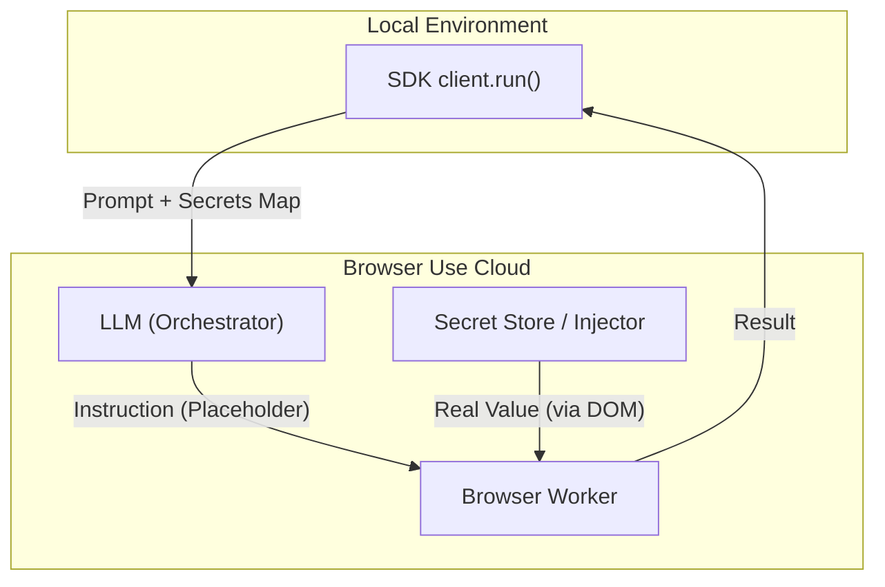
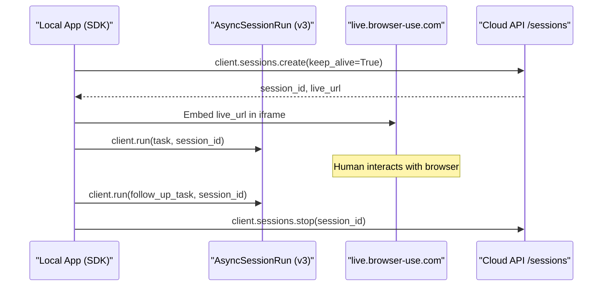

<!-- source: DeepWiki mcp.deepwiki.com · repo browser-use/sdk · page 4.4 Authentication, Secrets, and 2FA · fetched 2026-10-30 -->

# Authentication, Secrets, and 2FA

Relevant source files

The following files were used as context for generating this wiki page:

- [docs/cloud/agent/human-in-the-loop.mdx](docs/cloud/agent/human-in-the-loop.mdx)
- [docs/cloud/agent/workspaces.mdx](docs/cloud/agent/workspaces.mdx)
- [docs/cloud/browser/live-preview.mdx](docs/cloud/browser/live-preview.mdx)
- [docs/cloud/guides/2fa.mdx](docs/cloud/guides/2fa.mdx)
- [docs/cloud/guides/authentication.mdx](docs/cloud/guides/authentication.mdx)
- [docs/cloud/guides/secrets.mdx](docs/cloud/guides/secrets.mdx)
- [docs/cloud/llms-full.txt](docs/cloud/llms-full.txt)
- [docs/cloud/llms.txt](docs/cloud/llms.txt)
- [docs/cloud/tutorials/chat-ui.mdx](docs/cloud/tutorials/chat-ui.mdx)
- [docs/llms-full.txt](docs/llms-full.txt)
- [docs/llms.txt](docs/llms.txt)

This page documents the security and authentication patterns supported by the Browser Use SDK. It covers how to handle sensitive credentials, bypass or automate two-factor authentication (2FA), and integrate human intervention for complex security flows.

### Overview of Authentication Patterns

The SDK provides multiple layers of security and authentication management, ranging from simple credential injection to full 1Password vault integration and automated email verification.

| Feature | Description | Implementation |
| :--- | :--- | :--- |
| **Sensitive Data** | Inject real values into the DOM without sending them to the LLM. | `sensitive_data` / `sensitiveData` param |
| **Secrets Scoping** | Domain-specific credentials for the agent. | `secrets` param + `allowed_domains` |
| **Profiles** | Persistent browser state (cookies/localStorage). | `client.profiles` resource |
| **AgentMail** | Automated email verification for 2FA. | `agentmail=True` (default) |
| **TOTP** | Automated 6-digit code generation. | `bu_2fa_code` suffix in prompts |
| **HITL** | Human-in-the-Loop via live browser. | `live_url` + `client.run()` |

---

### Sensitive Data and Secrets Scoping

To protect credentials, the SDK supports two primary patterns: **Sensitive Data Injection** and **Domain-Scoped Secrets**.

#### Sensitive Data Injection
This pattern prevents the LLM from ever seeing the actual secret. You provide a placeholder in the prompt and a mapping in the `sensitive_data` parameter. The Cloud infrastructure replaces the placeholder with the real value only when interacting with the browser DOM [docs/cloud/guides/secrets.mdx:7-19]().

#### Domain-Scoped Secrets
You can provide credentials that are only accessible to the agent when it is on a specific domain. This is often paired with `allowed_domains` to prevent the agent from navigating to malicious sites to leak info [docs/cloud/guides/secrets.mdx:7-31]().

**Data Flow: Secret Injection**

Sources: [docs/cloud/guides/secrets.mdx:7-61](), [docs/cloud/llms-full.txt:83-86]()

---

### Persistent Profiles

Profiles allow you to save the browser's state, including cookies and `localStorage`. This is the most efficient way to handle authentication for sites with long-lived sessions [docs/cloud/guides/authentication.mdx:3-5]().

1. **Create/Get Profile**: Use `client.profiles.create()` to initialize a container [docs/cloud/guides/authentication.mdx:12-14]().
2. **Execute Task**: Pass the `profile_id` to `sessions.create()` or `run()` [docs/cloud/guides/authentication.mdx:15-16]().
3. **Persist State**: **Crucial:** You must call `sessions.stop()` to save the updated cookies to the profile storage [docs/cloud/guides/authentication.mdx:19-20]().

Sources: [docs/cloud/guides/authentication.mdx:1-40](), [docs/cloud/llms.txt:45-47]()

---

### Two-Factor Authentication (2FA)

Browser Use provides several automated and semi-automated ways to bypass 2FA challenges.

#### AgentMail (Email Verification)
Each session is assigned a unique email address by default (`agentmail=True`). The agent can check this inbox to retrieve verification codes automatically [docs/cloud/guides/2fa:150-173]().

#### TOTP with 1Password Integration
For authenticator-app style 2FA, you can provide a TOTP secret. In legacy v2 patterns, the SDK supports `op_vault_id` for 1Password. In v3, appending `bu_2fa_code` to a prompt instruction can trigger the agent to look for and generate a 6-digit code [docs/cloud/llms.txt:66-67]().

#### Human-in-the-Loop (HITL)
If a security challenge is too complex for the agent (e.g., a specific CAPTCHA or hardware key), you can use the `live_url` to let a human take over [docs/cloud/agent/human-in-the-loop.mdx:3-10]().

**Code Entity Interaction: HITL Flow**

Sources: [docs/cloud/agent/human-in-the-loop.mdx:24-52](), [docs/cloud/browser/live-preview.mdx:45-57](), [docs/cloud/tutorials/chat-ui.mdx:73-86]()

---

### Implementation Details

#### 1Password and Vaults
The SDK allows integration with 1Password via the `op_vault_id` parameter (primarily in v2). This enables the agent to fetch credentials directly from a secure vault during execution [docs/cloud/llms.txt:66-67]().

#### Webhook Verification
When using webhooks for async notifications (e.g., when a long-running auth task completes), the SDK recommends verifying the `X-Browser-Use-Signature` header. This is an HMAC-SHA256 signature over the concatenation of the timestamp and request body [docs/cloud/llms.txt:55]().

#### Summary Table of SDK Methods

| Resource | Method | Role in Auth |
| :--- | :--- | :--- |
| `profiles` | `create()`, `list()` | Managing persistent browser identities [docs/cloud/guides/authentication.mdx:44-66](). |
| `sessions` | `stop()` | Required to persist profile state [docs/cloud/guides/authentication.mdx:96-98](). |
| `sessions` | `create()` | Inject `profile_id` and `agentmail` settings [docs/cloud/llms-full.txt:48-61](). |
| `run()` | `run()` | Entry point for `secrets` and `sensitive_data` [docs/cloud/guides/secrets.mdx:14-18](). |

Sources: [docs/cloud/guides/authentication.mdx:1-99](), [docs/cloud/guides/2fa.mdx:1-190](), [docs/cloud/guides/secrets.mdx:1-61]().

---

