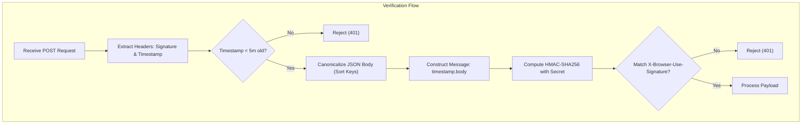

<!-- source: DeepWiki mcp.deepwiki.com · repo browser-use/sdk · page 4.5 Webhooks and Async Notifications · fetched 2026-10-30 -->

# Webhooks and Async Notifications

<details>
<summary>Relevant source files</summary>

The following files were used as context for generating this wiki page:

- [docs/cloud/agent/cache-script.mdx](docs/cloud/agent/cache-script.mdx)
- [docs/cloud/agent/follow-up-tasks.mdx](docs/cloud/agent/follow-up-tasks.mdx)
- [docs/cloud/agent/models.mdx](docs/cloud/agent/models.mdx)
- [docs/cloud/agent/structured-output.mdx](docs/cloud/agent/structured-output.mdx)
- [docs/cloud/browser/playwright-puppeteer-selenium.mdx](docs/cloud/browser/playwright-puppeteer-selenium.mdx)
- [docs/cloud/browser/stealth.mdx](docs/cloud/browser/stealth.mdx)
- [docs/cloud/faq.mdx](docs/cloud/faq.mdx)
- [docs/cloud/guides/mcp-server.mdx](docs/cloud/guides/mcp-server.mdx)
- [docs/cloud/guides/webhooks.mdx](docs/cloud/guides/webhooks.mdx)
- [docs/cloud/llms-full.txt](docs/cloud/llms-full.txt)
- [docs/cloud/llms.txt](docs/cloud/llms.txt)
- [docs/cloud/tutorials/grow-therapy-compare.mdx](docs/cloud/tutorials/grow-therapy-compare.mdx)
- [docs/llms-full.txt](docs/llms-full.txt)
- [docs/llms.txt](docs/llms.txt)

</details>


The Browser Use SDK provides a robust system for asynchronous monitoring of agent tasks through webhooks and integration with the Model Context Protocol (MCP). This allows developers to build reactive applications that respond to task completions, status changes, and state transitions without persistent polling.

### Webhook System Architecture

The webhook system is designed for high reliability and security. It enables the Browser Use Cloud to push real-time updates to a user-defined HTTP endpoint whenever an agent's status changes.

#### Event Types
Currently, the system supports the following event types:
- `agent.task.status_update`: Triggered when a task transitions between `running`, `idle`, or `stopped` states [docs/cloud/guides/webhooks.mdx:9-12]().
- `test`: A ping event used to verify the endpoint configuration [docs/cloud/guides/webhooks.mdx:13-13]().

#### Data Flow and Payload
When an event occurs, the Cloud API sends a `POST` request to the configured URL with a JSON payload containing the task and session identifiers.

**Payload Structure:**
```json
{
  "type": "agent.task.status_update",
  "timestamp": "2025-01-15T10:30:00Z",
  "payload": {
    "task_id": "task_abc123",
    "session_id": "session_xyz",
    "status": "idle",
    "metadata": {}
  }
}
```
Sources: [docs/cloud/guides/webhooks.mdx:17-28]()

### Signature Verification

To ensure requests originate from Browser Use and prevent replay attacks, every webhook includes two security headers:
1. `X-Browser-Use-Signature`: An HMAC-SHA256 hash of the payload [docs/cloud/guides/webhooks.mdx:34-34]().
2. `X-Browser-Use-Timestamp`: The Unix timestamp of the request [docs/cloud/guides/webhooks.mdx:35-35]().

#### Verification Logic
The signature is computed over the string `{timestamp}.{body}`. The `body` must be the raw JSON with keys sorted alphabetically and no extra whitespace (canonical JSON) [docs/cloud/guides/webhooks.mdx:37-37]().

**Verification Process Diagram:**


Sources: [docs/cloud/guides/webhooks.mdx:39-84]()

### MCP Server Integration

The Browser Use Cloud exposes a Model Context Protocol (MCP) server at `https://api.browser-use.com/v3/mcp`. This allows IDE tools and AI assistants (Cursor, Windsurf, Claude Desktop) to execute browser tasks directly.

#### Integration Configuration
To connect an IDE, the `x-browser-use-api-key` must be provided in the headers of the MCP configuration [docs/cloud/guides/mcp-server.mdx:1-33]().

#### Available MCP Tools
The MCP server provides a functional bridge between natural language prompts in IDEs and the SDK resources:

| MCP Tool Name | Description | Related SDK Resource |
| :--- | :--- | :--- |
| `run_session` | Creates a session and starts a task | `sessions.create()` |
| `get_session` | Polls status, cost, and live URL | `sessions.get()` |
| `send_task` | Sends follow-up to an idle session | `client.run(session_id=...)` |
| `stop_session` | Terminates task or destroys sandbox | `sessions.stop()` |
| `get_session_messages` | Retrieves agent reasoning and actions | `sessions.messages()` |

Sources: [docs/cloud/guides/mcp-server.mdx:69-80]()

### Implementation Mapping

The following diagram maps the high-level notification concepts to the specific entities and endpoints in the Cloud API.

**Entity Relationship and Event Map:**

```mermaid
classDiagram
    class "Cloud_API_v3" {
        +POST /sessions
        +POST /mcp
        +Webhook_Dispatcher
    }
    class "Webhook_Target" {
        +X-Browser-Use-Signature
        +X-Browser-Use-Timestamp
        +handle_status_update()
    }
    class "MCP_Client" {
        +Cursor
        +Claude_Desktop
        +Windsurf
    }
    
    "Cloud_API_v3" --|> "Webhook_Target" : "agent.task.status_update"
    "MCP_Client" --|> "Cloud_API_v3" : "run_session / get_session"
    "Cloud_API_v3" ..> "Webhook_Target" : "HMAC-SHA256 Verification"
```
Sources: [docs/cloud/guides/webhooks.mdx:110-179](), [docs/cloud/guides/mcp-server.mdx:12-67]()

### Configuration Summary

| Feature | Configuration Location | Key Security Mechanism |
| :--- | :--- | :--- |
| **Webhooks** | [Dashboard Settings](https://cloud.browser-use.com/settings?tab=webhooks) | HMAC-SHA256 over Canonical JSON |
| **MCP Server** | IDE Config (`mcp.json` / `claude_desktop_config.json`) | `x-browser-use-api-key` Header |
| **Async Polling** | `client.run()` method | Exponential Backoff on 429s |

Sources: [docs/cloud/guides/webhooks.mdx:6-6](), [docs/cloud/guides/mcp-server.mdx:18-50](), [docs/cloud/llms.txt:83-85]()

---

