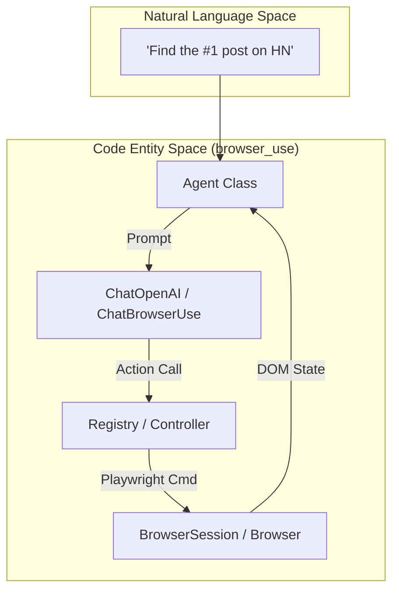

<!-- source: DeepWiki mcp.deepwiki.com · repo browser-use/sdk · page 5 Open Source SDK (browser_use Python Library) · fetched 2026-10-30 -->

# Open Source SDK (browser_use Python Library)

Relevant source files

The following files were used as context for generating this wiki page:

- [docs/generate-llms-txt.sh](docs/generate-llms-txt.sh)
- [docs/open-source/customize/skills/basics.mdx](docs/open-source/customize/skills/basics.mdx)
- [docs/open-source/introduction.mdx](docs/open-source/introduction.mdx)
- [docs/open-source/legacy/sandbox/quickstart.mdx](docs/open-source/legacy/sandbox/quickstart.mdx)
- [docs/open-source/llms-full.txt](docs/open-source/llms-full.txt)
- [docs/open-source/llms.txt](docs/open-source/llms.txt)
- [docs/open-source/quickstart.mdx](docs/open-source/quickstart.mdx)
- [docs/open-source/supported-models.mdx](docs/open-source/supported-models.mdx)

The `browser_use` Python library is a self-hosted, open-source framework for building AI-powered browser automation agents. Unlike the Cloud SDK which interacts with a managed API, this library allows developers to run agents locally or on their own infrastructure, providing full control over the browser instance and LLM selection.

## Core Concepts

The library is built around three primary entities that work together to translate natural language instructions into browser actions:

1.  **Agent**: The high-level orchestrator that manages the loop of perception (DOM analysis), reasoning (LLM), and action (tool execution).
2.  **Browser / BrowserSession**: Manages the underlying Playwright instance, handling tabs, cookies, and low-level page interactions.
3.  **Tools Registry**: A collection of functions (built-in or custom) that the Agent can invoke to interact with the web.

### Natural Language to Code Mapping

The following diagram illustrates how natural language tasks are processed by the library's core classes.

**Task Execution Flow**

Sources: [docs/open-source/quickstart.mdx:71-86](), [docs/open-source/llms.txt:18-22]()

---

## Agent and Browser Customization
The `Agent` class is the entry point for most users. It can be configured with various parameters to control its reasoning depth and execution limits. The `Browser` and `BrowserSession` classes provide hooks into the automation layer, allowing for real browser attachments or remote CDP connections.

*   **Agent Configuration**: Parameters like `max_steps`, `flash_mode`, and `system_prompt_extension` allow fine-tuning of the agent's behavior.
*   **Browser Lifecycle**: Support for persistent contexts, proxy rotation, and `on_step_start`/`on_step_end` hooks.

For details, see [Agent and Browser Customization](#5.1).

Sources: [docs/open-source/llms.txt:18-29](), [docs/open-source/quickstart.mdx:137-137]()

---

## Tools and Skills
The power of the open-source SDK lies in its extensibility through the Tools registry. Developers can define custom Python functions and expose them to the agent using decorators.

*   **@tools.action**: A decorator used to register custom functions.
*   **Dependency Injection**: Tools can automatically receive the current `BrowserSession` to perform complex DOM manipulations.
*   **Skills**: A concept for reusable, high-level API-like endpoints that can be shared across agents.

For details, see [Tools and Skills](#5.2).

Sources: [docs/open-source/llms.txt:31-37](), [docs/open-source/customize/skills/basics.mdx:15-27]()

---

## Supported Models and Integrations
The library is LLM-agnostic, supporting a wide range of providers through LangChain-compatible interfaces.

| Provider | Class | Environment Variable |
| :--- | :--- | :--- |
| **Browser Use** | `ChatBrowserUse` | `BROWSER_USE_API_KEY` |
| **OpenAI** | `ChatOpenAI` | `OPENAI_API_KEY` |
| **Google** | `ChatGoogle` | `GOOGLE_API_KEY` |
| **Anthropic** | `ChatAnthropic` | `ANTHROPIC_API_KEY` |
| **Azure** | `ChatAzureOpenAI` | `AZURE_OPENAI_API_KEY` |

Beyond LLMs, the library integrates with the **Model Context Protocol (MCP)** and workflow tools like **n8n**.

For details, see [Supported Models and Integrations](#5.3).

Sources: [docs/open-source/supported-models.mdx:12-162](), [docs/open-source/llms.txt:38-40]()

---

## CLI and Development Setup
For rapid prototyping and local development, the library includes a CLI and a specific architecture for managing browser states.

*   **CLI Commands**: `browser-use install` for setup and `browser-use open` for persistent sessions.
*   **Daemon Architecture**: Support for multi-session management with low-latency command execution.
*   **Production Path**: Transitioning from local scripts to the `@sandbox` decorator for cloud-hosted execution.

For details, see [CLI and Development Setup](#5.4).

Sources: [docs/open-source/quickstart.mdx:17-39](), [docs/open-source/llms.txt:16-16](), [docs/open-source/legacy/sandbox/quickstart.mdx:17-27]()

---

