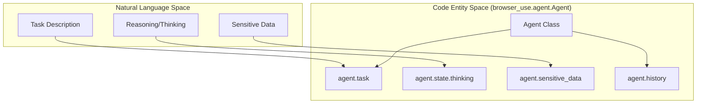
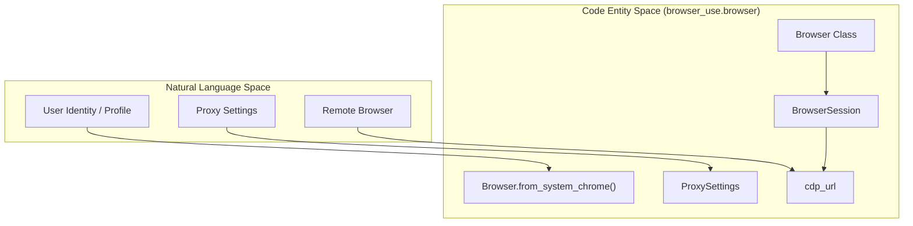

<!-- source: DeepWiki mcp.deepwiki.com · repo browser-use/sdk · page 5.1 Agent and Browser Customization · fetched 2026-10-30 -->

# Agent and Browser Customization

Relevant source files

The following files were used as context for generating this wiki page:

- [docs/open-source/customize/agent/all-parameters.mdx](docs/open-source/customize/agent/all-parameters.mdx)
- [docs/open-source/customize/agent/output-format.mdx](docs/open-source/customize/agent/output-format.mdx)
- [docs/open-source/customize/agent/prompting-guide.mdx](docs/open-source/customize/agent/prompting-guide.mdx)
- [docs/open-source/customize/browser/all-parameters.mdx](docs/open-source/customize/browser/all-parameters.mdx)
- [docs/open-source/customize/browser/authentication.mdx](docs/open-source/customize/browser/authentication.mdx)
- [docs/open-source/customize/browser/real-browser.mdx](docs/open-source/customize/browser/real-browser.mdx)
- [docs/open-source/customize/hooks.mdx](docs/open-source/customize/hooks.mdx)
- [docs/open-source/customize/tools/basics.mdx](docs/open-source/customize/tools/basics.mdx)
- [docs/open-source/customize/tools/response.mdx](docs/open-source/customize/tools/response.mdx)
- [docs/open-source/examples/templates/follow-up-tasks.mdx](docs/open-source/examples/templates/follow-up-tasks.mdx)
- [docs/open-source/examples/templates/parallel-browser.mdx](docs/open-source/examples/templates/parallel-browser.mdx)
- [docs/open-source/examples/templates/sensitive-data.mdx](docs/open-source/examples/templates/sensitive-data.mdx)
- [docs/open-source/legacy/actor/all-parameters.mdx](docs/open-source/legacy/actor/all-parameters.mdx)

This page provides a technical deep dive into customizing the behavior of the `Agent` and `Browser` classes within the `browser-use` open-source library. It covers parameter configurations, lifecycle hooks, authentication strategies, and how to control the agent's reasoning and output formats.

## Agent Configuration

The `Agent` class is the primary orchestrator that bridges the LLM and the browser. Its behavior is highly configurable through constructor parameters and environment variables.

### Core Parameters and Reasoning
The agent's intelligence and execution flow are controlled by several key flags:
*   **`max_steps`**: Limits the total number of iterations the agent can perform for a single task [docs/open-source/customize/hooks.mdx:80]().
*   **`use_thinking`**: When `True` (default), the agent uses an internal "thinking" field for explicit reasoning before taking actions [docs/open-source/customize/agent/all-parameters.mdx:29]().
*   **`flash_mode`**: A performance-optimized mode that skips evaluation, next goal, and thinking steps, relying purely on memory. Enabling this overrides `use_thinking` [docs/open-source/customize/agent/all-parameters.mdx:30]().
*   **`system_prompt_extension`**: Allows developers to append custom instructions to the default system prompt without overwriting it entirely [docs/open-source/customize/agent/all-parameters.mdx:34]().

### Visual and Extraction Settings
*   **`use_vision`**: Can be set to `"auto"`, `True`, or `False`. It determines if screenshots are included in the LLM context. Disabling vision is recommended when handling sensitive data to prevent PII leaks in screenshots [docs/open-source/customize/agent/all-parameters.mdx:17](), [docs/open-source/examples/templates/sensitive-data.mdx:35]().
*   **`page_extraction_llm`**: Allows specifying a separate, potentially smaller/cheaper LLM specifically for text extraction tasks [docs/open-source/customize/agent/all-parameters.mdx:19]().

### Agent Entity Mapping
The following diagram maps high-level Agent concepts to their corresponding code entities and data structures.

**Agent Architecture Mapping**

**Sources:** [docs/open-source/customize/hooks.mdx:36-40](), [docs/open-source/customize/agent/all-parameters.mdx:8-40]()

---

## Browser and Session Customization

The `Browser` class manages the browser process, while `BrowserSession` (often aliased as `browser_session`) handles the specific interaction state.

### BrowserSession Parameters
Configuration options for the browser include:
*   **`headless`**: Controls whether the browser runs with a UI. It auto-detects based on environment if set to `None` [docs/open-source/customize/browser/all-parameters.mdx:18]().
*   **`allowed_domains` / `prohibited_domains`**: Security features to restrict the agent's navigation. Lists over 100 domains are optimized to O(1) sets [docs/open-source/customize/browser/all-parameters.mdx:28-39]().
*   **`keep_alive`**: If `True`, the browser instance remains open after the agent completes its task, allowing for follow-up tasks in the same session [docs/open-source/customize/browser/all-parameters.mdx:27](), [docs/open-source/examples/templates/follow-up-tasks.mdx:24]().

### Authentication Strategies
1.  **Real Browser Profiles**: Use `Browser.from_system_chrome()` to attach to an existing Chrome installation, inheriting all logged-in sessions and extensions [docs/open-source/customize/browser/authentication.mdx:35](), [docs/open-source/customize/browser/real-browser.mdx:19]().
2.  **Storage State**: Export and load cookies/localStorage using a JSON file (Playwright format). Use `browser.export_storage_state('auth.json')` to save state [docs/open-source/customize/browser/authentication.mdx:62-71]().
3.  **TOTP 2FA**: Inject a TOTP secret into `sensitive_data` using the `bu_2fa_code` suffix. The agent will generate a fresh 6-digit code when it encounters that placeholder [docs/open-source/customize/browser/authentication.mdx:143-154]().

### Browser Entity Mapping
The following diagram illustrates the relationship between browser configuration and the underlying automation components.

**Browser Infrastructure Mapping**

**Sources:** [docs/open-source/customize/browser/all-parameters.mdx:14-52](), [docs/open-source/customize/browser/authentication.mdx:35-71]()

---

## Lifecycle Hooks

Lifecycle hooks allow developers to execute custom asynchronous code during the agent's execution loop.

| Hook | Description | Execution Point |
| :--- | :--- | :--- |
| `on_step_start` | Executed at the start of each step. | Before the LLM decides on the next action [docs/open-source/customize/hooks.mdx:17](). |
| `on_step_end` | Executed at the end of each step. | After actions are executed, before the next step starts [docs/open-source/customize/hooks.mdx:18](). |

### Implementation Details
Hooks are passed to the `agent.run()` method. They receive the `agent` instance as the sole parameter, providing access to:
*   `agent.browser_session`: For direct CDP commands or page state summary [docs/open-source/customize/hooks.mdx:43-49]().
*   `agent.history`: To inspect previous URLs or model thoughts [docs/open-source/customize/hooks.mdx:46-47]().
*   `agent.pause()` / `agent.resume()`: To halt execution for human intervention [docs/open-source/customize/hooks.mdx:65-68]().

**Sources:** [docs/open-source/customize/hooks.mdx:15-81]()

---

## Output Format and Tool Responses

The agent's output can be structured using Pydantic models via the `output_model_schema` parameter [docs/open-source/customize/agent/all-parameters.mdx:14]().

### ActionResult Customization
When creating custom tools using the `@tools.action` decorator, developers use `ActionResult` to control what the LLM sees:

| Property | Behavior |
| :--- | :--- |
| `extracted_content` | The primary data returned to the LLM [docs/open-source/customize/tools/response.mdx:31](). |
| `include_extracted_content_only_once` | If `True`, the content is shown once and then moved to a file the LLM can reference, saving context tokens [docs/open-source/customize/tools/response.mdx:51-53](). |
| `long_term_memory` | Information that persists in the LLM's context for all subsequent steps [docs/open-source/customize/tools/response.mdx:33](). |
| `is_done` | Signals the agent to terminate the task successfully [docs/open-source/customize/tools/response.mdx:76](). |

**Sources:** [docs/open-source/customize/tools/response.mdx:8-79](), [docs/open-source/customize/agent/all-parameters.mdx:14]()

---

