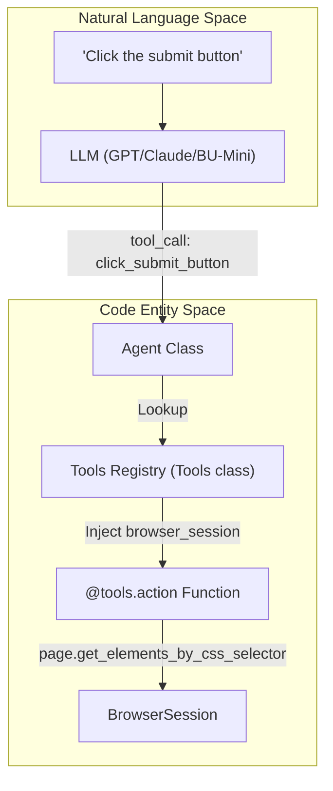
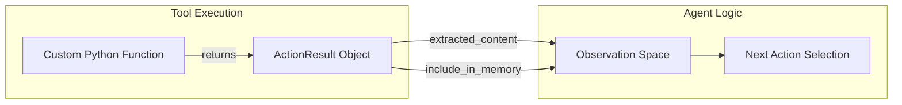

<!-- source: DeepWiki mcp.deepwiki.com · repo browser-use/sdk · page 5.2 Tools and Skills · fetched 2026-10-30 -->

# Tools and Skills

<details>
<summary>Relevant source files</summary>

The following files were used as context for generating this wiki page:

- [docs/generate-llms-txt.sh](docs/generate-llms-txt.sh)
- [docs/open-source/customize/tools/add.mdx](docs/open-source/customize/tools/add.mdx)
- [docs/open-source/customize/tools/available.mdx](docs/open-source/customize/tools/available.mdx)
- [docs/open-source/customize/tools/remove.mdx](docs/open-source/customize/tools/remove.mdx)
- [docs/open-source/llms-full.txt](docs/open-source/llms-full.txt)
- [docs/open-source/llms.txt](docs/open-source/llms.txt)

</details>


The `browser-use` library provides a robust **Tools Registry** that allows agents to interact with the web and local systems. This system bridges natural language instructions from an LLM to executable Python code through a structured dispatch mechanism.

## Tools Registry and `@tools.action`

The core of the extensibility model is the `Tools` class and its `@tools.action` decorator. This decorator registers a Python function as a "tool" that the Agent can perceive and call.

### Implementation and Registration
To add a custom tool, you instantiate the `Tools` registry and decorate your functions. The LLM uses the `description` parameter to understand when and why to invoke the tool.

```python
from browser_use import Tools, Agent, ActionResult

tools = Tools()

@tools.action(description='Ask human for help with a question')
async def ask_human(question: str) -> ActionResult:
    answer = input(f'{question} > ')
    return ActionResult(extracted_content=f'The human responded with: {answer}')

agent = Agent(task='...', llm=llm, tools=tools)
```
*Sources: [docs/open-source/customize/tools/add.mdx:23-36]()*

### Dependency Injection (Name Matching)
The registry uses **parameter name matching** to inject system objects into your tools. This is a critical design pattern: the SDK inspects the function signature and provides the requested objects based on the variable names, not just types.

| Parameter Name | Type | Description |
| :--- | :--- | :--- |
| `browser_session` | `BrowserSession` | Provides direct access to the current page and CDP. |
| `cdp_client` | `CdpClient` | Direct Chrome DevTools Protocol client. |
| `page_extraction_llm`| `BaseChatModel` | The LLM instance used by the agent for sub-tasks. |
| `file_system` | `FileSystem` | Access to the local/sandbox file system. |

**Common Pitfall**: Using `browser: Browser` instead of `browser_session: BrowserSession` will fail because the injector specifically looks for the `browser_session` string in the signature.
*Sources: [docs/open-source/customize/tools/add.mdx:43-60](), [docs/open-source/customize/tools/add.mdx:146-167]()*

## Data Flow: Natural Language to Tool Execution

The following diagram illustrates how a natural language request is transformed into a specific code execution via the `Tools` registry.

**Diagram: NL to Tool Execution Bridge**

*Sources: [docs/open-source/customize/tools/add.mdx:28-32](), [docs/open-source/customize/tools/add.mdx:71-86]()*

## Built-in Tools

The SDK comes with a comprehensive suite of pre-defined tools categorized by their interaction type.

| Category | Tools |
| :--- | :--- |
| **Navigation** | `search`, `navigate`, `go_back`, `wait` |
| **Interaction** | `click`, `input`, `upload_file`, `scroll`, `send_keys` |
| **Extraction** | `extract` (LLM-based), `screenshot`, `dropdown_options` |
| **System** | `write_file`, `read_file`, `evaluate` (JS execution) |
| **Control** | `switch` (tabs), `close`, `done` |

### Restricting Capabilities
You can restrict an agent's capabilities by excluding specific built-in tools during initialization:
```python
tools = Tools(exclude_actions=['search', 'wait'])
```
*Sources: [docs/open-source/customize/tools/available.mdx:11-49](), [docs/open-source/customize/tools/remove.mdx:9-14]()*

## Tool Response Handling

Tools should ideally return an `ActionResult` object. This class allows the tool to communicate complex state back to the agent beyond a simple string.

### The `ActionResult` Entity
When a tool finishes execution, it returns data that the Agent uses to decide the next step.

**Diagram: Tool Response Data Flow**

*Sources: [docs/open-source/customize/tools/add.mdx:28-31](), [docs/open-source/customize/tools/response.mdx:1-37]()*

## Skills Concept

In the open-source context, "Skills" refer to high-level capabilities composed of one or more tools or deterministic scripts. While "Tools" are individual atomic actions (like `click`), a "Skill" often represents a complex, reusable workflow (e.g., "Login to LinkedIn" or "Extract Invoice Data").

### Pydantic Integration
Skills often require structured input. The registry supports Pydantic models to define complex parameter schemas that the LLM must satisfy.

```python
class Cars(BaseModel):
    name: str = Field(description='The name of the car')
    price: int = Field(description='Price in USD')

@tools.action(description='Save cars to file')
def save_cars(cars: list[Cars]) -> str:
    # Logic to save Pydantic objects
    return f'Saved {len(cars)} cars'
```
*Sources: [docs/open-source/customize/tools/add.mdx:102-118]()*

### Domain Security
Tools and skills can be scoped to specific domains to prevent the agent from using sensitive capabilities on untrusted sites.
```python
@tools.action(description='Fill bank form', allowed_domains=['https://mybank.com'])
def fill_bank_form(account_number: str):
    pass
```
*Sources: [docs/open-source/customize/tools/add.mdx:121-131]()*

---

