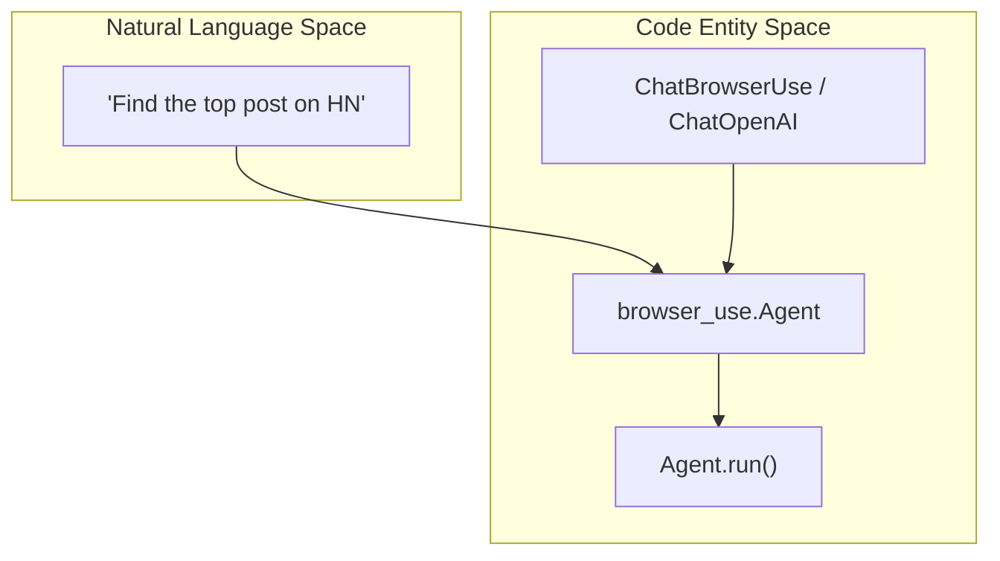
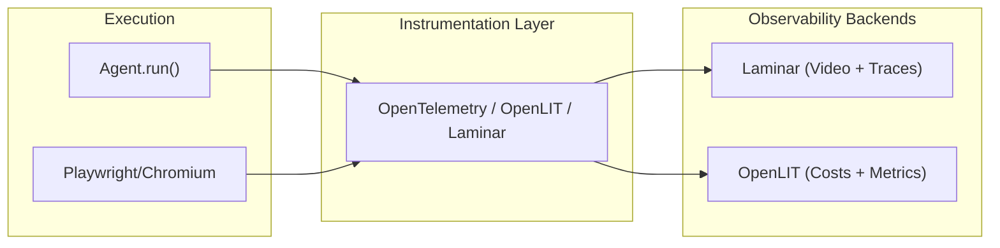

<!-- source: DeepWiki mcp.deepwiki.com · repo browser-use/sdk · page 5.3 Supported Models and Integrations · fetched 2026-10-30 -->

# Supported Models and Integrations

Relevant source files

The following files were used as context for generating this wiki page:

- [docs/cloud/browser/proxies.mdx](docs/cloud/browser/proxies.mdx)
- [docs/cloud/legacy/agent.mdx](docs/cloud/legacy/agent.mdx)
- [docs/cloud/legacy/public-share.mdx](docs/cloud/legacy/public-share.mdx)
- [docs/open-source/browser-use-cli.mdx](docs/open-source/browser-use-cli.mdx)
- [docs/open-source/customize/integrations/mcp-server.mdx](docs/open-source/customize/integrations/mcp-server.mdx)
- [docs/open-source/customize/skills/basics.mdx](docs/open-source/customize/skills/basics.mdx)
- [docs/open-source/development/monitoring/observability.mdx](docs/open-source/development/monitoring/observability.mdx)
- [docs/open-source/development/monitoring/openlit.mdx](docs/open-source/development/monitoring/openlit.mdx)
- [docs/open-source/development/n8n-integration.mdx](docs/open-source/development/n8n-integration.mdx)
- [docs/open-source/legacy/sandbox/quickstart.mdx](docs/open-source/legacy/sandbox/quickstart.mdx)
- [docs/open-source/quickstart.mdx](docs/open-source/quickstart.mdx)
- [docs/open-source/supported-models.mdx](docs/open-source/supported-models.mdx)

This page provides a technical overview of the Large Language Model (LLM) providers, external integrations, and observability tools supported by the Browser Use SDK. It covers both the managed Cloud infrastructure and the open-source library configurations.

## Supported LLM Providers

The SDK supports over 15 LLM providers. While `ChatBrowserUse` is the recommended optimized model, the architecture allows for seamless switching between major providers like OpenAI, Anthropic, and Google.

### Browser Use (Optimized)
`ChatBrowserUse` is an in-house model optimized for browser automation, designed to match the accuracy of top-tier models while operating 3-5x faster [docs/open-source/supported-models.mdx:14-14]().

| Model ID | Description |
| :--- | :--- |
| `bu-latest` / `bu-1-0` | Default optimized model [docs/open-source/supported-models.mdx:42-42]() |
| `bu-2-0` | Premium model with improved reasoning [docs/open-source/supported-models.mdx:43-43]() |

### Third-Party Integrations
The SDK leverages standard provider classes to interface with external LLMs.

*   **OpenAI**: Supports all models via `ChatOpenAI`. Compatible with any OpenAI-standard API by overriding the base URL [docs/open-source/supported-models.mdx:103-127]().
*   **Anthropic**: Uses `ChatAnthropic`. Coordinate clicking is automatically enabled for `claude-sonnet-4-*` and `claude-opus-4-*` models [docs/open-source/supported-models.mdx:131-138]().
*   **Google Gemini**: Supports Gemini and Gemma models via `ChatGoogle`. Requires `GOOGLE_API_KEY` [docs/open-source/supported-models.mdx:66-82]().
*   **Azure OpenAI**: Supports the Chat Completions API and the newer Responses API (required for `gpt-5.1-codex` models) [docs/open-source/supported-models.mdx:182-192]().

### LLM Configuration Flow
The following diagram illustrates how an LLM instance is passed into the `Agent` and utilized during execution.

**Agent-LLM Association**

Sources: [docs/open-source/quickstart.mdx:71-82](), [docs/open-source/supported-models.mdx:16-30]()

---

## Model Context Protocol (MCP) Server

Browser Use can operate as a local **Model Context Protocol (MCP)** server, allowing AI assistants (like Claude Desktop, Cursor, or Windsurf) to control a local browser through a standardized interface [docs/open-source/customize/integrations/mcp-server.mdx:1-6]().

### Implementation and Tools
The MCP server is started via the CLI using the `--mcp` flag [docs/open-source/customize/integrations/mcp-server.mdx:15-16](). It exposes several low-level automation tools to the connected LLM:

*   **Navigation**: `browser_navigate`, `browser_go_back`.
*   **Interaction**: `browser_click`, `browser_type`, `browser_scroll`.
*   **State**: `browser_get_state` (returns interactive elements and screenshots).
*   **Tab Management**: `browser_list_tabs`, `browser_switch_tab`, `browser_close_tab`.
*   **Autonomous Fallback**: `retry_with_browser_use_agent` [docs/open-source/customize/integrations/mcp-server.mdx:121-144]().

Sources: [docs/open-source/customize/integrations/mcp-server.mdx:117-144](), [docs/open-source/browser-use-cli.mdx:7-13]()

---

## Workflow and Framework Integrations

### n8n Integration
Browser Use integrates with n8n via the `n8n-nodes-browser-use` community node. This allows browser automation to be triggered as part of a larger visual workflow [docs/open-source/development/n8n-integration.mdx:7-9]().

*   **Operations**: `Run Task`, `Get Task Status`, `Get Task Media` (screenshots/PDFs), and `Stop Task` [docs/open-source/development/n8n-integration.mdx:78-84]().
*   **Data Flow**: The node sends instructions to the Browser Use Cloud API and returns structured results or media to subsequent n8n nodes [docs/open-source/development/n8n-integration.mdx:88-97]().

### Playwright Integration
While the SDK manages its own browser instances, it can connect to existing Playwright or Puppeteer setups via a `cdpUrl` [docs/open-source/browser-use-cli.mdx:114-115]().

### Managed Proxy Infrastructure
The Cloud SDK provides built-in residential proxy rotation across 195+ countries.
*   **Configuration**: Controlled via `proxy_country_code` in the `browsers.create` or `run` methods [docs/cloud/browser/proxies.mdx:7-14]().
*   **Custom Proxies**: Enterprise users can provide their own HTTP/SOCKS5 proxy details (host, port, credentials) [docs/cloud/browser/proxies.mdx:53-68]().

Sources: [docs/open-source/development/n8n-integration.mdx:1-124](), [docs/cloud/browser/proxies.mdx:1-85]()

---

## Observability and Monitoring

The SDK supports native tracing and session recording through integrations with OpenTelemetry-compatible platforms.

### Laminar
Laminar provides deep observability, specifically capturing **browser session recordings** (video) alongside agent steps [docs/open-source/development/monitoring/observability.mdx:10-12]().
*   **Setup**: Initialized via `Laminar.initialize(project_api_key=...)` [docs/open-source/development/monitoring/observability.mdx:39-39]().
*   **Traces**: Syncs the timeline of the browser video with the agent's internal thoughts and tool calls [docs/open-source/development/monitoring/observability.mdx:53-57]().

### OpenLIT
OpenLIT is an OpenTelemetry-native platform for tracking costs and performance [docs/open-source/development/monitoring/openlit.mdx:8-10]().
*   **Zero-Code Instrumentation**: Initialized with `openlit.init()`, it automatically wraps all LLM calls and browser actions [docs/open-source/development/monitoring/openlit.mdx:24-32]().
*   **Metrics**: Tracks token usage, cost per model, and request latency for page navigations [docs/open-source/development/monitoring/openlit.mdx:61-80]().

**Observability Data Flow**

Sources: [docs/open-source/development/monitoring/observability.mdx:8-49](), [docs/open-source/development/monitoring/openlit.mdx:8-52]()

---

