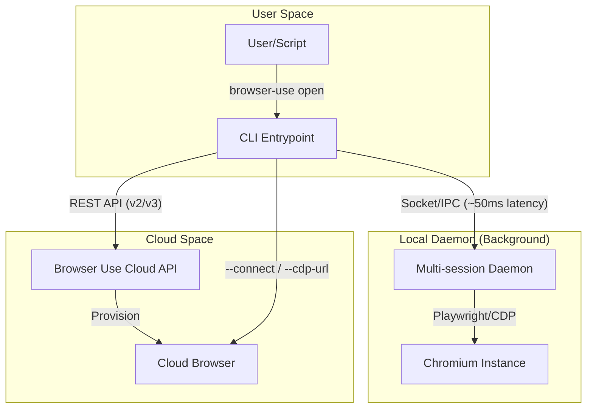
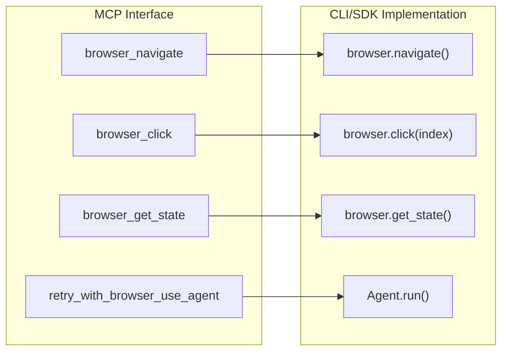

<!-- source: DeepWiki mcp.deepwiki.com · repo browser-use/sdk · page 5.4 CLI and Development Setup · fetched 2026-10-30 -->

# CLI and Development Setup

Relevant source files

The following files were used as context for generating this wiki page:

- [docs/cloud/browser/proxies.mdx](docs/cloud/browser/proxies.mdx)
- [docs/cloud/legacy/agent.mdx](docs/cloud/legacy/agent.mdx)
- [docs/cloud/legacy/public-share.mdx](docs/cloud/legacy/public-share.mdx)
- [docs/generate-llms-txt.sh](docs/generate-llms-txt.sh)
- [docs/open-source/browser-use-cli.mdx](docs/open-source/browser-use-cli.mdx)
- [docs/open-source/customize/integrations/mcp-server.mdx](docs/open-source/customize/integrations/mcp-server.mdx)
- [docs/open-source/development/n8n-integration.mdx](docs/open-source/development/n8n-integration.mdx)
- [docs/open-source/development/roadmap.mdx](docs/open-source/development/roadmap.mdx)
- [docs/open-source/development/setup/contribution-guide.mdx](docs/open-source/development/setup/contribution-guide.mdx)
- [docs/open-source/development/setup/local-setup.mdx](docs/open-source/development/setup/local-setup.mdx)
- [docs/open-source/llms-full.txt](docs/open-source/llms-full.txt)
- [docs/open-source/llms.txt](docs/open-source/llms.txt)

This page documents the Browser Use Command Line Interface (CLI), the local development environment for contributors, and the roadmap for the SDK. The CLI provides both direct browser automation and a unified interface for managing Browser Use Cloud resources.

## Browser Use CLI

The `browser-use` CLI is a high-performance tool designed for both manual browser manipulation and cloud platform management. It features a persistent daemon architecture that reduces command latency to approximately 50ms by keeping the browser process alive between discrete CLI calls [docs/open-source/browser-use-cli.mdx:7-10]().

### Core Architecture and Modes

The CLI operates in two primary functional domains:
1.  **Direct Browser Control**: Allows navigation, element interaction (click, type, scroll), and state inspection [docs/open-source/browser-use-cli.mdx:9-9]().
2.  **Cloud Platform Management**: Acts as a REST passthrough for the Browser Use API (v2 and v3), enabling management of sessions, tasks, and billing from the terminal [docs/open-source/browser-use-cli.mdx:11-11]().

#### Execution Flow Diagram
This diagram illustrates the interaction between the CLI, the background daemon, and the target browser.

Sources: [docs/open-source/browser-use-cli.mdx:7-15]()

### Installation and Setup

The recommended installation method is via the one-line installer which handles Python dependencies and system-level requirements [docs/open-source/browser-use-cli.mdx:25-30]().

| Method | Command |
| :--- | :--- |
| **macOS / Linux** | `curl -fsSL https://browser-use.com/cli/install.sh \| bash` |
| **Windows (PS)** | `& "C:\Program Files\Git\bin\bash.exe" -c 'curl -fsSL https://browser-use.com/cli/install.sh \| bash'` |
| **Manual (uv)** | `uv pip install browser-use && browser-use install` |

Sources: [docs/open-source/browser-use-cli.mdx:25-60]()

### Key CLI Commands

The CLI follows a state-based workflow: navigate to a page, run `state` to receive a list of interactive elements with indices, and then target those indices for actions [docs/open-source/browser-use-cli.mdx:13-13]().

*   **`browser-use state`**: Returns the current URL, page title, and a numbered list of clickable elements [docs/open-source/browser-use-cli.mdx:135-135]().
*   **`browser-use open <url>`**: Navigates the current tab to a specific URL [docs/open-source/browser-use-cli.mdx:126-126]().
*   **`browser-use click <index>`**: Clicks an element based on the index provided by the `state` command [docs/open-source/browser-use-cli.mdx:142-142]().
*   **`browser-use --mcp`**: Starts the CLI as a local Model Context Protocol (MCP) server, allowing IDEs like Cursor or Claude Desktop to control the browser [docs/open-source/customize/integrations/mcp-server.mdx:12-16]().

## Model Context Protocol (MCP) Server

Browser Use can run as an MCP server via stdio. This allows AI models to use the browser as a tool directly [docs/open-source/customize/integrations/mcp-server.mdx:6-6]().

### MCP Implementation Mapping
This diagram maps the MCP tool names to the underlying browser actions.

Sources: [docs/open-source/customize/integrations/mcp-server.mdx:117-144]()

## Local Development Setup

For contributors looking to modify the SDK or CLI, the repository uses `uv` for dependency management [docs/open-source/development/setup/local-setup.mdx:10-15]().

### Environment Configuration
1.  **Clone**: `git clone https://github.com/browser-use/browser-use` [docs/open-source/development/setup/local-setup.mdx:11-11]().
2.  **Sync**: `uv sync --all-extras --dev` installs all optional dependencies and development tools [docs/open-source/development/setup/local-setup.mdx:13-13]().
3.  **Environment**: Copy `.env.example` to `.env` and configure your `BROWSER_USE_API_KEY` or LLM provider keys [docs/open-source/development/setup/local-setup.mdx:21-23]().

### Development Utility Scripts
The repository provides several helper scripts in the `bin/` directory:
*   `./bin/setup.sh`: Automated venv creation and dependency installation [docs/open-source/development/setup/local-setup.mdx:34-34]().
*   `./bin/lint.sh`: Runs formatting (ruff/black), linting, and type checking [docs/open-source/development/setup/local-setup.mdx:37-37]().
*   `./bin/test.sh`: Executes the core test suite used in CI [docs/open-source/development/setup/local-setup.mdx:40-40]().

Sources: [docs/open-source/development/setup/local-setup.mdx:30-41]()

## Contribution and Roadmap

### PR Requirements
A great Pull Request must include:
*   A clear explanation of the "Why" behind the change [docs/open-source/development/setup/contribution-guide.mdx:26-26]().
*   Demo screenshots or GIFs for UI/behavioral changes [docs/open-source/development/setup/contribution-guide.mdx:27-27]().
*   Passing CI tests and a focus on a single feature per PR [docs/open-source/development/setup/contribution-guide.mdx:28-29]().

### Getting Help
Developers can find support through:
*   **Discord**: Active community with over 20k members [docs/open-source/development/get-help:67-67]().
*   **GitHub Issues**: For bug reporting and feature requests [docs/open-source/development/setup/contribution-guide.mdx:19-19]().
*   **Roadmap**: Future plans are tracked in the roadmap section, though currently listed as "Big things coming soon!" [docs/open-source/development/roadmap.mdx:8-8]().

Sources: [docs/open-source/development/setup/contribution-guide.mdx:8-38](), [docs/open-source/development/roadmap.mdx:1-9]()

---

