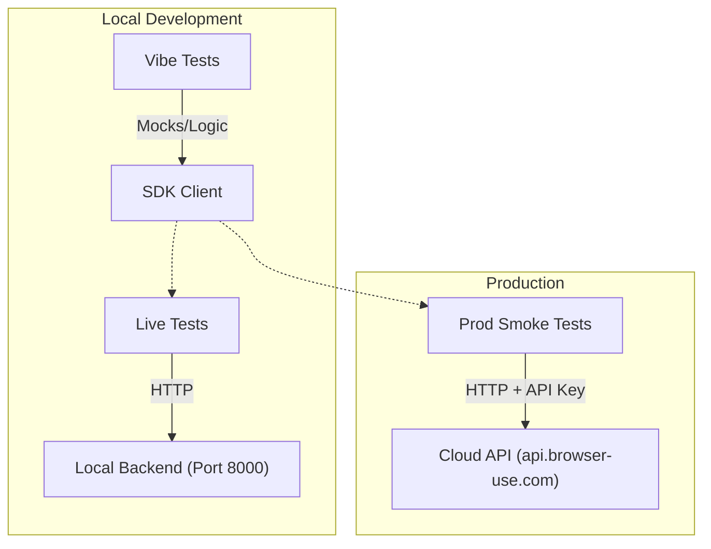
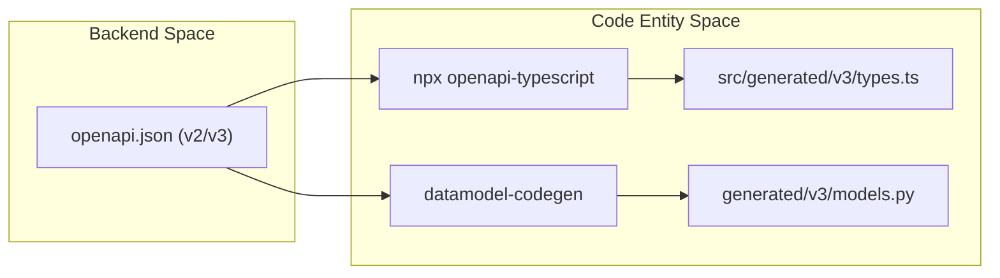

<!-- source: DeepWiki mcp.deepwiki.com · repo browser-use/sdk · page 6 Testing and Development Workflow · fetched 2026-10-30 -->

# Testing and Development Workflow

Relevant source files

The following files were used as context for generating this wiki page:

- [.claude/commands/generate.md](.claude/commands/generate.md)
- [.env.example](.env.example)
- [.gitignore](.gitignore)
- [RUNBOOK.md](RUNBOOK.md)
- [Taskfile.yml](Taskfile.yml)
- [browser-use-node/.gitignore](browser-use-node/.gitignore)
- [browser-use-node/pnpm-lock.yaml](browser-use-node/pnpm-lock.yaml)
- [browser-use-python/examples/profiles.py](browser-use-python/examples/profiles.py)
- [browser-use-python/examples/sessions.py](browser-use-python/examples/sessions.py)
- [browser-use-python/tests/test_live.py](browser-use-python/tests/test_live.py)
- [static/sdks-banner.png](static/sdks-banner.png)

This page provides an overview of the development lifecycle for the Browser Use SDKs, focusing on the multi-tiered testing strategy and the automated pipeline used to keep the Python and TypeScript SDKs synchronized with the Cloud API.

## Testing Strategy

The SDK uses a three-tier testing approach to ensure reliability across different environments without requiring a full backend stack for basic development.

| Tier | Name | Command | Description |
| :--- | :--- | :--- | :--- |
| **Tier 1** | **Vibe Tests** | `task test` | Spec-driven unit tests. Validates client initialization and basic logic. No backend or real API key required. |
| **Tier 2** | **Live Integration** | `task test:live` | Tests against a local backend (`localhost:8000`). Validates full request/response cycles and resource CRUD. |
| **Tier 3** | **Prod Smoke** | `task test:prod` | High-level sanity checks against the production API. Used before releases to ensure compatibility. |

Tests are categorized using `pytest` markers in Python (e.g., `@pytest.mark.live`, `@pytest.mark.prod`) and separate test files in TypeScript (`live.test.ts`, `prod.test.ts`).

For implementation details and coverage maps, see **[Test Infrastructure](#6.1)**.

### Tiered Testing Flow

The following diagram illustrates how the different test tiers interact with the system components.

**Test Tier Architecture**

Sources: [Taskfile.yml:106-160](), [browser-use-python/tests/test_live.py:31-51]()

---

## SDK Update Pipeline

The SDKs are designed to be 1:1 reflections of the Cloud OpenAPI specification. When the backend API changes, the repository follows a structured update pipeline managed via `Taskfile.yml` and AI-driven automation.

### Update Workflow (The `/sdk` Pipeline)

1.  **Pull & Diff**: Fresh specs are pulled from the backend and compared against snapshots in `snapshots/v2.json` and `snapshots/v3.json`.
2.  **Generation**: Types are regenerated using `openapi-typescript` (Node) and `datamodel-codegen` (Python).
3.  **Audit**: Parallel subagents (one for TS, one for Python) compare the new types against existing resource managers to identify missing endpoints or breaking changes.
4.  **Fix & Test**: Developers (or AI agents) apply fixes based on the audit and run the three-tier test suite.

For the step-by-step execution guide, see **[SDK Update Runbook](#6.2)**.

### Code Generation Tools

The repository utilizes deterministic code generation to ensure type safety across both languages.

| Language | Tool | Output Path |
| :--- | :--- | :--- |
| **TypeScript** | `openapi-typescript` | `browser-use-node/src/generated/` |
| **Python** | `datamodel-codegen` | `browser-use-python/src/browser_use_sdk/generated/` |

**Code Generation Pipeline**

Sources: [Taskfile.yml:34-65](), [RUNBOOK.md:20-29]()

---

## Development Utilities

The `Taskfile.yml` provides several utility commands to streamline the workflow:

*   **`task version:bump`**: Synchronizes versions across `package.json`, `pyproject.toml`, and `README.md`.
*   **`task check`**: Runs type-checking for both SDKs using `tsc` (Node) and `pyright` (Python).
*   **`task build`**: Compiles the TypeScript SDK (ESM/CJS) and builds the Python wheel via `uv`.
*   **`task snapshot:save`**: Commits the current OpenAPI specs to the `snapshots/` directory after a successful update.

Sources: [Taskfile.yml:88-105](), [Taskfile.yml:162-182](), [Taskfile.yml:206-212]()

---

