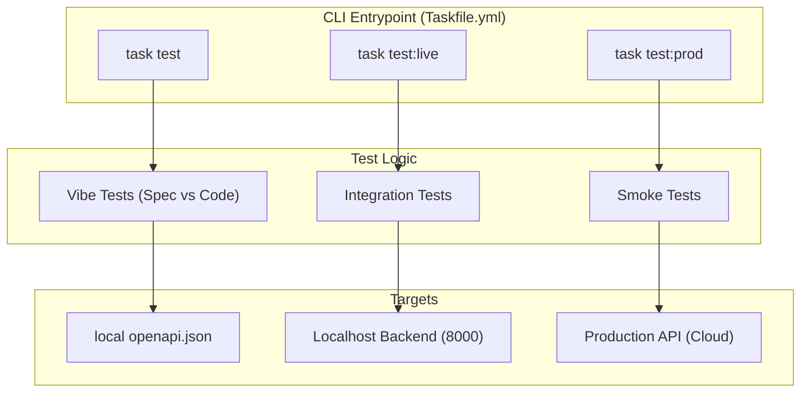
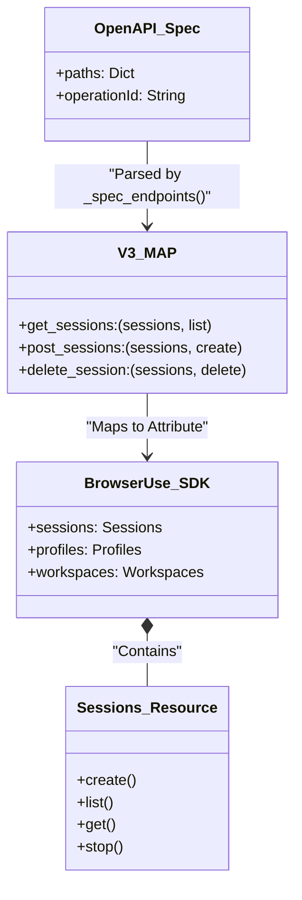

<!-- source: DeepWiki mcp.deepwiki.com · repo browser-use/sdk · page 6.1 Test Infrastructure · fetched 2026-10-30 -->

# Test Infrastructure

<details>
<summary>Relevant source files</summary>

The following files were used as context for generating this wiki page:

- [.claude/commands/test-docs.md](.claude/commands/test-docs.md)
- [Taskfile.yml](Taskfile.yml)
- [browser-use-node/examples/basic.ts](browser-use-node/examples/basic.ts)
- [browser-use-node/examples/streaming.ts](browser-use-node/examples/streaming.ts)
- [browser-use-node/examples/structured-output.ts](browser-use-node/examples/structured-output.ts)
- [browser-use-node/src/v3/resources/profiles.ts](browser-use-node/src/v3/resources/profiles.ts)
- [browser-use-node/tests/prod.test.ts](browser-use-node/tests/prod.test.ts)
- [browser-use-node/tests/vibe.test.ts](browser-use-node/tests/vibe.test.ts)
- [browser-use-python/examples/basic.py](browser-use-python/examples/basic.py)
- [browser-use-python/examples/profiles.py](browser-use-python/examples/profiles.py)
- [browser-use-python/examples/sessions.py](browser-use-python/examples/sessions.py)
- [browser-use-python/examples/streaming.py](browser-use-python/examples/streaming.py)
- [browser-use-python/examples/structured_output.py](browser-use-python/examples/structured_output.py)
- [browser-use-python/src/browser_use_sdk/v3/resources/profiles.py](browser-use-python/src/browser_use_sdk/v3/resources/profiles.py)
- [browser-use-python/tests/test_live.py](browser-use-python/tests/test_live.py)
- [browser-use-python/tests/test_prod.py](browser-use-python/tests/test_prod.py)
- [browser-use-python/tests/test_vibe.py](browser-use-python/tests/test_vibe.py)

</details>


The Browser Use SDK employs a three-tier testing strategy designed to ensure API coverage, local integration stability, and production reliability across both Python and TypeScript implementations. This infrastructure is managed primarily through a `Taskfile.yml` which orchestrates test execution, environment switching, and spec-driven validation.

## 1. Testing Tiers

The SDK categorizes tests into three distinct levels based on their dependencies and execution environment.

### Tier 1: Vibe Tests (Spec-Driven)
These tests do not require a running backend or a real API key. Their primary purpose is to verify **SDK Completeness**. They parse the local OpenAPI `openapi.json` files and ensure that every endpoint defined in the spec has a corresponding method in the SDK.

*   **Mechanism**: Uses `_V2_MAP` and `_V3_MAP` dictionaries to map `(method, path)` pairs to SDK resource classes and methods [browser-use-python/tests/test_vibe.py:46-130]().
*   **Coverage**: Ensures that no new API features are missing from the SDK clients.
*   **Execution**: `task test` [Taskfile.yml:119-124]().

### Tier 2: Live Integration Tests
These tests run against a **localhost backend**. They verify the end-to-end data flow between the SDK's HTTP layer and the actual API implementation without incurring cloud costs.

*   **Requirement**: A running instance of the Browser Use Cloud backend.
*   **Markers**: Annotated with `@pytest.mark.live` (Python) or run via `live.test.ts` (Node) [Taskfile.yml:125-142]().
*   **Execution**: `task test:live`.

### Tier 3: Prod Smoke Tests
These tests hit the **production API** (`api.browser-use.com`). They verify authentication, real-world latency, and the stability of the live infrastructure.

*   **Requirement**: A valid `BROWSER_USE_API_KEY` in `.env.prod` [browser-use-python/tests/test_prod.py:16-32]().
*   **Scope**: Critical paths including Session creation, Profile CRUD, and Task execution with structured output [browser-use-python/tests/test_prod.py:64-130]().
*   **Execution**: `task test:prod`.

---

## 2. Test Execution Flow

The following diagram illustrates how the `Taskfile.yml` routes different test commands to the appropriate SDK environments and backend targets.

### Test Routing Architecture

**Sources:** [Taskfile.yml:106-160](), [browser-use-python/tests/test_vibe.py:1-40]()

---

## 3. Spec-Driven Coverage (Vibe Tests)

The "Vibe" tests are the most critical for maintainers. They use reflection to inspect the SDK classes and compare them against the `openapi.json` source of truth.

### Coverage Mapping Entity Relationship
This diagram shows how the `TestV2Coverage` and `TestV3Coverage` classes bridge the "Natural Language Space" (the OpenAPI spec) to the "Code Entity Space" (the SDK Resource classes).


**Sources:** [browser-use-python/tests/test_vibe.py:100-130](), [browser-use-node/tests/vibe.test.ts:120-150](), [browser-use-python/src/browser_use_sdk/v3/resources/profiles.py:15-82]()

### Key Functions
*   `_spec_endpoints(spec)`: Iterates through the OpenAPI JSON to find all valid HTTP paths and methods [browser-use-python/tests/test_vibe.py:135-141]().
*   `test_all_spec_endpoints_mapped()`: Asserts that every endpoint found by `_spec_endpoints` exists in the `_V2_MAP` or `_V3_MAP` [browser-use-python/tests/test_vibe.py:154-158]().
*   `test_sdk_methods_exist()`: Uses `getattr` and `inspect` to verify that the methods referenced in the maps actually exist on the SDK client classes [browser-use-python/tests/test_vibe.py:160-170]().

---

## 4. Example Test Patterns

### Production Smoke Test (Python)
The production tests verify that the SDK correctly handles real network responses and Pydantic validation.

```python
# From browser-use-python/tests/test_prod.py
class TestProfiles:
    def test_crud_lifecycle(self, client):
        # Create
        profile = client.profiles.create(name="SDK Prod Test")
        assert profile.id is not None
        pid = str(profile.id)

        try:
            # Get and verify
            got = client.profiles.get(pid)
            assert str(got.id) == pid
        finally:
            # Cleanup
            client.profiles.delete(pid)
```
**Sources:** [browser-use-python/tests/test_prod.py:64-88]()

### Live Integration Test (TypeScript)
TypeScript tests use `vitest` or `tsx` to run against the local backend, often testing streaming capabilities.

```typescript
// From browser-use-node/examples/streaming.ts
const task = client.run("Summarize the wikipedia.org main page.");
for await (const step of task) {
  console.log(`[${step.number}] ${step.nextGoal} — ${step.url}`);
}
// Verify terminal result
console.log("\nOutput:", task.result!.output);
```
**Sources:** [browser-use-node/examples/streaming.ts:16-20]()

---

## 5. Summary of Test Commands

| Command | Tier | Target | Purpose |
| :--- | :--- | :--- | :--- |
| `task test` | Vibe | Local Spec | Verify SDK covers all OpenAPI endpoints. |
| `task test:live` | Integration | Localhost | Verify SDK-to-Backend communication logic. |
| `task test:prod` | Smoke | Production | Verify Auth, Billing, and real-world execution. |
| `task check` | Static | Source Code | Run `pyright` (PY) and `tsc` (TS) type checks. |

**Sources:** [Taskfile.yml:100-160]()

---

