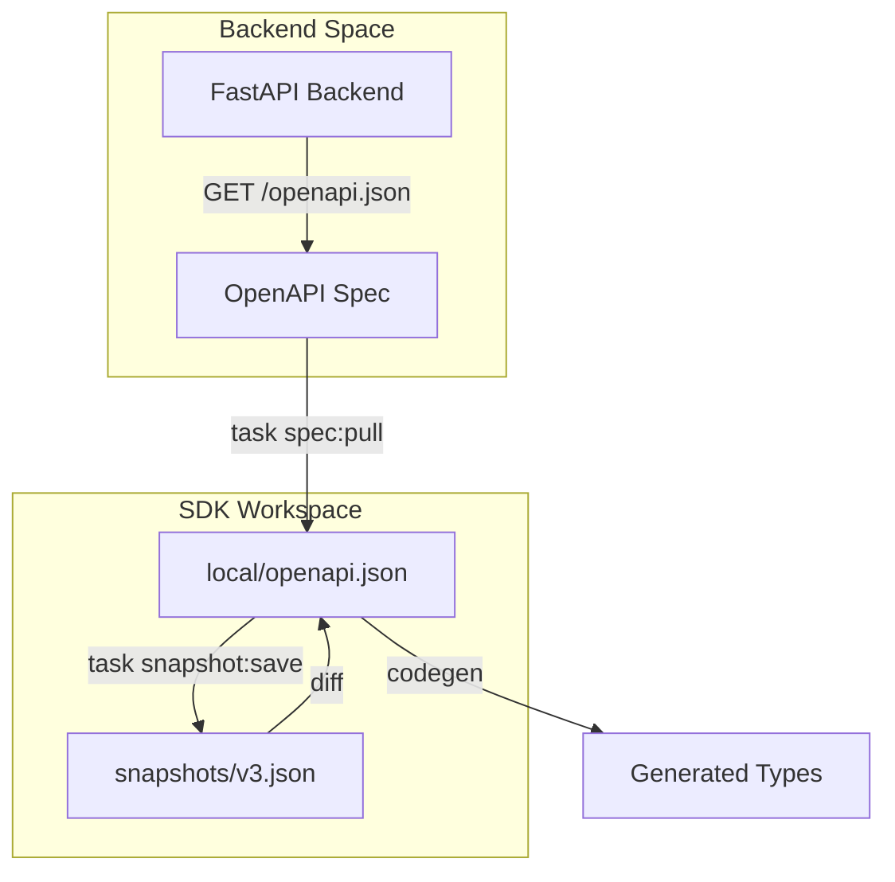
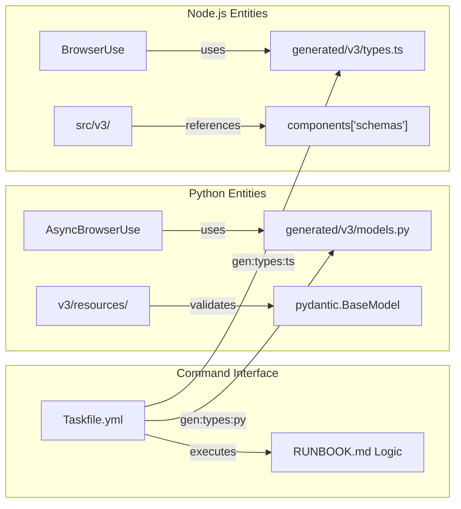

<!-- source: DeepWiki mcp.deepwiki.com · repo browser-use/sdk · page 6.2 SDK Update Runbook · fetched 2026-10-30 -->

# SDK Update Runbook

Relevant source files

The following files were used as context for generating this wiki page:

- [.claude/commands/generate.md](.claude/commands/generate.md)
- [.env.example](.env.example)
- [.gitignore](.gitignore)
- [RUNBOOK.md](RUNBOOK.md)
- [Taskfile.yml](Taskfile.yml)
- [browser-use-node/.gitignore](browser-use-node/.gitignore)
- [browser-use-node/package.json](browser-use-node/package.json)
- [browser-use-node/pnpm-lock.yaml](browser-use-node/pnpm-lock.yaml)
- [browser-use-python/examples/profiles.py](browser-use-python/examples/profiles.py)
- [browser-use-python/examples/sessions.py](browser-use-python/examples/sessions.py)
- [browser-use-python/pyproject.toml](browser-use-python/pyproject.toml)
- [browser-use-python/tests/test_live.py](browser-use-python/tests/test_live.py)
- [browser-use-python/uv.lock](browser-use-python/uv.lock)
- [static/sdks-banner.png](static/sdks-banner.png)

This runbook outlines the systematic process for updating the Browser Use Python and TypeScript SDKs when the backend OpenAPI specification changes. The SDKs follow a **1:1-with-OpenAPI** design philosophy, ensuring that every endpoint, parameter, and schema in the Cloud API is accurately reflected in both client libraries.

## Phase 0: Discover and Classify

The update process begins by identifying the delta between the current backend state and the last known SDK state.

1.  **Pull Fresh Specs**: Retrieve the latest `openapi.json` from the local or staging backend.
    *   `task spec:pull` [Taskfile.yml:13-18]()
2.  **Diff Against Snapshots**: Compare the fresh specs in `backend/spec/api/v{2,3}/openapi.json` against the historical records in `snapshots/v{2,3}.json`.
    *   `task snapshot:diff` [Taskfile.yml:214-222]()
3.  **Classify Changes**: Categorize the diffs to determine the version impact according to SemVer rules:

| Change Type | Impact | SDK Version Bump |
| :--- | :--- | :--- |
| New endpoint | Feature | MINOR |
| Removed endpoint / Required param / Enum removal | Breaking | **MAJOR** |
| New optional param / Response field / New enum value | Enhancement | PATCH |
| Description / Documentation only | Meta | None |

[RUNBOOK.md:5-15]()

### Data Flow: Spec to Snapshots
The `snapshots/` directory acts as the ground truth for the SDK's last published state.

Sources: [Taskfile.yml:13-18](), [Taskfile.yml:206-212](), [RUNBOOK.md:5-15]()

---

## Phase 1: Regenerate & Audit

Once changes are classified and approved, the code generation pipeline is triggered.

### 1. Regeneration
The SDKs use different tools for type generation:
*   **TypeScript**: `openapi-typescript` generates types from `components["schemas"]`. [browser-use-node/package.json:43]()
*   **Python**: `datamodel-codegen` generates Pydantic v2 models. [Taskfile.yml:45-64]()

### 2. Post-Generation Patches
Manual intervention is required to fix recurring quirks in the `datamodel-codegen` tool:
*   **Enum Defaults**: The generator often outputs string literals for enum defaults (e.g., `status: str = "idle"`). These must be patched to use actual Enum members (e.g., `status: Status = Status.idle`) to satisfy `pyright` type checking. [RUNBOOK.md:63]()
*   **Regex Engine**: If Pydantic models contain regex lookaheads, the `ConfigDict(regex_engine="python-re")` must be added to the model. [RUNBOOK.md:62]()

### 3. Deep Audit
Two parallel subagents (one for TS, one for Python) audit the resource managers against the new types.
*   **TS Auditor**: Inspects `browser-use-node/src/v2/` and `v3/`.
*   **Python Auditor**: Inspects `browser-use-python/src/browser_use_sdk/v2/` and `v3/`.
*   **Goal**: Ensure every new route is mapped to a method and every parameter is exposed. [RUNBOOK.md:25-29]()

Sources: [Taskfile.yml:28-65](), [RUNBOOK.md:20-29](), [RUNBOOK.md:62-64]()

---

## Phase 2: Fix and Synchronize

In this phase, developers (or AI agents) implement the missing logic identified during the audit.

### Method Mapping Conventions
To maintain consistency across both SDKs, use the following naming conventions based on the HTTP verb and path:

| HTTP Verb | Path Pattern | SDK Method Name |
| :--- | :--- | :--- |
| `POST` | `/resource` | `.create()` |
| `GET` | `/resource` | `.list()` |
| `GET` | `/resource/{id}` | `.get()` |
| `DELETE` | `/resource/{id}` | `.delete()` |
| `PATCH` | `/resource/{id}/stop` | `.stop()` |

[RUNBOOK.md:48]()

### Implementation Rules
*   **Python Parameter Mapping**: Convert `snake_case` SDK parameters to `camelCase` in the request body to match the backend expectations. [RUNBOOK.md:51]()
*   **Type Safety**: Python resource methods must return Pydantic model instances via `model_validate()`, never raw dictionaries. [RUNBOOK.md:68]()
*   **Resource Parity**: Python and TypeScript SDKs must maintain identical method coverage. [RUNBOOK.md:33]()

Sources: [RUNBOOK.md:31-35](), [RUNBOOK.md:48-51](), [RUNBOOK.md:68]()

---

## Phase 3: Test and Ship

The final phase ensures stability and updates the repository state.

### Testing Tiers
1.  **Vibe Tests**: Fast, spec-driven tests that require no backend.
    *   `task test` [Taskfile.yml:119-123]()
2.  **Live Integration Tests**: Tests against a running `localhost:8000` backend.
    *   `task test:live` [Taskfile.yml:137-141]()
3.  **Prod Smoke Tests**: Final validation against the production API.
    *   `task test:prod` [Taskfile.yml:155-159]()

### Release Steps
1.  **Version Bump**: Sync versions across `package.json`, `pyproject.toml`, and `README.md`.
    *   `task version:bump -- patch|minor|major` [Taskfile.yml:168-181]()
2.  **Save Snapshots**: Move the current specs to the `snapshots/` folder.
    *   `task snapshot:save` [Taskfile.yml:206-212]()
3.  **Commit**: Commit the changes and the new snapshots.
4.  **Publish**: Manually trigger the publish tasks.
    *   `task publish:ts` and `task publish:py` [Taskfile.yml:184-198]()

### System Entity Mapping

Sources: [Taskfile.yml:34-65](), [browser-use-node/package.json:43](), [browser-use-python/pyproject.toml:5-12](), [RUNBOOK.md:67-68]()

Sources: [Taskfile.yml:106-160](), [Taskfile.yml:168-212](), [RUNBOOK.md:37-43]()

---

